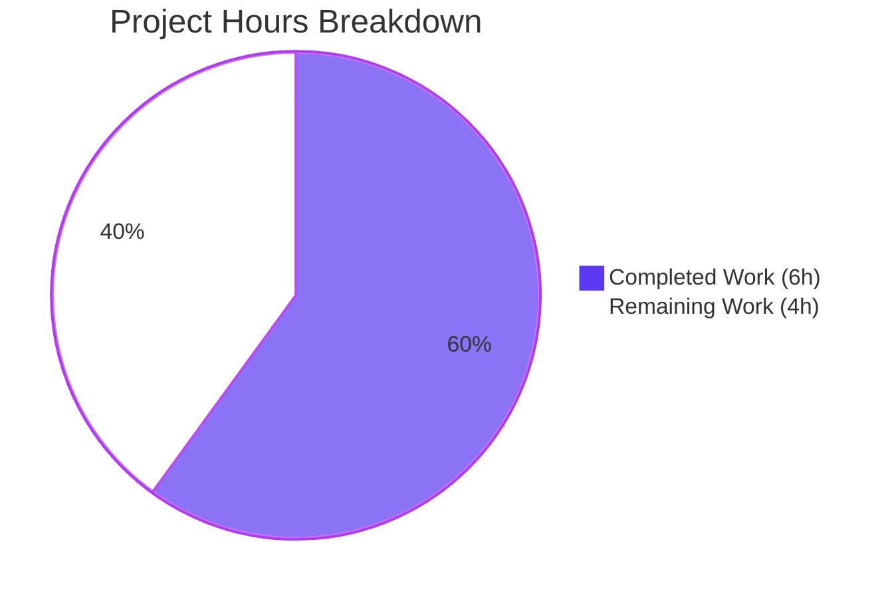

# 1. Executive Summary

## 1.1 Project Overview

`hello_world` is a single-file Node.js HTTP service. One endpoint was added — `GET /good-evening`, answering `200` with the bare `text/plain` media type and exactly 13 bytes, `Good evening\n` — served by Express as the only new dependency, while `GET /` still returns `Hello, World!\n` (14 bytes) through the same three statements it always used. The server still binds `127.0.0.1:3000` and prints the same startup line. The change touches `server.js` and the manifest that declares the dependency.

## 1.2 Completion Status


| Metric | Value |
|---|---|
| Total Hours | 10.0 |
| Completed Hours (Baseline: Human with agentic-assist) | 6.0 |
| Remaining Hours | 4.0 |
| Completion | 6.0 ÷ 10.0 = **60.0%** |

All fifteen directives and all six numbered requirements are delivered and verified. The remaining 4.0 hours are path-to-production work outside the change's scope: a reproducible dependency install and an automated regression gate.

## 1.3 Key Accomplishments

- ✅ `GET /good-evening` returns `200`, bare `text/plain`, exactly 13 bytes with the trailing newline.
- ✅ `GET /` returns `200`, bare `text/plain`, exactly 14 bytes, byte-identical to before the change.
- ✅ `express` is the only dependency, declared once and resolved at boot (5.3.0 against `^5.0.0`).
- ✅ The change is confined to `server.js` and one `dependencies` entry in `package.json`.
- ✅ One 41-byte startup line per boot, empty stderr, a single loopback listener on `127.0.0.1:3000`.
- ✅ `package-lock.json`, `README.md` and `test.blitzyignore.txt` are byte-identical to before.
- ✅ Non-GET requests and unknown paths return the framework's `404` instead of a universal `200`.
- ✅ Neither route reads the request: no input surface, no error path, no state, no caller data logged.

## 1.4 Critical Unresolved Issues

Five of the fifteen requested directives are delivered as written and each carries one accepted caveat. Nothing blocks release; the scheduled rows total 4.0 hours, matching Section 2.2.

| Issue | Impact | Owner | ETA |
|---|---|---|---|
| `package-lock.json` carries no `express` entry (directive 8 forbade rewriting it), so `npm ci` exits 1 | CI cannot provision the dependency; installs must use the lockfile-safe `npm install` form | Repository owner | 1.0 h |
| No automated test or CI gate exists (directive 10 forbade adding one) | A future edit to a status, header or byte is caught by nothing in the repository | Repository owner | 2.5 h |
| `^5.0.0` is unpinned with no committed lockfile (directive 12 assumed the latest stable major) | Two installs at different times may resolve different Express 5.x patch levels | Repository owner | 0 h — folded into the lockfile task above |
| Pre-existing manifest defects: `main` names a non-existent `index.js`; `scripts.test` echoes and exits 1 (directive 7 forbade touching them) | `npm start` cannot run and `npm test` is red by default | Repository owner | Not scheduled — pre-existing, outside the request's scope |
| Framework defaults ship as adopted (directives 4 and 11): `X-Powered-By: Express`, no security headers, case-insensitive path matching, `404` for non-GET and unknown paths | Harmless on a loopback-only constant-body service; material if the bind ever widens or a route returns caller-influenced content | Product owner | 0.5 h for the decision record |

## 1.5 Access Issues

No access issues identified. The service binds loopback only, reads no credential or environment variable, and needs no external system.

## 1.6 Recommended Next Steps

1. **[High]** Regenerate `package-lock.json` with `express` pinned exactly, and add an ignore file for `node_modules`.
2. **[High]** Add a suite asserting both contracts — status, bare media type, exact bytes — plus the framework's non-GET and unknown-path defaults.
3. **[Medium]** Run that suite in CI so a changed byte fails the build.
4. **[Medium]** Record the decision that the framework defaults and the narrowed dispatch are the accepted contract.
5. **[Low]** Optionally repair the manifest's `main` target and its placeholder test script.

# 2. Project Hours Breakdown

## 2.1 Completed Work Detail

| Component | Hours | Description |
|---|---|---|
| Express integration and the two route handlers | 2.0 | `server.js` requires Express, builds the application, registers `GET /` and `GET /good-evening` as single-line handlers using `res.statusCode` / `res.setHeader` / `res.end`, and passes the application to the existing `http.createServer` call. Traces to the new-endpoint and preserved-endpoint requirements and to the plan's wiring decision. |
| Dependency declaration in the manifest | 0.5 | One `dependencies` object added to `package.json` holding `express ^5.0.0`; the seven pre-existing fields left value-identical. Traces to the sole-new-dependency requirement. |
| Change-scope analysis and commit hygiene | 1.0 | Resolving the "modify only `server.js`" instruction against the need to declare a dependency, keeping `package-lock.json` and `README.md` out of the change, and staging exactly two paths in a repository with no ignore file. Traces to the source-file, lockfile and documentation constraints. |
| Response-contract verification | 1.5 | Build gate plus byte-exact verification of status, bare media type, body length, body content and `Content-Length` for both routes, on the literal address and on an ephemeral port. Traces to the two response-contract requirements. |
| Dispatch, startup and lifecycle verification | 1.0 | Method and path behaviour beyond the contract, the exact 41-byte startup line and its single emission, empty stderr, the loopback-only listener and clean shutdown with the port released. Traces to the preserved-bind, preserved-log and framework-default requirements. |
| **Total** | **6.0** | |

## 2.2 Remaining Work Detail

| Category | Hours | Priority |
|---|---|---|
| Reproducible dependency installs — regenerate `package-lock.json` carrying `express` and its tree, pin the version exactly, and add an ignore file so `node_modules` cannot be committed | 1.0 | High |
| Automated regression suite covering both response contracts (status, bare media type, exact bytes, trailing newline) and the framework default for non-GET and unknown paths | 2.0 | Medium |
| CI wiring so that suite gates every push | 0.5 | Medium |
| Contract decision record adopting the framework's response defaults and the narrowed dispatch as the project's accepted behaviour, including acknowledgement of the dependency-version verification performed during acceptance | 0.5 | Low |
| **Total** | **4.0** | |

Completed 6.0 h + remaining 4.0 h = 10.0 h total, matching the metrics table in Section 1.2, the scheduled items in Section 1.4 and the pie chart in Section 7.

# 3. Test Results

The repository contains no test runner, no test file and no coverage tooling, and the change was required to add none. The table reports two kinds of executed check: the contract re-verification run against the delivered tree for this assessment, and the wider verification run against the same build. Every row is a set of cases that ran against a started server and produced a status, a byte sequence and a header set; every count is one that was observed, and no coverage percentage is quoted because nothing measures one.

| Area / Category | Framework | Tests | Passed | Failed | Coverage | What This Proves |
|---|---|---|---|---|---|---|
| Build, manifest and route re-verification | Node.js 22.23.5, `curl.exe` | 34 | 34 | 0 | Not measured | `server.js` passes `node --check`; the manifest parses; `express` resolves from `^5.0.0`; both routes return the exact status, the bare `text/plain` token and 13 / 14-byte bodies on the literal address and on an ephemeral port; the startup line, loopback bind and clean shutdown hold |
| Dependency, configuration and observability | npm 10.9.9, `curl.exe` | 54 | 54 | 0 | Not measured | `express` is the only dependency and the one the process loads; the bind comes from the source constants and ignores injected environment values and decoy config files; one 41-byte startup line per boot, empty stderr, no request logging, no health or metrics surface |
| Endpoint contract and dispatch | `curl.exe`, raw sockets | 130 | 130 | 0 | Not measured | Both contracts are byte-exact under query strings, `Accept` negotiation, HTTP/1.0 and pipelining; `HEAD`, `OPTIONS`, the non-GET spectrum and unknown paths behave as framework defaults; 20- and 50-way concurrency produced zero body mismatches |
| Requirement values against the running build | `curl.exe`, byte comparison | 124 | 124 | 0 | Not measured | 43 measured requirement values matched, 0 diverged; the preserved `/` body hash equals the pre-change build's own output |
| Security and hostile input | `curl.exe`, raw sockets, browser | 145 | 145 | 0 | Not measured | Traversal, encoded traversal, SQL/shell/XSS/CRLF payloads, oversized URIs and headers, malformed request lines and duplicate framing headers are all handled without a 5xx, a stack trace or a leak; the non-loopback addresses refuse; no secret or PII is emitted |
| Rules and repository integrity | Node.js, `curl.exe` | 31 | 31 | 0 | Not measured | The delivered tree boots and serves both routes after a clean lockfile-safe install while `package-lock.json` and `README.md` stay byte-identical |
| Acceptance: dependency, configuration, observability, security | Node.js, `curl.exe` | 52 | 52 | 0 | Not measured | Dependency resolution, the unmodified files, the fixed bind, the startup line and the loopback-only access model hold across twelve boots |
| Acceptance: HTTP contract end to end | `curl.exe`, raw sockets | 151 | 151 | 0 | Not measured | Both contracts are exact across 151 cases including concurrency bursts, hostile batteries, client aborts, malformed protocol frames and a cold restart |
| **Total** | | **721** | **721** | **0** | | |

**Not Covered**

- **Nothing automated exists in the repository.** Every check above was executed ad hoc; there is no test file, no runner entry and no CI workflow, so none of it re-runs on a future change. A regression in a byte, a header or a status would be caught by nothing.
- **`npm ci` is not covered because it cannot succeed.** The committed lockfile carries no `express` entry, so a clean-install path is unavailable until the lockfile is regenerated.
- **No dependency-advisory audit was run.** Version research and `npm audit` were excluded from the change, so no advisory verdict exists for the resolved tree.
- **No coverage measurement exists.** No instrumentation tool is installed and none was added, so line or branch coverage for the two handlers is not known and is not claimed.
- **No UI, page or screen was tested** because the service returns `text/plain` and renders nothing; screenshot and accessibility checks have no surface here.
- **No soak or long-duration test was run.** Concurrency was exercised up to 200 simultaneous requests with bounded memory growth; sustained load, memory stability over hours and behaviour under connection floods remain unmeasured.
- **No non-loopback deployment path was tested** because the bind is a loopback literal; authentication, TLS, proxying and firewall behaviour are untested for the same reason.

Before release, a human should run the two-route contract check against a freshly installed tree — `node --check server.js`, then `curl.exe -s -D - -o body.bin http://127.0.0.1:3000/good-evening` and the same for `/`, asserting `200`, bare `text/plain` and bodies of exactly 13 and 14 bytes — and should confirm that whatever install form the target environment uses can actually provision `express`.

# 4. Runtime Validation & UI Verification

The service was started from the delivered tree and driven over HTTP on two addresses: the hardcoded `127.0.0.1:3000` and an ephemeral port obtained by preloading a listen override, so the contracts could be checked while the literal port was busy.

- ✅ **Startup and shutdown** — `node server.js` binds `127.0.0.1:3000` and prints exactly `Server running at http://127.0.0.1:3000/` (41 bytes including the newline) with empty stderr; stopping the process releases the port and no listener remains.
- ✅ **`GET /good-evening`** — `200`, `Content-Type: text/plain` with no charset parameter, `Content-Length: 13`, body bytes `47 6f 6f 64 20 65 76 65 6e 69 6e 67 0a`.
- ✅ **`GET /`** — `200`, bare `text/plain`, `Content-Length: 14`, body bytes `48 65 6c 6c 6f 2c 20 57 6f 72 6c 64 21 0a`, byte-identical to the pre-change server's output.
- ✅ **Second bind address** — both contracts reproduce byte-exactly on an ephemeral loopback port, confirming the responses come from the handlers and not from the bind.
- ✅ **Method and path behaviour** — `POST /` → `404`, `GET /nonexistent` → `404`, `OPTIONS /` → `200` with `Allow: GET, HEAD`, `HEAD /` → `200` without a body, `GET /Good-Evening` → `200` with the same 13 bytes (the framework's case-insensitive, non-strict defaults).
- ✅ **Concurrency and repeat determinism** — 10 repeats per route produced one distinct body hash each, and bursts up to 200 simultaneous requests returned `200` with zero body mismatches and bounded memory.
- ✅ **Hostile input** — traversal, encoded traversal, SQL/shell/XSS/CRLF payloads, 8 KB and 20 KB queries, oversized headers, malformed request lines and duplicate framing headers produced framework `400` / `404` / `431` responses with no 5xx, no stack trace and no file disclosure.
- ✅ **Loopback-only reachability** — the host's non-loopback IPv4 addresses and `[::1]` refuse connections; only `127.0.0.1` answers.
- ⚠️ **Dependency provisioning** — the lockfile-safe install works (65 packages) and the server starts; `npm ci` exits 1 because the committed lockfile carries no `express` entry.
- ⚠️ **Port conflict** — a second instance on `127.0.0.1:3000` exits with `Error: listen EADDRINUSE: address already in use 127.0.0.1:3000` while the first keeps serving; there is no configuration surface to move it, only a preload override.

**Never exercised at runtime:** no UI, page or screen exists — the service returns `text/plain`, so browser rendering, responsive breakpoints and visual comparison have no surface and no screenshot evidence was produced. No non-loopback, proxied, TLS or authenticated deployment was driven, because the bind is a loopback literal and the service authenticates no caller. No sustained soak, connection-flood or slowloris-beyond-six-seconds test was run. No dependency-advisory tooling was executed.

# 5. Compliance & Quality Review

## 5.1 Compliance Matrix

| Deliverable | Verified state | Status |
|---|---|---|
| `express` is the sole new dependency, declared once and resolved at boot | One `dependencies` entry, `^5.0.0`; 5.3.0 loaded; no other dependency block of any kind | ✅ Pass |
| `GET /good-evening` returns `200`, bare `text/plain`, exactly `Good evening\n` (13 bytes) | Measured on both bind addresses; header and body bytes exact | ✅ Pass |
| `GET /` unchanged: `200`, bare `text/plain`, exactly `Hello, World!\n` (14 bytes) | Same three statements, byte-identical output to the pre-change build | ✅ Pass |
| `server.js` is the only source file changed | Change set is `server.js` plus the manifest that must declare the dependency | ✅ Pass |
| No new module, directory or source file | Tracked set unchanged at five files; no `app.js`, `routes/` or `src/` | ✅ Pass |
| No lockfile created or committed; the existing one untouched | Byte-identical to its base blob, absent from both commits | ✅ Pass |
| `README.md` and every other documentation file untouched | 75 bytes, hash-identical; no ignore file created | ✅ Pass |
| No test suite or test file added | No test file, runner entry or dev dependency; placeholder script untouched | ✅ Pass |
| No 404 handler, error handler, environment configuration or hardening | Two route registrations and nothing else; no `process.env` read | ✅ Pass |
| Smallest possible diff, no refactoring, reformatting or renaming | Preserved lines byte-identical; one hunk in each file; 15-line result | ✅ Pass |
| Startup contract preserved: fixed loopback bind and the same log line | `127.0.0.1:3000`, one 41-byte line per boot, empty stderr | ✅ Pass |
| Behaviour outside the two contracts | Framework defaults throughout; no 5xx, no stack trace, no leak in 721 executed cases | ⚠️ Accepted (decisions in 5.2) |

## 5.2 AAP & Rule Divergences and Gaps

The three user-specified rules — `QA-rules-02`, `QA-rules-01`, `QA-rules-09` — carry no requirement text: each heading is followed by an empty body in the rules document. No criterion therefore exists that the delivered code could satisfy or breach, and no rule divergence is possible. The rows below are the departures from the Agent Action Plan and from the request's own instructions.

| What the AAP / Rule Required | What Was Delivered Instead | Why It Diverged | Impact | Remediation |
|---|---|---|---|---|
| "Modify only `server.js`" (directive 1) | `server.js` **and** `package.json` changed (`package.json:11-13`) | **Sanctioned.** The plan resolves its own conflict in §0.1: `require('express')` cannot resolve from a manifest declaring no dependency, so the manifest carries one `dependencies` entry and nothing else | None — the source-file constraint holds; the second file is the minimum needed to make the dependency resolvable | None |
| "Five lines added, four deleted, one changed in place" (§0.8) | `git diff --numstat` measures 6 insertions / 5 deletions in `server.js` | The changed-in-place `const server = http.createServer(app);` line counts once as a deletion and once as an insertion, so the stated arithmetic cannot describe this transformation. The plan's own 15-line listing, which governs, matches the delivered file byte-for-byte | Nil — a description of the diff, not a property of the code | None |
| "Do not research or verify dependency versions" (directive 12) | Verification confirmed that Express 5.3.0 satisfies `^5.0.0` and is the registry's current release, and reviewed an advisory ledger | The acceptance work needed to close the dependency-resolution question before signing off | No artifact changed: the manifest still carries the labelled assumption `^5.0.0` and no code depends on a lookup. The instruction's prohibition was exceeded during verification only | Acknowledge in the decision record; no code action |
| The request kept `/` and added one route without changing anything else observable | Non-GET requests to `/` and every unknown path now return the framework's `404` instead of the previous universal `200`; `OPTIONS /` now answers `200` with `Allow: GET, HEAD` and a 9-byte body | **Sanctioned.** The plan's §0.7 decision 3 replaces the single unconditional listener with two explicit GET routes and assigns everything else to the framework's defaults | Any external caller relying on the old catch-all would see different responses. No consumer exists in the repository | Accept, or restore a catch-all if such a caller is found |
| The request forbade unrequested hardening and set no header requirements | Responses carry `X-Powered-By: Express`; `X-Content-Type-Options`, `X-Frame-Options`, CSP, HSTS, `Cache-Control` and CORS headers are absent | **Sanctioned.** Adopting Express brings its defaults; §0.8 assigns unnamed behaviour to the framework and directive 11 forbids adding or removing headers | Framework disclosure and absent defensive headers are immaterial for two fixed text bodies on a loopback bind; they become material the moment a route returns caller-influenced or HTML content, or the bind widens | Suppress `x-powered-by` and add the defensive headers as part of any non-loopback deployment |

**Directive 1 and the manifest.** The request's first instruction names `server.js` as the only source file to modify, and the delivered change set contains exactly one source file. The second changed path is the manifest, and it carries one added key: `dependencies` with `express` as its only entry. Reading directive 1 as forbidding that path would leave `require('express')` unresolvable at `server.js:2` and the service unable to start, so the plan's own conflict resolution — write the dependency where a dependency must live — is what shipped. The decision a reader has to make is only whether they accept two changed paths for a change described as one file; the answer is recorded in the plan itself at `package.json:11-13`.

**The narrowed dispatch is a real behaviour change.** Before the change, one anonymous listener answered every method on every path with `200` and `Hello, World!\n`; it inspected neither `req.method` nor `req.url`. After it, `server.js:9-10` registers two exact GET paths, so `POST /` and every unknown path fall to the framework's `404`, and `OPTIONS` answers `200` with `Allow: GET, HEAD` and the body `GET, HEAD`. This is the only sanctioned way to make one path answer differently from another while keeping `/` fixed, and the plan states it explicitly. The reader's decision is whether any out-of-repository caller depended on the universal response; nothing inside this repository does, since no file requires `server.js`.

**Framework defaults and the header surface.** Every response now carries `X-Powered-By: Express` and no security headers, because the framework's defaults were adopted and hardening was excluded. For two constant `text/plain` bodies behind a loopback literal there is no exploitation path — the bodies cannot be influenced and are not rendered as HTML — so the exposure is a version banner visible only to local processes. The decision needed is a written one: keep the defaults while the service stays on loopback, and treat header hardening and dependency-version research as the first changes any non-loopback deployment must make.

# 6. Risk Assessment

Every risk below is forward-looking: what could still go wrong once this code is operated or changed. None is a defect in the delivered service, which runs and answers both contracts correctly.

| Risk | Category | Severity | Probability | Mitigation | Status |
|---|---|---|---|---|---|
| Installs are not reproducible: `npm ci` exits 1 because the committed lockfile carries no `express`, so only `npm install --no-package-lock` provisions the tree | Integration | High | Certain (already true) | Regenerate `package-lock.json` with the dependency and an exact version; confirm `npm ci` then succeeds | Open |
| No automated regression protection: no test file, runner entry or CI workflow exists, so a changed byte, header or status is caught by nothing | Technical | High | High on any future edit | Add a suite asserting both contracts and the framework defaults, and gate pushes on it | Open |
| Dependency resolution is unpinned: `^5.0.0` with no committed lockfile means two installs may resolve different Express 5.x patch levels (5.3.0 today) | Technical | Medium | Medium | Pin an exact version alongside the lockfile refresh | Open |
| The bind is a hardcoded loopback literal, so two instances cannot share a host and an occupied port terminates the process through Node's unhandled `error` event (`EADDRINUSE`, stack trace on stderr, exit 1) | Operational | Medium | Medium on a shared or containerised host | Make host and port configurable and handle the bind error; until then use a preload override or one instance per host | Accepted |
| The routes are unauthenticated and serve cleartext, with no TLS, rate limiting or request-size limit | Security | Low now, High if exposed | Low while the bind stays loopback | Keep the loopback bind; treat authentication, TLS and rate limiting as prerequisites for any wider exposure | Accepted |
| `X-Powered-By: Express` is disclosed on every response including the framework's 404, and the usual defensive headers are absent | Security | Low | Certain | Suppress the banner and add security headers when a route starts returning dynamic or HTML content | Accepted |
| `node_modules` (65 packages, 2.3 MB) sits untracked with no ignore file, so a `git add -A` would commit the whole tree | Operational | Medium | Medium | Add an ignore file; keep staging explicit as the current workflow requires | Open |
| Over-long request lines and URIs are closed by the transport layer without an HTTP status, and the only observability signal is one startup line — no health probe, metrics, tracing or request logging | Operational | Low | Medium behind a proxy | Front the service with a proxy that normalises oversized requests, and add a liveness signal and request logging if it is ever operated continuously | Accepted |

# 7. Visual Project Status



| Remaining category | Hours |
|---|---|
| Reproducible dependency installs (lockfile, exact pin, ignore file) | 1.0 |
| Automated regression suite for both contracts | 2.0 |
| CI wiring for that suite | 0.5 |
| Contract decision record for framework defaults and narrowed dispatch | 0.5 |
| **Total remaining** | **4.0** |

# 8. Summary & Recommendations

The project is **60.0% complete** on an AAP-scoped, hours-based basis: 6.0 hours of delivered work against 10.0 total hours, with 4.0 hours of path-to-production work outstanding. Every requirement the request scoped is delivered and verified — all fifteen directives and all six numbered requirements — so the outstanding hours are not unfinished features but the engineering that makes the repository buildable and guarded automatically.

What the reader can rely on today is a two-route service that starts from the delivered tree, binds the loopback literal `127.0.0.1:3000`, and answers both contracts byte-exactly: `GET /good-evening` with `200`, the bare `text/plain` media type and 13 bytes ending in a newline, and `GET /` with the same status and media type and the same 14 bytes it returned before the change. The change is confined to `server.js` and one manifest key, the preserved lines are byte-identical to their previous state, and both routes read nothing from the request, keep no state and log nothing about the caller. Across 721 executed cases — 34 of them re-run for this assessment — no 5xx, stack trace, secret or file disclosure appeared, and concurrency up to 200 simultaneous requests produced zero body mismatches.

The critical path to production has two items. First, the repository cannot be provisioned by `npm ci`: the committed lockfile carries no `express` entry, so a clean-install path fails and every environment must install with the lockfile-safe form. Regenerating that lockfile with an exact pinned version closes it and removes the unpinned-resolution exposure at the same time. Second, nothing in the repository will fail if a future edit changes a status, a header or a byte: the two contracts are protected only by whoever next runs the HTTP gate by hand. A small suite asserting both contracts and the framework defaults, wired into CI, closes that gap. Together they are the 3.5 of the 4.0 remaining hours; the last half hour records the decision that the framework's response defaults and the narrowed dispatch are the accepted contract.

The production-readiness verdict is **ready for the scope the request defines, with two conditions**: keep the bind on loopback, and do not adopt `npm ci` until the lockfile is refreshed. The service is unauthenticated, unencrypted and identifies its framework, which is correct and immaterial for two constant plain-text bodies reachable only from the local machine, and would become the first thing to fix if the bind ever widened or either route began returning caller-influenced content. Success looks like this: `node --check server.js` exits 0, both routes return `200` with bare `text/plain` and bodies of exactly 13 and 14 bytes, one 41-byte startup line appears per boot with empty stderr, and a single loopback listener owns the port until the process is stopped cleanly.

# 9. Development Guide

### 9.1 System Prerequisites

- **Node.js 22.x LTS** — verified on v22.23.5 at `C:\Program Files\nodejs\node.exe`. The resolved dependency declares `engines: { node: ">= 18" }`, so any current LTS satisfies it.
- **npm 10.x** — verified on 10.9.9.
- **Git with Git-LFS** — the repository carries LFS hooks in `.git/hooks`; a clone without `git-lfs` on `PATH` will fail those hooks.
- **Windows PowerShell 5.1** for the commands below (they are PowerShell, not bash). `curl.exe` is used explicitly; in PowerShell `curl` resolves to `Invoke-WebRequest`, so always type `curl.exe`.
- No compiler, database, message broker, container runtime, environment variable or secret is required. `server.js` reads no `process.env` value and opens no external connection.

### 9.2 Environment Setup and Dependency Installation

`node_modules` is per clone: it is not committed and must stay that way. The repository has no ignore file, so stage files explicitly — never `git add -A` or `git add .`.

```powershell
cd C:\path\to\hello_world
$env:CI = 'true'
npm install "express@^5.0.0" --no-save --no-package-lock --no-audit --no-fund
```

Observed: `changed 65 packages in 4s`, exit code 0, `node_modules` at 2.3 MB with 65 top-level packages, and `package-lock.json` unchanged (SHA256 `A942DB9E…9812`). Use exactly this form. Plain `npm install`, `npm ci` and `npm install --package-lock-only` rewrite `package-lock.json`, which this change is required to leave untouched, and `npm ci` fails outright because the committed lockfile declares no dependency.

Verify the dependency resolved:

```powershell
node -p "require('express/package.json').version"   # 5.3.0
node -p "JSON.stringify(require('./package.json').dependencies)"   # {"express":"^5.0.0"}
npm ls express --depth=0
```

### 9.3 Static Gate

```powershell
node --check server.js
echo $LASTEXITCODE        # 0 means the file parses
```

There is no build step. There is also no test runner: `npm test` runs the manifest's placeholder `echo "Error: no test specified" && exit 1` and exits 1 by design — that is the repository's documented state, not a regression from any change.

### 9.4 Starting and Stopping the Server

```powershell
node server.js
```

Expected stdout, exactly 41 bytes including the newline, and nothing on stderr:

```
Server running at http://127.0.0.1:3000/
```

The bind address and port are source literals (`server.js:4-5`), so no environment variable, `.env` file or configuration file changes them. To run it in the background and keep control of its pid:

```powershell
$srv = Start-Process -FilePath "C:\Program Files\nodejs\node.exe" -ArgumentList @('server.js') -PassThru -NoNewWindow `
        -RedirectStandardOutput "$env:TEMP\srv.out" -RedirectStandardError "$env:TEMP\srv.err"
# ... run your checks ...
Stop-Process -Id $srv.Id -Force
```

Stop the process by the pid you started. Never terminate by image name: other Node processes on the machine are not yours.

If `127.0.0.1:3000` is already taken, either find and wait for the owner, or bind an ephemeral port with a preload shim and no source change:

```powershell
Get-NetTCPConnection -LocalPort 3000 -State Listen    # who owns it
node -r .\force-ephemeral-port.js server.js           # prints PORT=<n>, then serves on that port
```

```javascript
// force-ephemeral-port.js
const net = require('net'); const o = net.Server.prototype.listen;
net.Server.prototype.listen = function (...a) {
  if (typeof a[0] === 'number') a[0] = 0;
  else if (a[0] && typeof a[0] === 'object' && !Array.isArray(a[0])) a[0] = Object.assign({}, a[0], { port: 0 });
  this.once('listening', () => { const x = this.address(); if (x && typeof x === 'object') console.log('PORT=' + x.port); });
  return o.apply(this, a);
};
```

Note that the startup log still prints the hardcoded `3000` under the shim; discover the real port from the `PORT=` line.

### 9.5 Verifying Both Contracts

With the server running, assert status, media type, length and exact bytes:

```powershell
curl.exe -s -D - -o ge.bin http://127.0.0.1:3000/good-evening
curl.exe -s -D - -o root.bin http://127.0.0.1:3000/

(Get-Item ge.bin).Length      # 13
(Get-Item root.bin).Length    # 14
[IO.File]::ReadAllBytes("ge.bin")   | ForEach-Object { $_.ToString('x2') }   # 47 6f 6f 64 20 65 76 65 6e 69 6e 67 0a
[IO.File]::ReadAllBytes("root.bin") | ForEach-Object { $_.ToString('x2') }   # 48 65 6c 6c 6f 2c 20 57 6f 72 6c 64 21 0a
```

Expected header sets — note the media type is the bare token, with no `charset` parameter:

```
HTTP/1.1 200 OK
X-Powered-By: Express
Content-Type: text/plain
Date: ...
Connection: keep-alive
Keep-Alive: timeout=5
Content-Length: 13        # 14 for /
```

Behaviour outside the two contracts is the framework's, and should be checked as well:

```powershell
curl.exe -s -o NUL -w '%{http_code}' -X POST http://127.0.0.1:3000/          # 404
curl.exe -s -o NUL -w '%{http_code}' http://127.0.0.1:3000/nonexistent       # 404
curl.exe -s -o NUL -w '%{http_code}' -X OPTIONS http://127.0.0.1:3000/       # 200
curl.exe -s -I -o NUL -w '%{http_code}' http://127.0.0.1:3000/               # 200, no body
curl.exe -s -o NUL -w '%{http_code}' http://127.0.0.1:3000/Good-Evening      # 200 (case-insensitive)
```

Read the response body with a client that preserves bytes — `curl.exe -o file` then inspecting the file, as above. A shell that appends its own newline will make a 13-byte body look like 14.

### 9.6 Example Usage

```powershell
PS> (curl.exe -s http://127.0.0.1:3000/good-evening)
Good evening
PS> (curl.exe -s http://127.0.0.1:3000/)
Hello, World!
```

Both responses are fixed constants; query strings, headers, cookies and request bodies are ignored, and `Accept` negotiation has no effect on the response.

### 9.7 Troubleshooting

| Symptom | Cause | Resolution |
|---|---|---|
| `Error: listen EADDRINUSE: address already in use 127.0.0.1:3000` with a stack trace on stderr and exit 1 | Something else holds the hardcoded port — typically a second instance of this server | `Get-NetTCPConnection -LocalPort 3000 -State Listen` to identify the owner; stop the one you started, or run with the ephemeral-port shim in 9.4 |
| `Error: Cannot find module 'express'` (`MODULE_NOT_FOUND`), exit 1 | Dependencies were never installed in this clone, or the process was started from a directory without `node_modules` | Run the install command in 9.2 from the repository root |
| `npm ci` exits 1 with a missing-dependency complaint about the lock file | The committed lockfile carries no `express` entry | Expected. Install with `--no-save --no-package-lock`; refresh the lockfile as a deliberate, separate change |
| `npm test` exits 1 with `Error: no test specified` | The manifest's placeholder script | Expected — there is no test suite in this repository |
| Startup log says port 3000 but requests to 3000 fail | You started the server with the ephemeral-port shim | Use the port from the `PORT=` line |
| `curl` in PowerShell returns an object or prompts | PowerShell aliases `curl` to `Invoke-WebRequest` | Always call `curl.exe` |
| `git status` shows a huge untracked `node_modules/` | No ignore file exists in the repository | Leave it untracked and stage files by name — never `git add -A` |

# 10. Appendices

## A. Command Reference

| Purpose | Command | Observed result |
|---|---|---|
| Check the runtime | `node --version` | `v22.23.5` |
| Check the package manager | `npm --version` | `10.9.9` |
| Install the dependency without touching the lockfile | `$env:CI='true'; npm install "express@^5.0.0" --no-save --no-package-lock --no-audit --no-fund` | exit 0, `changed 65 packages in 4s`, `package-lock.json` hash unchanged |
| Static gate | `node --check server.js` | exit 0 |
| Resolved dependency version | `node -p "require('express/package.json').version"` | `5.3.0` |
| Declared dependency | `node -p "JSON.stringify(require('./package.json').dependencies)"` | `{"express":"^5.0.0"}` |
| Start the server | `node server.js` | one line, `Server running at http://127.0.0.1:3000/` |
| Start on an ephemeral port | `node -r .\force-ephemeral-port.js server.js` | `PORT=<n>` then the startup line |
| Fetch a contract response | `curl.exe -s -D - -o ge.bin http://127.0.0.1:3000/good-evening` | `200`, bare `text/plain`, `Content-Length: 13` |
| Fetch the preserved response | `curl.exe -s -D - -o root.bin http://127.0.0.1:3000/` | `200`, bare `text/plain`, `Content-Length: 14` |
| Who owns the port | `Get-NetTCPConnection -LocalPort 3000 -State Listen` | one row, owning pid |
| Stop the server you started | `Stop-Process -Id <pid> -Force` | port released, no listener remains |
| Change set against the base commit | `git diff --stat 835878c..HEAD` | `2 files changed, 10 insertions(+), 6 deletions(-)` |

## B. Port Reference

| Port | Address | Purpose | Notes |
|---|---|---|---|
| 3000 | `127.0.0.1` | The service's only listening socket | Hardcoded in `server.js:5`; not overridable by any environment variable or configuration file. One instance per host. |
| any ephemeral | `127.0.0.1` | Contention-free verification | Obtained only through a preload shim; the source is unchanged and the startup log still prints `3000`. |
| — | any non-loopback | Not used | The bind is a loopback literal; `10.10.1.5`, `172.27.96.1` and `[::1]` all refuse connections. |

## C. Key File Locations

| Path | Role |
|---|---|
| `server.js` | The entire application: two requires, two constants, the Express application, two single-line route handlers, the `http.createServer(app)` call and the listen block. 15 lines. |
| `package.json` | The manifest: seven pre-existing fields plus the single `dependencies` entry. |
| `package-lock.json` | Lockfile, `lockfileVersion` 3, root entry only — it declares no dependency and must not be regenerated as part of a change to `server.js`. |
| `README.md` | Project note, unmodified. |
| `test.blitzyignore.txt` | Empty tracked placeholder, unrelated to the change. |
| `node_modules/` | Per-clone install, 65 packages, never committed; no ignore file exists, so stage explicitly. |

## D. Technology Versions

| Component | Version | Notes |
|---|---|---|
| Node.js | 22.23.5 | `node:test` is available if a suite is added; the resolved dependency requires `>= 18` |
| npm | 10.9.9 | Lockfile format 3 |
| express | 5.3.0 resolved from `^5.0.0` | The only dependency; 65 packages in its tree |
| PowerShell | 5.1 | Shell used for every command above |
| curl | 8.21.0 (`curl.exe`) | Used for all HTTP assertions |
| git / git-lfs | 3.8.1 | LFS hooks are installed in `.git/hooks` |

## E. Environment Variable Reference

The application reads none. `hostname` and `port` come from source literals at `server.js:4-5`, and booting with `PORT`, `HOST`, `NODE_ENV`, `TZ`, `LANG` and arbitrary extra variables injected changes nothing — the process still binds `127.0.0.1:3000` and logs the same line. The only variable used in this guide is `CI=true`, and only to keep `npm install` non-interactive.

## F. Glossary

| Term | Meaning |
|---|---|
| AAP | Agent Action Plan — the specification this change was delivered against, including its fifteen directives, six numbered requirements and preserved-line list. |
| Bare media type | The `Content-Type` value without parameters: `text/plain`, never `text/plain; charset=utf-8`. |
| Contract | The pair (status, media type, exact body bytes) each route must return. |
| Framework default | Whatever Express and Node do for a request the contract does not name — `404` for unknown paths and non-GET methods, `400`/`431` for malformed or oversized requests, `200` with `Allow: GET, HEAD` for `OPTIONS`. |
| Lockfile-safe install | `npm install … --no-save --no-package-lock`, which provisions `node_modules` without rewriting `package-lock.json`. |
| Preserved lines | The `http` require, the `hostname`/`port` constants and the `server.listen` block, which keep their exact text. |
