# Technical Specification

# 1. Introduction

## 1.1 Executive Summary

This repository is a deliberately minimal Node.js fixture: the npm package `hello_world` v1.0.0, titled `hao-backprop-test` in its README, consisting of a single 14-line CommonJS script (`server.js`) that opens an HTTP listener on `127.0.0.1:3000` and answers every request with the plain-text body `Hello, World!`. The complete deliverable is five files and 39 lines (913 bytes) — `README.md`, `package.json`, `package-lock.json`, `server.js`, and an empty `test.blitzyignore.txt` — with zero third-party dependencies, no build step, and no test suite.

**Core business problem being solved.** `README.md` states the repository is a "test project for backprop integration. Do not touch!" That sentence is the only statement of purpose in the repository. It frames the code not as an application but as a controlled specimen: a program whose entire runtime surface can be predicted and verified in seconds against a single fixed response. That predictability is what makes it useful as a low-ambiguity target for the integration it exists to exercise. No manifest field, comment, document, or test in the repository asserts any other objective; `package.json` carries no `repository`, `homepage`, or `keywords` field, so nothing ties the code to a product line or market.

**Key stakeholders and users.**

| Stakeholder | Relationship to the system | Evidence |
| --- | --- | --- |
| Local operator or HTTP client on the same host | Sole runtime consumer: any method and any path returns `200` with `Hello, World!`; the process is started with `node server.js` | `server.js:6-14` |
| Owner of the integration pipeline this repository impinges on | Uses the repository as a fixture; the "Do not touch!" instruction protects its known, unmodified state | `README.md:1-2` |
| Package author and repository committer | Defines package identity and licence (`hxu`, MIT); uploaded the five files in commit `835878c` | `package.json:9-10` |

**Expected business impact and value proposition.** The value delivered is test fidelity rather than product functionality. Four properties make the fixture dependable: the response is a constant, so any deviation is immediately attributable; the dependency graph is empty (`package-lock.json` holds only the root `hello_world` entry), so `npm ci` resolves nothing and cannot drift; the whole history is one commit (`835878c`, "Add files via upload"), so the baseline state is unambiguous; and the MIT licence (`package.json:10`) permits unrestricted reuse. Business impact is therefore indirect — this code produces no revenue, serves no external users, and exposes no business data. It protects the correctness of the integration that runs against it, and that is the full extent of the case the repository can support.


## 1.2 System Overview

The system is a single-process Node.js HTTP responder. Understanding its context, components, and success criteria is mostly a matter of establishing how little is present: five files, one of which executes, and one fixed response.

### 1.2.1 Project Context

**Business context and market positioning.** The repository is not a commercial product and presents no market position. `README.md:1` names it `hao-backprop-test` and `README.md:2` describes it as a "test project for backprop integration. Do not touch!", while the npm manifest declares the package as `hello_world` v1.0.0 described "Hello world in Node.js" (`package.json:2-4`). Two names for one artifact, neither backed by positioning metadata: `package.json` has no `repository`, `homepage`, `keywords`, or `files` field, the repository contains no documentation beyond the two-line README, and the entire history is one commit (`835878c`, "Add files via upload"). The artifact's stated role — a fixture belonging to an integration pipeline — is the whole of its context.

**Current system limitations.** Nothing in the repository indicates a predecessor system, a migration path, or a deprecation notice; no `TODO`, `FIXME`, `roadmap`, `future`, or `deprecated` marker appears anywhere in the tracked files, and there are no release tags or branches beyond the single commit shared by every reference. What can be documented instead are the limitations of this system measured against a service that would face real callers:

| Limitation | Consequence | Evidence |
| --- | --- | --- |
| Bind address fixed to loopback and port hard-coded | Reachable only from the same host; cannot be relocated without editing source | `server.js:3-4`, `server.js:12` |
| No routing and no method discrimination | Any path and any verb, including unknown paths, receives the same `200` response | `server.js:6-10`; verified `GET /nonexistent` → `200` |
| No configuration input | No environment variables, config file, or CLI arguments are read | `server.js` (three file-level constants only) |
| No error handling or shutdown logic | No branch can fail visibly; no signal or graceful-close handling exists | `server.js:6-14` |
| `main` points to a file that does not exist | The package cannot be required as a library; `index.js` is absent from the five-file tree | `package.json:5` |
| Test script fails by construction | Prints `Error: no test specified` and exits `1`, so no automated gate is possible | `package.json:7` |
| No module exports | The file runs only for its side effects and cannot be imported for isolated testing | `server.js` (no `module.exports`) |

**Integration with the existing enterprise landscape.** No integration is declared or implemented. The single network interface is a loopback listener (`server.js:3`, `server.js:12`), so a service on another host cannot reach it; there are no outbound calls, no datastore connection, no message broker, no authentication, and no TLS. There are also no credentials or secrets in the repository to manage. The only external relationship the code participates in is the one the README names: an integration pipeline that uses the repository as its subject.

### 1.2.2 High-Level Description

**Primary system capabilities.**

| Capability | Observed behavior | Evidence |
| --- | --- | --- |
| Bind an HTTP listener | One `http.Server` listens on `127.0.0.1:3000` | `server.js:3-4`, `server.js:12` |
| Return a fixed response | `200` with `Content-Type: text/plain` and body `Hello, World!\n` (14 bytes) for any method and any path | `server.js:6-10`; `Content-Length: 14` observed |
| Report startup | One stdout line at bind: `Server running at http://127.0.0.1:3000/` | `server.js:12-14` |
| Declare package identity | `hello_world` v1.0.0, MIT licence, author `hxu` | `package.json:2-3,9-10` |
| Record the dependency graph | `lockfileVersion: 3` with a root entry only — no third-party packages | `package-lock.json:4-11` |

**Major system components.**

| Component | Role | Size and notes |
| --- | --- | --- |
| `server.js` | The only executable code: entry point, listener, and request handler | 14 lines, 342 bytes, no exports |
| `package.json` | Package manifest: identity, entry point, scripts, licence | 10 lines; the sole script is a failing `test` |
| `package-lock.json` | Dependency lock proving an empty graph | 13 lines, lockfileVersion 3 |
| `README.md` | Purpose statement and the warning not to modify the project | 2 lines, 73 bytes |
| `test.blitzyignore.txt` | Empty placeholder file; contributes no behavior | 0 bytes |

**Core technical approach.** The implementation uses only Node.js built-ins: a single static CommonJS `require('http')` (`server.js:1`) with no framework, bundler, transpiler, type system, linter, database driver, or test runner anywhere in the repository. The module has no exports and runs for its side effects, so requiring it — or running `node server.js`, since no `start` script exists — immediately binds the fixed address and blocks. The request handler is one synchronous arrow function that ignores its `req` argument, sets a status code and a header, and ends the response with a constant string; there is no async work, no parsing, and no I/O beyond the socket. Address and port are module-level constants rather than configuration. The process runs on the Node.js runtime present in the environment (v22.23.5 with npm 11.21.3 were used to verify the behavior below), but no `engines` field pins that version.

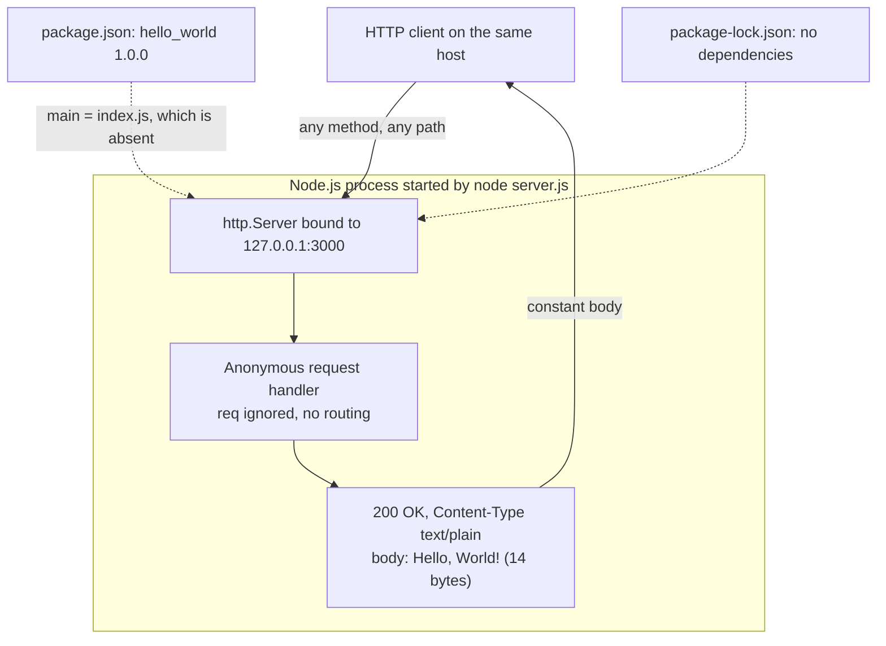

The runtime story has exactly two halves. A request lifecycle is a single hop: connection accepted, handler invoked, constant response written, socket closed by the HTTP stack. A process lifecycle is a single step: `node server.js` binds the port, logs one line, and stays alive indefinitely with no signal handling or graceful shutdown.

### 1.2.3 Success Criteria

No measurable objective, KPI, SLA, or acceptance threshold is documented anywhere in the repository: there are no tests, no CI configuration, no instrumentation, no metrics endpoint, and no monitoring hooks. The criteria that do exist are behavioral and fully specified by `server.js`; each row below was confirmed by starting the server and issuing requests against it.

| Criterion | Measurable target | Verification method |
| --- | --- | --- |
| Listener binds | TCP connection accepted on `127.0.0.1:3000` after `node server.js` | Start the process, then connect to the port |
| Status code | `200` for every request, every method, every path | `GET /`, `POST /anything`, `GET /nonexistent` all returned `200` |
| Content type | `Content-Type: text/plain` on the response | Inspect response headers |
| Response body | Exactly `Hello, World!\n` — 14 bytes | Compare `Content-Length` with the body, byte for byte |
| Startup log | `Server running at http://127.0.0.1:3000/` on stdout at bind | Capture stdout when launching |

**Critical success factors.** The fixture only succeeds if it stays untouched and trivially reproducible:

- The repository remains unmodified, per `README.md:2` ("Do not touch!"), so the baseline stays identical to commit `835878c`.
- Installation resolves nothing: the empty lockfile means `npm ci` cannot drift between environments.
- The code runs on a stock Node.js runtime with no install or build step, because its only import is a built-in module.
- The response stays constant, so any consumer's assertion on status, header, or body remains stable.

**Key performance indicators.** None are implemented. The following table records, per indicator, why the repository cannot currently report it.

| Indicator | Status in this repository | Evidence |
| --- | --- | --- |
| Service availability / uptime | Not measured — no health endpoint, probe, or metric | `server.js:6-10` (single handler, no additional endpoints) |
| Request latency and throughput | Not measured — no timing, counters, or per-request logging | `server.js:6-10` |
| Error rate | Not applicable — the handler writes `200` unconditionally and has no error branch | `server.js:7` |
| Test pass rate | No tests exist; `npm test` prints an error message and exits `1` | `package.json:7` |
| Release or deployment cadence | Not observable — no pipeline, container file, or release metadata | Repository root: five files, no CI or packaging configuration |

Adopting any indicator framework would require instrumentation this repository does not contain. Until then, the operative success test is a single HTTP exchange that returns the exact expected body.


## 1.3 Scope

The boundary of this system is unusually crisp: everything it does is observable in one 14-line file, so scope is defined both by what the code performs and by what a whole-tree search confirms is absent.

### 1.3.1 In-Scope

**Core features and functionalities.**

*Must-have capabilities.*

| Capability | Delivered as | Evidence |
| --- | --- | --- |
| Serve HTTP on the loopback interface | `http.createServer` plus `listen(3000, '127.0.0.1')` | `server.js:1`, `server.js:3-4`, `server.js:12` |
| Answer every request identically | Handler sets `200`, `Content-Type: text/plain`, body `Hello, World!\n`, ignoring `req` | `server.js:6-10` |
| Announce readiness at startup | One `console.log` inside the listen callback | `server.js:12-14` |
| Declare package identity and licence | `hello_world` v1.0.0, author `hxu`, MIT | `package.json:2-3,9-10` |
| Pin an empty dependency graph | `lockfileVersion: 3` with the root entry only | `package-lock.json:4-11` |
| State purpose and change policy | Two-line README naming the fixture and warning against edits | `README.md:1-2` |

*Primary user workflows.* The repository supports exactly one workflow, end to end:

1. An operator starts the process with `node server.js`. This is the only launch path, because `package.json` defines no `start` script; the stdout line `Server running at http://127.0.0.1:3000/` marks readiness.
2. A client on the same host sends an HTTP request to `127.0.0.1:3000` — any path, any method.
3. The server replies `200` with `text/plain` and the body `Hello, World!`.

There is no second workflow: no configuration step, no data submission, no administrative action, and no state to inspect afterward. Consuming the package programmatically is likewise not a supported workflow — `package.json:5` points `main` at a nonexistent `index.js`, and `server.js` exports nothing.

*Essential integrations.* One, and it is implicit: the loopback TCP/HTTP socket on port 3000 (`server.js:12`). The tree contains no outbound client call, datastore, message broker, third-party SDK, or authentication handshake to integrate.

*Key technical requirements.*

| Requirement | Detail | Evidence |
| --- | --- | --- |
| Runtime | Node.js with CommonJS resolution; the only import is the built-in `http` module; no `type` field set | `server.js:1`, `package.json` |
| Dependencies | Zero third-party packages; lockfile in npm v7+ `packages` format | `package-lock.json:4-11` |
| Build step | None — no transpiler, bundler, or compile script | `package.json:6-8`; no config files in tree |
| Configuration | None — host and port are source constants, not environment-driven | `server.js:3-4` |
| Network reach | Loopback only, port 3000 | `server.js:3`, `server.js:12` |
| Licensing | MIT | `package.json:10` |
| Execution model | Side-effect module with no exports and no `start` script; launched as `node server.js` | `server.js` (no `module.exports`), `package.json:6-8` |

**Implementation boundaries.**

- *System boundaries.* One process, one listening socket, 14 lines of code within a 39-line repository. Nothing but the loopback HTTP exchange crosses the process boundary: no filesystem reads or writes, no outbound network calls, no persistence, no secrets or credentials, and no scheduled or background work.
- *User groups covered.* Any local process able to connect to `127.0.0.1:3000`. Because the code contains no authentication, authorization, session, or cookie handling, it recognizes no distinct user groups, roles, or tenants: every caller is indistinguishable and receives the same response.
- *Geographic and market coverage.* Not applicable and not representable. The listener is bound to the loopback address, so no off-host traffic can arrive, and the repository contains no localization, regional configuration, or market segmentation.
- *Data domains included.* One static response payload, `Hello, World!\n`. No request body, query string, header, or path is parsed or stored; there is no data model, schema, or datastore; no personal or sensitive data is handled.

### 1.3.2 Out-of-Scope

**Explicitly excluded capabilities.** Each exclusion below rests on a whole-tree search of the tracked files, not on the mere absence of a familiar name.

| Excluded capability | Status | Evidence |
| --- | --- | --- |
| Routing and multiple endpoints | Absent — one handler serves every path; unknown paths return `200` | `server.js:6-10`; verified `GET /nonexistent` → `200` |
| HTTP method semantics and request parsing | Absent — `req` is never read; bodies, query strings, and headers are ignored | `server.js:6-10` |
| Structured response formats | Absent — no JSON or HTML serialization, only a constant text body | `server.js:8-9` |
| Error handling, 404, 5xx | Absent — status is set to `200` unconditionally; no error branch or error listener | `server.js:6-10` |
| Authentication, authorization, sessions | Absent — no token, JWT, cookie, or session code anywhere | Whole-repository search returned none |
| Persistence and datastores | Absent — no driver, ORM, or file storage; no request data to store | `package-lock.json` (empty graph), `server.js` |
| Outbound integrations | Absent — no HTTP client, queue, or third-party SDK | `server.js:1` (server use only) |
| TLS / HTTPS | Absent — the plain `http` module only | `server.js:1` |
| Configuration and environment handling | Absent — host and port are constants; no `.env`, no CLI parsing | `server.js:3-4`; no `.env` in tree |
| Observability (logs, metrics, traces) | Absent beyond one startup message; no per-request logging | `server.js:13` |
| Automated tests | Absent — no test files or framework; the `test` script fails by design | `package.json:7` |
| CI/CD, containerization, infrastructure | Absent — no workflow files, Dockerfile, compose file, or IaC | Repository root: five files only |
| Type checking, linting, formatting, bundling | Absent — no TypeScript, ESLint, Prettier, or bundler configuration | Repository root; `package.json` |
| Graceful shutdown and signal handling | Absent — the process runs until terminated externally | `server.js:12-14` |
| Library consumption | Not supported — no exports, and `main` names an absent `index.js` | `server.js`; `package.json:5` |

**Future phase considerations.** The repository documents no roadmap, backlog, or phase plan; no `TODO`, `FIXME`, `roadmap`, `future`, or `deprecated` marker appears in any tracked file. The only forward-looking statement is the opposite of a plan: `README.md:2` instructs readers not to touch the project, which reads as an intentional freeze of its scope rather than a staging point for later work. Every capability above would therefore be a new decision, not a deferred phase recorded here.

**Integration points not covered.** The system integrates with nothing beyond the local socket. Not covered: enterprise identity providers, service-to-service APIs, message brokers, databases or caches, webhooks and event consumers, cloud services, and any cross-host traffic — the loopback binding alone precludes the last of these.

**Unsupported use cases.** Concrete uses this system cannot serve:

- Serving real or external users: the process binds loopback only, with no authentication and no TLS.
- Meaningful multi-endpoint behaviour: every path returns the same body, so path-based semantics cannot be expressed.
- Stateful or data-carrying workloads: nothing is parsed, validated, or stored.
- Observability-driven operations: no metrics, traces, or request logs exist to monitor.
- Reuse as a dependency: the package cannot be imported — no exports, and a missing `main` entry.
- Regression-gated delivery: there is no test suite and no pipeline, so `npm test` fails by design instead of verifying anything.


## 1.4 References

Every claim in this section derives from the five tracked files in the repository; no external or web source was consulted.

- `README.md` — Project name `hao-backprop-test` and the sole statement of purpose ("test project for backprop integration. Do not touch!"), which establishes the fixture role, the business problem, and the change policy cited throughout sections 1.1–1.3.
- `package.json` — Package identity `hello_world` v1.0.0, description, `main: index.js` (a file absent from the tree), the failing `test` script, author `hxu`, and the MIT licence.
- `package-lock.json` — `lockfileVersion: 3` and a root-only `packages` entry, establishing that the dependency graph contains zero third-party packages.
- `server.js` — The entire executable system: `127.0.0.1:3000` binding, the unconditional `200` / `text/plain` / `Hello, World!\n` handler, the startup log line, absence of routing, request parsing, error handling, configuration, and exports.
- `test.blitzyignore.txt` — A 0-byte placeholder file with no behavior, cited when accounting for the full five-file inventory.
- `/` (repository root) — Confirmed a flat tree of five files with no subdirectories, no CI, container, or build configuration; the single commit `835878c` ("Add files via upload") shared by every local and remote branch establishes the baseline state.

Behavioral statements about status codes, headers, body length, and path- and method-independence were verified by running `node server.js` and issuing requests against `127.0.0.1:3000` on Node.js v22.23.5 with npm 11.21.3.


# 2. Product Requirements

## 2.1 Feature Catalog

Four features cover everything the repository actually delivers. They are derived from the only two sources of product intent present in the tree: the executable behavior in `server.js` and the stated purpose in `README.md:2` ("test project for backprop integration. Do not touch!"). No capability outside those sources is asserted here; everything the tree does not contain is recorded as out of scope in section 1.3.2 rather than as a feature. All four features exist at the single baseline commit `835878c`, the only commit reachable from any local or remote ref.

**Status semantics.** `package.json:2-10` carries no tracker, release, or lifecycle metadata, and the repository has no issue template, changelog, or tags. Status values below are therefore assigned from code presence plus a live run of the process on Node.js v22.23.5, not from any recorded state transition; `Completed` means the behavior is implemented and was observed working.

### 2.1.1 Feature Inventory Summary

| Feature ID | Feature Name | Feature Category | Priority Level |
| --- | --- | --- | --- |
| F-001 | Fixed-Response HTTP Request Handler | Runtime Service | Critical |
| F-002 | Loopback Listener Bootstrap | Process Lifecycle | Critical |
| F-003 | Dependency-Free Package Contract | Packaging & Distribution | High |
| F-004 | Immutable Integration Baseline | Fixture Governance | High |

| Feature ID | Status | Primary Evidence |
| --- | --- | --- |
| F-001 | Completed | `server.js:6-10`; verified live for GET, POST, PUT and HEAD |
| F-002 | Completed | `server.js:3-4`, `server.js:12-14`; startup log and port conflict verified live |
| F-003 | Completed | `package.json:2-10`, `package-lock.json:4-11`, `server.js:1` |
| F-004 | Completed | `README.md:1-2`; commit `835878c` shared by all refs |

### 2.1.2 F-001 — Fixed-Response HTTP Request Handler

| Field | Value |
| --- | --- |
| Feature ID | F-001 |
| Feature Name | Fixed-Response HTTP Request Handler |
| Feature Category | Runtime Service (request handling) |
| Priority Level | Critical |
| Status | Completed |

**Overview.** One anonymous arrow handler registered by `http.createServer` at `server.js:6-10` produces the system's entire observable response. It sets `res.statusCode = 200` (`server.js:7`), sets the single response header `Content-Type: text/plain` (`server.js:8`), and ends the response with the 14-byte body `Hello, World!\n` (`server.js:9`). The `req` argument is bound but never read, so path, method, query string, headers, and body have no influence on the result.

**Business Value.** This is the deliverable the fixture exists to expose. Because the response is a constant, any deviation an integration pipeline observes is immediately attributable to the pipeline rather than to the fixture, which is the property `README.md:2` identifies as the repository's purpose.

**User Benefits.** A caller needs nothing but the URI: no authentication, no payload, no query parameters, and no prior state. Verification is byte-exact — a live `GET /` returned `Content-Length: 14` with body `Hello, World!\n`, so an assertion on status, header, and body is stable across requests.

**Technical Context.** The handler is synchronous and performs exactly one write: three statements, no `await`, no callbacks, and no I/O beyond the response socket. Node computes `Content-Length: 14` for the single `res.end` call; for `HEAD /` the body is suppressed and `Content-Length` is not sent (both observed). Nothing in the handler differentiates requests, so the feature has one code path and no branches.

| Dependency Type | Detail |
| --- | --- |
| Prerequisite Features | F-002 supplies the bound listener the handler is attached to; F-003 supplies the built-in `http` module and a package that runs without install |
| System Dependencies | Node.js built-in `http` module (`server.js:1`) and the `http.ServerResponse` write API |
| External Dependencies | None — `package-lock.json:6-11` resolves zero third-party packages |
| Integration Requirements | An HTTP client able to reach `127.0.0.1:3000` on the same host; no other integration exists |

### 2.1.3 F-002 — Loopback Listener Bootstrap

| Field | Value |
| --- | --- |
| Feature ID | F-002 |
| Feature Name | Loopback Listener Bootstrap |
| Feature Category | Process Lifecycle |
| Priority Level | Critical |
| Status | Completed |

**Overview.** Two module-level constants, `hostname = '127.0.0.1'` and `port = 3000` (`server.js:3-4`), feed `server.listen(port, hostname, callback)` at `server.js:12-14`. The callback writes the single line `Server running at http://127.0.0.1:3000/`. The module exports nothing, so starting the process and starting the service are one act: `node server.js` binds the port and blocks.

**Business Value.** Startup costs a single command with no install step, no build step, and no configuration input, which keeps the fixture's runtime state predictable and its readiness signal unambiguous.

**User Benefits.** The operator gets exactly one startup line to wait on, and a port collision surfaces immediately and loudly: a second instance crashed with an unhandled `Error: listen EADDRINUSE: address already in use 127.0.0.1:3000` and exit code 1 (observed). `npm start` also launches the server, because npm falls back to `node server.js` when no `start` script is defined (`package.json:6-8`) — verified.

**Technical Context.** The listen call passes no backlog, no exclusive flag, and no TLS options. There is no `server.on('error')` listener, no `process.on('SIGINT'|'SIGTERM')` handler, and no `server.close()` path, so the process runs until terminated externally. The bind is loopback-only: the host's own non-loopback interface (`10.11.0.21` in the verification environment) was never bound, so no off-host client can connect.

| Dependency Type | Detail |
| --- | --- |
| Prerequisite Features | F-003 — the runtime and package must exist, and no build or install step may be required first |
| System Dependencies | Node.js bind/listen APIs over the loopback interface; a free TCP port 3000 on the host |
| External Dependencies | None |
| Integration Requirements | Same-host loopback only; no TLS, no reverse proxy, and no service discovery of any kind |

### 2.1.4 F-003 — Dependency-Free Package Contract

| Field | Value |
| --- | --- |
| Feature ID | F-003 |
| Feature Name | Dependency-Free Package Contract |
| Feature Category | Packaging & Distribution |
| Priority Level | High |
| Status | Completed |

**Overview.** `package.json` declares the package as `hello_world` v1.0.0, described "Hello world in Node.js", authored by `hxu`, under the MIT licence, with `main` set to `index.js` (`package.json:2-10`). It declares no `dependencies`, no `devDependencies`, and no `engines`, and its only script is a placeholder that prints `Error: no test specified` and exits 1 (`package.json:7`). `package-lock.json` corroborates the empty graph: `lockfileVersion: 3` with `requires: true` and a `packages` map holding a single root entry and no resolved packages.

**Business Value.** With nothing to download, the install step cannot drift between environments, and the repository presents no third-party supply-chain surface. The only import in the codebase is the built-in `http` module (`server.js:1`), so no registry access is needed to run the service.

**User Benefits.** Clone-and-run on a stock Node.js installation; nothing to provision, patch, or audit, and no lockfile churn to review.

**Technical Context.** CommonJS is implied rather than declared — `package.json` has no `type` field — which is why `require('http')` at line 1 resolves. The manifest's library-entry contract is unmet: `main` names `index.js`, which does not exist in the five-file tree, and `server.js` exports nothing, so the package cannot be consumed as a module; this is recorded as an unsatisfied requirement (F-003-RQ-003) in section 2.2.4.

| Dependency Type | Detail |
| --- | --- |
| Prerequisite Features | None — this feature is a prerequisite of F-001 and F-002 |
| System Dependencies | Node.js runtime with CommonJS resolution; npm only for manifest/lockfile tooling, never to install or serve |
| External Dependencies | None — no registry fetch, no SDK, no database driver |
| Integration Requirements | None |

### 2.1.5 F-004 — Immutable Integration Baseline

| Field | Value |
| --- | --- |
| Feature ID | F-004 |
| Feature Name | Immutable Integration Baseline |
| Feature Category | Fixture Governance |
| Priority Level | High |
| Status | Completed |

**Overview.** `README.md:1-2` names the project `hao-backprop-test` and states its purpose together with a change freeze: "test project for backprop integration. Do not touch!" The tree contains no `TODO`, `FIXME`, `roadmap`, or `deprecated` marker, and every local and remote ref resolves to the same commit `835878c` ("Add files via upload"), so the baseline state has exactly one definition.

**Business Value.** A fixture's value is fidelity: an unmodified specimen keeps every downstream assertion valid and makes any observed difference attributable to the system under test rather than to the fixture.

**User Benefits.** Any consumer of the repository knows precisely which five files and which behavior it faces, so test expectations can be written once and trusted repeatedly.

**Technical Context.** The freeze is documentation-only. No in-repo mechanism enforces it: there is no CI configuration, no branch protection visible in the checkout, no test suite (the `test` script fails by construction at `package.json:7`), and no lint or type gate. A change to the tree would therefore be detected only by a consumer comparing against commit `835878c`.

| Dependency Type | Detail |
| --- | --- |
| Prerequisite Features | F-001, F-002, F-003 — the frozen baseline is the state of those three implementations plus the manifest and README |
| System Dependencies | Git history containing the single commit `835878c` shared by all refs |
| External Dependencies | The backprop integration pipeline named in `README.md:2`, which is outside this repository |
| Integration Requirements | Repository-state consumption by that pipeline; no runtime integration |


## 2.2 Functional Requirements Tables

Each feature from section 2.1 carries a register of testable requirements, then two companion tables covering the technical specification and the validation rules for the same requirement IDs. Requirement IDs follow `F-XXX-RQ-YYY`. Every acceptance criterion below was checked against a running instance except where marked **not satisfied**, which records a requirement the tree does not meet.

### 2.2.1 Requirement Conventions

| Convention | Value Applied Here |
| --- | --- |
| Requirement ID | `F-XXX-RQ-YYY` — feature number `F-001`…`F-004`, requirement sequence `RQ-001`… per feature |
| Priority scale | Must-Have: required by the only supported workflow (start, request, receive); Should-Have: implied by the manifest or README but unenforced; Could-Have: neither present nor enforced |
| Complexity scale | Low where the requirement is met by three or fewer statements in the 14-line `server.js`; Medium where the requirement spans more than one file; High where it needs components the tree lacks (test harness, CI, configuration layer) |
| Verification basis | Manual HTTP probes, byte comparison of the response, process/exit-code inspection, and repository inspection; no automated harness exists because `package.json:7` makes `npm test` exit 1 |
| Requirement version | 1.0 for all requirements, derived from the sole commit `835878c`; no prior version exists and no change has been recorded since |
| Performance criteria | No latency, throughput, or availability target is defined anywhere in the repository, so each row states the structural work the code performs instead of a threshold |

### 2.2.2 F-001 — Fixed-Response HTTP Request Handler Requirements

| Requirement ID | Description | Acceptance Criteria | Priority / Complexity |
| --- | --- | --- | --- |
| F-001-RQ-001 | Every request path receives the same response | `GET /`, `GET /nonexistent?q=1`, and `GET /a/b/c` each return `200` with body `Hello, World!` | Must-Have / Low |
| F-001-RQ-002 | Every HTTP method receives the same response | `POST /anything`, `PUT /a/b/c`, `DELETE /x` return `200` with the 14-byte body; `HEAD /` returns the same status and `Content-Type` with no body | Must-Have / Low |
| F-001-RQ-003 | The response body is exactly 14 bytes | Body equals `48 65 6c 6c 6f 2c 20 57 6f 72 6c 64 21 0a` (`Hello, World!\n`); non-HEAD responses carry `Content-Length: 14` | Must-Have / Low |
| F-001-RQ-004 | The response declares a plain-text content type | Header `Content-Type: text/plain` is present with no charset or additional parameter | Must-Have / Low |
| F-001-RQ-005 | Request input is ignored and never echoed | A `POST /echo` carrying header `X-Probe: secret-marker` and body `payload=secret-marker` returns exactly `Hello, World!\n` with no reflected byte | Must-Have / Low |

| Requirement ID | Input Parameters | Output / Response | Performance Criteria |
| --- | --- | --- | --- |
| F-001-RQ-001 | Any request target; consumed: none | `200`, `Content-Type: text/plain`, body `Hello, World!\n` | No threshold defined; handler executes three synchronous statements with no I/O beyond the response socket |
| F-001-RQ-002 | Any method token, including unknown verbs | Same status, header, and body as `GET`; `HEAD` sends headers only | No threshold defined; method is never inspected, so per-request work is identical for every verb |
| F-001-RQ-003 | None | 14 fixed bytes; `Content-Length: 14` computed by Node from the single `res.end` call | No threshold defined; no serialization, templating, or encoding step exists |
| F-001-RQ-004 | None | One response header set by `res.setHeader` (`server.js:8`) | No threshold defined; single header write |
| F-001-RQ-005 | Request headers, body, and query are present but never read; `req` is unbound in the handler body | The constant body regardless of input size or content | No threshold defined; because the body is never consumed, request payload size adds no handler work |

| Requirement ID | Business Rules and Data Validation | Security and Compliance | Data Requirements |
| --- | --- | --- | --- |
| F-001-RQ-001 | Status is unconditionally `200`; no 404, 4xx, or 5xx path exists. Path and query are never validated | No authentication or authorization; exposure limited to the loopback interface; MIT licence (`package.json:10`) | No datastore, schema, or model — the only data is the source literal at `server.js:9` |
| F-001-RQ-002 | Method is never validated against an allow-list; unknown verbs are accepted | No method-based access control to bypass because no protected operation exists | None beyond the constant body |
| F-001-RQ-003 | Body is a compile-time literal, not composed from input, so it cannot vary | Fixed constant cannot leak or mutate; no TLS, so the response is plaintext on loopback | 14 bytes, no encoding or charset negotiation |
| F-001-RQ-004 | Header is set explicitly on every response | Declaring `text/plain` prevents content sniffing by clients; no `Content-Security-Policy` or other hardening header is sent | None |
| F-001-RQ-005 | No parsing of headers, body, or query; no echo path exists | No reflection surface for cross-site scripting or header injection; no secrets, credentials, or personal data appear in the repository | None stored or transmitted |

### 2.2.3 F-002 — Loopback Listener Bootstrap Requirements

| Requirement ID | Description | Acceptance Criteria | Priority / Complexity |
| --- | --- | --- | --- |
| F-002-RQ-001 | Bind the fixed loopback address and port | After `node server.js`, a TCP client connects to `127.0.0.1:3000` and receives `200` within the bind callback | Must-Have / Low |
| F-002-RQ-002 | Never bind a non-loopback interface | Connecting to the host's own address `10.11.0.21:3000` is refused while the server is running | Must-Have / Low |
| F-002-RQ-003 | Announce readiness on stdout | stdout receives exactly `Server running at http://127.0.0.1:3000/` once, with no other startup output | Must-Have / Low |
| F-002-RQ-004 | Launch with one command and no install or build step | `node server.js` binds the port on a fresh checkout; `npm start` also binds it through npm's implicit `node server.js` default | Must-Have / Low |
| F-002-RQ-005 | Fail visibly when the port is occupied | A second instance terminates with exit code `1` and reports `EADDRINUSE: address already in use 127.0.0.1:3000` | Should-Have / Low |

| Requirement ID | Input Parameters | Output / Response | Performance Criteria |
| --- | --- | --- | --- |
| F-002-RQ-001 | None; host and port are module constants (`server.js:3-4`), not configuration | Bound `http.Server` plus one log line | No threshold defined; the log is written inside the listen callback, so it post-dates the bind |
| F-002-RQ-002 | None; the bind address is a literal, with no override path | Listener visible only on `127.0.0.1` | No threshold defined; no proxy, load balancer, or TLS terminator in front of it |
| F-002-RQ-003 | None | One stdout line at bind time, then no further process output | No threshold defined; single `console.log` invocation (`server.js:13`) |
| F-002-RQ-004 | No environment variable, CLI argument, or config file is read | Running process serving requests | No install, build, or compile step precedes startup |
| F-002-RQ-005 | An already-bound `127.0.0.1:3000` | Unhandled `error` event, stack trace on stderr, exit code `1` | No threshold defined; failure occurs during `listen`, before any request is served |

| Requirement ID | Business Rules and Data Validation | Security and Compliance | Data Requirements |
| --- | --- | --- | --- |
| F-002-RQ-001 | Address and port are hard-coded; relocating the service requires editing source | Loopback binding keeps the service off any network segment; no TLS, no authentication | None |
| F-002-RQ-002 | No configuration validation because there is no configuration input | Off-host clients cannot connect, which is the only access control the system has | None |
| F-002-RQ-003 | The log line is the sole readiness contract; no health or readiness endpoint exists | Log contains no host or credential information beyond the bind address | None |
| F-002-RQ-004 | No `engines` field pins the runtime (`package.json`), so no version validation occurs; Node.js v22.23.5 was used for verification | Relies on Node.js built-ins only, so no third-party code enters the process | None |
| F-002-RQ-005 | No `server.on('error')` listener, no signal handling, and no graceful close path exist (`server.js:12-14`) | Crash exposes a stack trace on the local console; no remote surface | None |

### 2.2.4 F-003 — Dependency-Free Package Contract Requirements

| Requirement ID | Description | Acceptance Criteria | Priority / Complexity |
| --- | --- | --- | --- |
| F-003-RQ-001 | Declare and lock zero third-party packages | `package.json` has no `dependencies`, `devDependencies`, or `engines` key; `package-lock.json` `packages` contains only the root `""` entry with no `dependencies`; the server starts without `npm install` | Must-Have / Low |
| F-003-RQ-002 | Declare package identity and licence | `name` `hello_world`, `version` `1.0.0`, `description` "Hello world in Node.js", `author` `hxu`, `license` `MIT` | Must-Have / Low |
| F-003-RQ-003 | Expose a usable module entry point | **Not satisfied** — `main` is `index.js`, which does not exist in the tree, and `server.js` defines no `module.exports`; requiring the package as a library is impossible | Should-Have / Low |
| F-003-RQ-004 | Run on a stock Node.js runtime with no build step | Only built-in `http` is imported; no `type`, `engines`, bundler, transpiler, linter, or formatter configuration exists; the process starts from source | Must-Have / Low |

| Requirement ID | Input Parameters | Output / Response | Performance Criteria |
| --- | --- | --- | --- |
| F-003-RQ-001 | Manifest and lockfile contents | Empty resolved dependency graph; startup requires no registry access | No install time is incurred because nothing resolves; no threshold defined |
| F-003-RQ-002 | None | Metadata readable by npm tooling (`npm start` prints `hello_world@1.0.0`) | Not applicable — static metadata |
| F-003-RQ-003 | `main` field value | Currently no module surface; the only entry is by side effect when the file executes | Not applicable |
| F-003-RQ-004 | `node server.js` or `npm start` | Running process serving requests with no preceding build | No threshold defined; startup cost is module load plus socket bind |

| Requirement ID | Business Rules and Data Validation | Security and Compliance | Data Requirements |
| --- | --- | --- | --- |
| F-003-RQ-001 | The empty graph is an invariant of the fixture: adding a dependency would change the baseline | No third-party supply-chain surface and no integrity hashes to verify because no package is resolved | Lockfile carries only root package identity (`package-lock.json:6-11`) |
| F-003-RQ-002 | Identity must match the lockfile root entry (`hello_world` / `1.0.0` / MIT) | MIT licence permits unrestricted reuse and redistribution | None |
| F-003-RQ-003 | Manifest and implementation disagree, which is a contract defect: either `main` or an exported surface must change for library use | No secrets or credentials are exposed by the missing entry point | None |
| F-003-RQ-004 | Runtime compatibility is asserted by no field, so it is validated only by trying a Node.js version | CommonJS resolution is implied by the absent `type` field; no TLS or crypto configuration exists | None |

### 2.2.5 F-004 — Immutable Integration Baseline Requirements

| Requirement ID | Description | Acceptance Criteria | Priority / Complexity |
| --- | --- | --- | --- |
| F-004-RQ-001 | Keep the tracked tree identical to the baseline commit | All five files match commit `835878c` and `git status` reports no modification | Must-Have / Low |
| F-004-RQ-002 | Reproduce the baseline without network resolution | The lockfile resolves nothing, so provisioning requires no registry fetch and the served response is byte-identical across environments | Must-Have / Low |
| F-004-RQ-003 | Provide an automated regression gate for the fixture's contract | **Not satisfied** — `npm test` prints `Error: no test specified` and exits `1`; no test file, runner, or CI workflow exists | Could-Have / Medium |

| Requirement ID | Input Parameters | Output / Response | Performance Criteria |
| --- | --- | --- | --- |
| F-004-RQ-001 | Repository working tree | Clean status against `835878c`, the only commit reachable from any local or remote ref | Not applicable |
| F-004-RQ-002 | Root-only lockfile (`lockfileVersion: 3`) | No package fetched; identical runtime behavior on any environment with a compatible Node.js | No threshold defined; provisioning cost is a clone only |
| F-004-RQ-003 | A `test` script invocation | Currently a printed error and exit code `1` | Not applicable — no test execution occurs |

| Requirement ID | Business Rules and Data Validation | Security and Compliance | Data Requirements |
| --- | --- | --- | --- |
| F-004-RQ-001 | The freeze is stated only in prose (`README.md:2`); no branch rule, hook, or check enforces it from inside the repository | No credentials exist in the tree to rotate or protect | Five tracked files; no generated or binary artifacts |
| F-004-RQ-002 | Determinism relies on the empty dependency graph rather than on pinned versions | No integrity hashes exist because no package resolves | `package-lock.json` root entry only |
| F-004-RQ-003 | Absence of tests and CI means any regression would surface only at the consuming pipeline | No security scanning exists for the fixture either | No fixtures, mocks, or sample data accompany the code |


## 2.3 Feature Relationships

The four features are not peers: three of them are layers of one runtime path, and the fourth is the governance constraint over all three. Every relationship below is visible in `server.js`, `package.json`, `package-lock.json`, or `README.md`; nothing is inferred beyond what those files show.

### 2.3.1 Feature Dependency Map

Arrows point from a feature to what it needs. F-001 cannot exist without the listener from F-002, F-002 cannot start without the built-in `http` module and the install-free package from F-003, and F-004 is the freeze applied to the resulting state.

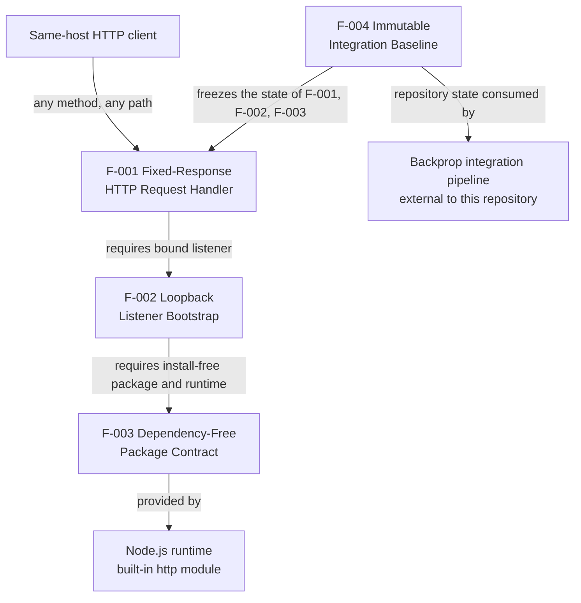

| From | To | Relationship | Evidence |
| --- | --- | --- | --- |
| F-001 | F-002 | Handler runs only once the listener is bound; the handler is registered before `listen` and invoked by the bound server | `server.js:6-10`, `server.js:12` |
| F-002 | F-003 | Binding needs the built-in `http` module and a package that starts without install or build | `server.js:1`, `package.json:6-8`, `package-lock.json:6-11` |
| F-003 | Node.js runtime | The only import is a built-in, so the runtime is the sole supplier of F-003's code dependency | `server.js:1` |
| F-004 | F-001, F-002, F-003 | The baseline is the state of those implementations plus the manifest and README | `README.md:2`, commit `835878c` |

### 2.3.2 Integration Points

| Integration Point | Direction and Type | Contract Observed | Evidence |
| --- | --- | --- | --- |
| Loopback TCP listener on `127.0.0.1:3000` | Inbound, synchronous HTTP request/response | Any method, any path → `200`, `Content-Type: text/plain`, `Hello, World!\n` | `server.js:3-4`, `server.js:12`; verified live |
| Startup stdout line | Outbound, one-way text on process start | Exactly `Server running at http://127.0.0.1:3000/` | `server.js:13`; verified with `cat -A` |
| Process exit status | Outbound, one-way signal to the launcher | `1` with an `EADDRINUSE` stack trace when the port is taken; no other exit path is coded | `server.js:12-14`; verified with a second instance |
| Repository state | Outbound, consumed at rest by the pipeline named in the README | Five files at commit `835878c`, unchanged | `README.md:2`, commit `835878c` |

No other integration point exists: the tree contains no outbound HTTP client, datastore connection, message broker, identity provider, or third-party SDK.

### 2.3.3 Shared Components

| Shared Component | Shared By | Role in Each Feature | Evidence |
| --- | --- | --- | --- |
| `server.js` request handler | F-001, F-004 | The response implementation for F-001 and part of the frozen baseline for F-004 | `server.js:6-10` |
| `hostname` / `port` constants | F-002, F-001 | Bind address for F-002; the address the handler's responses arrive on for F-001 | `server.js:3-4` |
| Built-in `http` module | F-003, F-002, F-001 | The sole code dependency (F-003), the bind API (F-002), and the server factory (F-001) | `server.js:1` |
| `package.json` + `package-lock.json` | F-003, F-004 | Identity and empty dependency graph for F-003; the pinned baseline state for F-004 | `package.json:2-10`, `package-lock.json:1-13` |

### 2.3.4 Common Services

There are none in the sense of an internal shared runtime: the repository contains no logging framework, configuration loader, error handler, connection pool, cache, or middleware chain. The only service any feature relies on is the Node.js runtime's own HTTP stack, which supplies request parsing, the response object, and socket lifecycle to F-001 and F-002 alike through the single `require('http')` at `server.js:1`. The single `console.log` at `server.js:13` is the entire logging surface, used by F-002 only.


## 2.4 Implementation Considerations

Considerations are recorded per feature against the five standard aspects. Where no requirement exists, the table says so rather than inventing a target, because the repository defines no latency, throughput, availability, or capacity figure anywhere.

### 2.4.1 F-001 — Fixed-Response HTTP Request Handler

| Aspect | Consideration | Evidence |
| --- | --- | --- |
| Technical constraints | Body and header are source literals, so any change to the response is a source edit and a restart. The handler never reads `req`, so adding routing, content negotiation, or request validation requires restructuring the handler, not configuring it | `server.js:6-10` |
| Performance requirements | None defined and none measurable: no timing, counters, or per-request logging. Structurally, a request costs three synchronous statements and one socket write, and Node computes `Content-Length: 14` from the single `res.end` call | `server.js:7-9`; `Content-Length: 14` observed |
| Scalability considerations | One process on one thread serves all requests through the event loop; there is no cluster, worker, or reuse-port configuration. Additional instances cannot share the fixed port — a second process failed with `EADDRINUSE` — so horizontal scaling would need external distribution | `server.js:12`; second-instance failure observed |
| Security implications | No authentication, authorization, session, or TLS anywhere. Exposure is limited to loopback, the handler reflects no input, and `text/plain` prevents client-side script execution; no hardening headers (`X-Content-Type-Options`, CSP) are sent | `server.js:7-9`; loopback-only bind verified |
| Maintenance requirements | No test covers the response contract, so a regression in status, header, or body has no automated detector. The handler is also untestable in isolation because the module exports nothing and requiring it binds the port | `package.json:7`; `server.js` (no `module.exports`) |

### 2.4.2 F-002 — Loopback Listener Bootstrap

| Aspect | Consideration | Evidence |
| --- | --- | --- |
| Technical constraints | Host and port are module constants with no environment-variable, CLI, or file override, so relocating the service means editing `server.js:3-4`. The module has no exports, so `require('./server.js')` starts the listener as a side effect, which rules out importing it in a test harness | `server.js:1-14` |
| Performance requirements | None defined. The startup log is written inside the listen callback, so the line reliably marks the moment the socket is bound; there is no health or readiness endpoint to poll | `server.js:12-14`; startup line captured with `cat -A` |
| Scalability considerations | One fixed loopback endpoint per host; no backlog tuning, no proxy, no container or orchestrator configuration, and no restart supervision. Concurrency is whatever the Node.js HTTP stack supplies by default — the observed `Keep-Alive: timeout=5` and `Connection: close` under HTTP/1.0 are those defaults | `server.js:12`; response headers observed |
| Security implications | The loopback bind is the system's only access control: a request to the host's own address `10.11.0.21:3000` was refused while `127.0.0.1:3000` answered. Traffic is plaintext with no TLS, no authentication, and no rate limiting. A bind failure writes a stack trace to stderr, with no listener to handle the error | `server.js:3`, `server.js:12`; connection refusal verified |
| Maintenance requirements | No `engines` field pins the runtime, so the Node.js version used is unrecorded by the project; an incompatible runtime would surface only at launch. There is no signal handling or graceful shutdown, so termination is always abrupt | `package.json` (no `engines`); `server.js:12-14` |

### 2.4.3 F-003 — Dependency-Free Package Contract

| Aspect | Consideration | Evidence |
| --- | --- | --- |
| Technical constraints | CommonJS is implied by the absent `type` field, which is what allows `require('http')`. `main` points to a `index.js` that does not exist, so the manifest's entry contract cannot be satisfied as written without adding a file or amending the field. No `start` script exists; `npm start` works only through npm's implicit `node server.js` default | `package.json:2-8`; `npm start` verified; `index.js` absent |
| Performance requirements | None defined. Installation and build cost is zero because nothing resolves and no compilation step exists | `package-lock.json:4-11` |
| Scalability considerations | Not applicable to a package that is never published or installed; note only that the manifest sets no `files` field and no `private` flag, so nothing in the metadata constrains what a publish would include | `package.json` (keys observed: name, version, description, main, scripts, author, license) |
| Security implications | The dependency graph is empty, so there is no third-party supply-chain exposure and no integrity hashes to verify. The MIT licence permits unrestricted use and redistribution. No secrets, credentials, or environment files exist to leak | `package-lock.json:6-11`, `package.json:10`; no `.env` in tree |
| Maintenance requirements | Three defects are visible to any maintainer: `main` references a missing file, the `test` script fails by construction, and the README's freeze instruction conflicts with any change. Version stays at `1.0.0` across a single commit, so no release process is exercised | `package.json:5-7`, `README.md:2`, commit `835878c` |

### 2.4.4 F-004 — Immutable Integration Baseline

| Aspect | Consideration | Evidence |
| --- | --- | --- |
| Technical constraints | The freeze is prose only — `README.md:2` — with no hook, branch rule, or check inside the repository enforcing it. Consumers must therefore pin commit `835878c` themselves to preserve fidelity | `README.md:2`; single commit across all refs |
| Performance requirements | None defined for the fixture itself. Reproducibility costs a clone: the root-only lockfile resolves nothing, so no registry fetch or install time is incurred | `package-lock.json:4-11` |
| Scalability considerations | Consumption scales without adjustment because it has no runtime component: any number of pipelines can read the same commit. The runtime component remains single-process and single-port, so concurrent consumers must share the one listener | `server.js:12`; `README.md:2` |
| Security implications | No secrets, keys, or personal data are present, and the empty dependency graph means no vulnerable package can be introduced. No security scanning or audit step exists; the freeze is a policy control, not a technical one | Whole tree; `package-lock.json` |
| Maintenance requirements | Any change to the fixture is a breaking change to every consumer's expectations, so it must be a deliberate new commit whose identity consumers record. The absence of tests and CI (F-004-RQ-003 unsatisfied) means the baseline's contract is protected by convention alone | `package.json:7`; no CI, test, or container files in tree |


## 2.5 Requirement Traceability and Cross-References

Traceability runs from each requirement to the source statement that implements it and the check that verified it. All Must-Have criteria were exercised against a running instance on Node.js v22.23.5; the two rows marked **not satisfied** record requirements the tree does not meet and are carried forward in section 2.6.3.

### 2.5.1 Traceability Matrix

| Requirement ID | Feature | Implementation Evidence | Verification Method |
| --- | --- | --- | --- |
| F-001-RQ-001 | F-001 | `server.js:6-10` — handler ignores the request target | `GET /`, `GET /nonexistent?q=1`, `GET /a/b/c` all returned `200` |
| F-001-RQ-002 | F-001 | `server.js:6` — `req` bound but never read | `POST`, `PUT`, `DELETE` returned `200` / 14 bytes; `HEAD` returned headers only |
| F-001-RQ-003 | F-001 | `server.js:9` — literal `'Hello, World!\n'` | Byte comparison plus `Content-Length: 14` on the response |
| F-001-RQ-004 | F-001 | `server.js:8` — `setHeader('Content-Type', 'text/plain')` | Response header inspection |
| F-001-RQ-005 | F-001 | `server.js:6` — no read of headers or body | `POST /echo` with `X-Probe: secret-marker` and body `payload=secret-marker` returned only `Hello, World!\n` |
| F-002-RQ-001 | F-002 | `server.js:3-4`, `server.js:12` | Connection to `127.0.0.1:3000` answered `200` |
| F-002-RQ-002 | F-002 | `server.js:3` — loopback literal as the only bind address | Connection to host address `10.11.0.21:3000` refused while the server ran |
| F-002-RQ-003 | F-002 | `server.js:13` — single `console.log` in the listen callback | stdout captured with `cat -A`: `Server running at http://127.0.0.1:3000/$` |
| F-002-RQ-004 | F-002 | `server.js:12`; `package.json:6-8` (no `start` script) | `node server.js` and `npm start` both bound the port on a checkout with no `node_modules` |
| F-002-RQ-005 | F-002 | `server.js:12-14` — no `error` listener | Second instance failed with `EADDRINUSE` and exit code `1` |
| F-003-RQ-001 | F-003 | `package.json` (no dependency keys), `package-lock.json:6-11`, `server.js:1` | Manifest and lockfile key inspection; server started with no install step |
| F-003-RQ-002 | F-003 | `package.json:2-3`, `package.json:9-10` | Field inspection; `npm start` reported `hello_world@1.0.0` |
| F-003-RQ-003 | F-003 | `package.json:5` names `index.js`; file absent; `server.js` has no exports — **not satisfied** | File existence check and export search |
| F-003-RQ-004 | F-003 | `server.js:1`; no `type`, `engines`, or build configuration anywhere | Launched from source on Node.js v22.23.5 with npm 11.21.3 |
| F-004-RQ-001 | F-004 | `README.md:2`; commit `835878c` | `git status` clean, `git log --all` shows the single commit |
| F-004-RQ-002 | F-004 | `package-lock.json:4-11` — root entry only | Lockfile inspection; no registry resolution needed |
| F-004-RQ-003 | F-004 | `package.json:7` — placeholder `test` script — **not satisfied** | `npm test` printed `Error: no test specified` and exited `1` |

### 2.5.2 Requirement Version Tracking

| Requirement Version | Baseline | Change History |
| --- | --- | --- |
| 1.0 | Commit `835878c5a9445a421c77ec2436ceea6e1b64e149` (`835878c`, "Add files via upload", Sandeep01Kumar, 2026-11-19T15:31:14+05:30) | Initial derivation. This commit is the only one reachable from any local or remote ref, so no earlier or later version of any requirement exists |

### 2.5.3 Related Process Flowcharts

| Diagram | Location | What It Contributes |
| --- | --- | --- |
| Request and process lifecycle flowchart | Section 1.2.2, "Core technical approach" | Shows the single path from HTTP client to listener, handler, and constant response, and the one-command process start that F-001 and F-002 requirements encode |
| Feature dependency map | Section 2.3.1 | Shows which feature is a prerequisite of which, and where the runtime and the external pipeline attach |

### 2.5.4 Linked Technical Specifications

| Reference | Section | Relevance to These Requirements |
| --- | --- | --- |
| Executive Summary | 1.1 | Establishes the fixture purpose and stakeholders that F-004 freezes, and the single-response deliverable that F-001 implements |
| System Overview | 1.2 | Records the same handler, listener, and manifest behavior at system level, including the verified status, header, and body values these requirements assert |
| Scope | 1.3 | Confirms that no capability beyond these four features exists, which is why the catalog stops at F-004 |
| References | 1.4 | Lists the five tracked files on which every requirement row depends |


## 2.6 Assumptions and Constraints

Every assumption below is either stated in a file or was confirmed by running the system; none is inherited from a roadmap, design document, or ticket, because the repository contains none.

### 2.6.1 Assumptions

| Assumption ID | Assumption | Basis |
| --- | --- | --- |
| A-01 | The repository is consumed as a test fixture, not deployed as a production service | `README.md:2` — "test project for backprop integration. Do not touch!" |
| A-02 | Consumers run a Node.js release that supports CommonJS and the built-in `http` module | `server.js:1`; no `type` or `engines` field in `package.json`. Verified on Node.js v22.23.5 / npm 11.21.3 |
| A-03 | TCP port 3000 on `127.0.0.1` is free when the process starts, and the operator accepts a hard failure otherwise | `server.js:3-4`; a second instance exited `1` with `EADDRINUSE` |
| A-04 | Consumers treat the constant response as the complete contract to assert against | `server.js:7-9`; no other response is producible |
| A-05 | The reference state of the system is the five-file tree at commit `835878c` | `git log --all` shows one commit; `git status` clean |
| A-06 | No provisioning step precedes startup: neither `npm install` nor a build is expected to run | `package-lock.json:4-11` resolves nothing; `server.js:1` imports only a built-in |
| A-07 | All traffic originates on the same host | `server.js:3` binds `127.0.0.1`; off-host connection to the host address was refused |

### 2.6.2 Constraints

| Constraint ID | Constraint | Evidence |
| --- | --- | --- |
| C-01 | No configuration surface: host and port are source constants | `server.js:3-4`; no `.env`, CLI parsing, or config file in tree |
| C-02 | Loopback-only reachability, plaintext HTTP, no TLS, no authentication | `server.js:3`, `server.js:1`; connection refusal observed on the host interface |
| C-03 | Zero third-party dependencies; introducing any changes the baseline | `package.json` (no dependency keys), `package-lock.json:6-11` |
| C-04 | No automated tests, test framework, or CI: `npm test` exits `1` by construction | `package.json:7`; no test or workflow files in tree |
| C-05 | The manifest entry point is unresolved: `main` names an absent `index.js`, and nothing is exported | `package.json:5`; `server.js` (no `module.exports`) |
| C-06 | No graceful shutdown or signal handling; the process ends only by external termination | `server.js:12-14` |
| C-07 | No performance, availability, throughput, or capacity target is recorded anywhere | No instrumentation, metrics endpoint, or requirement document in the tree |
| C-08 | No change history exists to date, so requirement traceability has a single version | Commit `835878c` is the only commit reachable from any ref |
| C-09 | Change to the fixture is discouraged by policy rather than prevented by tooling | `README.md:2`; no hook, branch rule, or check inside the repository |

### 2.6.3 Open Requirement Gaps

| Requirement | Gap | Consequence |
| --- | --- | --- |
| F-003-RQ-003 | `main` points to an absent `index.js` and the module exports nothing | The package cannot be consumed as a library or unit-tested without refactoring; only process-level side-effect launching works |
| F-004-RQ-003 | No test suite, runner, or CI gate exists, and the `test` script fails by design | The fixture's response contract is protected by convention only; a regression would first surface in the consuming pipeline |

Neither gap has a recorded remediation plan: the tree contains no `TODO`, `FIXME`, `roadmap`, or `deprecated` marker, and `README.md:2` instructs readers not to modify the project, so both are reported as observed deficiencies rather than as scheduled work.


## 2.7 References

Every requirement in this section derives from the five tracked files at commit `835878c` plus a live run of the process. No external or web source was consulted.

- `server.js` — The entire executable system: the loopback bind at `127.0.0.1:3000`, the unconditional `200` / `Content-Type: text/plain` / `Hello, World!\n` handler, the startup log line, and the absence of routing, request parsing, exports, error handling, and shutdown logic — the basis for F-001, F-002 and requirements F-001-RQ-001…005, F-002-RQ-001…005.
- `package.json` — Package identity (`hello_world` 1.0.0, MIT, author `hxu`), the absent dependency, `engines` and `start` keys, `main: index.js`, and the failing `test` script — the basis for F-003 and F-004 and for requirements F-003-RQ-001…004, F-004-RQ-003.
- `package-lock.json` — `lockfileVersion: 3` with a root-only `packages` entry, establishing the empty dependency graph relied on by F-003-RQ-001 and F-004-RQ-002.
- `README.md` — Project name `hao-backprop-test` and the purpose-plus-freeze statement ("test project for backprop integration. Do not touch!"), the sole basis for F-004.
- `test.blitzyignore.txt` — 0-byte placeholder with no behavior, cited only when accounting for the five-file baseline of F-004.
- `/` (repository root) — Confirmed a flat tree of five files with no subdirectories and no CI, container, build, lint, or test configuration; `.git` history shows the single commit `835878c` ("Add files via upload", 2026-11-19T15:31:14+05:30) reachable from every local and remote ref.

Behavioral acceptance criteria were verified by launching `node server.js` and `npm start` and issuing `GET /`, `GET /nonexistent?q=1`, `GET /a/b/c`, `POST /anything`, `POST /echo` with a probe header and body, `PUT /a/b/c`, `DELETE /x`, and `HEAD /` against `127.0.0.1:3000`, plus an attempted connection to the host interface `10.11.0.21:3000` and a second instance to observe `EADDRINUSE`, on Node.js v22.23.5 with npm 11.21.3.


# 3. Technology Stack

## 3.1 Programming Languages

The system's entire technology stack is one language executed by one runtime. This section records the languages actually present, keyed by component, and the platforms that the reference stack names but that this repository contains no code or configuration for — a distinction established by full-tree searches over every tracked file rather than by the absence of a familiar name.

### 3.1.1 Languages by Platform and Component

| Component | Language | How it is realized | Evidence |
| --- | --- | --- | --- |
| Server process — the only executable component | JavaScript (ECMAScript, ES2015+ syntax) | Executed directly by Node.js; CommonJS module format, no transpilation | `server.js:1` (`require`), `server.js:3-6` (`const`, arrow function), `server.js:13` (template literal) |
| Package manifest | JSON | npm manifest, also read by Node.js for package metadata | `package.json` |
| Dependency lockfile | JSON | npm lockfile in `lockfileVersion` 3 format | `package-lock.json:4` |
| Project documentation | Markdown | Two-line README, documentation only | `README.md:1-2` |

There is no client tier to hold a second language: the only client is any local process that opens a TCP connection to `127.0.0.1:3000`, and it runs whatever the caller already has. No source file in the repository is anything other than the four rows above.

### 3.1.2 Selection Criteria and Justification

**JavaScript on Node.js.** The manifest describes the project as "Hello world in Node.js" (`package.json:4`), and the implementation matches that intent with the smallest possible surface: a JavaScript file that imports nothing but the runtime's own HTTP module. Three properties follow directly from the code:

- **No build step is possible to require.** The source at `server.js` is the artifact that runs; there is no transpiler, bundler, or compiler in the tree, so a language whose output differs from its source would add a toolchain the repository does not have.
- **One language covers the whole system.** Request handling, startup, and logging are all in the same 14-line CommonJS file, so there is no inter-language boundary, marshalling, or interface definition to maintain.
- **The runtime supplies the protocol work.** HTTP parsing, keep-alive, and socket handling come from Node.js itself (`server.js:1`), so no framework or library language is introduced.

**CommonJS rather than ES modules.** `package.json` sets no `"type"` field, so Node.js resolves `.js` as CommonJS; `server.js:1` uses `require()` accordingly. The module also exports nothing, making it a side-effect entry point rather than a library.

**No static type system.** With no data model, no request parsing, and no exported API (the response is a single constant at `server.js:9`), there is nothing for a type checker to describe. No `tsconfig.json`, `.d.ts` file, or TypeScript dependency exists in the tree.

### 3.1.3 Language Constraints and Dependencies

| Constraint | Detail | Evidence |
| --- | --- | --- |
| CommonJS is load-bearing | Converting to ES modules would require both a manifest `"type"` change and rewriting `require`; the module cannot be `import`ed as-is | `server.js:1`; no `type` field in `package.json` |
| Runtime version is undeclared | No `engines` field and no `.nvmrc`, so no minimum or maximum Node.js version is contractually stated; the version is whatever the host provides | `package.json` (no `engines`); no version file in tree |
| Syntax floor is ES2015 | `const`, arrow functions, and template literals require a 2015-or-later runtime; nothing newer is used (no `async`/`await`, no optional chaining, no classes) | `server.js:3-6`, `server.js:13` |
| Verified runtime | Node.js v22.23.5 with npm 11.21.3 (V8 12.4.254.21-node.57, `NODE_MODULE_VERSION` 127) is the only runtime on which behavior was confirmed | Runtime probe; consistent with assumptions A-02 in section 2.6 |
| Support status of the verified runtime | Node.js 22 "Jod" has been in Maintenance LTS since 2025-10-21 with End-of-Life on 2027-04-30, so the verified runtime is in security-support-only status as of this document's date (2026-11-24) | [web] Node.js Release Working Group schedule; endoflife.date |
| No native addons | Nothing compiles against the Node ABI, so `NODE_MODULE_VERSION` 127 is not a compatibility constraint today | `server.js:1` (core module only); empty dependency graph |
| Character encoding | The response body is the ASCII literal `Hello, World!\n` and `Content-Type` carries no `charset` parameter, so the response is US-ASCII per HTTP defaults | `server.js:8-9`; `Content-Length: 14` observed |
| Language scope of dependencies | Any future dependency would have to be JavaScript or a native addon, which would introduce an ABI constraint the repository does not currently have | `package-lock.json:6-11` (nothing resolved) |

### 3.1.4 Platforms Considered and Not Applicable

The reference technology stack for this programme names languages for platforms this system does not implement. Because a whole-tree search finds no source file, dependency, or configuration for any of them, they are recorded as not applicable rather than planned:

| Language / platform | Status in this repository | Evidence |
| --- | --- | --- |
| Python (with Flask) | Absent — no `.py` file, no `requirements.txt`/`pyproject.toml`, no Python import | Whole-tree search; only code file is `server.js` |
| TypeScript, React, TailwindCSS, React-Native | Absent — no `.ts`/`.tsx`/`.jsx`, no frontend or mobile source, no dependency entries | `package.json` (no dependencies); only five files present |
| Swift (iOS), Kotlin (Android), Objective-C (macOS) | Absent — no native project, workspace, or source file | Whole-tree search |
| ElectronJS (desktop) | Absent — no main/renderer process, no desktop packaging | Whole-tree search |

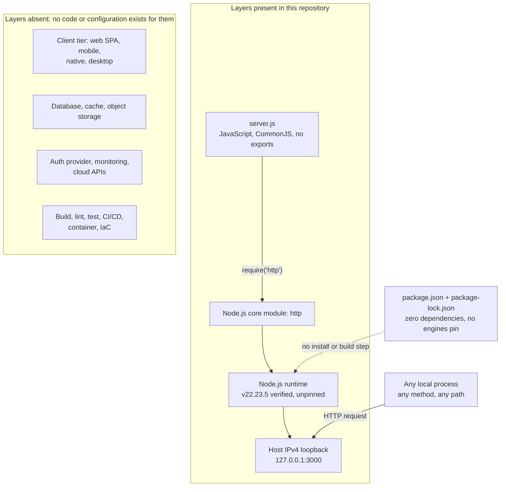


## 3.2 Frameworks & Libraries

### 3.2.1 Core Frameworks

**No application framework is used.** The HTTP layer is provided entirely by Node.js's built-in `http` module, imported at `server.js:1`. A runtime probe confirms the module is part of the runtime distribution rather than an installed package: `module.builtinModules.includes('http')` returns `true`. It therefore has no version number of its own — it ships with the Node.js release — and it appears nowhere in `package.json` or `package-lock.json`.

The complete set of runtime APIs the application calls:

| API | Purpose in this system | Evidence |
| --- | --- | --- |
| `http.createServer(requestListener)` | Creates the server with a single anonymous request listener | `server.js:6` |
| `res.statusCode = 200` | Sets the status for every response | `server.js:7` |
| `res.setHeader('Content-Type', 'text/plain')` | Sets the only response header the code controls | `server.js:8` |
| `res.end('Hello, World!\n')` | Writes the constant 14-byte body and closes the response | `server.js:9` |
| `server.listen(port, hostname, callback)` | Binds the fixed loopback address and runs the readiness log | `server.js:12-14` |
| `console.log(...)` | Startup announcement; a global, not an import | `server.js:13` |

### 3.2.2 Supporting Libraries

None. A search of all five tracked files for `require`/`import`/`export` statements returns exactly one code hit — `require('http')` at `server.js:1` — and the sole other textual match is the unrelated `"requires": true` key at `package-lock.json:5`. There is no middleware, router, body parser, logger, validation, templating, configuration, or test library anywhere in the tree.

### 3.2.3 Compatibility Requirements

| Requirement | Detail | Evidence |
| --- | --- | --- |
| CommonJS resolution | The listener is loaded with `require`, so the runtime must resolve CommonJS in a package that declares no `"type"` field | `server.js:1`; `package.json` |
| Core `http` API availability | All six APIs in section 3.2.1 are long-stable members of the `http` module; the practical version floor is set by the ES2015 syntax, not by the library API | `server.js:1-14` |
| HTTP/1.1 semantics | The response carries `Content-Length: 14` and a default keep-alive (`Connection: keep-alive`, `Keep-Alive: timeout=5`), both produced by the runtime's own HTTP stack with no application code involved | Observed response headers |
| HTTP/1.0 fallback | An HTTP/1.0 request returned `200` with `Connection: close` and no `Content-Length`, delimiting the body by closing the connection — again runtime behavior, not application code | Observed response headers |
| No peer or engine constraints | Neither `peerDependencies` nor `engines` exists, so no framework compatibility matrix applies | `package.json` |

### 3.2.4 Justification for the Choice

Using only the core module is the correct fit for this system's actual responsibilities, and a framework would be net-cost in every dimension the repository cares about:

- **Nothing to route.** One handler answers every method and path (`server.js:6-10`); frameworks earn their cost by dispatching, which this code never does.
- **Nothing to parse.** The `req` argument is never read, so body parsers, query parsers, cookie parsers, and header utilities have no input to consume.
- **Nothing to validate or serialize.** The response is a literal string, not JSON or HTML, so no serializer, view engine, or schema validator is needed.
- **The zero-dependency baseline is a documented constraint.** `package-lock.json:6-11` resolves nothing and constraint C-03 in section 2.6 records that introducing any third-party dependency changes the baseline; `README.md:2` additionally instructs readers not to modify the project.
- **Supply-chain surface stays empty.** With no framework, there is no package to audit, patch, or keep in step with the runtime.

### 3.2.5 Frameworks Considered and Not Applicable

| Framework / library | Status in this repository | Evidence |
| --- | --- | --- |
| Express, Koa, Fastify, Hapi (Node.js HTTP frameworks) | Absent — not referenced or installed; not needed because there is no routing, middleware, or parsing | `package.json` (no dependencies); `server.js:6-10` |
| Flask / Django (Python) | Absent — no Python source or manifest | Whole-tree search; only code file is `server.js` |
| LangChain (AI/LLM framework) | Absent — the repository contains no model call, prompt, embedding, or AI capability of any kind | Whole-tree search; single constant response at `server.js:9` |
| React, React-Native, TailwindCSS | Absent — no frontend or mobile component exists | `package.json` (no dependencies); five-file tree |
| ElectronJS | Absent — no desktop shell, main process, or renderer | Whole-tree search |


## 3.3 Open Source Dependencies

### 3.3.1 Package Identity and Registry

| Attribute | Value | Evidence |
| --- | --- | --- |
| Package name | `hello_world` | `package.json:2`; `package-lock.json:2` |
| Version | `1.0.0` | `package.json:3`; `package-lock.json:3` |
| Description | "Hello world in Node.js" | `package.json:4` |
| Author | `hxu` | `package.json:9` |
| Licence | MIT | `package.json:10`; `package-lock.json:10` |
| Registry | Public npm registry (default) — no `.npmrc`, no scoped names, no private-registry configuration | Absence of any registry configuration in the tree |

### 3.3.2 Dependency Inventory

| Dependency class | Count | Evidence |
| --- | --- | --- |
| Direct production (`dependencies`) | 0 — key absent | `package.json` |
| Development (`devDependencies`) | 0 — key absent | `package.json` |
| Peer / optional / bundled | 0 — keys absent | `package.json` |
| Transitive | 0 — the lockfile contains no `node_modules/...` entries, `resolved` URLs, or integrity hashes | `package-lock.json:6-12` |
| Vendored packages | 0 — no `node_modules/`, `vendor/`, or `lib/` directory exists | Whole-tree directory listing |
| Install-time scripts | 0 — no package exists to declare them | Empty dependency graph |

These counts are confirmed by the resolver, not merely by reading the manifest: `npm ls --all` reports `hello_world@1.0.0` with an empty tree, and `npm ci --dry-run` reports the project is already up to date, i.e. installation resolves nothing and writes nothing.

### 3.3.3 Lockfile Format and npm Compatibility

| Lockfile field | Value | Consequence |
| --- | --- | --- |
| `lockfileVersion` | `3` | The `packages`-map format introduced with npm 7; reading it requires npm ≥ 7 (Node.js ≥ 15), and npm 9 made it the default for `package-lock.json` (first bundled on the LTS line by Node.js 18.14.0) |
| `requires` | `true` | Flags that dependency requirements are recorded — here, only the root's own metadata |
| `packages` | A single `""` entry holding name, version, and licence | The graph has exactly one node, the project root itself |

The npm client observed in this environment is 11.21.3, which both reads and writes this format. Because the lockfile pins nothing, `npm ci` cannot drift between environments: there is no tree to reproduce.

### 3.3.4 The Node.js Runtime as the Only External Dependency

Stripped of the package metaphor, the system has exactly one third-party dependency: the Node.js runtime itself.

| Attribute | Detail | Evidence |
| --- | --- | --- |
| Role | Supplies the `http` module, the event loop, and the V8 engine — the entire execution substrate | `server.js:1`; runtime probe |
| Declared version constraint | None — no `engines` field, no `.nvmrc`, no container image tag | `package.json`; no version file in tree |
| Observed version | v22.23.5 (V8 12.4.254.21-node.57, `NODE_MODULE_VERSION` 127) | Runtime probe |
| Licensing | MIT, like the project's own licence, so no third-party licence obligation is introduced beyond attribution | `package.json:10` |
| Support status | Node.js 22 is in Maintenance LTS (since 2025-10-21) with End-of-Life on 2027-04-30 | [web] Node.js Release Working Group; endoflife.date |

The absence of a declared constraint is the single reproducibility gap in the dependency picture: the code will run on any CommonJS-capable Node.js release, but nothing in the repository states which one, so the effective runtime is chosen by whoever starts the process. Section 2.6 records this as assumption A-02.

### 3.3.5 Supply-Chain Posture

- **No install-time code.** With zero packages there is no lifecycle script that could execute at install time, so `npm install` and `npm ci` cannot run foreign code.
- **No upgrade surface.** Nothing can become outdated, vulnerable, or in conflict; there is no dependency-update obligation to schedule.
- **No lockfile churn.** The single root entry cannot change unless the manifest's own name, version, or licence changes (`package-lock.json:8-10`).
- **Residual risk is concentrated in the runtime.** Since the runtime is supplied by the environment and unpinned, runtime patching is an operator responsibility rather than a repository concern — the opposite of the usual dependency-management trade-off.


## 3.4 Third-Party Services

The system integrates with no third-party service. That conclusion rests on three independent checks: a static sweep of all five tracked files for outbound-client, credential, environment-variable, and telemetry tokens (zero matches); the process's own runtime footprint (one socket file descriptor — the listener — and no child processes); and the observed request path, which never leaves the process. Section 3.4.6 records the one inbound interface that does exist.

### 3.4.1 External APIs and Integrations

| Service class | Status | Evidence |
| --- | --- | --- |
| Outbound HTTP/REST clients | None — `http` is used only to create a server; no `http.request`, `fetch`, `axios`, or `net`/`dns` call exists | `server.js:1`, `server.js:6`; zero matches for client APIs |
| Message brokers, queues, webhooks | None | Whole-tree search |
| File transfer or object-storage APIs | None | Whole-tree search |
| Name resolution | Not required — the only address used is the numeric literal `127.0.0.1` | `server.js:3` |

### 3.4.2 Authentication and Identity Services

No authentication provider, SDK, or protocol is present: no Auth0, no OIDC/OAuth client, no JWT library, no session or cookie handling. Consequently the service recognizes no identity at all — every caller is indistinguishable, and no authorization decision is made. This matches the scope recorded in section 1.3, where authentication, authorization, and sessions are listed as out of scope.

### 3.4.3 Monitoring and Observability Tools

| Capability | Status | Evidence |
| --- | --- | --- |
| APM / error tracking (e.g. Sentry, Datadog, New Relic) | None | Zero matches for telemetry tokens across all tracked files |
| Metrics or traces (Prometheus, OpenTelemetry, StatsD) | None — no metrics endpoint, counter, or timer | `server.js:6-10` (handlers write only status, header, body) |
| Structured or per-request logging | None — the only output is one startup line | `server.js:13` |
| Health or readiness endpoint | None — the single handler answers every path identically, so there is no dedicated probe path | `server.js:6-10` |

### 3.4.4 Cloud Services

No cloud provider SDK, credential, region, or endpoint appears anywhere in the tree, and no infrastructure-as-code definition exists to create cloud resources. The reference stack's AWS components (and any equivalent) have no correspondent in this system: it has no cloud resource to configure, address, or pay for.

### 3.4.5 Secrets and Credential Management

None required and none present. A search across all tracked files for secret, token, password, credential, and `process.env` usage returns zero matches; there is no `.env` file, no configuration loader, and no key material to rotate. Host and port are source constants (`server.js:3-4`), which is the entire configuration surface.

### 3.4.6 The One Integration Point

The system's only external interaction is inbound, and it is the contract consumers depend on:

| Attribute | Value | Evidence |
| --- | --- | --- |
| Transport | Plain HTTP/1.1 over TCP; no TLS | `server.js:1` (plain `http` module) |
| Address | `127.0.0.1:3000` — IPv4 loopback, so callers must run on the same host | `server.js:3-4`, `server.js:12` |
| Request accepted | Any method, any path; the `req` argument is never read | `server.js:6-10`; verified `GET /`, `POST /arbitrary/path`, `GET /nonexistent` all returned `200` |
| Response returned | `200`, `Content-Type: text/plain`, body `Hello, World!\n` (14 bytes) | `server.js:7-9`; observed headers and body |
| Readiness signal | Stdout line `Server running at http://127.0.0.1:3000/` at bind time | `server.js:12-14`; observed stdout |
| Failure mode | A second instance on the same port raises an unhandled `EADDRINUSE` error event and exits `1` | Observed with two concurrent starts |

Because the binding is loopback-only, no third-party service could reach this process even if one were introduced, and no TLS certificate or public DNS name is needed.


## 3.5 Databases & Storage

The system has no data tier. It stores nothing, reads nothing, and writes nothing: the response is a literal in the source file, so there is no state to persist, cache, or protect. The evidence is a zero-match sweep of all tracked files for datastore drivers, ORMs, schema and migration terms, filesystem calls (`fs.*`), cache clients, and object-storage references, plus the runtime observation that the process opens no file descriptors other than its listening socket.

### 3.5.1 Primary and Secondary Databases

| Datastore class | Status | Evidence |
| --- | --- | --- |
| Relational database (PostgreSQL, MySQL, SQLite) | None — no driver, no connection string, no ORM | Zero matches across tracked files |
| Document database (MongoDB and equivalents) | None — no driver, no client, no schema | Zero matches across tracked files |
| Key-value store | None | Zero matches across tracked files |
| Search index or analytics store | None | Zero matches across tracked files |

No database is referenced in `package.json`, `package-lock.json`, or `server.js`, and the empty dependency graph in `package-lock.json:6-12` leaves no route by which a driver could be present.

### 3.5.2 Data Persistence Strategy

The persistence strategy is statelessness. Nothing is written to disk, so nothing can be lost on restart, and nothing must be restored. The process holds no state between requests: the handler at `server.js:6-10` reads no input, computes nothing, and returns a compile-time constant, so two identical requests at different times are guaranteed identical responses. Section 1.3 records the same conclusion from the scope angle — no data model, schema, or datastore exists because there is no request data to keep.

### 3.5.3 Caching

No caching layer is used, and none is needed: the fastest possible response path is already reached because the body is a string literal held in the process image (`server.js:9`) rather than derived from I/O. There is no cache client, no in-memory store, no HTTP cache-control header, and no `ETag` or `Last-Modified` handling.

### 3.5.4 Storage Services

| Storage mechanism | Status | Evidence |
| --- | --- | --- |
| Object storage (S3 or equivalent) | None | Zero matches for storage tokens |
| Filesystem reads/writes | None — no `fs` module imported anywhere | `server.js:1` is the only import |
| Block volumes or mounts | None required; no path is configured or referenced | `server.js` (no path constant) |
| Log files or durable audit trail | None — the single startup message goes to stdout and is not persisted by the application | `server.js:13` |

### 3.5.5 Data Handled by the System

| Data item | Origin | Storage |
| --- | --- | --- |
| Response body `Hello, World!\n` | Literal in source, `server.js:9` | None — emitted per request and discarded |
| Request method, path, headers, body | Supplied by the caller | None — never read; the `req` argument is unused |
| Host and port | Source constants, `server.js:3-4` | None — compiled into the process |

Because no request attribute is inspected or retained, the system processes no personal, sensitive, or regulated data; no retention rule, encryption-at-rest control, or data-subject request procedure applies.

### 3.5.6 Operational Consequences

- **No backup or restore procedure** is required or possible.
- **No schema migration or versioning** obligation exists, so there is no upgrade ordering to coordinate.
- **No connection pooling, timeout tuning, or credential rotation** applies.
- **No data-loss mode** exists: the process can be killed at any instant and restarted with identical behavior, which is why the fixture is safe to run and re-run in an integration pipeline (`README.md:2`).


## 3.6 Development & Deployment

### 3.6.1 Development Tools

No development tool is configured. `npm run` lists exactly one script for `hello_world@1.0.0` — `test` — and that script is the npm-init placeholder that prints `Error: no test specified` and exits `1` (`package.json:6-8`). A by-name search for tool configuration files across every non-git path returned nothing: there is no ESLint, Prettier, Biome, EditorConfig, TypeScript, Babel, Webpack, Vite, Jest, Mocha, or `.nvmrc` file.

| Tool category | Status | Evidence |
| --- | --- | --- |
| Linter / formatter | None configured | No dotfile or `*.config.js` in tree |
| Transpiler / type checker | None — JavaScript source executes as written | `package.json` (no devDependencies); `server.js` |
| Bundler / minifier | None — a single 342-byte file needs none | Five-file tree |
| Test runner and test files | None — the `test` script fails by construction | `package.json:7`; no test file exists |
| Package manager | npm (observed 11.21.3) — used only for manifest, lockfile, and script execution | `package-lock.json:4` (`lockfileVersion` 3) |

### 3.6.2 Build System and Run Commands

There is no build step: the artifact that ships is the source file. The commands available to an operator, as executed in this environment:

| Command | Effect | Verified result |
| --- | --- | --- |
| `node server.js` | Canonical launch: binds `127.0.0.1:3000` and logs readiness | Stdout `Server running at http://127.0.0.1:3000/`; `GET /` → `200`, `text/plain`, 14 bytes |
| `npm start` | Works even though no `start` script is declared, because npm falls back to `node server.js` when `server.js` exists at the package root; npm spawns `sh -c node server.js` | `200`, `text/plain`, 14 bytes served |
| `npm ci` / `npm install` | Resolves and installs nothing | `npm ci --dry-run` → "up to date"; `npm ls --all` → empty tree |
| `npm test` | Prints `Error: no test specified` and exits `1` by design | Exit status `1` |
| `node index.js` | Not runnable — the manifest's `main` points to a file absent from the tree | `package.json:5`; `index.js` not among the five tracked files |

The two working launch paths differ only in wrapper: `npm start` adds an npm and shell process layer around the same `node server.js` child. Neither reads configuration, because host and port are source constants (`server.js:3-4`).

### 3.6.3 Version Control

| Attribute | Value | Evidence |
| --- | --- | --- |
| System | Git | Repository metadata |
| History | One commit, `835878c` "Add files via upload", shared by every ref | Git log |
| Hosting | GitHub remote (`origin`) with `main` plus QA branches | Git remotes and branches |
| Ignore rules | No `.gitignore`; the similarly named `test.blitzyignore.txt` is a 0-byte file, not an ignore list | `test.blitzyignore.txt` size 0 |
| Local hooks or checks | None in the repository | No `.husky`, no hooks configuration |

### 3.6.4 Containerization

No `Dockerfile`, `.dockerignore`, `docker-compose.yml`, or Kubernetes manifest exists, and nothing in the repository produces an image. A container run would also require a source change before it served anything useful: the listener binds the loopback address `127.0.0.1` (`server.js:3`), which inside a container namespace is reachable only from within that namespace — publishing a port would not expose it. Containerization is therefore not only absent but incompatible with the current binding as written.

### 3.6.5 CI/CD

No pipeline exists in the repository: there is no `.github/workflows` directory, no `.gitlab-ci.yml`, no `Jenkinsfile`, and no build or deploy script (`*.sh` search returned nothing). The consequence is structural rather than incidental — the only script available for a pipeline to invoke is `npm test`, which exits `1` by construction, so there is no green state a pipeline could reach today. Constraint C-04 in section 2.6 records the same gap. Deployment, such as it is, remains a manual copy of five files plus `node server.js`.

### 3.6.6 Deployment Requirements and Topology

| Requirement | Detail | Evidence |
| --- | --- | --- |
| Runtime | Any CommonJS-capable Node.js release; version not pinned. Node.js 22 is Maintenance LTS with EOL 2027-04-30 | `package.json` (no `engines`); runtime probe; [web] Node.js release schedule |
| Provisioning | None — no install and no build; `npm ci` resolves nothing | `package-lock.json:6-12`; `npm ci --dry-run` |
| Port availability | TCP `127.0.0.1:3000` must be free; a second instance fails with `EADDRINUSE` and exit `1` | `server.js:3-4`; observed failure |
| Network exposure | Loopback only — no route, firewall rule, proxy, or TLS certificate is needed or provided | `server.js:3` |
| Configuration | None — no environment variables, config file, or CLI arguments are read | `server.js:3-4` |
| Process supervision | None inside the application: no signal handler, no graceful shutdown, no restart logic | `server.js:12-14` |
| Deployment artifact | The five tracked files at commit `835878c` | Git history |

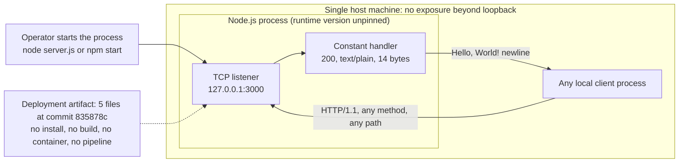

### 3.6.7 Security Implications of the Stack

| Stack element | Security implication | Mitigating factor or exposure |
| --- | --- | --- |
| Zero third-party packages | No dependency vulnerability surface and no install-time script execution | Supply-chain risk is limited to the runtime itself |
| Unpinned Node.js runtime | The deployed runtime may be older or newer than the verified v22.23.5, including out of support | Operator must pin the runtime externally; the repository offers no constraint |
| Plain `http` module, no TLS | Traffic is unencrypted and unauthenticated at the transport layer | Loopback binding keeps it off the network; exposure would require a source change |
| No authentication or authorization | Any local process that can open a socket receives the same response | No sensitive data is served, so disclosure impact is nil |
| No secrets in the tree | Nothing to leak, rotate, or scan for | Configuration is entirely non-secret constants (`server.js:3-4`) |
| No logging beyond one startup line | No request trace exists for incident analysis; absence also means no log-injection or PII-in-logs risk | Acceptable for a fixture, insufficient for a service with callers |
| Unhandled `listen` error | Port conflict crashes the process with a stack trace to stderr; no graceful degradation | Failure is loud and immediate, which suits a test harness |
| No test or CI gate | A behavioral regression would be caught only by the consuming pipeline, not by this repository | `README.md:2` freeze policy is the only control |


## 3.7 References

Every statement in this section rests on one of the sources below. Files were read in full; absences were established by whole-tree searches over all tracked files rather than by inspection of a single manifest.

**Repository files**

- `server.js` — the only executable code: `require('http')` as the repository's sole import (`:1`), the address constants `127.0.0.1` and `3000` (`:3-4`), the single constant handler setting `200`, `Content-Type: text/plain`, and the 14-byte body (`:6-10`), and the `listen` plus readiness log (`:12-14`). Establishes the language, the core-module dependency, the absence of framework code, and the lack of exports.
- `package.json` — package identity `hello_world` 1.0.0 / MIT / author `hxu`, description "Hello world in Node.js", `main` pointing at an absent `index.js`, the single failing `test` script, and the absence of every dependency block, `engines`, and `type` field.
- `package-lock.json` — `lockfileVersion` 3 with a single root `""` entry and no resolved packages, integrity hashes, or `node_modules` entries; proves the empty dependency graph.
- `README.md` — project name `hao-backprop-test` and the "test project for backprop integration. Do not touch!" freeze policy that frames the no-framework, no-new-dependency rationale.
- `test.blitzyignore.txt` — a 0-byte file; establishes that the repository carries no ignore rules despite the filename.
- Repository root (the five-file tree with no subdirectories) — establishes the absence of a `Dockerfile` or Compose file, Terraform or other IaC, a CI workflow directory, a `.gitignore`, and any linter, formatter, bundler, transpiler, or test configuration.
- Git metadata (single commit `835878c` "Add files via upload", `origin` on GitHub, `main` plus QA branches) — establishes the version-control baseline and that no pipeline or hook exists in the repository.

**Runtime observations**

- Executed `node server.js` and `npm start` against `127.0.0.1:3000`, capturing headers and body for `GET /`, `POST /arbitrary/path`, and `GET /nonexistent`, the startup stdout line, and the open file descriptors and child processes of the running process — establishes the response contract, the loopback-only footprint, and the absence of runtime egress.
- Runtime probes reporting Node.js v22.23.5, V8 12.4.254.21-node.57, `NODE_MODULE_VERSION` 127, npm 11.21.3, and `module.builtinModules.includes('http') === true` — establishes the verified runtime and that `http` is a core module.
- `npm ls --all` (empty tree), `npm ci --dry-run` ("up to date"), `npm run` (only `test`), `npm test` (exit `1`), and a second concurrent `node server.js` (unhandled `EADDRINUSE`, exit `1`) — establish install and script behavior plus the port-conflict failure mode.

**Web sources**

- [web] Node.js Release Working Group release schedule (`nodejs/Release` README) — Node.js 22 "Jod" release, Active LTS entry (2024-10-29), Maintenance LTS entry (2025-10-21), and End-of-Life (2027-04-30).
- [web] endoflife.date, Node.js — corroborates the Node.js 22 support phases and end-of-life date.
- [web] npm Docs, `package-lock.json` (CLI v7 and v9) — `lockfileVersion` 3 originated with npm 7 and is readable by npm ≥ 7.
- [web] npm Docs, CLI v9 changelog — npm 9 made `lockfileVersion` 3 the default for `package-lock.json`.
- [web] Node.js v15.0.0 and v18.14.0 release notes — npm 7.0.0 shipped with Node.js 15.0.0; npm 9.3.1 first reached the LTS line with Node.js 18.14.0.


# 4. Process Flowchart

## 4.1 System Workflows


Every workflow in this system is implemented by six executed statements in `server.js`: one `require` (`server.js:1`), two module constants (`server.js:3-4`), one `http.createServer` call that registers a single anonymous handler (`server.js:6-10`), and one `server.listen` call whose callback logs a readiness line (`server.js:12-14`). The handler body sets a status code (`server.js:7`), sets one header (`server.js:8`), and ends the response with a 17-character literal (`server.js:9`). There is no routing layer, no middleware, no service layer, and no data layer, so the process inventory is short and every step below is both readable in the source and reproducible by running the process.

Within repository code there are no decision statements at all. A `git grep` over all five tracked files counted zero occurrences of `try`, `catch`, `throw`, `if`, `else`, `switch`, `while`, `return`, `async`, `await`, `Promise`, `server.on`, `process.on`, `setTimeout`, `setInterval`, `process.env`, or `req.`; the only control-flow-bearing file is `server.js`, and a pattern search for `try|catch|if |else|while|for |switch|return|throw` across `*.js` returned no hits. Every branch that a caller can observe — bind success or failure, accepted or rejected request, body sent or suppressed, connection kept alive or closed — is evaluated by Node.js built-in modules, not by code in this repository. Sections 4.1.1 and 4.4 attribute each decision to the layer that makes it.

### 4.1.1 Core Business Processes

#### Workflow inventory

| Workflow ID | Process | Trigger | Implemented steps and evidence |
| --- | --- | --- | --- |
| WF-01 | Process bootstrap | `node server.js`, or `npm start` which falls back to the same command | Load module → `require('http')` (`server.js:1`) → assign `hostname`/`port` (`server.js:3-4`) → `http.createServer` registers the handler (`server.js:6-10`) → `server.listen(port, hostname, cb)` (`server.js:12`) → callback logs `Server running at http://127.0.0.1:3000/` (`server.js:13`) → process idles in the event loop |
| WF-02 | Request service | Any accepted TCP connection carrying a request the parser accepts | Parser emits `request` → handler sets `res.statusCode = 200` (`server.js:7`) → sets `Content-Type: text/plain` (`server.js:8`) → `res.end('Hello, World!\n')` (`server.js:9`); Node adds `Date`, `Connection`, `Keep-Alive`, `Content-Length: 14` — all observed on the wire |
| WF-03 | Port conflict failure | Port `127.0.0.1:3000` already bound when `listen` runs | `listen` emits an `error` event with no subscriber → uncaught exception → stack trace on stderr → exit code `1`; a running instance keeps serving (`server.js:12`, observed) |
| WF-04 | Process termination | `SIGINT`, `SIGTERM`, or external kill | Default signal disposition; no handler exists, so the process exits immediately with no log line, no drain, and no `server.close()`; `SIGINT` observed to exit `130` with the log unchanged |
| WF-05 | Package tooling | `npm test`, `npm start`, `npm ci` | `npm test` prints `Error: no test specified` and exits `1` (`package.json:7`); `npm start` launches `node server.js`; `npm ci` resolves nothing (`package-lock.json:6-11`) |

WF-01 and WF-02 are the only processes that produce the system's intended effect. WF-03 and WF-04 are the complete set of process-level exits, and WF-05 covers the manifest surfaces documented in section 3.6.2.

#### End-to-end user journeys

The system supports exactly one journey. There is one actor at runtime — a same-host HTTP client — plus the operator who starts and stops the process.

| Step | Actor | Action | Observable result |
| --- | --- | --- | --- |
| 1 | Operator | Runs `node server.js` (or `npm start`) | Process starts; nothing is installed or built first, because the only import is a built-in module (`server.js:1`) |
| 2 | Runtime | Binds `127.0.0.1:3000` and invokes the listen callback | stdout receives exactly `Server running at http://127.0.0.1:3000/` (`server.js:13`, observed) |
| 3 | Client | Opens a TCP connection to `127.0.0.1:3000` and sends a request | Connection accepted; loopback-only bind means an off-host attempt to `10.11.0.21:3000` was refused (curl exit `7`) |
| 4 | Runtime | Parses the request and emits `request` | Request line, headers, query, and body are available on `req` and are never read |
| 5 | Handler | Writes status, header, and body | `200`, `Content-Type: text/plain`, 14 bytes `Hello, World!\n` (`server.js:7-9`, observed) |
| 6 | Runtime | Serializes and applies connection rules | Adds `Date`, `Connection: keep-alive`, `Keep-Alive: timeout=5`, `Content-Length: 14`; no `Server` header is sent |
| 7 | Client | Receives the response | Byte-exact body; a second request reuses the same socket (`Re-using existing connection` observed) |
| 8 | Operator | Terminates the process | Immediate exit; `SIGINT` observed at exit code `130` with no shutdown output |

Journey variants change nothing but the framing. `POST /deep/path?x=1` with a body, `GET /nonexistent`, and `HEAD /` all complete steps 3-6 identically; `HEAD` differs only in that Node suppresses the body and omits `Content-Length` (observed). A 5,000,000-byte `POST` body returned the same 14 bytes in 3.09 ms, because the body is never consumed.

#### System interactions

| Interaction | From → To | Mechanism in this repository | Evidence |
| --- | --- | --- | --- |
| Connect | Client → listener | TCP handshake against the literal bind address | `server.js:3-4`, `server.js:12` |
| Dispatch | Listener → handler | Node's HTTP server emits `request` for each parsed message; the handler is the only subscriber | `server.js:6` |
| Respond | Handler → response socket | Three writes: `statusCode`, `setHeader`, `res.end` | `server.js:7-9` |
| Report readiness | Process → stdout | One `console.log` inside the listen callback; nothing is logged per request | `server.js:13` |
| Persist | Handler → anywhere | No interaction exists: no datastore, filesystem, cache, broker, or outbound socket | zero matches for `fs.`, `process.env`, `fetch`, `axios`, `http.request`, `net.`, `dns.` across all tracked files |

#### Decision points

| Decision | Evaluated by | Outcomes | Evidence |
| --- | --- | --- | --- |
| D-01 — Can the fixed address and port be bound? | Node/OS inside `server.listen` | Bound → readiness line; refused → `EADDRINUSE`, exit `1` | `server.js:12`; both outcomes observed |
| D-02 — Is the request valid HTTP? | Node HTTP parser, outside repository code | Valid → handler runs; malformed → runtime answers `400 Bad Request` with `Connection: close` | raw `NOTAMETHOD / HTTP/9.9` probe returned `400`; application log unchanged |
| D-03 — Do header fields fit the parser limit? | Node HTTP parser (16 KiB default) | Within limit → handler runs; exceeded → runtime answers `431` | 20 KB `X-Long` header probe returned `431` |
| D-04 — Is the method `HEAD`? | Node response serializer | `HEAD` → headers only, no `Content-Length`; any other verb → body sent | `HEAD /` and `GET /` compared live |
| D-05 — Keep the connection open? | Node connection management | HTTP/1.1 → `keep-alive` with `timeout=5`; HTTP/1.0 or explicit `close` → socket closed after the response | both observed; idle socket closed at 6010 ms |
| D-06 — Does path, method, query, or body change the outcome? | Nothing — no such code exists | Always identical response | zero branch statements in `*.js`; F-001-RQ-001 and F-001-RQ-002 in section 2.2.2 |

D-06 is the defining property of the flow: the only in-application decision is that there is none. Path, verb, headers, and body are bound to `req` and never inspected.

#### Error handling paths

| Error path | Origin | Observed system behaviour | Application response |
| --- | --- | --- | --- |
| E-01 Port already in use | `listen` | `Error: listen EADDRINUSE: address already in use 127.0.0.1:3000` on stderr, unhandled `error` event, exit `1` | None — no `server.on('error')` subscriber (`server.on` count 0) |
| E-02 Malformed request | Node parser | `400 Bad Request`, connection closed | None — handler is never invoked |
| E-03 Oversized header | Node parser | `431 Request Header Fields Too Large` | None — handler is never invoked |
| E-04 Client abort mid-request | Socket layer | Connection torn down; server stayed alive and answered the next request `200` with no log output | None — no socket error listener |
| E-05 Operator termination | Signal | Immediate exit, `130` on `SIGINT` | None — no signal handler, no graceful close |
| E-06 Exception inside the handler | Handler | Cannot occur today: no `throw`, no awaited call, no I/O that can reject. If introduced, the process would die, since no `try/catch`, `uncaughtException`, or `unhandledRejection` handler exists (counts 0) | None |

E-06 is a latent path rather than an active one: the handler's three statements cannot fail, which is why a repository with no error handling produces no errors in practice.

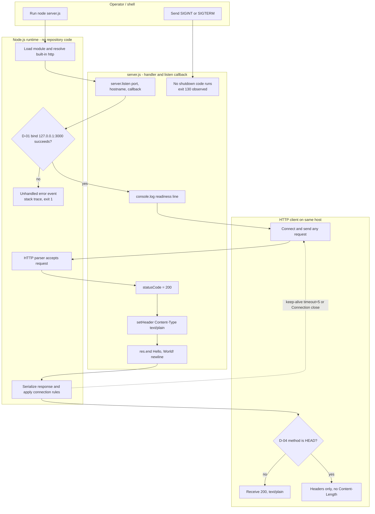

### 4.1.2 Integration Workflows

#### Data flow between systems

The system boundary is a single TCP socket on the loopback interface. Exactly four data elements cross it, and only two of them are produced by repository code.

| Data element | Direction | Handled by | Fate |
| --- | --- | --- | --- |
| Request line, headers, query string | Inbound | Node HTTP parser, then bound to `req` | Never read: `req.` has zero occurrences in the repository |
| Request body (any size, any encoding) | Inbound | Node socket buffers | Discarded unread; a 5 MB body was answered in 3.09 ms with the constant reply |
| Status line and response headers | Outbound | Handler (`server.js:7-8`) plus Node serializer | `200`, `Content-Type: text/plain`, with Node supplying `Date`, `Connection`, `Keep-Alive`, `Content-Length: 14` |
| Response body | Outbound | Handler literal (`server.js:9`) | 14 bytes `Hello, World!\n`, identical for every request |

No other data crosses any boundary: there are no files written or read, no database or cache client, no message broker, no telemetry exporter, and no outbound HTTP call anywhere in the tree.

#### API interactions

| Interface | Direction | Contract | Authentication and limits |
| --- | --- | --- | --- |
| HTTP on `127.0.0.1:3000` | Inbound | Any method, any path, any query, any body → `200 text/plain`, `Hello, World!\n` | None: no auth, no authorization, no rate limit, no request-size limit beyond Node's parser limits |
| Outbound network calls | None | No client library or socket call exists (`fetch`, `axios`, `http.request`, `https`, `net.`, `dns.` all zero) | Not applicable |
| Datastore or broker | None | No driver, ORM, connection string, or queue client | Not applicable |
| npm registry | Tooling only, outside runtime | `package-lock.json` resolves zero packages, so no fetch occurs at install or start | Not applicable |

Interface stability is total because the response is a compile-time literal: there is no schema, no content negotiation, no versioning header, and no deprecation path (F-001-RQ-003 and F-001-RQ-005 in section 2.2.2).

#### Event processing flows

| Event | Emitter | Subscriber in this repository | Resulting behaviour |
| --- | --- | --- | --- |
| `request` | `http.Server` | The single handler passed to `http.createServer` (`server.js:6`) | Sets status and header, ends response |
| `listening` | `http.Server` | Callback passed to `server.listen` (`server.js:12-14`) | Writes the readiness line once |
| `error` | `http.Server` | None | Process throws and exits `1` (E-01) |
| Socket `timeout` / `close` | Connection socket | None | Node's own 5-second keep-alive timer closes an idle connection; observed closure at 6010 ms |
| Process signals | `process` | None (`process.on` count 0) | Default termination (E-05) |

There is no pub/sub substrate, no webhook receiver, no polling loop, and no event replay: the only events in the system are Node's own emitter callbacks on the one server instance.

#### Batch processing sequences

No batch construct exists anywhere in the repository. The absence is complete rather than partial:

| Batch construct | Present? | Evidence |
| --- | --- | --- |
| Scheduled job or cron entry | No | zero matches for `cron`, `schedule`, `setInterval`, `setTimeout` |
| Worker, queue, or consumer loop | No | zero matches for `queue`, `worker`, `consumer`, `job`, `batch` |
| Filesystem or datastore scan | No | zero matches for `fs.`, `readFile`, `writeFile`, `stream` |
| Bulk or paginated API call | No | no outbound client exists at all |

The only repetition in the system is per-request event-loop work, which is unbounded in count but identical in content; 50 concurrent requests each returned `200`.

#### Integration with the consuming pipeline

The one integration this repository participates in is out-of-process and documented as F-004 in section 2.1.5: an external "backprop integration" pipeline consumes the repository as a fixture (`README.md:2`). It transfers no runtime data, so its workflow is a provisioning-and-assertion sequence rather than a network integration.

| Step | Pipeline action | Repository-side behaviour | Evidence |
| --- | --- | --- | --- |
| 1 | Provision the checkout at commit `835878c` | Five files, no generated artifacts; `npm ci` resolves nothing | `package-lock.json:6-11`; commit history |
| 2 | Launch `node server.js` | Binds `127.0.0.1:3000` and writes the readiness line to stdout | `server.js:12-14`; observed |
| 3 | Wait for readiness | Only signal available is the stdout line; no health or readiness endpoint exists | F-002-RQ-003 in section 2.2.3 |
| 4 | Issue one or more requests over loopback | Returns `200 text/plain` with 14 bytes, regardless of request content | `server.js:6-10`; observed |
| 5 | Terminate the process | Immediate exit on signal; no drain | E-05 above |
| 6 | Detect regression | No in-repo gate: `npm test` exits `1` by construction, so a behavioral change surfaces only in the pipeline | `package.json:7`; F-004-RQ-003 |

Steps 3 and 6 are the integration's weak points: readiness and regression detection both depend on conventions outside the repository, which constraint C-04 in section 2.6.2 records.


## 4.2 Flowchart Requirements


The workflows defined in section 4.1 are linear. Each has one start point, a fixed sequence of statements, and one end point, with decision diamonds appearing only where a Node.js built-in module or the operating system decides the outcome. The tables below record, per workflow, every element a flowchart must show — start and end points, process steps, decision diamonds, system boundaries, user touchpoints, error states, and recovery paths — plus the timing and validation rules that apply at each step. All diagrams produced from these requirements appear in section 4.4.

### 4.2.1 Workflow Element Inventory

#### Element matrix

| Flowchart element | WF-01 Process bootstrap | WF-02 Request service | WF-03 / WF-04 Failure and termination |
| --- | --- | --- | --- |
| Start point | Operator runs `node server.js` or `npm start` | Connection accepted carrying a request the parser accepts | `listen` fails on a bound port, or the operator signals the process |
| End point | Readiness line written; process idles in the event loop | Response flushed; socket kept alive or closed | Exit code `1` on `EADDRINUSE`; exit code `130` on `SIGINT` |
| Process steps | Module load, `require('http')`, constant assignment, `createServer`, `listen`, readiness log (`server.js:1-14`) | `statusCode = 200`, `setHeader`, `res.end` (`server.js:7-9`) | One runtime path per cause; no application statements execute |
| Decision diamonds | D-01 bind succeeds? | D-02 valid HTTP?, D-03 header size?, D-04 `HEAD`?, D-05 keep-alive? | None — no alternative path exists |
| System boundaries | Process ↔ operating system (port bind) | Process ↔ loopback socket | Process ↔ stderr and exit status |
| User touchpoints | Operator stdout; npm script surface | Client socket and response body | Operator console; pipeline exit-code check |
| Error states | E-01 | E-02, E-03, E-04, E-06 | E-01, E-05 |
| Recovery path | Operator frees the port and restarts | None required; server state unaffected | Operator or pipeline restarts the process |

#### System boundaries

| Boundary | Inside | Outside | Evidence |
| --- | --- | --- | --- |
| Process | One Node.js process running `server.js`; no module exports, so the file cannot be embedded in another process | Any other process on the host | `module.exports` count 0; `server.js` runs only for its side effects |
| Network | Loopback socket `127.0.0.1:3000` | Host interface `10.11.0.21` and every off-host client; connection refused when probed | `server.js:3-4`; curl exit `7` against `10.11.0.21:3000` |
| Package | Five tracked files at commit `835878c`; zero resolved dependencies | npm registry, which is never contacted | `package-lock.json:6-11`; `server.js:1` imports a built-in only |
| Data | Nothing — no datastore, filesystem, cache, or broker | Any storage subsystem | zero matches for `fs.`, `process.env`, `database`, `cache`, `queue` |

The network boundary is the only one that carries traffic, and it is one-directional in terms of code: Node reads the request framing, the handler writes a constant.

#### User touchpoints

| Touchpoint | Actor | Form | Evidence |
| --- | --- | --- | --- |
| Readiness signal | Operator or pipeline | Single stdout line `Server running at http://127.0.0.1:3000/` | `server.js:13`; observed once per start |
| Request/response | Same-host HTTP client | Any method and path on `127.0.0.1:3000`; constant `200` reply | `server.js:6-10`; observed for GET, POST, HEAD |
| Process control | Operator or supervisor | `SIGINT` / `SIGTERM` with default disposition | observed exit `130` on `SIGINT` |
| Tooling surface | Developer | `npm start` (fallback to `node server.js`), `npm test` (exits `1`) | `package.json:6-8`; observed |
| Fixture identity | Consumer of the repository | Two-line `README.md` naming the project and freezing changes | `README.md:1-2` |

#### Decision diamonds per diagram

| Diagram (section 4.4) | Diamonds shown | Actor lanes | Note |
| --- | --- | --- | --- |
| 4.4.1 High-level system workflow | D-01, D-02, D-03, D-05 | Operator, runtime, application, client | Shows both the serving path and the bind-failure path |
| 4.4.2 F-001 request handler | D-04, plus an explicit "no branch" node for D-06 | Client, runtime, handler | Makes visible that path, method, query, and body are not evaluated |
| 4.4.2 F-002 listener bootstrap | D-01 | Operator, runtime, application | Failure edge terminates in exit `1` |
| 4.4.2 F-003 package contract, F-004 baseline | None | Developer, pipeline | Purely sequential; no runtime decision exists |
| 4.4.3 Error handling | D-01, D-02, D-03 | Runtime, application, operator | One terminal node per error state E-01…E-06 |
| 4.4.4 Integration sequence | None | Pipeline, operator, process, client | Timing marks for readiness, request, keep-alive close |
| 4.4.5 State transition | D-01 and D-05 as transition guards | — | Five process states, two of them terminal |

#### Error states and recovery paths

| Error state | Recovery path implemented in code | Who recovers | Evidence |
| --- | --- | --- | --- |
| E-01 `EADDRINUSE` | None — no `error` listener, no retry, no alternate port | Operator or pipeline, by freeing the port and restarting | `server.js:12`; exit `1` observed |
| E-02 Malformed request | None needed — runtime answers `400` and closes | Client, by correcting the request | raw-probe response `400 Bad Request` |
| E-03 Oversized header | None needed — runtime answers `431` | Client, by reducing header size | 20 KB header probe returned `431` |
| E-04 Client abort mid-request | None — no socket error listener | Client, by reconnecting; server state unaffected | server answered the next request `200` after an aborted POST |
| E-05 Signal termination | None — no drain or `server.close()` | Operator or supervisor, by restarting | exit `130` on `SIGINT`, log unchanged |
| E-06 Latent handler exception | None — no `try/catch`, no `uncaughtException` handler | Nobody; the process would exit | zero matches for `try`, `catch`, `uncaughtException`, `unhandledRejection` |

The repository contains no automatic recovery of any kind: `retry`, `backoff`, `reconnect`, `restart`, `resume`, and `dead-letter` all have zero occurrences in the tracked files. Recovery is always external to the process.

### 4.2.2 Timing and SLA Considerations

No service-level objective, latency target, availability target, or throughput target is recorded anywhere in the repository, which constraint C-07 in section 2.6.2 states. The figures below are measurements from a live instance on Node.js v22.23.5 and exist to bound the flowcharts, not to represent commitments.

| Timing aspect | Observed value | Measurement basis |
| --- | --- | --- |
| Startup to readiness line | 33-41 ms across five runs | Spawn `node server.js`, poll stdout every 5 ms until the line appears |
| Single request, loopback | 0.416-0.833 ms per request | Ten sequential `curl` GETs reporting `time_total` |
| 200 concurrent requests | 58 ms total, 200 of 200 answered `200` | Node client with `keepAlive` agent and 200 sockets |
| 500 sequential requests | 2704 ms total, about 5.4 ms each | Sequential `curl` invocations, dominated by client process startup rather than server work |
| 5 MB request body | Response in 3.09 ms | `POST` of 5,000,000 bytes; body never read |
| Keep-alive idle window | Advertised `Keep-Alive: timeout=5`; socket closed at 6010 ms | Raw socket held idle after one response |
| Termination | Immediate; no drain interval | `SIGINT` observed, log unchanged |

Four timing dependencies govern whether a workflow completes:

- **Readiness precedes traffic.** Nothing listens before `server.listen` returns, and the only readiness signal is the stdout line written inside the listen callback (`server.js:12-14`). A client that connects before that line appears gets a refused connection.
- **Port availability precedes bind.** A second instance fails during `listen`, before any request is served, so a supervisor must treat exit `1` as a startup failure rather than a request failure.
- **Parser windows precede the handler.** No timeout is configured in the repository (`setTimeout` and `setInterval` have zero occurrences), so Node's default header and request timeouts govern an incomplete request. The handler itself has no deadline because it performs no I/O.
- **Keep-alive reuse has a five-second horizon.** A client reusing a connection must send its next request within the advertised five seconds, or the socket is closed and the client must reconnect.

| SLA domain | Target defined | Consequence for the flowchart |
| --- | --- | --- |
| Availability | None | No health probe, retry, or failover step can be drawn |
| Latency | None | Latency nodes shown as measurements only, not thresholds |
| Throughput / capacity | None | No queue, backpressure, or admission-control step exists |
| Error rate | None | The handler cannot fail by construction; runtime-level `400`/`431` are not counted or logged |
| Recovery time | None | Recovery is an operator action outside the process |

### 4.2.3 Validation Rules

Validation in this system is protocol-level and delegated entirely to Node.js. The application applies three unconditional output rules and performs no input validation, which is consistent with F-001-RQ-005 in section 2.2.2: request headers, body, and query are present but never read.

| Step | Business rule enforced by code | Data validation performed | Authorization and compliance checkpoint |
| --- | --- | --- | --- |
| S-1 Bind `127.0.0.1:3000` | Address and port are fixed constants; no alternative is attempted | None — nothing is read from environment, file, or arguments (`process.env` count 0) | None; loopback binding is the only access control (C-02) |
| S-2 Admit request | No admission rule exists; every parser-accepted request proceeds | Delegated to Node's HTTP parser: malformed → `400`, headers over the parser limit → `431` | None; no authentication, no authorization, no rate limit |
| S-3 Compose response | Status is always `200`, header always `text/plain`, body always the same 14 bytes (`server.js:7-9`) | None — the body is a compile-time literal, so it cannot vary with input | None; no CORS, CSP, or other hardening header is sent |
| S-4 Handle connection | Connection lifetime follows the client's protocol version and `Connection` header | None | None |
| S-5 Terminate | No shutdown rule is implemented | None | None |

#### Rule inventory

| Rule ID | Rule | Enforced | Evidence |
| --- | --- | --- | --- |
| VR-01 | Every request receives status `200` | Yes — hard-coded assignment | `server.js:7`; verified for GET, POST, PUT, HEAD, unknown paths |
| VR-02 | The response body is exactly `Hello, World!\n` (14 bytes) | Yes — string literal | `server.js:9`; `Content-Length: 14` and byte comparison observed |
| VR-03 | The response declares `text/plain` with no charset | Yes — single `setHeader` call | `server.js:8`; observed |
| VR-04 | Request input is never parsed, validated, echoed, or stored | Yes — `req` is never dereferenced | `req.` count 0; a `POST` carrying a probe marker returned only the constant |
| VR-05 | No authorization checkpoint exists at any step | Yes, by absence — any same-host process is served identically | no auth, token, session, or cookie code in the tree |
| VR-06 | No payload ceiling or rate limit is enforced by the application | Yes, by absence — only Node's parser header limit applies | 5 MB body accepted; `limit`, `rate`, `throttle` have zero occurrences |
| VR-07 | No transport security is applied | Yes, by absence — plain `http`, no TLS option passed to `listen` | `server.js:1`, `server.js:12` |
| VR-08 | No per-request audit trail exists | Yes, by absence — the only log statement is the startup line | `console.` count 1, at `server.js:13` |

#### Compliance posture

| Concern | Position | Evidence |
| --- | --- | --- |
| Licence obligations | MIT, with no bundled third-party code, so no attribution file is required | `package.json:10`; `package-lock.json` resolves zero packages |
| Personal or regulated data | None collected, stored, or transmitted; the only data is a source literal, so privacy regimes have no data flow to govern | `server.js:9`; no datastore or filesystem access |
| Access control obligations | Satisfied only by network scoping: the listener cannot be reached off-host, and no credential exists to protect | `server.js:3`; off-host connection refused |
| Audit and retention | Not applicable — nothing is logged per request and nothing is stored | `console.` count 1; no `fs.` usage |

Because the response is a literal and the request is never read, the flowchart for every step in S-2 and S-3 contains no branch that input could influence. The only input-dependent branch in the entire system belongs to the HTTP parser in the runtime, and it terminates the exchange rather than altering the response.


## 4.3 Technical Implementation


The implementation contains no state machine, no persistence, and no error-handling construct. Its Technical Implementation section is therefore an inventory of what the process holds in memory, how Node's event loop sequences the work, and which mechanisms are absent. Each absence below was confirmed by counting occurrences across all five tracked files.

### 4.3.1 State Management

#### Process state transitions

| State | Entered when | Observable signal | Exit transition |
| --- | --- | --- | --- |
| Created | Process spawned by `node server.js` or npm's fallback | None; no output before module evaluation | Module evaluation completes → Binding |
| Binding | `server.listen(port, hostname, cb)` executes (`server.js:12`) | None | Bind succeeds → Listening; bind fails → Bind-failed |
| Listening | The bind completes and the callback runs (`server.js:13`) | Single stdout line `Server running at http://127.0.0.1:3000/` | External signal → Terminated |
| Bind-failed | `listen` emits `error` with no subscriber | stderr stack trace ending in `code: 'EADDRINUSE'`; exit code `1` | Terminal |
| Terminated | `SIGINT`, `SIGTERM`, or external kill | Exit code `130` observed for `SIGINT`; no shutdown output | Terminal |

Two of the five states are terminal, and no transition is initiated by application code: `Created → Binding` and `Binding → Listening` are module-evaluation side effects, `Binding → Bind-failed` is an operating-system refusal, and `Listening → Terminated` is a signal. The corresponding state diagram is in section 4.4.5.

#### Connection state transitions

| Connection state | Entered when | Observable evidence | Exit |
| --- | --- | --- | --- |
| Accepted | TCP handshake completes on `127.0.0.1:3000` | Connection established | Request parsed → Responded |
| Responded | `res.end` has flushed the 14 bytes (`server.js:9`) | `200`, `Content-Type: text/plain`, `Content-Length: 14` | Idle (keep-alive) or Closed |
| Idle | HTTP/1.1 client with no `Connection: close` | `Keep-Alive: timeout=5` header | Server closes after 5 s idle (observed at 6010 ms) or next request → Responded |
| Closed | HTTP/1.0, explicit `close`, idle timeout, parse error, or client abort | `Connection: close` on HTTP/1.0 responses; silent teardown on abort | Terminal |

Connection state lives entirely inside Node's HTTP implementation. The handler holds no reference to the socket, the request, or the response after `res.end` returns, so no connection carries application state from one request to the next.

#### Data persistence points

| Persistence mechanism | Present | Evidence |
| --- | --- | --- |
| Database, ORM, or schema | No | zero matches for `database`, `schema`, `migration`, `orm`, driver names |
| Filesystem read or write | No | zero matches for `fs.`, `readFile`, `writeFile`, `stream` |
| Cache or key-value store | No | zero matches for `cache`, `redis`, `memcached`, `session` |
| Message queue or event log | No | zero matches for `queue`, `broker`, `producer`, `consumer`, `kafka` |
| In-memory mutable state | No | all four bindings are `const` (`server.js:1,3,4,6`); no `let`, `var`, counter, or map exists |
| Cookie, token, or session store | No | zero matches for `cookie`, `token`, `session`, `jwt` |

The only data the process retains is what it was compiled with: the address and port constants (`server.js:3-4`) and the body literal (`server.js:9`). A restart therefore loses nothing, which is why restart is unconditionally safe for this system.

#### Caching requirements

| Caching layer | Requirement | Evidence |
| --- | --- | --- |
| Application response cache | None — nothing is computed, so nothing can be cached | `server.js:7-9`; no cache client |
| HTTP cache validators | None — no `Cache-Control`, `ETag`, `Last-Modified`, or `Expires` header is sent | observed response headers contain only `Content-Type`, `Date`, `Connection`, `Keep-Alive`, `Content-Length` |
| Connection reuse | Only reuse mechanism present — the 5-second keep-alive window | `Keep-Alive: timeout=5` observed; socket closed at 6010 ms |
| DNS or client caching | Not applicable — the bind address is a literal | `server.js:3` |

#### Transaction boundaries

The unit of work is a single `res.end` call (`server.js:9`), and it is the only boundary that exists:

- There is no multi-step operation, so there is nothing to commit or roll back; the response is fully determined before the socket is touched.
- One `res.end` call means the HTTP message is written once by Node, so a client sees a complete response or no response — never a partial application state.
- No external resource participates, so there is no distributed transaction, no two-phase commit, and no compensating action.
- No idempotency key or de-duplication exists, because repeated requests are indistinguishable and produce identical output.

#### Concurrency and sequencing

The handler is synchronous with no `await`, callback, or promise inside it (counts: `async` 0, `await` 0, `Promise` 0). Each request therefore runs to completion within one event-loop turn, and there is no shared mutable state to lock. Because nothing blocks on I/O, the only queueing that can occur is connection acceptance. Two hundred concurrent requests all returned `200` in 58 ms, and 50 parallel `curl` requests all returned `200`, which is consistent with a handler that completes immediately.

### 4.3.2 Error Handling

#### Mechanism inventory

| Error-handling mechanism | Present | Evidence |
| --- | --- | --- |
| `try` / `catch` / `finally` | No | zero occurrences across all tracked files |
| `server.on('error')` listener | No | `server.on` count 0 |
| `process.on('uncaughtException')` or `'unhandledRejection'` | No | `process.on` count 0 |
| Retry, backoff, or attempt loop | No | zero matches for `retry`, `backoff`, `attempt`, `reconnect` |
| Fallback port, host, or static response | No | `server.js:3-4` are literals; `server.js:12` has no second argument set |
| Configured timeout or deadline | No | `setTimeout` and `setInterval` counts 0; no timeout option passed to `listen` |
| Structured logging or error logger | No | single `console.log` at `server.js:13`; no logging library |
| Metrics, alerting, health, or readiness endpoint | No | no route exists; the readiness signal is the stdout line |
| Graceful shutdown or `server.close()` | No | `server.close` count 0; exit `130` observed on `SIGINT` |

#### Error classification and observed outcomes

| Error class | Trigger | Detected by | Outcome |
| --- | --- | --- | --- |
| Protocol | Malformed request line or oversized header | Node HTTP parser (`clientError` default handling) | `400 Bad Request` with `Connection: close`, or `431`; socket destroyed; nothing logged |
| Infrastructure | Port `127.0.0.1:3000` already bound | Node `listen` error event | Unhandled error, stack trace on stderr, exit `1`; no serving |
| Connection | Client aborts mid-request | Socket layer | Connection torn down silently; server survives and serves the next request |
| Application | None possible — the handler performs no failing operation | — | Latent: an exception would terminate the process, since no handler exists |
| Operator | `SIGINT`, `SIGTERM` | Operating system | Immediate exit, `130` observed for `SIGINT` |

#### Notification flows

The system emits exactly two kinds of machine-visible failure signal, and neither is structured:

- **stderr stack trace on `listen` failure.** The observed text identifies `code: 'EADDRINUSE'`, `errno: -98`, `syscall: 'listen'`, `address: '127.0.0.1'`, `port: 3000`, and closes with the runtime banner `Node.js v22.23.5`. There is no timestamp, severity, correlation ID, or request context.
- **Process exit status.** `1` for a bind failure and `130` for `SIGINT` are the only exit codes the system can produce; a supervisor must treat any exit as fatal, because no restart loop exists inside the process.

Request-level failures produce no notification at all: a `400` or `431` is generated and forgotten, and a client abort writes nothing. There is no log aggregation, no metrics counter, no alert hook, and no way to reconstruct a request history from the process.

#### Recovery procedures

The procedures below follow from observed behaviour; each is performed outside the process, because the repository implements no recovery path.

| Symptom | Signal observed | Recovery steps | Verification |
| --- | --- | --- | --- |
| Start-up exits immediately | stderr `EADDRINUSE` and exit `1` | Identify and stop the process holding `127.0.0.1:3000`, then rerun `node server.js` | Readiness line appears; a probe request returns `200` |
| Process must be stopped | None; termination is silent | Send `SIGINT` or `SIGTERM`; expect exit `130` / `143` | Port becomes free; no shutdown log is written |
| Process died unexpectedly | Exit status only | Restart; no state, cache, or transaction to reconcile | Readiness line appears; response byte-identical |
| Client gets `400` or `431` | Response from the runtime | Correct request framing or header size; no server-side action | Subsequent valid request returns `200` |
| Client gets connection refused | Client-side error | Confirm the process is running and the client runs on the same host | Off-host access is impossible by design (C-02) |
| Pooled connection is unexpectedly closed | Socket closed with no error | Reconnect; the idle horizon is the advertised five seconds | New connection returns `200` |

Restart is the universal recovery, and it is safe without ordering constraints because nothing is persisted: no cache to warm, no queue to drain, no transaction to complete, and no session to migrate.


## 4.4 Required Diagrams


Each diagram below is traced from `server.js` and confirmed against a live process. Lanes represent actors and layers rather than modules, because the application has one module. Diamonds are labelled with the decision identifiers from section 4.1.1 (D-01…D-06) and terminal nodes with the error identifiers from section 4.1.1 (E-01…E-06), so a node in a diagram can be matched to a row in an earlier table. Requirement references use the identifiers established in sections 2.1 and 2.2.

### 4.4.1 High-Level System Workflow

Four lanes show the whole system: the operator who owns the process lifecycle, the Node.js runtime that makes every decision, the `server.js` handler that composes the response, and the same-host client that consumes it.

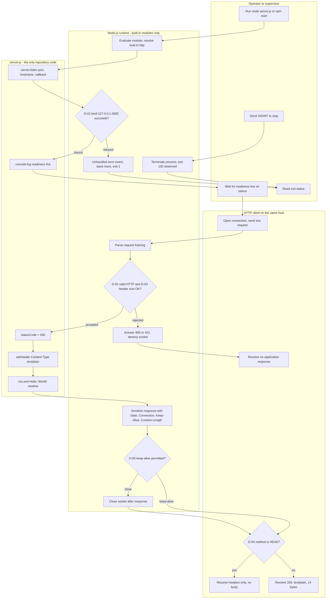

Reading the diagram: only the five app-lane nodes are repository code, and none of them branches. Every diamond belongs to the runtime lane (D-01, D-02, D-03, D-05) or to the client's own choice of verb (D-04). The two paths out of D-01 are the only way the process can fail to start, and they land on exit code `1`; the termination path (E-05) leaves through exit code `130`. Related requirements: F-001-RQ-001…005, F-002-RQ-001…005 (section 2.2.2 and 2.2.3).

### 4.4.2 Detailed Process Flows for Each Core Feature

#### F-001 — Fixed-Response HTTP Request Handler

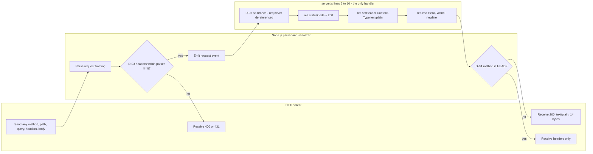

The single path through the handler layer is the feature's complete behaviour: four nodes, no diamond. D-06 is drawn as a process node rather than a diamond precisely because the code contains no condition — the `req` argument is bound and never read. The only request-shaping diamonds sit in the HTTP layer above the handler (E-02, E-03) and after it (E-04 handled by the serializer). Related requirements: F-001-RQ-001…005.

#### F-002 — Loopback Listener Bootstrap

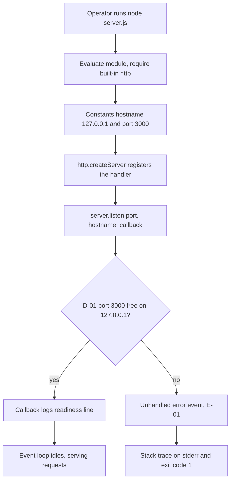

The bootstrap flow has one decision and two terminal states. Readiness is signalled only by the stdout line written inside the listen callback (`server.js:12-14`), so nothing in the application is observable before it. Related requirements: F-002-RQ-001…005; constraint C-06 in section 2.6.2 covers the absent shutdown path.

#### F-003 — Dependency-Free Package Contract

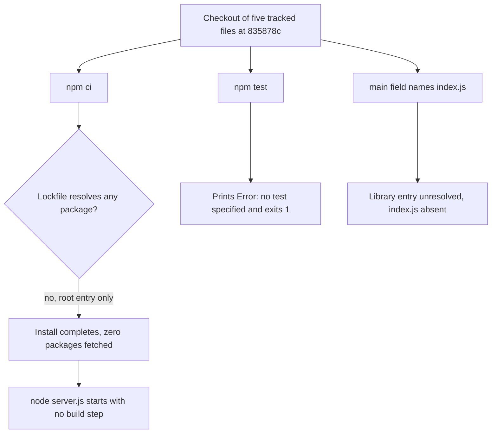

This flow contains no runtime decision at all: the three branches are independent manifest facts — an empty lockfile, a test script that always fails, and a `main` field pointing at a file that does not exist. The last two are the unmet requirements F-003-RQ-003 and F-004-RQ-003 of section 2.2.

#### F-004 — Immutable Integration Baseline

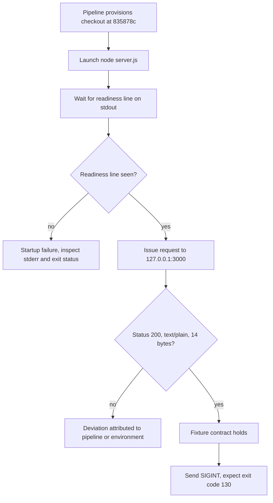

The diamonds in this flow belong to the consuming pipeline, not to the repository: they are the assertions a fixture consumer must make, derived from `README.md:2` and the constant contract in `server.js:7-9`. Because the response cannot vary, a mismatch in Q7 is attributable to the pipeline or its environment rather than to the fixture — the property F-004 exists to provide.

### 4.4.3 Error Handling Flowchart

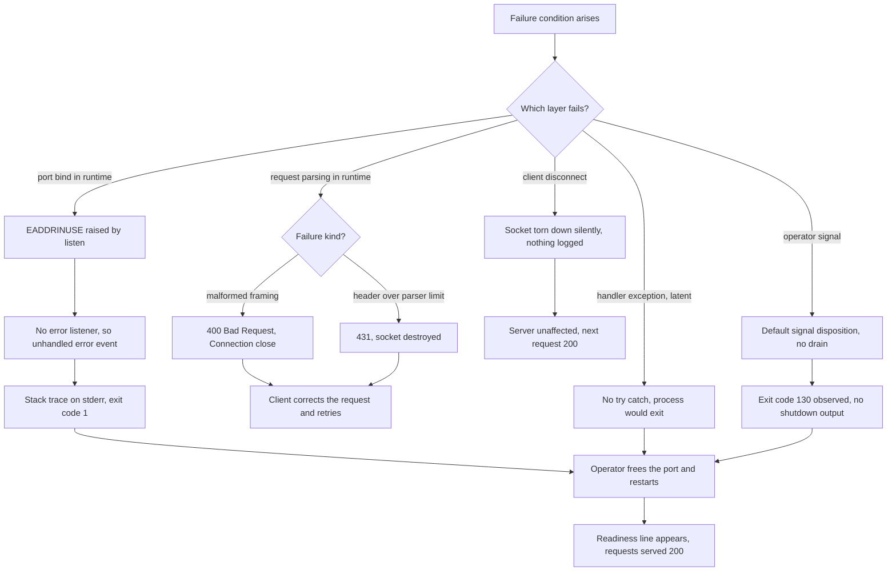

Every branch terminates outside the application: the process either exits (X-4, X-15) or the runtime answers the client without consulting repository code (X-8, X-9). No diamond has an in-application recovery edge, matching the mechanism inventory in section 4.3.2 where retry, fallback, and graceful shutdown all count zero. The lone recovery node, X5, is an operator action.

### 4.4.4 Integration Sequence Diagram

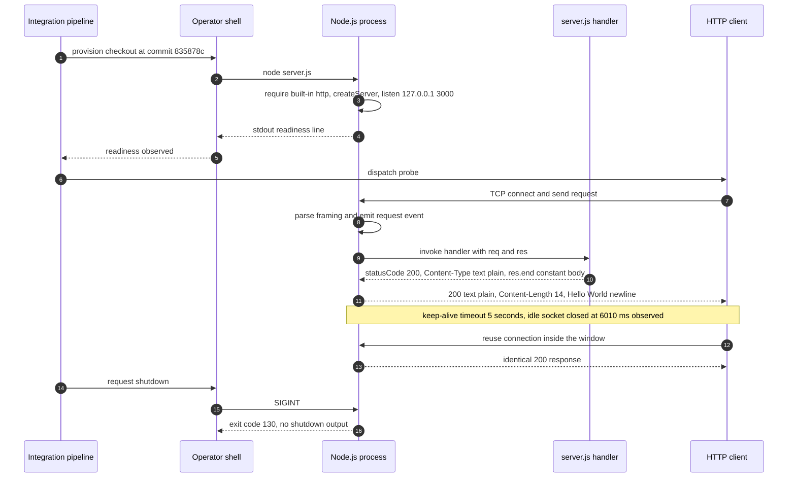

The sequence has one request/response pair per connection and no callback, webhook, or asynchronous continuation. The only timing constraint that affects ordering is the readiness gate (step 4 must precede step 8) and the five-second keep-alive window, both documented in section 4.2.2. No step involves an external service, so the diagram contains no third-party participants.

### 4.4.5 State Transition Diagram

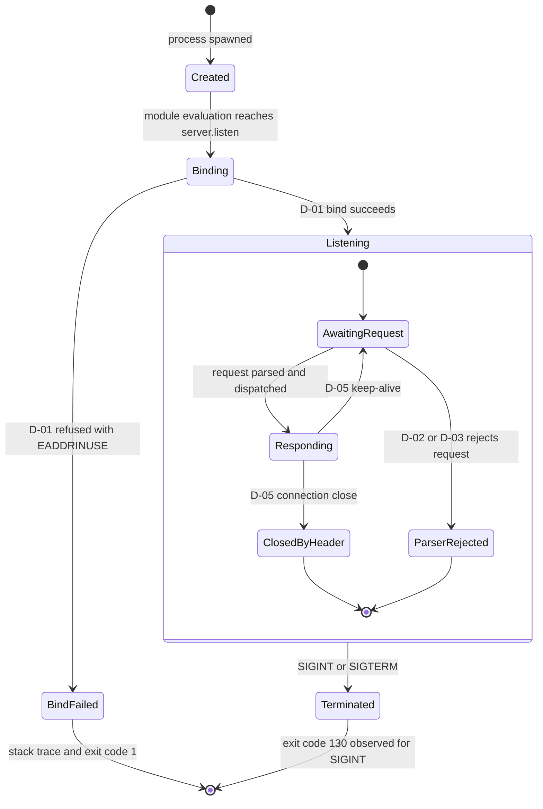

Two levels of state appear here. The outer level is the process lifecycle: `Created → Binding → Listening` on success, `Binding → BindFailed` on a port collision, and `Listening → Terminated` on a signal, with `BindFailed` and `Terminated` terminal. The inner `Listening` composite state is the connection lifecycle, which loops between `AwaitingRequest` and `Responding` for as long as the client keeps the connection inside the five-second window; `ClosedByHeader` and `ParserRejected` end a single connection without affecting the process. No state carries application data, so every transition is reversible only by a restart, and a restart is always safe.


## 4.5 References


- `server.js` — the only executable file; every workflow step, decision attribution, and diagram node in this section is traced to its lines 1-14 (import, constants, handler, listen callback)
- `package.json` — package identity, absent dependency and `engines` keys, the always-failing `test` script (line 7), and the unresolved `main` field (line 5)
- `package-lock.json` — `lockfileVersion: 3` with a root-only `packages` map, establishing the empty dependency graph and zero third-party integration
- `README.md` — the fixture purpose statement ("test project for backprop integration. Do not touch!") that defines the F-004 baseline-consumption workflow
- `test.blitzyignore.txt` — 0-byte placeholder file; confirmed to contribute no executable flow or ignore rules
- repository root (`""`) — five tracked files and zero subdirectories, establishing that no routing, batch, queue, or integration code exists anywhere in the tree
- git history at commit `835878c` — the single commit shared by every local and remote ref, which makes the baseline single-valued for the F-004 flow

No web sources were consulted for this section: every claim derives from the tracked files above and from live probes of the running process on Node.js v22.23.5 (startup, GET/POST/HEAD responses, keep-alive idle close, `EADDRINUSE` failure, `SIGINT` termination, off-host refusal, parser `400`/`431` responses, and client abort).


# 5. System Architecture

## 5.1 High-Level Architecture

### 5.1.1 System Overview

**Architecture style.** The system is a single-process, single-module, stateless request–response monolith in which every piece of protocol machinery is delegated to the Node.js runtime. All application behavior is four statements in one file: a status assignment, a header assignment, a body write (`server.js:7-9`), and a listener registration (`server.js:12-14`). There is no framework, no middleware chain, no router, no service layer, no data layer, and no second module — the repository holds five files totaling 913 bytes, of which exactly one (342 bytes) executes.

The style is deliberate rather than accidental. `README.md:1-2` names the repository `hao-backprop-test` and describes it as a "test project for backprop integration. Do not touch!", so the artifact exists as a stable subject for an external pipeline (assumption A-01 in section 2.6.1). A single file with a constant response is the smallest construct that yields a real HTTP endpoint while leaving nothing that can drift between runs.

**Architectural principles and patterns.**

- **Delegation over composition.** `http.createServer(handler)` (`server.js:6`) hands one function to the runtime; the runtime owns socket acceptance, HTTP parsing, header serialization, keep-alive, and error responses for malformed framing. The application composes nothing.
- **One executable artifact.** Bootstrap and request handling live in the same file with no module boundary, so there is no dependency graph to reason about inside the process.
- **Stateless constant contract.** The response is composed from literals only (`server.js:7-9`); no request field reaches the response, so repeated requests are indistinguishable and the contract is fully declared by three lines (assumption A-04).
- **Zero third-party surface.** The single import is the built-in `http` module (`server.js:1`), and `package-lock.json:6-12` contains only the root package entry — an empty dependency graph (constraint C-03).
- **Buildless, configuration-free operation.** No transpiler, bundler, or compile script exists, and host and port are source constants (`server.js:3-4`) rather than environment input (constraint C-01).
- **Fail fast, never recover.** No `try`/`catch`, no `server.on('error')`, no `process.on(...)`, and no signal handler appear in any tracked file; a port collision ends the process with exit `1` and a `SIGINT` ends it with exit `130` (constraint C-06, detailed in section 4.3.2).
- **Isolation by binding.** The listener is bound to `127.0.0.1` (`server.js:3`), so reachability is limited to the host without any authentication, authorization, or TLS layer (constraint C-02).

Patterns observable in the source are correspondingly few: **callback registration** (the request handler and the listen callback passed as arguments to runtime functions), the **side-effect module** (no `module.exports`, so requiring the file starts a server — constraint C-05), and the **static responder** (a handler that ignores its `req` argument entirely).

**System boundaries and major interfaces.**

| Interface | Contract | Evidence |
| --- | --- | --- |
| Network | TCP listener on `127.0.0.1:3000`, HTTP/1.1 (HTTP/1.0 also answered), any method and any path answered `200` with `text/plain` and the 14-byte body `Hello, World!\n` | `server.js:3-4`, `server.js:6-14`; verified with `GET /`, `POST /deep/path`, `HEAD /`, `GET /no/such/route`, `curl --http1.0` |
| Process lifecycle | Launched as `node server.js`; readiness announced by one stdout line; exit `1` on bind failure and `130` on `SIGINT`; no graceful shutdown | `server.js:12-14`; observed stdout, `EADDRINUSE` exit `1`, and exit `130` |
| Package metadata | Declarative only: identity, entry point, licence; not consumed at runtime, and `main` names an absent `index.js` | `package.json:2-10`, `package-lock.json:6-12` |
| Programmatic | None — the module exports nothing, so it cannot be imported as a library | `server.js` (no `module.exports`) |
| Data | None — the process reads no file, opens no database connection, and holds no mutable state; all bindings are `const` | `server.js:1-14`; zero matches for filesystem, database, cache, or queue APIs |

Inside the boundary sits one OS process, one listening socket, and one constant string. Everything else — the operator, the same-host client, the runtime, and the consuming pipeline — is outside it, as the context diagram shows.

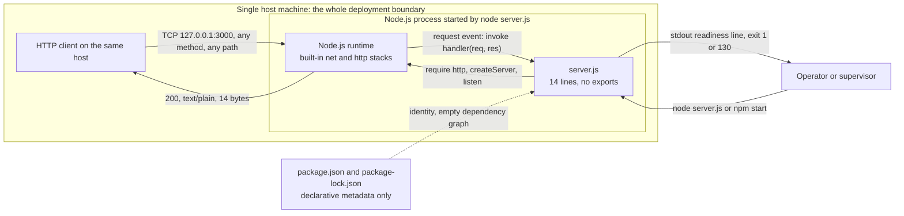

### 5.1.2 Core Components Table

Only two components execute anything: the repository's single module and the Node.js runtime it delegates to. The remaining rows are artifacts whose content constrains how the process behaves, plus the two external actors the architecture exists to serve.

| Component Name | Primary Responsibility | Key Dependencies | Integration Points |
| --- | --- | --- | --- |
| `server.js` request handler (lines 6-10) | Compose the one response: set `statusCode = 200`, set `Content-Type: text/plain`, end with `Hello, World!\n`; ignore the request entirely | The `res` object supplied by the runtime; no other module | Invoked by the runtime's `request` event; writes to the socket through `res.end` |
| `server.js` bootstrap (lines 12-14) | Bind the listener to `127.0.0.1:3000` and print the readiness line from the listen callback | `http` built-in (`server.js:1`); `hostname` and `port` constants (`server.js:3-4`) | OS socket layer for the bind; stdout for readiness; process exit status on failure |
| Node.js runtime (external) | Own the event loop, TCP acceptance, HTTP parsing and serialization, keep-alive (advertised `timeout=5`), and `400`/`431` handling for malformed input | Installed Node.js release, version unpinned by the manifest (assumption A-02) | Loads `server.js` as a CommonJS module; invokes the handler; returns bytes to the client |
| `package.json` | Declare identity (`hello_world` 1.0.0), licence (MIT), the `main` entry, and the single `test` script | None — no dependency block of any kind | Read by npm (`npm test`, `npm start` fallback); ignored by the running server |
| `package-lock.json` | Record the resolved dependency graph, which is empty: `lockfileVersion` 3 with the root entry only | None | Read by `npm ci`/`npm install`, which fetch nothing |
| `README.md` | State the artifact's purpose and the policy that it must not be modified | None | Human reference only; no runtime effect |
| `test.blitzyignore.txt` | Occupy the tree as a 0-byte placeholder | None | None; contributes no behavior |
| Operator or supervisor (external) | Spawn the process, gate on the readiness line, terminate it by signal | Shell or supervisor outside the repository | `node server.js`; stdout/stderr; exit status |
| Same-host HTTP client (external) | Issue the request the fixture exists to answer | Any HTTP client able to reach loopback | TCP `127.0.0.1:3000` |

The Critical Considerations dimension of the component table is carried in the following table so that no table exceeds four columns.

| Component Name | Critical Consideration |
| --- | --- |
| `server.js` request handler | Cannot fail by design but also cannot vary: no path, method, header, or body changes the output, and any future branch would be the first error-handling code in the repository |
| `server.js` bootstrap | Hard-coded address and port make a second instance impossible on the same host — it exits `1` with `EADDRINUSE`; no fallback exists |
| Node.js runtime | The only source of protocol behavior, and the only version-sensitive element: upgrade or downgrade changes the runtime, not the repository (no `engines` field) |
| `package.json` | `main` points at an absent `index.js`, so the manifest's entry contract is unresolved; there is no `start` script, though npm falls back to `node server.js` |
| `package-lock.json` | Vacuous by construction: it proves no supply-chain surface exists, and any added dependency would invalidate that property |
| `README.md` | The freeze policy ("Do not touch!") is enforced by convention only — no hook, check, or pipeline inside the repository |
| `test.blitzyignore.txt` | Easy to mistake for an ignore list; it is empty and has no effect on tooling or runtime |
| Operator or supervisor | Must supply every operational capability the process lacks: restart on exit, readiness gating, and cleanup of a stale port holder |
| Same-host HTTP client | Bounded by the five-second keep-alive idle window; a pooled connection closed at that horizon must be re-established |

### 5.1.3 Data Flow Description

**Primary flows.** Three flows exist, and each is short enough to trace end to end.

1. **Startup.** The operator executes `node server.js`. CommonJS evaluation resolves the single built-in import (`server.js:1`), binds the two constants (`server.js:3-4`), registers the handler with `http.createServer` (`server.js:6`), and calls `server.listen(3000, '127.0.0.1', cb)` (`server.js:12`). On success the callback writes `Server running at http://127.0.0.1:3000/` to stdout (`server.js:13`); on failure the runtime raises an `error` event that nobody subscribes to, so the process prints a stack trace to stderr and exits `1`.
2. **Request handling.** A same-host client opens a TCP connection and sends any request. The runtime parses the framing and emits `request`, invoking the handler with `(req, res)` (`server.js:6`). The handler sets `res.statusCode = 200` and `Content-Type: text/plain`, then calls `res.end('Hello, World!\n')` (`server.js:7-9`). The runtime serializes status line, headers, and the 14-byte body — adding `Date`, `Connection: keep-alive`, `Keep-Alive: timeout=5`, and `Content-Length: 14` — and either keeps the socket for reuse or closes it, depending on protocol version and headers.
3. **Termination.** A signal ends the process with no application involvement: exit `130` was observed for `SIGINT`, and `SIGTERM` produced no shutdown output. Nothing is flushed, drained, or persisted, because nothing is held.

**Integration patterns and protocols.** The only inter-component pattern is **synchronous in-process callback invocation** — the runtime calls the handler on the event loop, and the handler returns without awaiting anything (zero occurrences of `async`, `await`, or `Promise` in the tracked files). Externally the pattern is one **stateless request–response exchange** over plaintext HTTP/1.1 on the loopback interface, with keep-alive connection reuse available for five idle seconds. There is no publish/subscribe, no queue, no batch, and no outbound call of any kind.

**Data transformation points.**

| Point | Input | Output | Where |
| --- | --- | --- | --- |
| Handler invocation | A parsed request object, never dereferenced | Status code, one header, one constant body | `server.js:7-9` |
| Serialization | The three response assignments | HTTP/1.1 message: status line, `Date`, `Connection`, `Keep-Alive`, `Content-Length: 14`, body | Node.js `http` serializer |
| Startup templating | The `hostname` and `port` constants | The single readiness line via a template literal | `server.js:13` |
| Parsing | Raw socket bytes | Parsed request or a runtime-generated `400`/`431` | Node.js `http` parser |

No transformation depends on data content: the handler transforms nothing, and the two application-side outputs (body and log line) are both fixed at authoring time. Data in flight is limited to the 14-byte body and the request head the runtime discards.

**Key data stores and caches.** None. There is no database, ORM, schema, migration, filesystem access, cache client, session store, or in-memory collection — all four module bindings are `const` (`server.js:1,3,4,6`), and whole-tree searches for persistence and cache APIs return nothing. The only retained state anywhere is protocol-level and lives inside the runtime: the socket, its buffers, and the five-second keep-alive window. A restart therefore loses nothing, which is why restart is the universal recovery in section 5.4.3. Caching is likewise absent at the HTTP layer: responses carry no `Cache-Control`, `ETag`, `Last-Modified`, or `Expires` header, so intermediaries — none of which are reachable over loopback — would have nothing to validate against.

### 5.1.4 External Integration Points

The architecture has no outbound integration: no HTTP client, message broker, database driver, SDK, identity provider, or webhook exists in the tree, and the loopback binding precludes off-host traffic in both directions. The integration points that do exist are the four below — one network protocol, one process-control channel, one package-management relationship that resolves to nothing, and the consuming pipeline the README names.

| System Name | Integration Type | Data Exchange Pattern | Protocol/Format |
| --- | --- | --- | --- |
| Same-host HTTP client | Inbound network, synchronous | Request–response, one exchange per request, connection optionally reused for 5 idle seconds | Plaintext HTTP/1.1 over TCP `127.0.0.1:3000`; `text/plain` body, 14 bytes |
| Operator shell or process supervisor | Process control, out of band | One-way launch, one readiness line returned, exit status on termination | POSIX process invocation (`node server.js`), stdout/stderr text, exit codes `1` and `130` |
| npm CLI and package registry | Package management, one-way at install time | Declared graph resolved to nothing; no package is fetched | JSON manifest and `lockfileVersion` 3 lockfile |
| Consuming integration pipeline | Black-box harness use, external | Checkout, launch, probe, assert, terminate | Git checkout of commit `835878c`; HTTP assertion; signal-based shutdown |

SLA obligations for these points are carried here, again to keep every table within four columns.

| System Name | SLA Requirement and Observed Reality |
| --- | --- |
| Same-host HTTP client | No latency, availability, or throughput target is recorded anywhere (constraint C-07). Observed: 50 parallel requests to distinct paths all returned `200` in 41 ms wall clock, and the handler completes within one event-loop turn. |
| Operator shell or process supervisor | No readiness deadline, restart policy, or shutdown timeout is defined. Readiness is the stdout line only; termination is immediate with no drain, so a supervisor must treat any exit as fatal. |
| npm CLI and package registry | Provisioning must resolve nothing, and it does: `npm ci` completes with no packages fetched. The repository imposes no registry, proxy, or credential requirement. |
| Consuming integration pipeline | The README states the fixture's role but records no SLA, cadence, or assertion set. Because the response cannot vary, any deviation is attributable to the pipeline or its environment rather than to this repository (assumption A-04). |


## 5.2 Component Details

### 5.2.1 HTTP Server Module (`server.js`)

**Purpose and responsibilities.** The file holds the system's entire behavior in two responsibilities that share no data: a **bootstrap** that binds a listener and announces readiness (`server.js:12-14`), and a **request handler** that composes a constant response (`server.js:6-10`). It performs no routing, no request parsing, no validation, no authorization, no serialization of application data, and no error handling — each of those is either delegated to the runtime or absent altogether.

**Technologies and frameworks.** Plain JavaScript on Node.js using CommonJS resolution: a single `require('http')` (`server.js:1`), no `type` field in the manifest, no transpiler, no type system, no framework, no bundler. Language features used are limited to `const` bindings, one arrow function for the handler, one arrow function as the listen callback, and one template literal for the log line.

**Key interfaces and APIs.**

| Interface | Shape | Evidence |
| --- | --- | --- |
| Runtime registration | `http.createServer((req, res) => …)` — the handler is injected into the runtime, which owns dispatch | `server.js:6` |
| Response API used | `res.statusCode`, `res.setHeader`, `res.end` — three calls, no streaming, no `write` loop | `server.js:7-9` |
| Request API used | None; `req` is bound and never read, so path, method, query, headers, and body cannot influence the output | `server.js:6` |
| Network position | `server.listen(3000, '127.0.0.1', callback)` — loopback interface only | `server.js:12` |
| Process surface | One stdout line at bind; no stderr writes; no signal handlers; exit codes supplied by the runtime | `server.js:13`; observed exit `1` (`EADDRINUSE`) and `130` (`SIGINT`) |
| Library surface | None — no `module.exports`, so `require('./server')` would start a server rather than return a function (constraint C-05) | whole-file inspection; `module.exports` count 0 |

**Data persistence requirements.** None. The module holds four `const` bindings — the `http` reference, `hostname`, `port`, and the server instance (`server.js:1,3,4,6`) — and no `let`, `var`, counter, map, or buffer. It performs no filesystem access and opens no datastore connection, so the process state equals the constants it was compiled with and a restart is loss-free.

**Scaling considerations.** The handler is synchronous and completes within one event-loop turn (zero `async`, `await`, `Promise`, `setTimeout`, or `setInterval` occurrences), so horizontal concurrency per process is bounded by the event loop rather than by any lock or worker pool; 50 parallel requests to distinct paths all returned `200` in 41 ms wall clock. No `cluster` or `worker_threads` usage exists to add cores. Scale-out is blocked by design in three ways: the bind address is loopback (`server.js:3`), the port is a literal (`server.js:4`), and there is no configuration input (constraint C-01) — so a second instance on the same host fails with `EADDRINUSE` and exit `1` rather than joining a pool. Vertical scale is the only lever, and the workload gives it nothing to do.

### 5.2.2 Node.js Runtime

**Purpose and responsibilities.** The runtime is the component that actually implements the protocol. It loads `server.js` as a CommonJS module, accepts TCP connections, parses HTTP request framing, emits `request`, invokes the handler, serializes the response (adding `Date`, `Connection`, `Keep-Alive`, and `Content-Length`), manages keep-alive for five idle seconds, generates `400` and `431` responses for malformed input without consulting application code, and translates a failed bind into an unhandled `error` event that terminates the process.

**Technologies and versions.** Node.js only; no framework layer sits between the runtime and the handler. The manifest declares no `engines` field, so the runtime version is an environmental fact rather than a repository constraint (assumption A-02). Behavior in this document was observed on Node.js v22.23.5 with npm 11.21.3.

**Key interfaces.** Module loading (`require`), the `request` event, the `ServerResponse` API surface used by the handler, stdout/stderr, and POSIX exit status. The runtime is also the system's only error-handling layer: every `4xx` a client can receive originates here, not in `server.js`.

**Data persistence and scaling.** The runtime retains only protocol state per connection — the socket, its buffers, and the keep-alive timer. It scales the same way the module does, one event loop per process, and it exposes no clustering mechanism that the repository enables.

### 5.2.3 Non-Executing Artifacts

These files never execute, but they constrain the architecture: the manifest defines identity and launch, the lockfile proves the dependency surface is empty, and the README sets the change policy that keeps the baseline fixed.

| Artifact | Architectural role | What it establishes | Evidence |
| --- | --- | --- | --- |
| `package.json` | Package and launch contract | Name `hello_world` 1.0.0, MIT licence, author `hxu`, `main` = `index.js` (absent), only script `test` which exits `1`; no `start`, `build`, `engines`, `type`, or dependency keys | `package.json:2-10` |
| `package-lock.json` | Proof of an empty dependency graph | `lockfileVersion` 3 with a single `""` root entry; no `node_modules` paths, URLs, or hashes, so `npm ci` fetches nothing | `package-lock.json:4-12` |
| `README.md` | Purpose statement and freeze policy | Names the project `hao-backprop-test` and instructs readers not to modify it, which is the only guard on the fixture's stability (assumption A-01) | `README.md:1-2` |
| `test.blitzyignore.txt` | Inert placeholder | 0 bytes; no effect on runtime, tests, or tooling | file size 0 |

Two inconsistencies are architectural rather than cosmetic, and both are visible only across artifacts: `package.json:5` names `main` = `index.js`, which is absent from the five-file tree (constraint C-05), and the README's project name differs from the npm package name while no `repository` or `homepage` field reconciles them.

### 5.2.4 Component Interaction Diagram

The diagram shows the nine interactions that constitute the system. Interactions 1-5 are lifecycle; 6-9 are the request path. Nothing else crosses a component boundary.

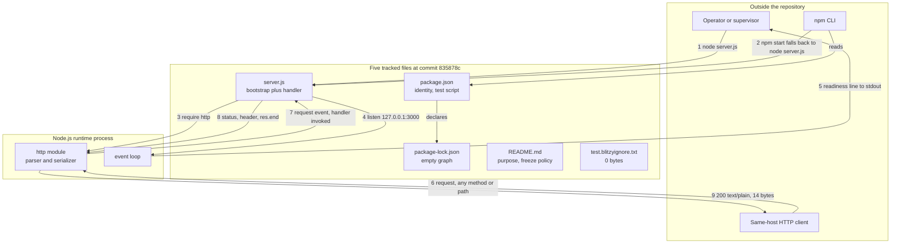

Interactions 3, 4, 7, and 8 are the only ones initiated by repository code, and none of them branches. `README.md` and `test.blitzyignore.txt` appear with no outgoing edge because they influence the system only through the humans who read them and the tooling that ignores them.

### 5.2.5 State Transition Diagram

The states below are operational — what an operator or supervisor can observe and act on — and they complement the process-internal and connection-internal states in section 4.4.5.

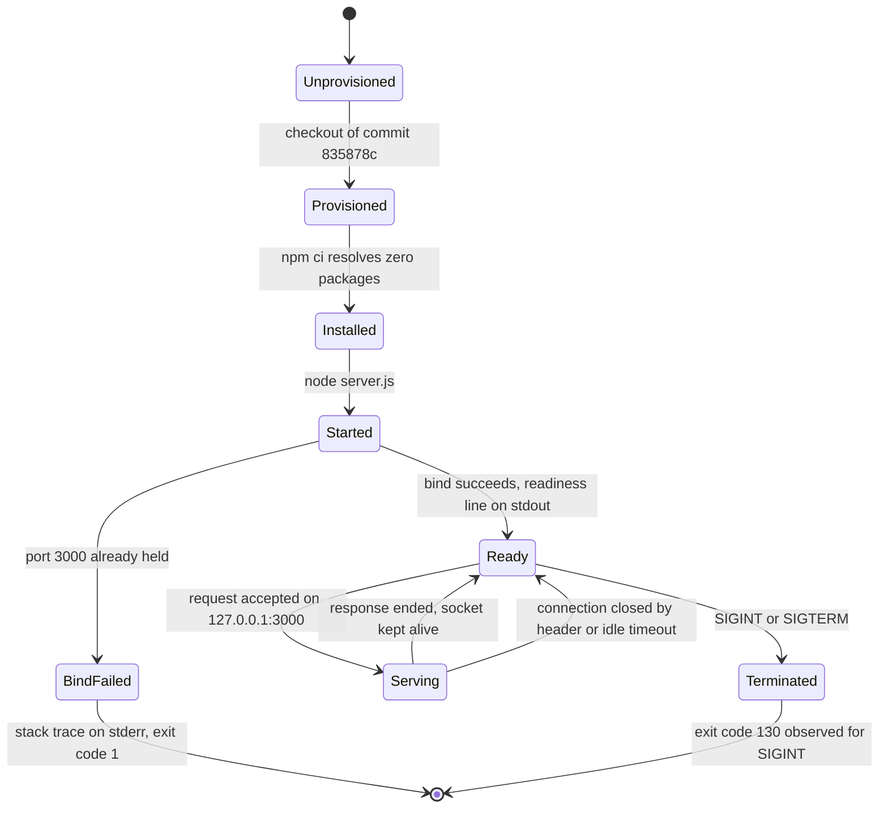

Three properties follow from the shape. `Installed` is a formality that changes nothing, because the lockfile resolves no packages. `BindFailed` is reachable only from a first start on a port that another process holds, and it is terminal — there is no retry edge because no retry code exists. Every recovery path leaves and re-enters the graph from `Unprovisioned` or `Installed`, since the only in-process transition out of a failure is process exit; `Crashed` is folded into `BindFailed` here because an unhandled `error` event produces the same observable outcome, exit code `1`.

### 5.2.6 Sequence Diagram: Request Lifecycle

The sequence traces the complete lifecycle, including the bind-failure alternative that the flow diagram cannot show on the same timeline.

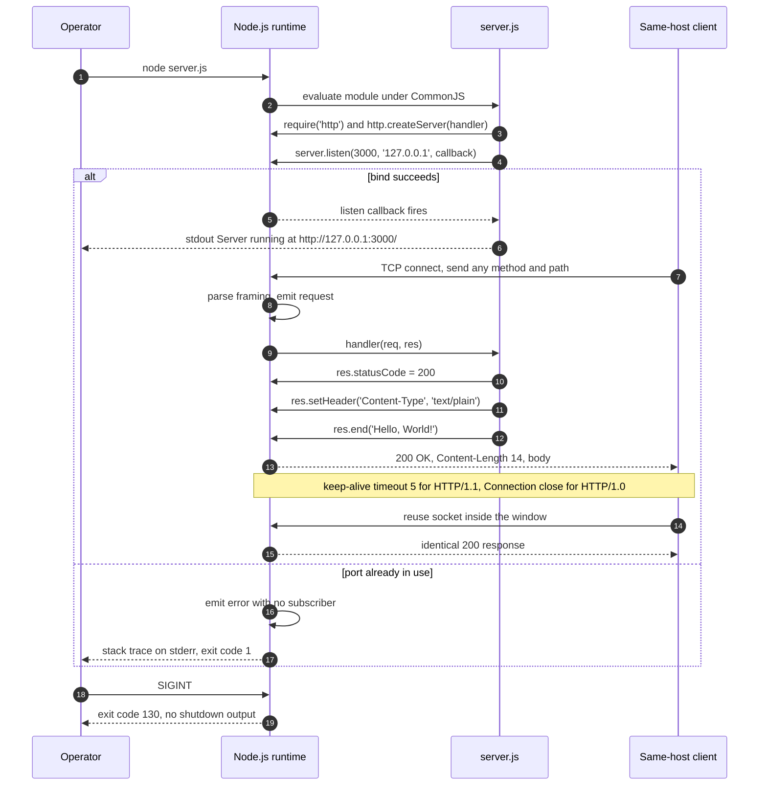

Ordering constraints are few and absolute: the readiness line (step 5) must precede any client request, which is why an operator gates on stdout; the keep-alive window bounds socket reuse; and termination is immediate at any point after `Ready`, with no drain step to wait for. No participant outside the host appears, and no step awaits an external service.


## 5.3 Technical Decisions

### 5.3.1 Architecture Style Decision

No design note, ADR, or source comment records why the system is shaped as it is: `server.js` contains zero comments, and the tree contains no design document. The decisions below are therefore reconstructed from the code, with each alternative assessed against the constraints in section 2.6.2 and the stated purpose in `README.md:2`.

| Decision | Alternatives rejected | Why the recorded choice wins | Consequence |
| --- | --- | --- | --- |
| Single-file, single-process monolithic module | Layered service (router + handlers + service layer); microservices; serverless function | The artifact must be a stable fixture for an external pipeline (assumption A-01), so the smallest construct that answers HTTP is optimal; layering would add files without adding capability | Everything changes together; there is no seam to extend, and no component can be tested or deployed independently |
| Runtime-provided HTTP stack, no framework | Express, Fastify, Koa, Hono, or any router package | A framework's value is routing, middleware, and parsing — none of which this system uses, since `req` is never read (`server.js:6`); any package would break the empty dependency graph (constraint C-03) | Zero supply-chain surface and no install or build step; routing, validation, and middleware must be written from scratch if ever needed |
| Stateless constant responder | Stateful service with request-dependent output | A constant response is the property the fixture exists to provide: output cannot drift, so any deviation is attributable to the consumer (assumption A-04) | No request data is exchanged; the response cannot be parameterized without a source change |
| Side-effect module with no library entry | Library-first module exporting a factory or app object | `node server.js` alone is a complete launch contract; a library surface would duplicate that contract (constraint C-05) | The module cannot be imported or unit-tested in isolation; `main` names an absent `index.js` |

The tradeoff common to all four is explicit and accepted: **architectural simplicity in exchange for extensibility and testability**. Each rejected alternative would require code this repository deliberately does not have, and `README.md:2` ("Do not touch!") records the intent that it stays that way.

### 5.3.2 Communication Pattern Choice

| Decision | Alternatives rejected | Why the recorded choice wins | Consequence |
| --- | --- | --- | --- |
| Synchronous request–response over plaintext HTTP/1.1 on loopback | HTTPS/TLS; HTTP/2; WebSocket or SSE; message queue; gRPC | The consumer needs a single assertable exchange; streaming and queuing have no state to carry, and TLS would add certificate provisioning for traffic that never leaves the host (constraint C-02) | One exchange per request, connection reuse for 5 idle seconds, no push channel, and no encryption |
| Hard-coded bind address and port (`127.0.0.1:3000`) | Environment variables, config file, CLI flags, port `0` dynamic allocation | A fixed port makes the fixture's address part of its contract, so a consumer can hard-code `http://127.0.0.1:3000/` with no discovery step (constraint C-01) | A second instance cannot run on the host (`EADDRINUSE`, exit `1`), and relocation requires editing `server.js:3-4` |
| Callback registration rather than event handlers | `server.on('request', …)`, `process.on('SIGTERM', …)`, `server.on('error', …)` | One `createServer(handler)` expression expresses the whole wiring; no listener subscription exists anywhere in the file | Failure events have no subscriber, so a bind error crashes the process instead of being handled (section 4.3.2) |
| Risky-free protocol posture: no timeouts, retries, or deadlines | Configured `server.timeout`, `headersTimeout`, retry with backoff | Neither side of the exchange can be slow enough to matter for a local constant response, and no timer or retry construct exists in the code | The only timeout in the system is the runtime's five-second keep-alive advertisement; a hung client would hold a socket until the runtime's default |

### 5.3.3 Data Storage Solution Rationale

The decision is not "which store," but "no store," and it is visible in the code rather than declared: no driver, ORM, schema, migration, filesystem call, or queue client appears anywhere in the five tracked files, and the lockfile's empty graph (`package-lock.json:6-12`) makes any such client impossible without a source and manifest change.

| Aspect | Decision | Rationale | Consequence |
| --- | --- | --- | --- |
| Application state | None — all four bindings are `const` (`server.js:1,3,4,6`); no `let`, `var`, counter, or collection | The handler reads nothing and returns a literal, so there is nothing to remember between requests | Requests are perfectly idempotent and mutually independent; concurrency needs no locking |
| Persistence medium | None — no database, file, or cache tier | Nothing is submitted by a client (`req` is never dereferenced) and nothing is computed, so there is no data to persist | No backup, migration, or restore procedure is needed; restart is always safe |
| Configuration state | Compiled-in constants only, no `.env`, CLI, or config file (constraint C-01) | The address and port belong to the fixture's contract | Any relocation is a code change reviewed as such, not an operational override |
| Secrets | None present, therefore none to rotate or scan for | No credential is needed to answer a loopback request | No secrets-management integration exists, and none is required |

### 5.3.4 Caching Strategy Justification

No cache exists at any layer, and for this system that is a complete strategy rather than a gap.

| Layer | Present | Justification | Consequence |
| --- | --- | --- | --- |
| Application-level response cache | No | The response is a literal, so a cache would store one constant at the cost of indirection | None missed: composition is three assignments (`server.js:7-9`) |
| HTTP cache validators | No — responses carry only `Content-Type`, `Date`, `Connection`, `Keep-Alive`, `Content-Length` | No consumer re-fetches for freshness, and no intermediary is reachable over loopback | Clients cannot conditionally revalidate; every request transfers the full 14 bytes |
| Connection reuse | Yes — the runtime's keep-alive, advertised as `timeout=5` | The only reuse mechanism that pays off, since it removes TCP setup from repeated probes | A pooled socket closed after the idle window must be re-established; a supervisor must tolerate that close |
| External cache tier (Redis, Memcached) | No | Zero dependencies (constraint C-03) and no data to share across processes | No cache-coherence or cache-availability failure mode exists |

### 5.3.5 Security Mechanism Selection

| Decision | Alternatives rejected | Why the recorded choice wins | Consequence |
| --- | --- | --- | --- |
| Reachability control by binding to loopback | Authentication and authorization middleware; API keys; mTLS; network ACL | On a single host, `127.0.0.1` (`server.js:3`) is the cheapest control that removes off-host access entirely, and the response contains nothing sensitive to protect (constraint C-02) | Any local process can obtain the response; the boundary is the host, not the caller, so the system cannot distinguish users, roles, or tenants |
| Plain HTTP, no TLS | `https.createServer` with a certificate | Traffic never leaves the host, and a certificate would need provisioning and rotation that the repository has no configuration surface for | No transport encryption; enabling HTTPS would be a source change plus new configuration |
| No secrets in the tree | Vault or environment-based secret injection | There is nothing to authenticate, so there is no secret to manage | No secret-scanning requirement and no rotation procedure; equally, no audit trail of callers |
| No request inspection or input handling | Schema validation, body limits, path sanitization | The application never reads `req`, so no attacker-controlled value reaches application logic | The only input-handling surface is the runtime's parser, which answers malformed framing with `400` or `431` |
| No logging of requests | Structured access logs with redaction | A fixture's consumers assert on responses, not logs | No audit trail, no PII-in-logs risk, and no way to reconstruct request history (section 5.4.1) |

The residual risk profile is therefore narrow: no dependency vulnerabilities (nothing installed), no secret exposure (nothing stored), and no injection path (no parsed input). What remains is the runtime itself — version unpinned by the manifest (assumption A-02) — and the local-host trust assumption, which the loopback binding makes explicit.

### 5.3.6 Decision Tree

The tree traces the four decisions of section 5.3.1 to the alternatives each one forecloses. Every leaf marked Chosen corresponds to a construct that exists in `server.js`; every leaf marked Rejected would have required code the repository does not contain.

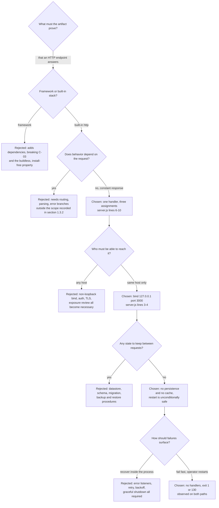

### 5.3.7 Architecture Decision Records

| ADR | Decision | Rationale | Consequence |
| --- | --- | --- | --- |
| ADR-01 | Single-file monolithic module | Smallest construct that answers HTTP for a fixture meant to stay fixed (`README.md:2`) | No internal seams; every change touches the only file |
| ADR-02 | Built-in `http` module, no framework | Framework features are unused because `req` is never read (`server.js:6`) | Zero dependencies and no build step; routing must be hand-written if ever required |
| ADR-03 | Bind `127.0.0.1:3000` as source constants | Fixed address makes the contract fully predictable (constraint C-01) | One instance per host; relocation requires a code change |
| ADR-04 | No persistence of any kind | Nothing is read from the request and nothing is computed | Restart is always safe; no backup, migration, or restore exists |
| ADR-05 | No caching beyond runtime keep-alive | A constant response has nothing to cache | No cache invalidation or coherence concerns; no HTTP validators are emitted |
| ADR-06 | Loopback binding in place of authentication and TLS | Isolation by binding is sufficient for non-sensitive data on one host (constraint C-02) | Local processes are indistinguishable and unauthenticated; no encryption |
| ADR-07 | No error handling: fail fast and loud | A fixture should not mask environmental faults from the pipeline that consumes it | Bind collision exits `1` with a stack trace; `SIGINT` exits `130`; no graceful shutdown (constraint C-06) |
| ADR-08 | Zero third-party dependencies, lockfile pinned to the root entry only | Removes supply-chain and install drift (constraint C-03) | Any added package invalidates the baseline and the documented provisioning path |
| ADR-09 | No tests and no CI; the `test` script fails by design | The baseline is frozen, so a test suite is not maintained (constraint C-04) | `npm test` exits `1`; the contract is protected only by convention and by the consumer's probe |
| ADR-10 | CommonJS side-effect module with no exports | `node server.js` is the complete launch contract | No library entry point; `main` points at an absent `index.js` (constraint C-05) |

Every ADR above is **implicit in code or absent by omission**; none is documented in the repository. Their status is best described as *accepted as built and frozen by policy*: `README.md:2` directs that the project not be modified, and no hook, branch rule, or check enforces that direction (constraint C-09).


## 5.4 Cross-Cutting Concerns

### 5.4.1 Monitoring and Observability

The system has no observability layer: no metrics endpoint, health or readiness route, counter, histogram, or instrumentation of any kind exists. The handler answers every path identically (`server.js:6-10`), so even a `/health` probe would be indistinguishable from any other request — it would return `200` whether the application were healthy or merely alive.

| Signal | Available | Detail | Consequence |
| --- | --- | --- | --- |
| Readiness | Yes, indirectly | One stdout line at bind: `Server running at http://127.0.0.1:3000/` (`server.js:13`) | A supervisor must parse stdout or wait for a successful probe; there is no `200`-vs-`503` signal |
| Liveness | Only as process existence | The process persists until signalled or killed | Detecting a hung process requires an external probe with a deadline the repository does not define |
| Request metrics | No | No counters, timers, or per-request logging; `server.js:6-10` contains no I/O beyond `res.end` | No throughput, latency, or error-rate data can be collected from the application |
| Error metrics | No | A bind failure produces a stack trace and exit `1`; a malformed request produces a `4xx` with nothing recorded | Failure rates are invisible unless the supervisor captures stderr and exit status |
| Dependency health | Not applicable | Zero dependencies and no external services to check | No dependency-health surface is needed |

The practical monitoring model is therefore **black-box probing plus process supervision**: an external component launches `node server.js`, gates on the readiness line or a first successful request, polls `127.0.0.1:3000` for `200` with the exact 14-byte body, and watches the process exit status. Both signals it relies on are observed behaviors — stdout at bind and exit codes `1`/`130` — not instrumentation.

### 5.4.2 Logging and Tracing Strategy

| Aspect | Implementation | Evidence | Implication |
| --- | --- | --- | --- |
| Logging framework | None | No logger package in the manifest, empty lockfile | Log format and destination are entirely the runtime's defaults |
| Application log statements | Exactly one: `console.log` inside the listen callback | `server.js:13` | The only application-emitted record is a startup banner |
| Request logging | None | No statement inside the handler references `req`, a logger, or timing | No access trail exists; request history cannot be reconstructed |
| Error logging | None | No `console.error`; no error listener (`server.on` count 0) | Errors appear only as runtime-generated stderr output |
| Structured fields | None | The log line is a template literal with two interpolations | No timestamp, level, service name, or correlation ID is attached |
| Tracing | None | No OpenTelemetry, tracing SDK, or header propagation in the tree | No distributed context; there is nothing to trace beyond one process and one exchange |
| Log destination | stdout/stderr inherited from the launching shell | Observed by launching with redirection | Collection is the operator's responsibility; log aggregation must be supplied externally |

Because every response is byte-identical, tracing adds no diagnostic value for this system: a failure is identifiable from the process exit status and stderr alone. The coordination cost of a logging or tracing library would also contradict the empty dependency graph (constraint C-03).

### 5.4.3 Error Handling Patterns

The error-handling pattern is **fail fast and delegate**: the application defines no handler for any failure, so every failure is either answered by the runtime or terminates the process for an external supervisor to detect. Section 4.3.2 inventories the absent mechanisms; this section assigns the responsibility each failure lands on.

| Error class | Owner of the handling | Application involvement | Observable outcome |
| --- | --- | --- | --- |
| Malformed request framing or oversized headers | Node.js runtime | None — the handler is never invoked | `400 Bad Request` (or `431`) with `Connection: close`; socket destroyed; nothing logged |
| Port already bound at startup | Node.js runtime | None — no `error` listener exists | Unhandled `error` event: stack trace on stderr naming `EADDRINUSE`, exit code `1` |
| Exception inside the handler | Nobody — latent | No `try`/`catch` anywhere | Uncaught exception would terminate the process; unreachable today because no failing operation exists in the handler |
| Client disconnect mid-request | Node.js socket layer | None | Connection torn down silently; the process serves the next request normally |
| Operator signal | Operating system default | None — no signal handler | Immediate exit, code `130` observed for `SIGINT`; no drain, no shutdown log |
| Runtime version fault | Operator or platform | None | Out of scope for the code; the manifest pins no version (assumption A-02) |

The flow below traces each class to the party that must react, showing that no branch is resolved inside application code.

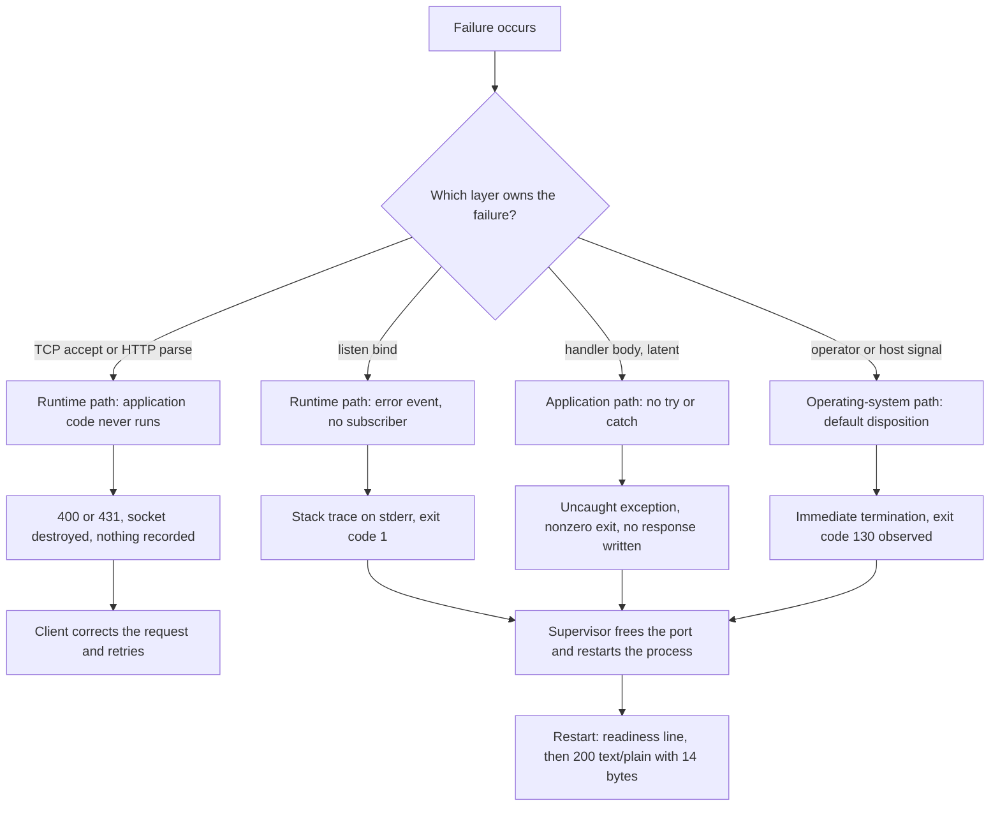

Because no recovery edge exists inside the process, restart is the universal remedy, and it carries no ordering constraints: no transaction to complete, no queue to drain, no cache to warm, no session to migrate.

### 5.4.4 Authentication and Authorization

Neither authentication nor authorization exists. `server.js` reads no header, cookie, token, or query parameter — it never dereferences `req` at all (`server.js:6`) — so every caller receives the identical response regardless of identity, origin, or credentials. The only access control is the **loopback bind** (`server.js:3`), which restricts which hosts can reach the socket and nothing more.

| Control | Status | Rationale | Residual exposure |
| --- | --- | --- | --- |
| Reachability control | Present — `127.0.0.1` bind | Keeps traffic off every network interface without configuration (constraint C-02) | Any process on the host, including an unprivileged one, can call it |
| Caller authentication | Absent | No credential scheme exists and no sensitive data is served | The system cannot attribute a request to a caller |
| Authorization or roles | Absent | There is a single response and no protected resource | No tenant, role, or scope concept can be expressed |
| Transport encryption | Absent — plain `http` module | Traffic stays within the host | No confidentiality against a same-host observer |
| Session or token state | Absent | Stateless by design | No revocation, expiry, or replay surface exists |
| Secrets management | Not applicable | No secret is needed to answer a request | Nothing to rotate or leak |

If off-host exposure were ever required, this section describes what would have to be built rather than reconfigured: authentication, TLS termination, and a non-loopback bind, with no existing configuration surface to receive them (constraint C-01).

### 5.4.5 Performance Requirements and SLAs

No performance requirement, availability target, throughput ceiling, or latency budget is recorded anywhere in the repository (constraint C-07). What can be stated is the observed behavior of the implementation.

| Dimension | Requirement recorded | Observed behavior | Architectural driver |
| --- | --- | --- | --- |
| Latency | None | Handler completes within one event-loop turn; no I/O, no computation, no awaiting | Three synchronous assignments (`server.js:7-9`) |
| Throughput | None | 50 parallel requests to distinct paths all returned `200` in 41 ms wall clock on Node.js v22.23.5 | Single event loop, no locks, no shared state |
| Concurrency | None | Unbounded in application terms; each request is independent and stateless | Handler holds no reference beyond the call |
| Availability | None | Process-level only: running or exited; no restart within the process | No supervision, no health signal beyond stdout (constraint C-06) |
| Resource footprint | None | One process, one socket, 342 bytes of source, no dependencies | Buildless, dependency-free module |
| Scalability | None | Vertical only — one instance per host, because the port and address are literals | `server.js:3-4`; a second instance exits `1` with `EADDRINUSE` |

Any SLA offered to a consumer would therefore be inherited from the host and the supervisor, not from the application. The measurable contract the system does provide is exact rather than statistical: `200`, `Content-Type: text/plain`, `Content-Length: 14`, body `Hello, World!\n`, for every request.

### 5.4.6 Disaster Recovery

| Aspect | Position | Basis |
| --- | --- | --- |
| Recovery point objective (RPO) | Zero loss is automatic — there is no state to lose | No persistence, no cache, all bindings `const` (`server.js:1,3,4,6`) |
| Recovery time objective (RTO) | Bounded by process start plus port availability; no target recorded | Startup is a single `listen` call; failure is immediate and loud |
| Backup | Not applicable — nothing to back up except five tracked files | `git ls-files` lists exactly five files |
| Failover | Not supported — one instance per host, loopback only, no replica mechanism | `server.js:3-4`; second instance exits `1` |
| Restore procedure | Checkout commit `835878c`, `node server.js`, confirm the readiness line, probe for the exact response | Observed behavior; single commit in history |
| Data reconciliation | Not required — no transaction, queue, or session survives a restart | No persistence layer exists |
| Configuration recovery | Trivial — configuration is source constants, so restoring the file restores the configuration | constraint C-01 |

Recovery is therefore **restart-only and unconstrained by ordering**. The two failure modes an operator can meet are a held port (free it, relaunch, observe exit `1` until it is free) and an unexpected exit (relaunch; no state to reconcile). Because the workspace is five files in version control at a single commit, reconstruction is deterministic.

### 5.4.7 Architectural Assumptions and Scalability Implications

| Assumption | Architectural impact if it fails |
| --- | --- |
| A-01: the repository is a test fixture, not a production service (`README.md:2`) | Every cross-cutting gap above becomes a defect: monitoring, tracing, error handling, and authentication would all have to be built |
| A-02: consumers run a CommonJS-capable Node.js with the built-in `http` module; version unpinned | A runtime change alters parsing, keep-alive, and default timeouts without any repository change; there is no `engines` guard |
| A-03: `127.0.0.1:3000` is free at start and a hard failure is acceptable | A co-located service on the same port prevents startup entirely; no dynamic port or retry exists |
| A-04: the constant response is the complete contract to assert against | Any change to `server.js:7-9` breaks consumers silently, with no test or CI gate to catch it (constraint C-04) |
| A-05: commit `835878c` is the reference state | A modified checkout has no way to signal divergence; the manifest records no `repository` or `version` history beyond `1.0.0` |
| A-06: no install or build precedes startup | Introducing a dependency would require a provisioning step the documentation and lockfile do not anticipate |
| A-07: all traffic originates on the same host | Off-host use requires a non-loopback bind plus TLS and authentication — none of which has a configuration path (constraint C-01) |

| Boundary | Consequence for growth |
| --- | --- |
| Single process, single event loop | CPU-bound work would block all requests; today nothing is computed, so the limit is untested and unmeasured |
| Hard-coded address and port | Horizontal scale-out on one host is impossible; multiple hosts would each own a private loopback listener |
| No shared state | Instances would be trivially interchangeable if they could coexist, since no session or cache is involved |
| No configuration surface | Environment-specific behavior requires code changes, which conflicts with the freeze policy in `README.md:2` |
| No observability | Added load cannot be diagnosed from inside the system; capacity planning would rely on external probes alone |

The architecture scales in exactly one direction: **more identical restarts**, which the absence of state makes safe and the loopback bind makes cheap. Any other growth — request-dependent behavior, off-host callers, multiple instances, persistent data — crosses a boundary this design deliberately does not have, and would be new work rather than a configuration change.


## 5.5 References

- `server.js` — the entire executable system: the `http` import (line 1), the `hostname` and `port` constants (lines 3-4), the constant-response handler (lines 6-10), and the loopback bind with readiness log (lines 12-14); also the absence of exports, error handling, timers, and routing referenced throughout sections 5.1-5.4
- `package.json` — package identity `hello_world` 1.0.0, MIT licence, author `hxu`, `main` = `index.js` (absent from the tree), the sole `test` script that exits `1`, and the absence of `start`, `engines`, `type`, and every dependency block
- `package-lock.json` — `lockfileVersion` 3 with only the `""` root entry, establishing that the dependency graph is empty and that provisioning resolves no packages
- `README.md` — the project name `hao-backprop-test` and the statement that this is a "test project for backprop integration. Do not touch!", which underpins assumption A-01 and the freeze policy in the ADRs
- `test.blitzyignore.txt` — 0-byte placeholder with no runtime or tooling effect
- Repository root (`/`) — the five-file, 913-byte tree with no subdirectories, no container file, no CI configuration, and no design documentation, which grounds every "absent" statement in this section
- Local runtime environment — Node.js v22.23.5 and npm 11.21.3, used to verify the response contract (`GET`, `POST`, `HEAD`, unknown path, HTTP/1.0), the keep-alive window, `EADDRINUSE` exit `1`, exit `130` on `SIGINT`, and 50 parallel requests completing in 41 ms
- Internal cross-references: section 1.3.2 (out-of-scope capabilities), section 2.6.1 and 2.6.2 (assumptions A-01…A-07 and constraints C-01…C-09), section 3.6.2 (launch commands), section 4.3.2 (error-handling mechanism inventory), section 4.4.5 (process and connection state transitions)
- No external web source was required: every claim in this section derives from the repository files or from executing them locally.


# 6. SYSTEM COMPONENTS DESIGN

## 6.1 Core Services Architecture

### 6.1.1 Service Components

**Core Services Architecture is not applicable for this system.** The repository's only executable artifact is `server.js`: a single CommonJS module of 342 bytes that registers one request handler (`server.js:6-10`) and one loopback listener (`server.js:12-14`). There is no second module, no separately deployable unit, no remote peer, and no process-to-process call anywhere in the tree. The complete checkout is five files totalling 913 bytes, and a whole-tree sweep for distributed vocabulary (`cluster`, `worker_threads`, `proxy`, `registry`, `retry`, `breaker`, `health`, `replica`, `backup`) matched only the substring `log` inside `console.log` at `server.js:13`. The areas this section is required to cover are therefore documented twice over — what exists in the single-process design, and the verified absence of each distributed mechanism — so a reader can see both the shape of the system and why nothing else is present.

The determination rests on the five tests below; the system fails every one of them.

| Test for a core services architecture | Result | Evidence |
| --- | --- | --- |
| Two or more independently deployable units | Absent | One executable file (`server.js`); `git ls-files` lists five files, none under a source directory |
| A network boundary between components | Absent | The handler is invoked in-process through the callback registered at `server.js:6` |
| A registry or discovery mechanism to locate peers | Absent | Address and port are source literals at `server.js:3-4` |
| An independent scaling unit and a replica set | Absent | A second instance exits `1` with `EADDRINUSE`; the bind is loopback-only |
| Shared state needing consistency control | Absent | No datastore, cache, or session; all four bindings are `const` (`server.js:1,3,4,6`) |

What does behave like a component set is the module and the runtime it delegates to. Those three rows, plus the external supervisor that owns everything the process cannot do for itself, are the entire component inventory.

| Component | Responsibility boundary | Interaction mechanism | Failure containment |
| --- | --- | --- | --- |
| `server.js` request handler (`server.js:6-10`) | Compose the one response from literals: `statusCode = 200`, `Content-Type: text/plain`, `Hello, World!\n` | Registered as the runtime's `request` listener; writes via `res.end` | Cannot fail — no I/O, no branch, `req` never dereferenced |
| `server.js` bootstrap (`server.js:12-14`) | Bind `127.0.0.1:3000` and announce readiness | `server.listen(port, hostname, cb)` plus one `console.log` | None — a bind error is an unhandled event, exit `1` |
| Node.js runtime (external) | Own TCP accept, HTTP parse/serialize, keep-alive, `400`/`431` generation, timers | Loads the module as CommonJS; emits `request` | Contains framing faults only; shares the process's fate otherwise |
| Operator or supervisor (external) | Spawn, gate on readiness, terminate | `node server.js`, stdout, exit status | Sole owner of restart (constraint C-06) |

Sections 5.1.2 and 5.2 record these components in full; this sub-section covers only their service-boundary properties.

#### 6.1.1.1 Service Boundaries and Responsibilities

The only real boundary is the OS process that hosts the listening socket. Inside it there is no internal boundary at all: bootstrap and request handling share one file, and the module exports nothing (`module.exports` count is zero), so nothing can be composed, stubbed, or called from outside. The remaining boundaries are properties of placement and of the protocol rather than of a service decomposition.

| Boundary | Inside | Outside | Operational consequence |
| --- | --- | --- | --- |
| Process (deployment unit) | Event loop, one socket, the 14-byte body | Clients, supervisor, consuming pipeline | Only TCP bytes and an exit status cross it |
| Loopback interface | Any process on the host | Every other host (connection refused) | Access control is network placement alone (constraint C-02) |
| Module | Lines 1-14, no exports | Nothing can import the file | Launching is a side effect only (constraint C-05) |
| Responsibility | Constant response composition | Routing, auth, persistence, logging, health | Every request is answered identically |

There is no per-path or per-method responsibility split to document: `GET /`, `GET /health`, `GET /readyz`, `PUT /x`, `DELETE /x`, `OPTIONS /x`, and `PATCH /deep/path?q=1` were each answered `200` with the same 14 bytes, because the handler never reads the request.

#### 6.1.1.2 Inter-Service Communication Patterns

No inter-service communication exists. Two communication edges are present, and both are contained within one host process.

| Edge | Pattern | Transport and format | Evidence |
| --- | --- | --- | --- |
| Runtime → handler | Synchronous in-process callback, one invocation per request | Function call on the event loop; no bridge, queue, or serialization | `server.js:6`; `async`, `await`, and `Promise` counts are zero |
| Client → runtime | Stateless request–response, one exchange per request header set | Plaintext HTTP/1.1 over TCP; HTTP/1.0 also answered; keep-alive advertised `timeout=5`, idle socket closed at 6027 ms | `server.js:1`, `server.js:3-4`; probe output |
| Runtime → operator | One-way readiness announcement at bind | stdout text line, no structure or level | `server.js:13` |

Absent entirely: RPC or gRPC, message broker, queue, event bus, pub/sub, webhook, and outbound HTTP client. No `fetch`, `axios`, `https.request`, `net.`, or `dns.` call appears in any tracked file, and the process was observed holding one listening socket with zero child processes, so no outbound dependency can exist at runtime. Payload semantics are trivial: the request object is never dereferenced (`req.` count zero), request bodies are discarded unread — a 5,000,000-byte `POST` was answered with the standard 14-byte reply in about 3 ms — and the response is a literal.

#### 6.1.1.3 Service Discovery Mechanisms

No discovery mechanism exists at any layer: not a registry, not DNS, not a sidecar, not an environment variable (`process.env` count zero), not a configuration file. Peers are located by a convention frozen in source.

| Discovery function | Mechanism present | Evidence | Consequence |
| --- | --- | --- | --- |
| Locating the endpoint | Source constants `127.0.0.1` and `3000` | `server.js:3-4` | Callers must be told the address out of band; relocation needs a code change (constraint C-01) |
| Announcing readiness | One stdout line from the listen callback | `server.js:13` | A supervisor must parse stdout or probe; nothing is published to a registry |
| Registering instance presence | None | No registry client, no sidecar, no annotation in any file | A caller cannot enumerate instances; only one can exist per host |
| Deregistering on shutdown | None | No signal handler; `SIGINT` exited `130` and `SIGTERM` `143` with no output | Stale registrations are impossible because none are created |

The practical substitute is the pair "fixed loopback address + readiness line". It works only because the service is a singleton on one host: the loopback bind makes the endpoint unreachable from any other machine — a request to the host address `10.11.0.21:3000` was refused with curl exit code `7` — so no resolver on the network could ever be useful.

#### 6.1.1.4 Load Balancing Strategy

No load balancing exists, and the current topology leaves nothing to balance. Every request converges on one listener served by one event loop.

| Balancing layer | Mechanism present | Evidence | Effect |
| --- | --- | --- | --- |
| External L4/L7 balancer | None | No proxy, ingress, or upstream configuration in the five-file tree | All traffic reaches the single listener directly |
| Server-side distribution | None | No `cluster`, `worker_threads`, or `child_process` usage; zero child processes observed | One event loop serves every request |
| Concurrency control | OS accept queue feeding the event loop | 200 requests at 50-way concurrency all returned `200` in 146 ms wall clock | Requests queue and interleave; none is routed |
| Off-host ingress | Unavailable | Bind is `127.0.0.1`; off-host request refused | A balancer cannot be placed in front without changing source (blocked by constraints C-01 and C-02) |

Adding a second worker is not merely unconfigured but rejected: a second `node server.js` failed with an unhandled `error` event, `Error: listen EADDRINUSE: address already in use 127.0.0.1:3000`, and exit code `1`, while the first instance kept answering `200`. The port is a singleton, so the concurrency a caller can obtain is the concurrency of one process.

#### 6.1.1.5 Circuit Breaker Patterns

No circuit breaker exists, and there is no dependency for one to protect. A breaker requires a remote callee, a failure signal, a timeout, a threshold, and a fallback; the tree contains none of them.

| Breaker element | Present | Evidence |
| --- | --- | --- |
| Protected dependency (callee) | No | No outbound client of any kind; the only import is the built-in `http` module (`server.js:1`) |
| Failure counting and threshold state | No | No counters, no mutable state; every binding is `const` (`server.js:1,3,4,6`) |
| Timeout or abort on the request path | No | `setTimeout`, `setInterval`, and abort usage all count zero |
| Half-open probe and fallback response | No | The only response is the literal at `server.js:9` |

A breaker on the loopback edge would also be structurally inert. The handler runs synchronously to completion inside one event-loop turn and performs no I/O, so an in-flight call can never hang or time out, and the sole failure mode on that edge is a port conflict raised before any request arrives — an unhandled `error` event that ends the process with exit code `1` rather than a request-path error a breaker could observe.

#### 6.1.1.6 Retry and Fallback Mechanisms

Neither retry nor fallback exists in application code: `try`, `catch`, `throw`, retry, backoff, and jitter all count zero across the tracked files, and no `server.on('error')` or `process.on(...)` listener is registered. Every failure either terminates the process or is answered by the runtime, and recovery is pushed onto the caller or the supervisor.

| Failure | Retry in code | Observed result | Retry owner |
| --- | --- | --- | --- |
| Port 3000 already bound at start | No | Unhandled `error` event, `EADDRINUSE` stack on stderr, exit `1` | Operator or supervisor |
| Malformed request line | No | `400 Bad Request`, `Connection: close` | Caller |
| Oversized request header (33 KB sent) | No | `431 Request Header Fields Too Large`, `Connection: close` | Caller |
| Client aborts mid-request | No | Silent socket teardown; the next request returned `200` | Caller |
| Exception inside the handler | No | Latent — no `try`/`catch`, no error listener; would end the process | Operator or supervisor |

There is no fallback of any kind: no static error page, no cached or degraded body, no alternate endpoint, and no `Retry-After` header. Runtime-generated `400` and `431` responses carry empty bodies and close the connection. Retrying is nonetheless safe for callers by construction, because the response depends on no state at all — but a retry issued after the process has exited fails at the TCP layer until an external supervisor relaunches `node server.js`.


### 6.1.2 Scalability Design

No scaling configuration exists in this repository. There is no autoscaler manifest, no orchestrator descriptor, no container file, no `cluster` or worker usage, and no resource limit — the tree is five files and one of them executes. The system's scaling posture is therefore a property of its two source constants rather than of a scalability design: one process, one loopback socket, one port, and a response that depends on nothing. Section 5.4.7 records the architectural consequences of those boundaries; this sub-section documents the scaling dimensions themselves.

| Scaling dimension | Position in this system | Governing constraint |
| --- | --- | --- |
| Horizontal within a host | Impossible — the port literal is a singleton | `server.js:3-4`; second instance exits `1` |
| Horizontal within a process | Not implemented — no `cluster`, `worker_threads`, or `child_process` | Absence sweep, zero matches |
| Horizontal across hosts | Not provided; each host would be an isolated island | Loopback bind (`server.js:3`), constraint C-02 |
| Vertical | Implicit only — bounded by one event loop, no limits declared | No `engines`, heap flag, or cgroup limit |
| Capacity target | None recorded anywhere | Constraint C-07 |

#### 6.1.2.1 Horizontal and Vertical Scaling Approach

The approach is vertical growth of a single process, with restarts as the only repeating operation. Horizontal scaling is not configured and, more strongly, is blocked by the address and port literals.

| Scaling axis | Supported | Binding constraint | Evidence |
| --- | --- | --- | --- |
| Add a second process on one host | No | Fixed `127.0.0.1:3000`; second instance exits `1` | `server.js:3-4`; `EADDRINUSE` probe |
| Add in-process workers | No | Neither `cluster` nor `worker_threads` is referenced; zero child processes observed | Absence sweep; process probe |
| Add instances on other hosts | Not usable as scale-out | Each host binds its own private loopback listener; the two cannot share traffic | Off-host request refused (curl exit `7`) |
| Grow the host | Implicit | Single event loop; nothing declares or caps memory or CPU | 7 threads, VmRSS 49,960 kB observed |
| Place a balancer in front | No | No proxy or ingress configuration exists, and a non-loopback bind would require a source change | File inventory; constraints C-01, C-02 |

The architecture is replica-friendly but not replica-capable. Because the handler holds no state and returns a constant, instances would be perfectly interchangeable if they could coexist — the only obstacles are a hard-coded address and port (constraint C-01) and a loopback bind (constraint C-02), both frozen by the "Do not touch!" policy in `README.md:2` (constraint C-09). Under that policy the documented scaling paths are a larger host and serial replacement.

#### 6.1.2.2 Auto-Scaling Triggers and Rules

There are no auto-scaling triggers and no rules. No orchestration descriptor exists in the tree, so no scaling rule could be declared, and the application emits no signal a trigger could read — no metrics endpoint, counter, histogram, or per-request log statement.

| Candidate trigger | Signal this system emits | Usable by an autoscaler | Evidence |
| --- | --- | --- | --- |
| CPU or memory utilization | None from the application | No — host-level tooling only | No instrumentation in any file |
| Request rate or latency | None | No | No counters, timers, or request logging |
| Queue or backlog depth | None | No — no queue exists | No queue or worker code |
| Process readiness or liveness | One stdout line; any path returns `200` | Weak — `/health` is indistinguishable from any other path | `server.js:13`; `GET /health` returned `200` with 14 bytes |

Even if a rule were added externally, the fixed port caps replicas at one per host, so the only lever a controller would have is host size or host count — the latter requiring a bind change the project's policy forbids.

#### 6.1.2.3 Resource Allocation Strategy

Allocation is whatever the host grants a single Node.js process. Nothing in the repository reserves, requests, or limits a resource.

| Resource | Observed allocation | Declared in repository | Evidence |
| --- | --- | --- | --- |
| Processes | 1 `node server.js`, 0 children | None | Process probe during load |
| Threads | 7 (main, V8/platform threads, libuv pool) | None — no worker or pool configuration | `/proc/<pid>/task` count |
| Memory | VmRSS 49,960 kB (≈48.8 MiB) while serving 200 parallel requests | None — no heap flag, no `engines` pin, no cgroup limit | `/proc/<pid>/status` |
| Sockets | 1 listening socket on `127.0.0.1:3000`; keep-alive connections reused for up to 5 idle seconds | None — no backlog, timeout, or connection-limit setting | `Keep-Alive: timeout=5` header; idle close at 6027 ms |

Per-request allocation comes entirely from the runtime: the handler adds three property writes (`server.js:7-9`) and holds no reference beyond the call, so no application-level buffer, pool, or cache grows with load.

#### 6.1.2.4 Performance Optimization Techniques

The only optimization applied is the elimination of work: the handler performs three literal assignments and no I/O, and every expensive protocol activity is delegated to the runtime.

| Technique | Applied | Basis |
| --- | --- | --- |
| Zero per-request work | Yes | Three assignments, `req` unused, no `async`/`await`/`Promise` anywhere (`server.js:7-9`) |
| Fixed 14-byte body, no serialization | Yes | `res.end('Hello, World!\n')`; no JSON, template, or templating engine |
| Connection reuse via keep-alive | Yes, by runtime default | `Keep-Alive: timeout=5`; a second request on the same socket reused the connection |
| Single event loop, no locks or shared state | Yes | All bindings `const`; no locks, pools, or worker threads |
| Caching, compression, pooling, clustering, TLS, HTTP/2 | No — and not needed | Zero matches for each; 14 bytes over loopback make them pure overhead |

Measured behavior on Node.js v22.23.5: sequential loopback requests completed in 0.416–0.833 ms each, and 200 requests at 50-way concurrency all returned `200` in 146 ms wall clock. The response budget is therefore a single event-loop turn plus socket write, with no queueing other than the OS accept backlog.

#### 6.1.2.5 Capacity Planning Guidelines

No capacity target is recorded in the repository (constraint C-07). The guidelines below are derived from observed behavior rather than from a plan of record.

| Planning input | Observed basis | Guideline |
| --- | --- | --- |
| Instances per host | A second instance exits `1` with `EADDRINUSE` | Plan for exactly one; treat port 3000 as exclusive and reclaim it before restart |
| Concurrency ceiling | 200 concurrent requests served in 146 ms by one event loop | Size load expectations per host, not per replica; no in-application limit exists to tune |
| Scaling unit | Stateless, constant response | Scale by restart or replacement; no warm-up, cache fill, or state migration step |
| Reachability | Loopback only; off-host refused | Capacity beyond one host requires a bind and port change, which the freeze policy forbids (constraints C-01, C-09) |

Two operational consequences follow. First, a capacity increase is indistinguishable from a restart, so throughput planning reduces to host sizing plus a supervisor restart budget. Second, because no metrics are emitted (section 5.4.1), saturation must be detected from outside the process — latency growth at the client or CPU pressure on the host — since the application itself can report neither load nor error rate.


### 6.1.3 Resilience Patterns

No resilience machinery is implemented in application code. Resilience is inherited from the Node.js runtime for protocol-level faults and is otherwise delegated to an external supervisor, because the process contains no fault handling of its own: `try`, `catch`, `throw`, `process.on`, and `server.on` all count zero across the tracked files. Sections 5.4.3 and 5.4.6 assign each failure to the party that handles it; this sub-section documents the pattern positions themselves.

| Resilience capability | Position in this system | Governing evidence |
| --- | --- | --- |
| Framing-fault containment | Provided by the runtime, not the code | `400` and `431` responses observed; handler never invoked |
| Process-fault recovery | Absent; fails fast and stays down | Unhandled `error` event, exit `1`; no restart policy |
| State recovery | Not required — nothing is held | All bindings `const` (`server.js:1,3,4,6`) |
| Replication or failover | Absent | Single process, single loopback port |
| Degradation policy | Absent | Only two outcomes exist: `200` with 14 bytes, or no process |

#### 6.1.3.1 Fault Tolerance Mechanisms

Fault tolerance in the application layer is zero. Every mechanism observed belongs to the HTTP runtime's parser, socket layer, or timer, and each one was reproduced against the running process.

| Fault | Contained by | Mechanism | Observed result |
| --- | --- | --- | --- |
| Malformed request line | Node.js parser | `400 Bad Request`, `Connection: close` | `NOTAMETHOD / HTTP/9.9` answered `400`, connection closed |
| Oversized request header | Node.js parser | `431 Request Header Fields Too Large`, `Connection: close` | 33 KB header rejected; process unaffected |
| Idle keep-alive socket | Runtime timer | Server-side close after the advertised `timeout=5` | Socket closed 6027 ms after the response |
| Slow or half-open client | Non-blocking event loop | Incomplete request held without blocking others | Parallel request answered `200` in 6 ms |
| Client abort mid-request | Socket teardown | Silent cleanup, no output | Process stayed alive; next request returned `200` |
| Port conflict at startup | Nothing | No `error` listener on the server object | Unhandled event, stack trace, exit `1` |
| Exception inside the handler | Nothing | No `try`/`catch`, no `uncaughtException` handler | Latent; unreachable today because the handler cannot fail |

The pattern is therefore **contain cheap faults at the runtime, expose expensive ones as process exit**. Two consequences follow: a malformed request never reaches the application, and a startup fault never produces a servable state, so callers see either the exact contract or a refused connection and never a partially degraded response.

#### 6.1.3.2 Disaster Recovery Procedures

Recovery is restart-only, and it is unconstrained by ordering because the process holds no state: there is no transaction to complete, queue to drain, cache to warm, or session to migrate. No runbook, backup job, snapshot script, or restore automation exists in the repository, so the procedure below is derived from verified behavior.

| DR aspect | Position | Basis |
| --- | --- | --- |
| Recovery point objective | Zero loss, automatically | Nothing is persisted; the only outputs are the log line and the response |
| Recovery time objective | One process start plus port availability; no target recorded | Startup is a single `listen` call (constraint C-07) |
| Backup | Not applicable beyond the five tracked files | `git ls-files` lists five files; no data store |
| Restore | Check out commit `835878c` and relaunch | Single commit reachable from every ref |
| Reconciliation | None required | No durable state, no sequence, no ids |
| Configuration recovery | Trivial — configuration is source constants | Constraint C-01 |

The restore sequence, in the order the observations require:

1. Confirm port 3000 is free on `127.0.0.1`; a held port makes startup fail immediately with `EADDRINUSE` and exit `1`.
2. Restore the tree to commit `835878c`. No install or build step applies: the dependency graph is empty and the only import is built in.
3. Launch `node server.js`. `npm start` also works, through npm's fallback to a root-level `server.js` when no `start` script is declared.
4. Gate readiness on the single stdout line `Server running at http://127.0.0.1:3000/`.
5. Assert the contract: `200`, `Content-Type: text/plain`, `Content-Length: 14`, body `Hello, World!` followed by a newline.

#### 6.1.3.3 Data Redundancy Approach

No redundancy mechanism exists, and none is needed: the system stores no data. Redundancy is present only in version control, where every ref points at the same single commit.

| Data artefact | Store | Redundancy | Evidence |
| --- | --- | --- | --- |
| Request payloads and headers | None — discarded unread | None | `req` never dereferenced; a 5 MB body was answered in ~3 ms |
| Application state | None — all bindings `const` | None | `server.js:1,3,4,6` |
| Operational output | stdout/stderr of the launching shell | None — no aggregation or shipping configuration | `server.js:13` is the only application log statement |
| Source tree | Git, commit `835878c` | Version-control copies only (`main` and four QA refs share the tree) | `git log --all` shows one commit |

With no data to lose, the recovery point objective is zero by construction rather than by replication, and a replica would add availability without adding durability — a trade the project has not made anywhere in its five files.

#### 6.1.3.4 Failover Configurations

No failover configuration exists at any layer.

| Failover element | Present | Evidence |
| --- | --- | --- |
| Standby or replica instance | No | A second instance exits `1`; one process per host |
| Traffic shift (VIP, DNS, proxy) | No | Loopback bind; no proxy or ingress configuration |
| Health-check-driven replacement | No | No orchestrator; `/health` returns `200` identically to any path |
| Automatic restart on exit | No | No process-manager config, unit file, or container restart policy |
| State transfer on promotion | Not applicable | No durable state to transfer |

Failover is nonetheless clean in principle: because the process is stateless, a replacement is byte-identical to its predecessor. It is also entirely external — the repository contributes no readiness signal beyond a stdout line and no health signal that distinguishes a healthy process from a merely alive one. The observed port-conflict probe shows the absence of coordination: the second instance died while the first continued serving `200`, with no handshake, lock, or leader election involved.

#### 6.1.3.5 Service Degradation Policies

There is no degradation policy. No rate limiter, load shedder, request timeout, feature flag, or alternate response path exists, and the handler cannot express a partial or conditional outcome.

| Degradation control | Present | Consequence under stress |
| --- | --- | --- |
| Rate limiting or load shedding | No | Connections are accepted until the event loop saturates; nothing throttles or rejects |
| Request timeout | No | No timer is created; the runtime's own header and keep-alive limits are the only bounds |
| Degraded or partial response | No | Output is binary: `200` with the 14-byte body, or no process |
| Alternative or cached content | No | The body is a literal at `server.js:9`; no cache exists to serve from |
| Retry signalling to callers | No | No `Retry-After` header is emitted on any path |

The effective policy is "serve or die". Because each request costs one event-loop turn with no waiting, saturation manifests as queuing latency at the accept socket rather than as errors, which the application cannot report — the same observability gap recorded in section 5.4.1.


### 6.1.4 Required Diagrams

The three diagrams below depict the system as observed, not as intended: each one shows the single path that exists and labels the distributed capability the specification area calls for as explicitly absent. They are drawn from `server.js`, from the five-file inventory, and from the runtime probes recorded in 6.1.1 through 6.1.3.

#### 6.1.4.1 Service Interaction Diagram

The interaction is one synchronous request–response exchange in which the runtime does all protocol work and the handler contributes three assignments. The diagram's final note carries the finding of 6.1.1.2 through 6.1.1.6: no discovery, load balancer, breaker, retry, or replica mediates the edge.

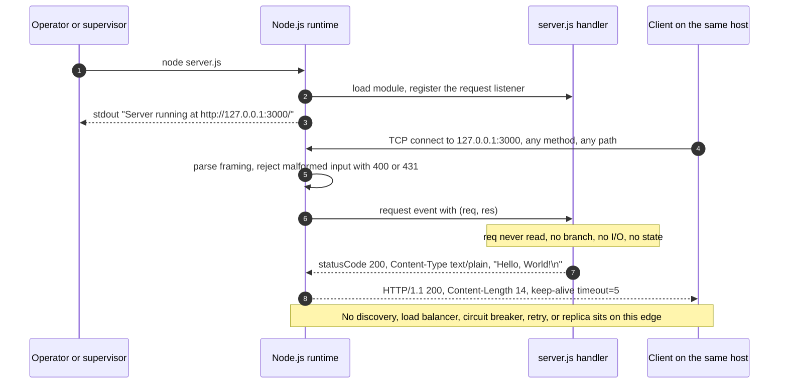

Two properties of the diagram are worth reading literally. The handler never sends anything except through the `res` object it is given, so the runtime is both the entry and the exit of every exchange; and the readiness message travels on stdout rather than over the network, which is why the supervisor appears on the same lifeline as the process.

#### 6.1.4.2 Scalability Architecture Diagram

The scalability picture is a single host containing a single process on a single loopback socket, with the three scale-out paths that a distributed design would use shown as the rejections they actually are.

```mermaid
flowchart TD
    subgraph HOST["Single host — the whole deployment boundary"]
        PROC["node server.js process<br/>one event loop, 7 threads, ~48.8 MiB RSS"]
        SOCK["Listening socket 127.0.0.1:3000<br/>loopback only, exactly one per host"]
        HAND["Handler — constant 200 response, 14 bytes"]
        SOCK --> HAND
        PROC --- SOCK
    end
    CLIENT["Client on the same host"] -->|"TCP 127.0.0.1:3000"| SOCK
    SUP["Operator or supervisor"] -->|"node server.js"| PROC
    PROC -->|"readiness line on stdout"| SUP
    SECOND["Second instance on the same host"] -.->|"bind fails: EADDRINUSE, exit 1"| SOCK
    OFFHOST["Client on another host"] -.->|"connection refused: loopback bind"| SOCK
    VERT["Vertical only: larger host, same single process"] -.-> PROC
```

The dashed edges are the entire capacity story: horizontal scale-out within a host is rejected by the port literal, horizontal reach beyond the host is rejected by the loopback bind, and the only direction left is a larger host running the same single process (section 6.1.2.1).

#### 6.1.4.3 Resilience Pattern Implementations Diagram

Resilience resolves through exactly two deflection points — the runtime for protocol faults and the external supervisor for process faults — and the diagram names the patterns that a resilient design would add and this repository does not contain.

```mermaid
flowchart TD
    FAULT["Fault occurs"] --> CLASS{"Which layer owns the fault?"}
    CLASS -->|"HTTP parsing"| RT["Node.js runtime parser"]
    CLASS -->|"socket or timer"| RT2["Node.js socket layer"]
    CLASS -->|"listen bind"| AP["Application has no error listener"]
    CLASS -->|"operator signal"| OS["No signal handler"]
    RT --> R1["400 or 431 with Connection close"]
    RT2 --> R2["Idle socket closed after about 6 s<br/>slow client does not block others"]
    AP --> A1["Unhandled error event, stack trace on stderr, exit 1"]
    OS --> O1["Immediate exit: 130 on SIGINT, 143 on SIGTERM"]
    R1 --> CALLER["Caller corrects the request and retries"]
    A1 --> SUP["External supervisor relaunches node server.js"]
    O1 --> SUP
    SUP --> READY["Readiness line, then 200 text/plain, 14 bytes"]
    ABSENT["Not implemented anywhere in the repository:<br/>circuit breaker, retry with backoff, replica failover,<br/>autoscaler, load shedding, degraded response"]
    classDef missing fill:#ffffff,stroke:#999999,stroke-dasharray: 5 5
    class ABSENT missing
```

The two branches that end in `400`/`431` and in socket closure are resolved without application code, which is why they leave the process untouched. The two branches ending in process exit have no recovery edge inside the repository; the supervisor node is drawn outside that boundary deliberately, because restart is the only mechanism the system has (sections 6.1.3.1 and 6.1.3.2).


### 6.1.5 References

Every claim in this section rests on the files below or on runtime probes executed against them with Node.js v22.23.5 and npm 11.21.3. No web source was needed, because the section records repository behavior rather than external facts.

**Repository files and folders**

- `server.js` — the only executable file and the entire runtime: `require('http')` (line 1), the `127.0.0.1` and `3000` constants (lines 3-4), the constant-answer handler with `req` unused (lines 6-10), and the listener plus readiness log (lines 12-14). Establishes the component inventory, the single communication edge, the absence of exports, error handling, timers, and signal handlers.
- `package.json` — identity (`hello_world` 1.0.0), no dependency blocks, no `engines`, no `start` script, and the `test` script that exits `1` by construction. Establishes the empty dependency surface and the absence of any lifecycle, build, or process-management configuration.
- `package-lock.json` — `lockfileVersion` 3 with only the root package entry, proving the resolved dependency graph is empty and that no scaling, proxy, or resilience library is installed.
- `README.md` — names the repository `hao-backprop-test` and states "test project for backprop integration. Do not touch!", the policy that freezes the address and port literals and therefore the scaling conclusions.
- `test.blitzyignore.txt` — 0 bytes; confirmed to be an empty placeholder and not an ignore list, so no path was excluded from the evidence base.
- Repository root `""` — five files, no subdirectories: the complete inventory that rules out additional services, deployment descriptors, CI workflows, container files, and configuration.

**Runtime evidence gathered from those files**

- `node server.js` startup, request, and shutdown behavior on Node.js v22.23.5 (all-method and all-path `200` responses including `/health` and `/readyz`; `400` on a malformed request line; `431` on a 33 KB header; keep-alive idle close at 6027 ms; `SIGINT` exit `130`; `SIGTERM` exit `143`).
- Process and socket footprint under load (1 process, 0 children, 7 threads, VmRSS 49,960 kB, 200 requests at 50-way concurrency answered in 146 ms), a second instance failing with `EADDRINUSE` and exit `1`, and an off-host request refused at `10.11.0.21:3000` with curl exit `7`.
- `git log`, `git ls-files`, and `git status` confirming the single commit `835878c`, the five-file tree, and a clean working tree after probing.

**Cross-referenced sections of this specification**

- 2.6.1 and 2.6.2 — assumptions A-01 through A-07 and constraints C-01 through C-09 cited throughout this section.
- 4.3.2 — error-handling inventory; the fault ownership model in 6.1.3.1.
- 5.1.2 and 5.2 — component table and component details summarized in 6.1.1.
- 5.4.1 — observability gaps that limit auto-scaling triggers and capacity detection.
- 5.4.3 and 5.4.6 — fail-fast error ownership and disaster recovery referenced from 6.1.3.
- 5.4.7 — architectural assumptions and scalability implications that bound 6.1.2.


## 6.2 Database Design

### 6.2.1 Applicability Determination

**Database Design is not applicable to this system.** The repository contains no database, no persistent store, and no data model to design. Its only executable file, `server.js` (14 lines, 342 bytes), compiles a constant string into the process image at line 9 and returns it to every caller; nothing the system produces outlives a single event-loop turn. There is consequently no schema to define, no index to tune, no replica to configure, and no backup to schedule.

This determination rests on five independent evidence layers, not on the absence of familiar names. Each layer alone would be suggestive; together they make persistence structurally impossible rather than merely unimplemented.

| Evidence layer | Finding | Basis |
| --- | --- | --- |
| Source code | One import, a Node.js built-in; four `const` bindings; zero mutable state; `req` never dereferenced | `server.js:1`, `server.js:3-4`, `server.js:6` |
| Dependency graph | No dependency block exists in the manifest, and the lockfile resolves exactly one package — the root itself | `package.json:1-11`, `package-lock.json:6-12` |
| Configuration | No `.env`, `.rc`, `.ini`, `.toml`, `.yaml`/`.yml`, container file, or compose file anywhere in the tree | Repository root: five files, no subdirectories |
| Version history | Every one of the six refs carries the same five files; `git rev-list --objects --all` lists no other path | Commit `835878c`, the only commit reachable from any ref |
| Runtime footprint | Serving process held 22 file descriptors — sockets, pipes, anonymous inodes, `/dev/null` — and not one regular file | `/proc/<pid>/fd` of a live `node server.js` on Node.js v22.23.5 |

The fifth layer is the decisive one for a persistence question. A datastore of any kind — a relational file, an embedded SQLite database, a log sink, a spill file — would appear as an open regular-file descriptor while the process serves traffic. None appears. Two requests issued against the same running process, `GET /` and `POST /anything?x=1`, returned byte-identical `200` responses of `Content-Length: 14`, which is the observable signature of a handler with no state to consult or mutate.

A whole-tree sweep for 45 persistence terms (database engines, drivers, ORMs, migration tools, schema and index vocabulary, cache clients, filesystem and session APIs) returned zero matches in application code. The only non-zero hits for generic words such as `index`, `table`, `cache`, and `commit` resolved to Git's own sample hook scripts under `.git/hooks/` or to the literal `"index.js"` at `package.json:5`; none originated in a tracked file.

| Test for a database design requirement | Result | Evidence |
| --- | --- | --- |
| An entity set with durable state to model | Absent — the only value produced is a source literal | `server.js:9` |
| A driver, client, or ORM able to reach a store | Absent — the only import is the built-in `http` module | `server.js:1`; `package.json` has no dependency keys |
| A schema, DDL, or migration toolchain to version | Absent — zero matches for schema or migration vocabulary | Tracked-file sweep at HEAD |
| Connection configuration: DSN, host, credentials, pool limits | Absent — no configuration surface of any kind | Constraint C-01, section 2.6.2 |
| State that must survive a restart | Absent — all four bindings are `const`; the response depends on no input | `server.js:1,3,4,6`; section 6.1.3.2 |

The system fails all five tests, so the required areas are documented below as verified absences rather than as designs. That framing is deliberate and follows section 3.5: a reader must be able to tell "not documented here" apart from "does not exist." Each sub-section therefore names the area the specification calls for, states what occupies it, and cites the file and line that settles the question.

| Required area | Disposition | Documented in |
| --- | --- | --- |
| Schema design: entities, models, indexes, partitioning, replication, backup | Not applicable — no schema exists; each element is individually refuted | 6.2.2 |
| Data management: migration, versioning, archival, retrieval, caching | Not applicable — no stored data; versioning reduces to the Git commit | 6.2.3 |
| Compliance: retention, fault tolerance, privacy, audit, access control | Not applicable — no personal or regulated data is read or kept | 6.2.4 |
| Performance optimization: queries, caching, pooling, read/write split, batching | Not applicable — the response path performs no I/O of any kind | 6.2.5 |
| Required diagrams: schema, data flow, replication | Schema and replication diagrams show empty space; the data-flow diagram shows why | 6.2.6 |

Two consequences follow for anyone extending this fixture. First, every persistence capability listed in this section would be a new architectural decision rather than a change to an existing design, because the tree records no data model, no migration history, and no store vendor. Second, the absence is not an oversight to be corrected silently: `README.md:2` states "test project for backprop integration. Do not touch!", which constraint C-09 in section 2.6.2 records as a freeze policy. The conclusion also agrees with section 3.5 ("The system has no data tier") and section 1.3.2, which lists persistence and datastores as explicitly out of scope.


### 6.2.2 Schema Design

No schema exists in this system, so the elements this area requires — entity relationships, data models, indexes, partitioning, replication, and backup — have no object to describe. Each is addressed below by naming what would occupy the space and the evidence that it is empty. The complete persistent-schema surface of the repository is zero tables, zero columns, zero keys, zero indexes, zero constraints, zero partitions, and zero replicas; the only declarations anywhere in the tree are four `const` bindings in `server.js`, documented in 6.2.2.2.

#### 6.2.2.1 Entity Relationships

No entity set exists, therefore no relationship exists: not one-to-one, one-to-many, many-to-many, nor any cardinality or referential rule. The system's entire output is a 14-byte literal at `server.js:9`, and its entire input surface is discarded — the `req` parameter at `server.js:6` is bound but never dereferenced, so no path, header, query string, or body is ever read into a variable that could become an entity.

| Candidate entity | Where its state would live | What actually happens | Evidence |
| --- | --- | --- | --- |
| Response content | A table or document row | Constructed from a source literal on each request, then discarded | `server.js:9` |
| Request payload | A table or document row | Never dereferenced; bodies are drained and dropped by the runtime | `server.js:6`; `req.` count is zero |
| Client or session identity | A session table or store | No identity concept; every caller is indistinguishable | `server.js:6-10` |
| Operational event or audit row | A log or events table | One startup line on stdout, no per-request record | `server.js:13` |

The absence of relationships is a direct consequence of the absence of keys: with no column holding an identifier, no join condition, no foreign key, and no cardinality can be expressed. Section 6.2.6.1 draws the resulting entity-relationship diagram, which contains no entity boxes and no relation edges, only the three source artefacts that a mistaken reader might take for entities.

#### 6.2.2.2 Data Models and Structures

The only data structures in the system are the four module-level bindings of `server.js`. All four are declared `const`, and a search of the tracked files finds no `let` and no `var` declaration anywhere, so the module exposes no mutable state at all — not a counter, not a buffer, not a cache map.

| Binding | Kind | Value or role | Line |
| --- | --- | --- | --- |
| `http` | Module reference | Node.js built-in HTTP module, the sole import | `server.js:1` |
| `hostname` | String constant | `'127.0.0.1'` — loopback address | `server.js:3` |
| `port` | Number constant | `3000` — the only listening port | `server.js:4` |
| `server` | `http.Server` instance | Holds the request listener; binds the socket | `server.js:6`, `server.js:12` |

Beyond these, the only structure crossing the process boundary is the HTTP message itself, and it is transient by definition: the runtime allocates a request object, the handler ignores it, and the response is composed from a literal and its three assignments at `server.js:7-9`. There is no serialization step — `JSON.` matches zero times across the tracked files — so no object is ever converted to a stored or transmitted representation. This is why section 3.5.5 can state that the system handles no data item of any kind beyond the body it emits and the constants compiled into it.

#### 6.2.2.3 Indexing Strategy and Index Inventory

There is no indexing strategy because there is no data set to index. An index exists to accelerate retrieval from a store; this system performs no retrieval, so no key space, no B-tree, no hash table, and no full-text structure exists at any layer. The only lookup the system performs is the operating system's dispatch of an accepted connection to the listening socket — a kernel function governed by the bind at `server.js:12`, not by application code.

The index inventory is empty in every conventional class.

| Index class | Conventional purpose | Instances present | Evidence |
| --- | --- | --- | --- |
| Primary key or unique index | Enforce row identity | 0 | No table, column, or DDL in any tracked file |
| Secondary or composite index | Accelerate filtered reads | 0 | No read path exists; `req` never dereferenced |
| Full-text or search index | Match text content | 0 | No search or query code; no search client in the dependency graph |
| Cache or lookup map | Avoid recomputation | 0 | Zero matches for cache terms in application code; all bindings `const` |

Two consequences deserve emphasis. First, because no query is issued, there is no query plan to inspect and no index that could be missing — the classic index-advisory question does not apply. Second, the handler's work per request is three property assignments (`statusCode`, one header, and the body at `server.js:7-9`) followed by a socket write, so the retrieval cost that an index would reduce is already zero.

#### 6.2.2.4 Constraint Inventory

No database constraint exists: no `NOT NULL`, no uniqueness rule, no check expression, no foreign key, and no referential action, because none has a table to attach to. The constraint inventory that does govern the system is therefore architectural rather than declarative, and it is worth recording precisely because these are the rules that make the absence of a data tier stable rather than accidental.

| Constraint | What it enforces | Enforcement mechanism | Evidence |
| --- | --- | --- | --- |
| Zero third-party dependencies | No driver or ORM can enter the build | Manifest has no dependency keys; lockfile resolves only the root | `package.json:1-11`, `package-lock.json:6-12` |
| No configuration surface | No DSN, credential, or pool setting can be supplied | Host and port are source constants; no `.env` or config file exists | `server.js:3-4`; constraint C-01 |
| Loopback-only binding | Only same-host callers can reach the service | Socket bound to `127.0.0.1`; off-host connect refused | `server.js:3`; constraint C-02 |
| Single listener per host | Exactly one instance can serve | Fixed port `3000`; a second instance exits `1` with `EADDRINUSE` | `server.js:4`; constraint A-03 |
| Immutable module state | No value can be accumulated across requests | All four bindings declared `const`; no `let` or `var` | `server.js:1,3,4,6` |
| Change freeze | No schema or model is to be added | Policy sentence in the README, not tooling | `README.md:2`; constraint C-09 |

Note the asymmetry with a relational design: these constraints are enforced by the language, the manifest, and the operating system rather than by a schema definition the database validates at write time. The absence of declarative integrity rules is defensible here only because there are no writes to validate.

#### 6.2.2.5 Partitioning Approach

No partitioning exists, and there is nothing to partition. Partitioning divides a data set across physical or logical shards to bound index size or parallelize scans; this system holds no data set, so the concept has no application. The only partition in the system is spatial and process-level: one OS process on one host, bound to one loopback address, serving one port.

| Partitioning dimension | Conventional purpose | Position in this system | Evidence |
| --- | --- | --- | --- |
| Horizontal: rows by key range or hash | Bound index size, parallelize scans | Not applicable — no rows or keys exist | `server.js:6-10` |
| Vertical: column groups across stores | Separate hot and cold attributes | Not applicable — no columns exist | No DDL in any tracked file |
| Tenant or regional sharding | Isolate data ownership | Not applicable — no tenant, region, or identity concept | `server.js:6-10`; constraint C-02 |
| Time-based partitioning | Retire aged data cheaply | Not applicable — nothing is retained long enough to age | `server.js:9` |

The one boundary that does resemble partitioning is the host boundary, and it is a partition of traffic rather than of data: each host running `node server.js` binds its own private `127.0.0.1:3000` listener and shares nothing with any other host. That isolation is a consequence of the loopback bind, documented as constraint C-02 in section 2.6.2, not of a partitioning design.

#### 6.2.2.6 Replication Configuration

No replication configuration exists: no primary, no standby, no read replica, no log shipping, no snapshot schedule, and no quorum. A replication topology requires durable state to propagate, and the system has none — every response is derived from a literal already present in the process image.

| Replication element | Conventional purpose | Present | Evidence |
| --- | --- | --- | --- |
| Primary or source node | Authoritative copy of the data | No — no datastore exists | No driver in `package.json`; empty resolved graph |
| Standby, secondary, or read replica | Availability and read scaling | No — a second process cannot even bind | `EADDRINUSE`, exit `1` on a second instance |
| Log shipping or change stream | Propagate writes with bounded lag | No — no writes, no log, no client | Zero matches for replication or stream terms in application code |
| Failover promotion | Resume service after node loss | No — recovery is an external restart | Section 6.1.3.4 |

Replication exists in the repository at exactly one level, and it is version control rather than a database: every ref — `main`, `QA-24-nov-win-vm`, `origin/HEAD`, `origin/main`, `origin/QA-23-nov-branc-vm`, `origin/QA-24-nov-win-vm`, and `origin/QA-branch-19-nov` — points at the same single commit `835878c` and the same five files. That is a copy of the source code, not a replica of data, and it provides no failover for a running process. Section 6.2.6.3 draws this topology.

#### 6.2.2.7 Backup Architecture

No backup architecture exists, in the sense that no backup job, snapshot script, dump utility, retention policy, or restore automation is defined in the repository. This is not a gap in coverage but a correct response to the system's data profile: with no durable state, the backup set is empty, and the recovery point objective is zero by construction rather than by scheduling.

| Backup aspect | Conventional requirement | Position in this system | Evidence |
| --- | --- | --- | --- |
| Backup target | Copy of the data set | Empty — nothing to copy; the only artefacts are the five tracked files | `git ls-files` |
| Backup mechanism | Scheduled dump, snapshot, or replication | None defined anywhere in the tree | Repository root: five files, no scripts |
| Restore procedure | Reconstitute data and resume service | Restore commit `835878c` and relaunch `node server.js` | Single commit; `server.js:12` |
| Verification | Prove a restore is usable | Assert `200`, `Content-Type: text/plain`, `Content-Length: 14` | `server.js:7-9` |

What plays the role of a backup is the version-control history in `package.json`, `server.js`, `package-lock.json`, and `README.md`: restoring the tree from commit `835878c` reproduces the service exactly, because the response is a compile-time constant and startup requires no provisioning step — the dependency graph is empty and the sole import is a built-in (`server.js:1`). Section 6.2.4.2 records the same conclusion from the fault-tolerance angle, and section 6.1.3.2 gives the ordered restore sequence.


### 6.2.3 Data Management

The data-management areas — migration, versioning, archival, storage and retrieval, and caching — all presuppose stored data whose shape and lifetime must be governed. This system stores nothing, so each area reduces to a statement about the absence of a lifecycle. What does exist is the lifecycle of the source tree itself, which Git governs; the distinction matters because versioning of code is not versioning of data, and conflating the two is the most likely misreading of this repository.

#### 6.2.3.1 Migration Procedures

No migration procedure, tool, or framework exists. There is no migration directory, no numbered or timestamped migration script, no baseline schema file, and no version table to record which migrations have been applied — the repository root holds five files and no subdirectories, and a sweep for migration vocabulary (`migration`, `migrate`, `schema`, `flyway`, `liquibase`, `alembic`, `knex`, `prisma`) returns zero matches in application code.

| Migration concern | Conventional mechanism | Position in this system | Evidence |
| --- | --- | --- | --- |
| Applying a schema change | Versioned up/down scripts run in order | No schema and no scripts; host and port are the only mutable facts | `server.js:3-4` |
| Recording applied state | A migrations or schema-version table | No table exists; no state is recorded across runs | `server.js` declares no storage |
| Rolling back a failed change | Down-migration or restore from snapshot | Revert the commit; each process start is a clean start | Single commit `835878c` |
| Coordinating upgrade order | Sequence across dependent stores | Not applicable — one process, no peers, no store | Section 6.1.1.2 |

The nearest equivalent operation is a source edit followed by a process restart, and its blast radius is the single file that contains all behaviour. Because the process holds no state between requests, an upgrade requires no data conversion step: stop the process, change `server.js`, start it again, and the observable contract is either reproduced or changed deliberately. `README.md:2` instructs readers not to perform such edits, which constraint C-09 records as a freeze policy rather than as a technical barrier.

#### 6.2.3.2 Versioning Strategy

Data versioning does not apply, but the repository does carry version metadata that a reader may encounter and should be able to interpret. Its three independent markers are set out below; none of them versions a data set.

| Version marker | Value | What it actually versions | Evidence |
| --- | --- | --- | --- |
| Package version | `1.0.0` | The npm package identity, never incremented | `package.json:3`; `package-lock.json:3` |
| Lockfile format | `lockfileVersion` `3` | The npm lockfile schema (npm 7+ `packages` map form), not application data | `package-lock.json:4` |
| Source revision | Commit `835878c`, the only commit reachable from any ref | The five-file tree itself | `git log --all`; constraint C-08 |

The lockfile deserves one clarification. Because its `packages` map contains exactly one entry, keyed `""` for the project root (`package-lock.json:6-12`), there are no resolved dependencies, no integrity hashes, and no transitive versions to pin. The lockfile therefore guarantees reproducibility by recording that there is nothing to reproduce — which is also why constraint C-03 can state that introducing any dependency would change the baseline.

#### 6.2.3.3 Archival Policies

No archival policy exists, and no archival target is reachable: there is no cold-storage client, no object-storage SDK, no filesystem write, and no scheduled job in the tree. Archival moves aged data to cheaper storage; with no stored data, there is no aging process and no retention tier to define.

| Archival element | Conventional purpose | Position in this system | Evidence |
| --- | --- | --- | --- |
| Retention window after which data is archived | Bound primary-store growth | Not applicable — no record survives its own response | `server.js:9` |
| Archive destination | Cold store, object bucket, or tape tier | None configured; no storage client in the dependency graph | `package.json` (no dependencies) |
| Archive trigger | Age, size, or schedule | None — no timer is created anywhere in the tree | `setTimeout` and `setInterval` match zero times |
| Retrieval from archive | Restore aged data on demand | None — no read path of any kind exists | `req` never dereferenced |

The only durable output the system produces is the readiness line at `server.js:13`, and it is written to stdout rather than to a file the application owns: no shipping, rotation, or retention configuration exists, and a live process was observed holding no regular-file descriptor at all. Whether that line is captured is a property of the launching shell or supervisor, outside the repository.

#### 6.2.3.4 Data Storage and Retrieval Mechanisms

The storage and retrieval mechanism is: none, on both sides. The handler neither reads nor writes. Its three statements at `server.js:7-9` assign a status code, set one header, and end the response with a literal, and the `req` object it receives is never touched — a search of the tracked files finds zero occurrences of `req.`.

| Access operation | Conventional mechanism | Occurrences | Evidence |
| --- | --- | --- | --- |
| Read from a datastore | Query through a driver or ORM | 0 | No driver in the dependency graph; no query vocabulary in code |
| Write to a datastore | Insert, update, or delete | 0 | `server.js:6-10` contains no persistence call |
| Read or write the filesystem | `fs` module or equivalent | 0 | `server.js:1` is the only import; `fs` matches nowhere |
| Outbound network call to a remote store | HTTP or driver socket to a peer | 0 | Built-in `http` used only to create a server (`server.js:6`) |

Runtime observation matches the source. The live process held 22 descriptors while serving traffic — the listening socket, its stdio sockets, pipes, anonymous event-loop inodes (`eventpoll`, `io_uring`, `eventfd`), and `/dev/null` — and not a single regular file, so no data file, spill file, lock file, or embedded database was open. Response semantics confirm the same: `GET /` and `POST /anything?x=1` both returned `200`, `Content-Type: text/plain`, `Content-Length: 14`, body `Hello, World!` with a trailing newline, because the answer cannot depend on anything the caller sent.

#### 6.2.3.5 Caching Policies

No caching policy exists at any layer, and the absence is measurable rather than inferred. The response header set is exactly `Content-Type`, `Date`, `Connection`, `Keep-Alive`, and `Content-Length`; a count of `Cache-Control`, `ETag`, `Last-Modified`, and `Expires` headers returned zero. A request carrying `Accept-Encoding: gzip, deflate, br`, `If-None-Match: "abc"`, and `Cache-Control: max-age=60` received the same uncompressed `200` with no validator and no `304` — so there is no content negotiation, no compression, and no conditional-request support.

| Cache layer | Conventional mechanism | Present | Evidence |
| --- | --- | --- | --- |
| In-process object or result cache | Map, LRU, or memoization | No | All four bindings are `const`; no collection is allocated |
| External cache | Redis, Memcached, or equivalent client | No | Empty resolved dependency graph; no cache vocabulary in code |
| HTTP cache semantics | `Cache-Control`, `ETag`, `Last-Modified`, `304` | No | Header probe: zero cache headers, no validator, no conditional response |
| CDN or reverse-proxy cache | Edge caching of responses | No | No proxy, ingress, or edge configuration in the tree |

One mechanism is often mistaken for caching here: HTTP keep-alive. It is present, advertised as `Keep-Alive: timeout=5` with the idle socket closed at roughly 6 seconds, but it reuses a TCP connection rather than retaining a computed result. This is consistent with section 3.5.3, which notes that caching buys nothing when the body is a string literal held in the process image (`server.js:9`) rather than derived from I/O.


### 6.2.4 Compliance Considerations

Compliance obligations attach to data that is collected, stored, or disclosed. This system does none of the three: it reads no request attribute, retains nothing, and transmits only a 14-byte constant to the caller that asked for it. The five areas below are therefore documented as verified inapplicability with the evidence that settles each one, because a compliance reviewer must be able to confirm that no control was omitted rather than merely unmentioned.

#### 6.2.4.1 Data Retention Rules

No retention rule exists because no data is retained. The retention period for every value the system handles is the duration of one response write: the body at `server.js:9` is composed from a source literal in the process image and discarded once the socket write completes, and the request object is never dereferenced (`req.` count zero), so nothing a caller sends is even copied into application memory.

| Data item | Origin | Retention period | Evidence |
| --- | --- | --- | --- |
| Response body `Hello, World!` plus newline | Source literal | Duration of the socket write; then discarded | `server.js:9` |
| Status code and `Content-Type` header | Source literals | Per-request, not accumulated | `server.js:7-8` |
| Request method, path, headers, body | Supplied by the caller | Never read; dropped unread by the runtime | `server.js:6` |
| Readiness message | Source literal at startup | Written to stdout once; not owned or rotated by the application | `server.js:13` |

Because the process keeps no state, a restart is indistinguishable from a first start with respect to data: there is nothing to expire, nothing to purge, and no deletion request a subject could make that would have an effect. That is also why the system cannot produce a data inventory on demand — there is no inventory to produce, and the tables above are the complete enumeration of what crosses the boundary.

#### 6.2.4.2 Backup and Fault Tolerance Policies

The recovery posture is zero-loss by construction rather than by policy: since nothing is persisted, nothing can be lost, and the recovery point objective is zero without a backup job existing. Fault tolerance in application code is likewise absent — `try`, `catch`, `throw`, `process.on`, and `server.on` match zero times across the tracked files — so every fault either is contained by the Node.js runtime or ends the process.

| Failure class | Containment | Recovery owner | Evidence |
| --- | --- | --- | --- |
| Malformed request line or oversized header | Node.js parser answers `400` or `431` and closes the connection; the handler is never invoked | Caller | Runtime behavior; `server.js:6` never reached |
| Idle keep-alive connection | Runtime timer closes the socket after the advertised `timeout=5` | Runtime | `Keep-Alive: timeout=5` header |
| Port already bound at startup | Nothing catches it; unhandled `error` event ends the process with exit `1` | External supervisor or operator | No `server.on('error')` listener; constraint A-03 |
| Process killed or host lost | No state to recover; a replacement serves identically | External supervisor or operator | All bindings `const`; `server.js:1,3,4,6` |

The policy that follows is deliberately simple: contain cheap faults at the runtime, expose expensive ones as process exit, and restore by relaunching the same commit. Because the restore set is the five tracked files at commit `835878c` and no data needs reconciliation, a replacement instance is byte-identical in behaviour to its predecessor. Section 6.1.3 covers the mechanism-level detail, and section 6.1.3.2 gives the ordered restore sequence; this sub-section records only the compliance-facing conclusion that no data-protection obligation constrains the recovery procedure.

#### 6.2.4.3 Privacy Controls

No privacy control exists, and none is required, because the system processes no personal or sensitive data. The strongest available evidence is structural rather than intentional: the handler never dereferences the request (`server.js:6`), so it cannot observe an IP-derived header, a cookie, an authorization token, a query parameter, or a body field even if a caller sends one. Nothing identified can be collected, so nothing identified can be leaked or disclosed.

| Privacy control class | Conventional purpose | Position in this system | Evidence |
| --- | --- | --- | --- |
| Data minimization and purpose limitation | Limit collection to stated need | Absolute — collection is zero; no request field is read | `server.js:6`; `req.` count zero |
| Consent, notice, and subject access | Enable subject rights over stored records | Not applicable — no records, no subject identity, no store to query | No identity, session, or cookie handling anywhere |
| Encryption in transit | Protect data on the wire | Absent — plaintext HTTP; the built-in `http` module only | `server.js:1`; constraint C-02 |
| Encryption at rest, tokenization, masking | Protect stored sensitive values | Not applicable — no stored values and no secrets or credentials in the tree | No `.env` or config file; no key material in any tracked file |

The one control that does operate is reachability: the listener binds `127.0.0.1` (`server.js:3`), so no off-host caller can reach the service at all — a connection to the host's own address was refused. That is a network-placement property rather than a privacy safeguard, and it must not be mistaken for authentication: any process on the same host can connect and will receive the same response.

#### 6.2.4.4 Audit Mechanisms

No audit mechanism exists. Audit requires a durable, attributable record of events; the application emits exactly one line, at startup, on stdout (`server.js:13`), and no per-request record of any kind — no access log, no request identifier, no status-code counter, no timestamped event stream. Because the handler cannot fail and holds no state, there is also nothing an audit trail would capture beyond the fact of a request arriving.

| Audit concern | Conventional mechanism | Present | Evidence |
| --- | --- | --- | --- |
| Record of access to data | Access log with subject, object, and outcome | No — nothing is accessed, and no per-request log statement exists | `server.js:6-10`; `server.js:13` is the only log call |
| Record of change to data | Change log or history table | No — no data changes; the only change history is Git | Single commit `835878c` |
| Tamper-evident storage of records | Append-only store or hash chain | No — output goes to stdout, unowned by the application | `server.js:13`; zero regular-file descriptors at runtime |
| Attribution of an action to an identity | Authenticated principal in each record | No — the system has no identity concept at all | `server.js:6-10`; constraint C-02 |

The only durable and attributable history in the repository is version control: commit `835878c` is reachable from every ref and records the complete source of the system. That history answers "what changed in the code", not "who read what data", and it is not produced or maintained by the running process.

#### 6.2.4.5 Access Controls

No access control exists in the application: no authentication, no authorization, no role, no permission check, no API key, no token validation, no session, and no cookie handling — each of those terms matches zero times across the tracked files. Every caller that can reach the socket receives the same `200` response with the same body, so the system cannot express a distinction between principals even in principle.

| Access control layer | Conventional mechanism | Position in this system | Evidence |
| --- | --- | --- | --- |
| Network reachability | Firewall, security group, or bind address | The only effective control: bound to loopback, so off-host callers are refused | `server.js:3`; constraint C-02 |
| Authentication | Credential, token, or certificate verification | Absent — no verification code and no credential storage | `server.js:1` imports only `http`; no secrets in the tree |
| Authorization | Role or policy evaluation per resource | Absent — there is one resource, returned unconditionally | `server.js:6-10` |
| Transport and host-level protection | TLS, mutual TLS, OS file permissions | No TLS (constraint C-02); repository files carry ordinary filesystem permissions | `server.js:1`; repository root listing |

The practical access-control statement for operators is therefore narrow and precise: the service is reachable by any local process that can open a TCP connection to `127.0.0.1:3000`, and by nothing else. Section 1.3.1 draws the same conclusion from the user-group angle — every caller is indistinguishable, and no roles, tenants, or administrator path exist.


### 6.2.5 Performance Optimization

Performance optimization in a database context means shortening the path between a request and its data: fewer round trips, better plans, pooled connections, and precomputed results. This system has no data path to shorten. The handler performs three property assignments and one socket write, with no I/O, no branch, and no waiting, so the performance posture is the elimination of work rather than the optimization of it.

#### 6.2.5.1 Query Optimization Patterns

No query is issued, so no query optimization pattern applies: there is no statement to rewrite, no plan to inspect, no join order to influence, no `EXPLAIN` output to read, and no index to add. The equivalent body of practice here is the removal of the query entirely — the response is a compile-time constant rather than a computed or retrieved value, which is the limiting case every query optimizer is trying to approach.

| Optimization pattern | Conventional purpose | Applied | Basis |
| --- | --- | --- | --- |
| Index-driven access path | Avoid full scans | No — no access path exists | No store, no table, no query |
| Plan caching or prepared statements | Reuse parsed and planned statements | No — nothing to prepare or cache | `server.js:6-10` contains no query call |
| Projection and predicate pushdown | Reduce bytes read from the store | No — the payload is a 14-byte literal | `server.js:9` |
| Eliminating the round trip | Remove the store from the hot path | Yes, in the limiting form: no store is consulted at all | `server.js:9`; zero regular-file descriptors at runtime |

The one measurable statement that can be made about the request path is that its cost is a single event-loop turn plus a socket write. Section 6.1.2.4 records sequential loopback requests completing in 0.416–0.833 ms each and 200 requests at 50-way concurrency returning `200` in 146 ms wall clock on Node.js v22.23.5, so no queueing occurs beyond the operating system's accept backlog. None of that time is attributable to data access, because none is performed.

#### 6.2.5.2 Caching Strategy

There is no caching strategy because there is no computation or retrieval whose result could be cached. Caching trades memory for latency; when the un-cached cost is already three assignments, the cache would add lookup overhead and an invalidation surface without removing any work. This is the performance-economics counterpart to the policy statement in 6.2.3.5, and it matches section 3.5.3.

| Candidate cache | Latency it would remove | Verdict | Evidence |
| --- | --- | --- | --- |
| In-process response cache | Cost of composing the literal | Not worth it — composition is three assignments | `server.js:7-9` |
| External cache (Redis or similar) | A datastore round trip | Not applicable — no round trip occurs; no cache client is installed | `package.json` (no dependencies) |
| HTTP cache (validators, `304`) | A full response body transfer | Absent — zero `ETag`, `Last-Modified`, `Expires`, or `Cache-Control` headers emitted | Header probe; `server.js:8` sets one header only |
| Compression or content negotiation | Bytes on the wire | Absent — a gzip and `If-None-Match` request still received the uncompressed 14-byte `200` | Header probe |

The mechanism that is often mistaken for a cache here is HTTP keep-alive, which is present and does help: the runtime advertises `Keep-Alive: timeout=5`, so a client's next request reuses the existing TCP connection and avoids a new handshake. It reduces connection-setup cost, not data-access cost, and it holds no response bytes.

#### 6.2.5.3 Connection Pooling

No connection pool exists. A pool amortizes the cost of opening connections to a datastore; this system opens no outbound connection of any kind, so the only connection resource it manages is the inbound listening socket, and the runtime manages it. There is no pool size, maximum, minimum, idle timeout, acquisition timeout, or health check to tune, and no `pg`, `mysql2`, `mongoose`, or generic-pool dependency in the graph.

| Pool parameter | Conventional purpose | Position in this system | Evidence |
| --- | --- | --- | --- |
| Maximum and minimum size | Bound concurrency against the store | Undefined — no pool exists; no `maxConnections` is set on the listener | `server.js:12` passes only port, host, and callback |
| Idle and acquisition timeouts | Reclaim or fail fast on connections | Not configured — the runtime's keep-alive `timeout=5` is the only connection timer | `Keep-Alive: timeout=5` header |
| Backlog and queue depth | Buffer pending work | Runtime default accept backlog; never adjusted | `server.js:12` |
| Health check or validation query | Detect dead pooled connections | None — no query language and no peer to check | `server.js:1` imports only `http` |

What the system does have is a single listening socket per host: the port literal at `server.js:4` is exclusive, and a second instance exits `1` with `EADDRINUSE`. Concurrency is therefore served by one event loop draining the operating system's accept queue, and the practical guidance from section 6.1.2.5 is to size load expectations per host rather than per replica.

#### 6.2.5.4 Read/Write Splitting

No read/write splitting exists, and no split would have a referent: the system issues no reads against a store and no writes to one, so there is no read replica to route to, no write primary to protect, and no routing rule, hint, or consistency policy to define.

| Splitting element | Conventional purpose | Present | Evidence |
| --- | --- | --- | --- |
| Read-replica routing | Scale read throughput | No — no read path and no replica | No datastore driver; empty resolved graph |
| Write-primary targeting | Serialize writes on one node | No — no write path exists at all | `server.js:6-10` contains no persistence call |
| Read-your-writes or staleness policy | Bound replica lag for callers | Not applicable — no replica lag can arise | Nothing is replicated; section 6.2.2.6 |
| Connection routing layer or proxy | Direct traffic by statement type | No proxy or ingress configuration in the tree | Repository root: five files |

The only direction of traffic in the system is inbound: a client connects to `127.0.0.1:3000`, and the response travels back over the same socket. Section 6.1.1.2 records both edges of that exchange, and neither has a third party on it. Adding a read replica or a write primary would require a datastore to attach them to, which constraint C-03 (zero third-party dependencies) rules out without changing the baseline.

#### 6.2.5.5 Batch Processing Approach

No batch processing exists. Batching amortizes per-item overhead across many items — bulk inserts, chunked reads, queue drains, scheduled sweeps — and none of those operations occurs: there is no queue, no scheduler, no worker, and no background task. Work is performed strictly one request at a time, synchronously, inside a single event-loop turn.

| Batch mechanism | Conventional purpose | Present | Evidence |
| --- | --- | --- | --- |
| Bulk write or upsert | Reduce per-row write overhead | No — no writes exist | `server.js:6-10` |
| Chunked read or pagination | Stream large result sets | No — no read path and no result set | `req` never dereferenced |
| Background or scheduled job | Move work off the request path | No — no timer, worker, or scheduler; `setTimeout`, `setInterval`, `cluster`, and `worker_threads` all match zero times | Tracked-file sweep |
| Queue or stream consumer | Buffer and process asynchronously | No — no `async`, `await`, or `Promise` anywhere in the tree | `server.js` (fully synchronous body) |

The handler's equivalent of batch amortization is the opposite of batching: it does the minimum possible work per request and keeps no reference beyond the call, so no buffer, pool, or accumulator grows with load. This is why section 6.1.2.3 observes that per-request allocation comes entirely from the runtime, and why throughput planning for this fixture reduces to host sizing plus a restart budget rather than to batch-size tuning.


### 6.2.6 Required Diagrams

The three diagrams below depict the system as observed. Because two of the three requested diagram types describe artefacts that do not exist, they are drawn as measured emptiness rather than omitted: the schema diagram shows the zero counts and the only source artefacts a reader might mistake for entities, and the replication diagram shows that the sole replicated artefact is the Git commit. The data-flow diagram is the substantive one, because it shows exactly where a storage tier would sit and why nothing crosses that point.

#### 6.2.6.1 Database Schema Diagram (ERD)

The entity-relationship diagram for this system has no entity boxes and no relation edges. Its two panels are the empty schema surface and the three source artefacts that could be misread as entities; the dashed edges show that each artefact is consumed or emitted within one response and never reaches a store. The absence of any relation edge is itself the finding: a relationship requires an identifier column to join on, and no column exists.

```mermaid
flowchart TB
    subgraph SCHEMA["Schema surface an ERD would model — measured empty"]
        T0["Tables: 0<br/>Columns: 0"]
        T1["Primary keys: 0<br/>Foreign keys: 0"]
        T2["Indexes: 0<br/>Constraints: 0"]
        T3["Relationships: 0<br/>Cardinalities: 0"]
    end
    subgraph SOURCE["Source artefacts that do exist — server.js"]
        LIT["Response body literal<br/>Hello, World! plus newline — line 9"]
        ADDR["Endpoint constants<br/>127.0.0.1 and 3000 — lines 3-4"]
        LOG["Readiness line to stdout<br/>line 13"]
    end
    STORE[("Persistent store: none<br/>no driver, no schema, no data file")]
    LIT -.->|"discarded after each response"| STORE
    ADDR -.->|"never persisted"| STORE
    LOG -.->|"emitted, not stored"| STORE
    T0 -.- NOTE["No relation edge can exist:<br/>there is no identifier column to join on"]
    classDef absent fill:#ffffff,stroke:#999999,stroke-dasharray: 5 5
    class T0,T1,T2,T3,STORE absent
```

#### 6.2.6.2 Data Flow Diagram

This diagram traces the only path a byte can take through the system. The runtime owns both ends of the exchange — it accepts the connection, parses framing, invokes the handler, and serializes the response — while the handler contributes three assignments and a literal. The dashed edges leaving the handler are the critical feature: both the read and the write direction terminate at a node labelled absent, which is where a data-flow diagram of a persistent system would show a store, a cache, and a filesystem.

```mermaid
flowchart LR
    CL["Client on the same host"] -->|"TCP connect to 127.0.0.1:3000"| ACC["OS accept queue"]
    ACC --> PARSE["Node.js HTTP parser<br/>400 or 431 on malformed input"]
    PARSE --> HND["server.js request handler<br/>lines 6-10; req never read"]
    HND --> RESP["statusCode 200 plus one header<br/>res.end with the literal — line 9"]
    RESP --> WIRE["HTTP/1.1 200 — Content-Length 14"]
    WIRE --> CL
    HND -.->|"read direction: none"| NONE[("No database, no cache, no filesystem<br/>verified at runtime: zero regular-file descriptors")]
    HND -.->|"write direction: none"| NONE
    classDef absent fill:#ffffff,stroke:#999999,stroke-dasharray: 5 5
    class NONE absent
```

#### 6.2.6.3 Replication Architecture Diagram

No replication architecture exists for data, because there is no data to replicate. What is replicated is the source tree: one commit, reachable from six refs, cloned onto each host that runs the process. Each host then becomes an isolated island — its own loopback listener, its own port, no shared traffic and no shared state — and a second instance on the same host is rejected outright by the port.

```mermaid
flowchart TD
    subgraph GIT["Version control — the only replicated artefact"]
        REV["commit 835878c<br/>5 files, 913 bytes"]
        REFS["refs: main, QA-24-nov-win-vm, origin/main,<br/>origin/QA-23-nov-branc-vm,<br/>origin/QA-24-nov-win-vm, origin/QA-branch-19-nov"]
        REV --- REFS
    end
    subgraph HOSTA["Host A — the deployment boundary"]
        PA["node server.js<br/>listening 127.0.0.1:3000"]
    end
    subgraph HOSTB["Host B — isolated island, shares no traffic"]
        PB["node server.js<br/>listening 127.0.0.1:3000"]
    end
    REV -->|"git clone or checkout"| PA
    REV -->|"git clone or checkout"| PB
    PA --- DREP["No data replica<br/>no writes to propagate"]
    PB --- DREP
    SECOND["Second instance on Host A"] -.->|"bind fails: EADDRINUSE, exit 1"| PA
    classDef absent fill:#ffffff,stroke:#999999,stroke-dasharray: 5 5
    class DREP absent
```

Two readings of this topology are worth stating explicitly. First, the code replicas are not failover: neither host can take over the other's traffic, because each listener is bound to its own loopback interface and an off-host connection is refused. Second, the absence of a data replica is not a durability risk in this system — there is no state whose loss a replica would prevent, which is why section 6.1.3.3 can report a recovery point objective of zero by construction rather than by replication.


### 6.2.7 References

Every claim in this section rests on the files below, or on probes executed against them with Node.js v22.23.5. No external or web source was consulted, because the section records repository behaviour rather than outside facts.

**Repository files**

- `server.js` — the only executable file and the complete persistence surface: the single `require('http')` import (line 1), the `127.0.0.1` and `3000` constants (lines 3-4), the `http.createServer` call whose `req` parameter is never dereferenced (line 6), the three response assignments (lines 7-9), the `listen` call (line 12), and the single `console.log` (line 13). 14 lines, 342 bytes.
- `package.json` — package identity `hello_world` 1.0.0 with no dependency block at all (lines 1-11), the `main` entry naming a non-existent `index.js` (line 5), the placeholder `test` script (lines 6-8), and the MIT licence (line 10). Establishes the absence of any driver, ORM, pool, or cache client.
- `package-lock.json` — `lockfileVersion` 3 (line 4) with a `packages` map containing only the root entry (lines 6-12), proving the resolved dependency graph is empty.
- `README.md` — names the project `hao-backprop-test` and states "test project for backprop integration. Do not touch!" (line 2), the freeze policy cited as constraint C-09.
- `test.blitzyignore.txt` — 0 bytes; confirmed to be an empty placeholder rather than an ignore list, so no path was excluded from the evidence base.

**Repository folders**

- Repository root `""` — five files, no subdirectories, 39 lines and 913 bytes in total: the complete inventory that rules out schemas, migrations, seeds, fixtures, data directories, container files, and configuration.
- `.git/hooks/` — the location of the only non-zero matches for generic words such as `index`, `table`, `cache`, and `commit` during the token sweep; inspecting them established that no match originated in application code.

**Version-control evidence**

- `git ls-files`, `git rev-list --objects --all`, and per-ref `git ls-tree -r` — confirmed that commit `835878c` is the only commit and that all six refs (`main`, `QA-24-nov-win-vm`, `origin/HEAD`, `origin/main`, `origin/QA-23-nov-branc-vm`, `origin/QA-24-nov-win-vm`, `origin/QA-branch-19-nov`) carry the same five files, with no stash and no deleted persistence code.

**Runtime evidence gathered from those files**

- Response probes: `GET /` and `POST /anything?x=1` both returned `200`, `Content-Type: text/plain`, `Content-Length: 14`, body `Hello, World!` with a trailing newline.
- Header probe: the full response header set is `Content-Type`, `Date`, `Connection`, `Keep-Alive: timeout=5`, `Content-Length`; a count of `Cache-Control`, `ETag`, `Last-Modified`, and `Expires` returned zero, and a request with `Accept-Encoding: gzip, deflate, br` plus `If-None-Match` received the same uncompressed `200` with no validator.
- Descriptor probe: the live process held 22 descriptors — listening socket, stdio sockets, pipes, anonymous `eventpoll`/`io_uring`/`eventfd` inodes, and `/dev/null` — with no regular-file descriptor, establishing that no data file, log file, or embedded database is open while serving.
- Tracked-file token sweep for 45 persistence terms (database engines, drivers, ORMs, migration tools, schema and index vocabulary, cache clients, filesystem and session APIs): zero matches in application code.

**Cross-referenced sections of this specification**

- 3.5 — Databases & Storage; the same no-data-tier conclusion reached from the storage angle, including the statement that no per-request state is held.
- 1.3 — Scope; persistence and datastores listed as explicitly out of scope, and user groups described as indistinguishable.
- 2.6 — assumptions A-03 and constraints C-01, C-02, C-03, C-07, C-08, and C-09, cited throughout this section.
- 6.1 — Core Services Architecture; stateless single-process design, and the measured latency, thread, and memory figures quoted in 6.2.5.1.
- 6.1.3.2, 6.1.3.3, 6.1.3.4 — recovery procedure, recovery point objective, and failover positions referenced from 6.2.2.7 and 6.2.6.3.


## 6.3 Integration Architecture

### 6.3.1 Integration Applicability and Scope

**Integration Architecture is not applicable for this system.** The repository contains no outbound integration of any kind: it calls no service, publishes to no broker, consumes no event stream, and depends on no third-party SDK. Every component of an integration architecture — a protocol client, a message channel, a gateway, a contract registry — is absent from the five tracked files, and the empty dependency graph in `package-lock.json` leaves no route by which one could be present.

The single qualification is inbound. The process binds one HTTP listener on `127.0.0.1:3000` (`server.js:3-4`, `server.js:12`) and answers every request with a fixed body (`server.js:7-9`), so a consumer on the same host can integrate with it over a socket. That inbound surface is the system's only integration boundary, and 6.3.2 documents it as an API contract. It is not an integration architecture: nothing in the system initiates an exchange, translates between protocols, or coordinates with a peer.

#### 6.3.1.1 Determination Tests

| Test for an integration architecture | Result | Evidence |
| --- | --- | --- |
| An outbound client to a remote service | Absent — the only import constructs a server, never a client | `server.js:1`; zero matches for `http.request`, `fetch`, `axios`, `net.`, `dns.`, or `tls.` |
| An inbound network interface | Present, loopback only | `server.js:3-4`, `server.js:12-14`; off-host connections refused |
| A message broker, queue, or event bus | Absent | Whole-tree sweep: zero matches for broker, queue, stream, or scheduling vocabulary |
| An API gateway, ingress, or reverse proxy | Absent | No proxy, ingress, or upstream configuration file exists in the tree |
| A third-party SDK, credential, or endpoint | Absent | No dependency block in `package.json`; zero secret, token, or credential matches |
| A machine-readable interface definition | Absent | No OpenAPI, Swagger, JSON Schema, or collection file among the five tracked files |

#### 6.3.1.2 Evidence Base

The determination rests on the complete checkout rather than a sample: `git ls-files` lists exactly five files totalling 39 lines — `server.js` (14), `package.json` (10), `package-lock.json` (13), `README.md` (2), and a 0-byte `test.blitzyignore.txt` — with no subdirectories and no hidden configuration. A whole-tree text sweep of every file, JSON manifests included, returned one import in total: `require('http')` at `server.js:1`, a Node.js built-in used to create the listener.

Three independent signals agree. Statically, no client library, credential, endpoint, or configuration call appears anywhere. Structurally, `package-lock.json` declares `lockfileVersion` 3 with a single root entry and no resolved packages, so no integration library is installed. At runtime, the process holds one listening socket and starts no child process — the footprint recorded in section 3.4 — so no outbound connection can originate from it. Section 6.1.1.2 fixes the same conclusion from the service angle: the only communication edges are a client's request into the listener and one stdout line out.

#### 6.3.1.3 Required Areas and Their Findings

| Area this section must cover | Finding | Documented in |
| --- | --- | --- |
| API design (protocol, auth, authorization, rate limiting, versioning, documentation) | The inbound contract exists and is fully specified; every governance facet is absent | 6.3.2 |
| Message processing (events, queues, streams, batch, error handling) | Not applicable — no asynchronous channel, producer, consumer, or scheduler exists | 6.3.3 |
| External systems (third-party, legacy, gateway, contracts) | Not applicable — no outbound dependency and no gateway sits in front of the listener | 6.3.4 |
| Integration, API, and message-flow diagrams | One synchronous request–response edge to draw; message flow is empty by construction | 6.3.5 |

#### 6.3.1.4 Consequences for Introducing Integration

Adding an integration would be new construction rather than configuration, because the repository offers nothing to configure. Address and port are source literals (`server.js:3-4`) and `process.env` appears nowhere, so no endpoint, credential, or toggle can be supplied without editing code (constraint C-01). The loopback bind (`server.js:3`) makes the listener unreachable from any other host, so an external peer could not call it at all (constraint C-02). The module exports nothing, leaving no seam for a client to be injected or stubbed (constraint C-05). The "Do not touch!" policy in `README.md:2` freezes the current shape (constraint C-09), and `npm test` exits `1` by construction, so no gate exists to catch a contract change either.


### 6.3.2 API Design

The system exposes exactly one API: a single, unversioned HTTP listener on `127.0.0.1:3000` that returns a constant response. This sub-section specifies that API as observed and records, facet by facet, which governance mechanisms exist. The protocol and contract are real and exact; authentication, authorization, rate limiting, and versioning are absent by design, and the absence is stated here rather than implied.

#### 6.3.2.1 Protocol Specifications

| Protocol aspect | Observed behaviour | Evidence |
| --- | --- | --- |
| Transport and security | Plaintext TCP over HTTP serialized by the Node.js built-in `http` module. No TLS: `https` is never imported and no certificate, key, or keystore file exists | `server.js:1`; whole-tree artifact search |
| HTTP versions accepted | HTTP/1.1 and HTTP/1.0. A `GET / HTTP/1.0` without `Host` returned `200`; an HTTP/2 cleartext preface (`PRI * HTTP/2.0`) was answered `400` | Raw-socket probes on Node.js v22.23.5 |
| `Host` header requirement | Required under HTTP/1.1 — omitting it produced a runtime `400` before the handler ran; not required under HTTP/1.0 | Raw-socket probes |
| Method dispatch | None. `GET`, `POST`, `PUT`, `DELETE`, `PATCH`, `OPTIONS`, and `TRACE` each returned `200` with the same 14-byte body | curl sweep of all methods |
| Path dispatch | None. `/`, `/v1/orders`, `/webhook`, `/x`, and `/deep/path?q=1` are indistinguishable | curl sweep; `req` never dereferenced at `server.js:6` |
| Content negotiation | None. `Content-Type: text/plain` is set unconditionally (`server.js:8`); `Accept`, `Accept-Encoding`, and `Accept-Language` are ignored, and no charset parameter is emitted | `server.js:8`; observed headers |
| Request body handling | None. No parser, no reader, no reference to `req`; bodies are discarded unread, including a 5 MB payload answered in about 3 ms (section 6.1.1.2) | `server.js:6-10` |
| Response framing | Body is an in-memory string, so `GET` returns `Content-Length: 14`; `HEAD` returned no body and no `Content-Length` | `server.js:9`; observed responses |
| Connection management | Keep-alive advertised as `timeout=5`; an idle socket closed at 6027 ms; HTTP/1.0 requests answered with `Connection: close` | Observed headers and socket timing |
| Protocol faults | `400 Bad Request` for a malformed request line, `431 Request Header Fields Too Large` for oversized headers; both runtime-generated with empty bodies and `Connection: close` | Section 6.1.3.1; probes |
| Response header set | Exactly five on `GET`: `Content-Type`, `Date`, `Connection`, `Keep-Alive`, `Content-Length`. No `Server`, `X-*`, CORS, cache, or rate-limit headers | Observed responses |

Because no method or path is interpreted and no state is written, every request is trivially idempotent and safe to repeat — there is nothing for a second identical call to change.

#### 6.3.2.2 Authentication Methods

No authentication method of any kind is implemented. `server.js` never dereferences the request object, so no header, query parameter, cookie, or body field can influence the outcome.

| Authentication scheme | Implemented | Evidence |
| --- | --- | --- |
| API key (header or query) | No | `req` never read at `server.js:6`; no key constant in the file |
| Bearer token or JWT | No | No `crypto` import, no token library in the lockfile, no signature check |
| HTTP Basic credentials | No | No `Authorization` parsing; no user or password constant |
| OAuth 2.0 / OIDC | No | No provider endpoint, client ID, or redirect handling |
| Mutual TLS client certificate | No | Plain `http` module; no TLS context, CA file, or `requestCert` option |
| Session cookie | No | No `Set-Cookie` emitted; no session store or signing key |
| HMAC request signature | No | No shared secret, nonce, or timestamp validation |

The behavioural consequence was verified rather than inferred: a request carrying an `Authorization` header received the identical `200` and 14-byte body, exactly like an unauthenticated one. The system therefore cannot attribute a request to a caller, and the only access control in force is network placement — the loopback bind at `server.js:3`, as recorded in section 5.4.4.

#### 6.3.2.3 Authorization Framework

No authorization framework exists, and none could take effect: there is a single resource whose response is a compile-time literal, so any policy decision would have the same outcome for every caller.

| Authorization concept | Status | Consequence |
| --- | --- | --- |
| Role or group model | Absent | No caller can be granted or denied a capability |
| Scope or permission check | Absent | The API is all-or-nothing and equally available to every local process |
| Tenant, owner, or row-level filter | Absent | No identifier exists in a request to scope a decision to |
| Policy decision point | Absent | No authorization call, interceptor, or middleware on the request path |
| Protected resource | Absent | The only asset is the literal at `server.js:9`; nothing is being protected |
| Access audit trail | Absent | No per-request logging, so no decision could be recorded |

Section 5.4.4 reaches the same conclusion from the cross-cutting angle. The practical boundary is therefore coarse and complete: any process on the host may call the API, and no process on any other host may reach it.

#### 6.3.2.4 Rate Limiting Strategy

No rate limiting, throttling, quota, or load shedding exists. The process holds no counters and no mutable state — every binding is `const` (`server.js:1,3,4,6`) — so a limit could not be tracked without new state.

| Throttling control | Present | Effect under load |
| --- | --- | --- |
| Request-rate limiter | No | Connections are accepted until the single event loop saturates |
| Concurrency or connection cap | No | No `server.maxConnections`, backlog, or in-flight counter is set |
| Per-client quota | No | Callers are indistinguishable, so a per-client limit has no key |
| `429 Too Many Requests` response | No | The only status the handler can write is `200` (`server.js:7`) |
| `Retry-After` signalling | No | Emitted on no path, including runtime `400`/`431` responses |
| Request timeout or deadline | No | No timer is created; the runtime's header and keep-alive limits are the only bounds |

Saturation therefore manifests as growing latency in the operating system's accept queue rather than as an error the API reports. Measured behaviour on Node.js v22.23.5: 200 requests at 50-way concurrency all returned `200` in 146 ms wall clock (section 6.1.2.4). The only throttle in force is the runtime's own keep-alive idle timeout of five seconds.

#### 6.3.2.5 Versioning Approach

There is no API versioning. The contract is a string literal, so it has no compatibility surface to version, and no signal exists by which a consumer could select or detect a version.

| Versioning dimension | Position | Evidence |
| --- | --- | --- |
| Manifiest version | `1.0.0` for the package, recorded in both the manifest and the lockfile | `package.json:3`, `package-lock.json:3-4` |
| URI path versioning | None — `/v1/orders` returns the same 14 bytes as `/`, so a path segment is inert | Method and path sweep; `server.js:6-10` |
| Header or media-type versioning | None — no `Accept-Version`, custom media type, or vendor header is read or emitted | Observed header set |
| Query parameter versioning | None — query strings are never parsed | `req` never dereferenced |
| Deprecation signalling | None — no `Deprecation`, `Sunset`, or `Warning` header on any path | Observed header set |
| Compatibility policy | None recorded; `README.md:2` freezes the repository instead | `README.md` (2 lines) |
| Change detection | None — `npm test` prints an error and exits `1`; no CI configuration exists | `package.json:6-8` |

A future change to `server.js:7-9` would therefore be a silent breaking change: no version negotiation, no test gate, and no documentation of the former contract exists in the repository to diff against.

#### 6.3.2.6 Documentation Standards

No interface documentation standard is applied. The only prose in the repository is a two-line README that does not mention the API at all.

| Documentation artifact | Present | Evidence |
| --- | --- | --- |
| OpenAPI / Swagger definition | No | Not among the five tracked files; no `openapi` or `swagger` token anywhere |
| JSON Schema or example payloads | No | No schema file; the payload is a literal |
| Postman or HTTP collection | No | No collection file in the tree |
| Inline code documentation | No | `server.js` contains no comment of any kind across its 14 lines |
| README usage guidance | No | `README.md` names the project and states "Do not touch!" only |
| Consumer entry-point guidance | Inconsistent | `package.json:5` sets `main` to `index.js`, which does not exist; the real entry point is `server.js`, and no `start` script aliases it |

The de facto specification is therefore the source itself: `server.js:7-9` defines the entire contract. This Technical Specification supplies the missing normative description, and the tables in 6.3.2.1 and 6.3.2.7 are the authoritative statement of that contract.

#### 6.3.2.7 Consumer-Facing API Contract

| Contract element | Value | Verified by |
| --- | --- | --- |
| Base address | `http://127.0.0.1:3000/` — IPv4 loopback, so the consumer must run on the same host | `server.js:3-4`, `server.js:12` |
| Request target | Any path and any query string; none is interpreted | Path sweep |
| Method | Any HTTP method, including `TRACE` and `OPTIONS`; none is interpreted | Method sweep |
| Request headers honoured | Only those the runtime requires for framing; a `Host` header is mandatory under HTTP/1.1 | Raw-socket probes |
| Success response | Status `200`, headers `Content-Type: text/plain` and `Content-Length: 14`, body `Hello, World!\n` | `server.js:7-9`; observed responses |
| Error responses | `400` for malformed framing, `431` for oversized headers; empty body, `Connection: close`, generated by the runtime | Probes; section 6.1.3.1 |
| Retry semantics | Safe at any time — the response depends on no state; a retry after process exit fails at the TCP layer until a supervisor relaunches it | Absence of state; section 5.4.6 |
| Readiness signal | One stdout line, `Server running at http://127.0.0.1:3000/`, written at bind | `server.js:13` |


### 6.3.3 Message Processing

Message processing is not applicable for this system. There is no asynchronous channel in any direction: no producer, no consumer, no broker, no scheduler, and no durable message store. A whole-tree sweep for broker, queue, stream, batch, and scheduling vocabulary (`kafka`, `rabbit`, `amqp`, `mqtt`, `sqs`, `sns`, `pubsub`, `nats`, `redis`, `queue`, `broker`, `EventEmitter`, `stream`, `batch`, `cron`, `schedule`, `worker`, `job`) returned zero matches, and the empty dependency graph in `package-lock.json` means no messaging client could be loaded even implicitly.

The one inbound edge is synchronous. A request is parsed by the runtime and handed to a callback (`server.js:6`), which writes a constant and returns; the exchange completes within a single event-loop turn and leaves nothing queued, buffered, or pending. Each sub-section below records the verified absence for its area so that the gap is explicit rather than assumed.

#### 6.3.3.1 Event Processing Patterns

| Event-processing element | Status | Evidence |
| --- | --- | --- |
| Domain or integration events emitted | None — no `emit` call exists in the repository | Whole-tree sweep; `server.js:1-14` |
| Event listener registration | Only the runtime's implicit `request` listener, supplied as the `createServer` callback | `server.js:6` |
| Event bus, pub/sub, or topic subscription | None | Zero matches for `pubsub`, `topic`, `subscribe`, `broker` |
| Webhook consumption (inbound) | None — a `POST /webhook` is answered like any other path and its body never read | Probed: `200`, 14 bytes |
| Webhook emission (outbound) | None — no HTTP client exists to call one | `server.js:1`; zero client-API matches |
| Transactional outbox or change feed | Not applicable — there is no store and no transaction | Section 3.5 |
| Event schema or envelope | None — no message format, version, or correlation identifier exists | No serialization call in the tree |

Nothing subscribes to the server object's `error` event either, which is why a bind conflict terminates the process rather than producing an application-level event (section 6.1.3.1).

#### 6.3.3.2 Message Queue Architecture

| Queue element | Status | Evidence |
| --- | --- | --- |
| Broker or transport | None — no broker host, port, or connection string appears anywhere | Whole-tree sweep |
| Client library | None — the only import is the built-in `http` module | `server.js:1`; empty lockfile |
| Queue, topic, or exchange declaration | None | No configuration file exists |
| Producer path | None — the handler writes to a socket response, never to a channel | `server.js:9` |
| Consumer or worker | None — no worker process, thread, or loop is started | No `cluster`/`worker_threads`/`child_process` reference |
| Acknowledgement, visibility, or redelivery | None | No queue semantics to apply |
| Dead-letter destination | None | No failure routing exists |
| Operational controls (depth, lag, purge) | None | No metrics endpoint or admin surface |

The only ordered channel in the system is the operating system's TCP accept queue feeding the single event loop, which is a runtime property rather than an application queue.

#### 6.3.3.3 Stream Processing Design

| Streaming element | Status | Evidence |
| --- | --- | --- |
| Incremental read of request data | None — `req` is never read, so a body is discarded without streaming or buffering into the application | `server.js:6-10` |
| Chunked or incremental response write | None for successful responses — a complete 14-byte string is passed to `res.end` | `server.js:9` |
| Backpressure or flow control | Not applicable — no long-lived write and no piped source | No `pipe` or `pipeline` call |
| Windows, watermarks, aggregations | None | No stream vocabulary in the tree |
| Stream codec or framing | None beyond HTTP framing performed by the runtime | `server.js:1`, `server.js:9` |

The one place chunked framing appears is the runtime's own error response, where a `400` with no body is sent with `Transfer-Encoding: chunked` and a terminating zero-length chunk. That is protocol plumbing emitted by Node.js, not application streaming.

#### 6.3.3.4 Batch Processing Flows

| Batch element | Status | Evidence |
| --- | --- | --- |
| Scheduler, cron, or timer | None — `setTimeout` and `setInterval` appear nowhere | Whole-tree sweep |
| Job definition or queue of work | None | No job code or descriptor |
| Batch input or output files | None — no `fs` import, no path constant | `server.js:1` is the only import |
| Bulk data transfer endpoint | None — no upload or download path is distinguished | Path sweep |
| Batch status, checkpoint, or resumption | None | No state of any kind is held |
| Manual trigger script | None — the manifest declares no `start`, `build`, or task script | `package.json:6-8` |

The only repeatable process-level flow is start-up: `node server.js` binds the socket, prints one line, and serves indefinitely (`server.js:12-14`). There is no work to batch because there is no work performed per request.

#### 6.3.3.5 Error Handling Strategy

Integration error handling is thin and deliberate: the runtime owns protocol faults, the caller owns request correction, and an external supervisor owns process restart. No application-level handler, retry, backoff, dead-letter path, or idempotency key exists — `try`, `catch`, `throw`, and `server.on('error')` all count zero across the tracked files.

| Failure class | Handler | Consequence for the integrating caller |
| --- | --- | --- |
| Malformed request line or bad HTTP version | Node.js parser | `400 Bad Request`, empty body, `Connection: close`; the caller must correct and re-send |
| Oversized request header | Node.js parser | `431 Request Header Fields Too Large`, empty body, socket closed |
| Missing `Host` under HTTP/1.1 | Node.js parser | `400 Bad Request`; the request never reaches the application |
| Unverified `Expect: 100-continue` flow | Node.js parser | The exchange still completes with `200`; no `100 Continue` is required by the handler |
| Exception inside the handler | Nobody — latent | No failure is reachable today; if one occurred the process would exit without a response |
| Port already bound at start | Nobody | Unhandled `error` event, `EADDRINUSE` on stderr, exit `1`; callers see connection refused until restart |
| Client abort or timeout | Socket layer | Silent teardown; the process continues serving |

Three properties make this safe for an integrating caller despite the absence of machinery. Every failure precedes side effects, because no side effect exists. Retry is always safe, because the response depends on no state. And a partially applied request is impossible, so no compensating action or dead-letter review is ever needed. Section 5.4.3 records the same ownership model from the cross-cutting angle and section 6.1.3.1 from the resilience angle.


### 6.3.4 External Systems

The system integrates with no external system in either direction. It holds no client, no credential, no provider endpoint, and no gateway, and the five-file checkout contains no interface descriptor, adapter, or translation layer. Section 3.4 reaches the same conclusion for third-party services and section 6.1.1.2 for inter-service communication; this sub-section records the position of each external-system pattern the specification area calls for, and inventories the dependencies the system does rely on.

#### 6.3.4.1 Third-Party Integration Patterns

| Integration pattern | Status | Evidence |
| --- | --- | --- |
| Outbound REST or RPC client | None — `http` is imported only to create a server, and no request is ever issued | `server.js:1`, `server.js:6`; zero matches for `fetch`, `axios`, `got`, `grpc` |
| Signed inbound webhook receiver | None — a webhook `POST` is answered `200` like any other path, with no signature verification | Probed; `req` never read |
| Polling client or scheduled pull | None — no timer, no scheduler, no state to reconcile | Zero matches for `setTimeout`, `setInterval`, `cron` |
| Vendor SDK | None — no dependency block exists in the manifest | `package.json`; empty lockfile |
| OAuth or token exchange flow | None — no provider, client ID, or token store | Whole-tree sweep |
| File drop, SFTP, or object storage | None — no `fs` import, no path constant, no storage client | `server.js:1` |
| Partner-side message bridge | None — no broker client of any kind | Zero matches for broker vocabulary |

#### 6.3.4.2 Legacy System Interfaces

No legacy interface exists: no fixed-width or flat-file exchange, no database link, no SOAP or XML-RPC endpoint, no message-queue bridge, and no shared-filesystem convention. The repository contains no data-format parser at all — the response is a string literal and the request is unread.

Two properties of the source can look like legacy heritage but are runtime conventions rather than interfaces. The module is CommonJS (`require` at `server.js:1`, no `"type": "module"` in the manifest), and the request handler is a plain callback rather than an `async` function. Neither is a contract with another system; both are idioms of the Node.js runtime the process executes on, and both are pinned to nothing because the manifest declares no `engines` field.

#### 6.3.4.3 API Gateway Configuration

No gateway, ingress, or reverse proxy is configured, and none is present in the tree — no proxy descriptor, upstream list, route rule, TLS terminator, or container file. Consumers reach the listener directly.

| Gateway function | Status | Consequence |
| --- | --- | --- |
| Request routing and path rewriting | Absent | Every path reaches the same handler, so a gateway would have nothing to route on |
| TLS termination | Absent | Traffic is plaintext HTTP on the loopback interface, which never leaves the host |
| Authentication offload | Absent | No upstream identity header is read; the handler dereferences no header at all |
| Edge throttling or quota enforcement | Absent | No limiter exists at either layer; the runtime's accept queue is the only backpressure |
| Request or response transformation | Absent | The body is a literal, so there is nothing to transform |
| Observability and access logging | Absent | No access log is produced at any layer |

A gateway could not be placed in front of this listener without a source change: the bind address is the loopback literal `127.0.0.1` (`server.js:3`), so no off-host proxy can reach it, and the address and port have no configuration path (constraint C-01, constraint C-02).

#### 6.3.4.4 External Service Contracts

The system is party to no external contract: no provider terms, no SLA, no quota, no rate agreement, no API key, and no pinned provider API version. There is no third party whose availability, schema, or deprecation schedule could affect it.

The only contract in force is the one this system offers to its own local consumers, recorded normatively in 6.3.2.7 and in section 3.4.6:

| Contract facet | Commitment | Stability |
| --- | --- | --- |
| Endpoint | `http://127.0.0.1:3000/`, any path, any method | Fixed by source literals (`server.js:3-4`) |
| Response | `200`, `Content-Type: text/plain`, `Content-Length: 14`, body `Hello, World!\n` | Fixed by source literals (`server.js:7-9`) |
| Failure modes | Runtime `400`/`431`, or connection refused when the process is absent | Runtime-defined; no application handler |
| Availability commitment | None recorded; the process is running or it is not | No SLA, no target, no supervision in the repository |
| Change notification | None — no version negotiation, no deprecation header, no changelog | `README.md:2` freezes the tree instead |

#### 6.3.4.5 External Dependency Inventory

The repository depends on nothing it installs, but the running system depends on four things supplied by its host and operator. Those are the complete external dependencies; there is no remote service among them.

| External dependency | Role in the running system | Supplied by | Repository artifact |
| --- | --- | --- | --- |
| Node.js runtime with the built-in `http` module | Loads the module as CommonJS, accepts and parses connections, serializes responses, generates `400`/`431` | The host (version unpinned — assumption A-02; verified on v22.23.5) | `server.js:1`; no `engines` field |
| Operating system TCP stack and loopback interface | Provides `127.0.0.1:3000`, the accept queue, and the keep-alive timers | The host | `server.js:3-4`, `server.js:12` |
| Operator or supervisor | Launches `node server.js`, gates on the stdout readiness line, restarts after exit, frees port 3000 | The operator; no unit file, container, or process-manager configuration exists | `server.js:12-14` |
| Consuming client on the same host | Issues the requests; must originate locally because the bind is loopback | The caller | None — no client code, contract, or collection in the tree |

Two build-time tools appear but are not runtime dependencies: `git`, which holds the single commit `835878c`, and `npm`, which reads the manifest and lockfile and can launch the server through its root-file fallback even though no `start` script is declared. Neither is consulted once the process is running.


### 6.3.5 Integration Diagrams

The diagrams below depict the integration architecture as it exists: one synchronous request–response edge into a single loopback process, with every distributed mechanism the specification area anticipates drawn as explicitly absent. They are derived from `server.js`, the five-file inventory, and the runtime probes recorded in 6.3.2 through 6.3.4.

#### 6.3.5.1 Integration Flow Diagram

```mermaid
flowchart TD
    subgraph HOST["Single host — the complete integration boundary"]
        LISTEN["Listening socket<br/>127.0.0.1:3000"]
        RUNTIME["Node.js HTTP runtime<br/>framing, keep-alive, error statuses"]
        HANDLER["server.js handler<br/>three literal assignments"]
        LISTEN --> RUNTIME
        RUNTIME --> HANDLER
    end
    CONSUMER["Local consumer process"] -->|"plaintext HTTP request"| LISTEN
    RUNTIME -->|"200, text/plain, 14 bytes"| CONSUMER
    SUPERVISOR["Operator or supervisor"] -->|"node server.js"| RUNTIME
    RUNTIME -.->|"readiness line on stdout"| SUPERVISOR
    ABSENT["Verified absent:<br/>outbound client, broker, queue, event bus,<br/>API gateway, third-party SDK, legacy adapter"]
    classDef missing fill:#ffffff,stroke:#999999,stroke-dasharray: 5 5
    class ABSENT missing
```

The solid edges are the whole integration graph: a consumer's request in, a constant response out, and a lifecycle edge to the operator who owns restart. The dashed edge is out-of-band — readiness travels on stdout, not over the network — and nothing initiates a call toward another system.

#### 6.3.5.2 API Architecture Diagram

```mermaid
flowchart LR
    CALLER["Client or test harness on the same host"]
    subgraph PROCESS["node server.js — one process, one event loop"]
        SOCKET["HTTP listener on 127.0.0.1:3000"]
        PROTO["Runtime protocol layer<br/>parse request, serialize response"]
        RESPOND["Handler response<br/>200, text/plain, 14 bytes"]
        SOCKET --> PROTO
        PROTO --> RESPOND
    end
    CALLER -->|"any method, any path"| SOCKET
    RESPOND -->|"Content-Length 14"| CALLER
    subgraph ABSENT["Governance layers verified absent"]
        A1["Authentication"]
        A2["Authorization and roles"]
        A3["Rate limiting and quotas"]
        A4["Path or header versioning"]
        A5["Gateway, proxy, or edge TLS"]
        A6["Machine-readable API definition"]
    end
```

The handler is reached directly by the runtime; no node inside the request path performs identity, admission, routing, or version negotiation, which is why the six absent layers occupy no position in the diagram.

#### 6.3.5.3 Message Flow Diagram

```mermaid
sequenceDiagram
    autonumber
    participant C as Local consumer
    participant RT as Node.js HTTP runtime
    participant H as server.js handler
    C->>RT: TCP connect to 127.0.0.1:3000
    C->>RT: Request — any method, any path, any body
    alt Framing is valid
        RT->>H: request event with (req, res)
        Note over H: No queue, no async hop, no state<br/>req is never read
        H-->>RT: 200, Content-Type text/plain, "Hello, World!\n"
        RT-->>C: 200 with Content-Length 14
    else Framing is invalid
        RT-->>C: 400 or 431, empty body, Connection close
        Note over RT,C: Handler never invoked, nothing recorded
    end
    Note over C,H: No broker, topic, stream, or batch stage exists in this flow
```

Both branches are single-hop and synchronous. The alternate branch is decided entirely by the runtime's parser before any application code runs, so there is no message that could be requeued, dead-lettered, or replayed.

#### 6.3.5.4 Key-Flow Sequence: Consumer Onboarding and Contract Verification

This is the flow an integrating consumer follows, and the whole of it: start, gate on readiness, probe, assert the fixed response, and accept that no credential, quota, or version handshake applies.

```mermaid
sequenceDiagram
    autonumber
    participant S as Operator or supervisor
    participant N as node server.js process
    participant L as Loopback socket 127.0.0.1:3000
    participant T as Consumer or test harness
    S->>N: launch node server.js
    N->>L: listen on 3000, 127.0.0.1
    L-->>S: stdout "Server running at http://127.0.0.1:3000/"
    T->>L: GET /
    L-->>T: 200, text/plain, Content-Length 14
    Note over T: Assert the exact body "Hello, World!" and a newline
    T->>L: POST /webhook with a JSON body
    L-->>T: Identical 200 and 14 bytes — body ignored
    Note over T,L: No authentication, quota, or version negotiation to satisfy
    S->>N: send SIGTERM
    N-->>S: exit code 143, no drain, no shutdown message
```

The absence of a handshake is the contract: a consumer that asserts the fixed status, header, and body has fully integrated, and a consumer that omits every prerequisite an ordinary API would demand still succeeds.


### 6.3.6 References

**Repository files and folders**

- `server.js` — the only executable file and the entire integration surface: `require('http')` (line 1), the `127.0.0.1` and `3000` literals (lines 3-4), the handler that ignores `req` and writes status, header, and body (lines 6-10), and the listener with its readiness log (lines 12-14). Establishes the API contract in 6.3.2, the absence of any client, queue, stream, or scheduler in 6.3.3, the loopback-only boundary in 6.3.4, and every node in the diagrams of 6.3.5.
- `package.json` — package identity `hello_world` `1.0.0` (lines 2-3), `main` pointing at the nonexistent `index.js` (line 5), the guaranteed-failing `test` script (lines 6-8), and the absence of any dependency block, `engines`, or `start` script. Establishes the versioning position in 6.3.2.5, the documentation gap in 6.3.2.6, and the tool-only role of npm in 6.3.4.5.
- `package-lock.json` — `lockfileVersion` 3 (line 4) with a single root package entry (lines 7-11) and no resolved packages, proving the dependency graph is empty and that no integration library can be loaded.
- `README.md` — two lines naming the project `hao-backprop-test` and stating "test project for backprop integration. Do not touch!". Establishes the freeze policy (constraint C-09) that makes integration work new construction, and the absence of any API documentation.
- `test.blitzyignore.txt` — 0 bytes; confirmed empty, so no path was excluded from the evidence base.
- Repository root `""` — five files, no subdirectories, no hidden configuration: the complete inventory that rules out adapters, gateway or proxy descriptors, container files, CI workflows, message-queue configuration, and machine-readable API definitions.

**Runtime evidence gathered from those files**

- Method and path sweep on Node.js v22.23.5: `GET`, `POST`, `PUT`, `DELETE`, `PATCH`, `OPTIONS`, and `TRACE` against `/`, `/v1/orders`, `/webhook`, `/x`, and `/deep/path?q=1` all returned `200` with the identical 14-byte body.
- Raw-socket protocol probes: `GET / HTTP/1.0` without `Host` returned `200`; `GET / HTTP/1.1` without `Host` returned `400`; `HEAD /` returned `200` with no body and no `Content-Length`; a malformed request line returned `400`; an HTTP/2 cleartext preface returned `400`.
- Observed response header set on `GET`: `Content-Type`, `Date`, `Connection`, `Keep-Alive: timeout=5`, `Content-Length: 14` — no CORS, cache, rate-limit, or `Retry-After` headers.
- Request carrying an `Authorization` header answered identically to one without it, confirming that no credential is read and no authentication is enforced.
- Process lifecycle: `kill -TERM` produced exit code `143` and `kill -INT` exit code `130`, with no drain and no shutdown message; both runs emitted only the readiness line.
- `git ls-files` and `git log` confirming the five-file tree and the single commit `835878c`.

**Cross-referenced sections of this specification**

- 2.6.1 and 2.6.2 — assumptions A-01 through A-07 and constraints C-01, C-02, C-05, C-07, and C-09 cited throughout 6.3.
- 3.4 — third-party services; 3.4.6 records the inbound integration point summarized in 6.3.4.4.
- 3.5 — the absent data tier, which removes any queued, streamed, or persisted message from scope in 6.3.3.
- 5.4.3 — error ownership model reused in 6.3.3.5; 5.4.4 — authentication and authorization findings used in 6.3.2.2 and 6.3.2.3.
- 5.4.6 and 5.4.7 — recovery and scalability boundaries behind the retry and availability statements in 6.3.2.7 and 6.3.4.4.
- 6.1.1.2 — inter-service communication findings; 6.1.2.4 — measured throughput cited in 6.3.2.4; 6.1.3.1 — runtime fault containment cited in 6.3.2.1 and 6.3.3.5.

No web source was used: every statement rests on repository files or on runtime probes executed against them.


## 6.4 Security Architecture

### 6.4.1 Authentication Framework

**Detailed Security Architecture is not applicable for this system.** The repository is a five-file, 913-byte Node.js fixture whose only executable artifact answers every request with a constant 14-byte body; `README.md:2` states its purpose as "test project for backprop integration. Do not touch!" (assumption A-01). A whole-tree sweep of the tracked files for `auth|token|session|cookie|password|secret|credential|tls|https|crypto|cipher|helmet|cors|csrf|rate limit|sanitiz|encrypt|jwt|oauth|rbac|permission|role|audit|log` returned exactly two substring hits: the word `author` in `package.json:9` and the `http://` scheme inside the startup log template at `server.js:13`. No identity, credential, session, policy, or transport-protection mechanism exists in source, configuration, or dependency graph, and the lockfile resolves zero packages, so no security middleware could be loaded even implicitly.

The three areas the specification calls for are therefore documented as verified absences, each grounded in a file or a probe, together with the standard security practices this system substitutes for them and the controls that would have to be built — not merely reconfigured — if the fixture were ever exposed beyond the host. Every claim below rests on `server.js`, on the manifests, or on requests issued against the running process on Node.js v22.23.5; the cross-cutting view appears in section 5.4.4.

#### 6.4.1.1 Applicability Determination and Whole-System Control Matrix

The determination rests on four properties that together leave no security control to specify. Authentication governs access to something of value; this system holds no data, no user, and no privileged operation, since the response is a literal composed from three statements (`server.js:7-9`). It also requires a decision point at which identity could be checked; the handler never dereferences its request object — `req.` occurs zero times in `server.js` — so no header, path, query, or socket attribute is available to a check even if one were written. The only remaining boundary is network placement: `server.js:3` binds `127.0.0.1`, which keeps the listener off every non-loopback interface, verified by a refused connection to the host's own LAN address `10.11.0.21:3000` (curl exit `7`). And the fixture is frozen by policy (`README.md:2`), so the absent controls are a design consequence rather than an oversight to be patched.

| Security domain | Control in this system | Evidence | Consequence |
| --- | --- | --- | --- |
| Reachability | Loopback bind only, `127.0.0.1:3000`; off-host refused | `server.js:3-4`; LAN-address probe, curl exit `7` | Access control is network placement alone (constraint C-02) |
| Authentication | Absent; credentials ignored | `req.` count 0; `GET /admin` with bearer token and cookie returned the standard `200` | No caller can be identified or refused |
| Authorization | Absent; no roles, scopes, or protected resources | One literal response for every path (`server.js:7-9`) | No decision to enforce, no denial path exists |
| Transport security | Absent; plain `http` module, no TLS listener | `server.js:1`; TLS handshake to the same port failed `wrong version number` | Traffic is cleartext on the loopback interface |
| Session and token state | Absent; fully stateless | No `Set-Cookie` in the response header dump; no store of any kind | No expiry, revocation, or replay surface |
| Input trust | Request never parsed, body discarded unread | `req.` count 0; 200,000-byte `POST` answered `200` with 14 bytes | No injection, deserialization, or body-size surface in application code |
| Secret material | None exists in the tree | No `.env`, config file, key, certificate, or credential in the five files | Nothing to rotate, leak, or scan for |
| Supply chain | Zero dependencies | `package-lock.json:6-11` holds only the root entry; no `node_modules` | No vulnerable third-party package can be introduced without changing the baseline (constraint C-03) |
| Audit trail | None | One `console.log` at bind (`server.js:13`); no per-request statement | No record of who requested what |
| Output encoding | Fixed `text/plain`, fixed literal body | `server.js:8-9`; sole `setHeader` call sets `Content-Type` | No active content served, so no XSS or clickjacking surface |

What the system does instead of a security architecture is a small set of standard practices, each discharged either by the running code or by the operator outside it. The distinction matters: only the first three rows are properties of the repository; the rest are obligations the fixture pushes onto its host and its consuming pipeline.

| Standard practice | Discharged by | How |
| --- | --- | --- |
| Least exposure | The repository | The listener is bound to loopback only (`server.js:3`), so no interface, firewall rule, or TLS terminator decides reachability |
| No secrets in source control | The repository | No credential, key, or token of any kind appears in the five tracked files, so there is nothing to leak through the single commit `835878c` |
| Minimize attack surface | The repository | One dependency-free module, no request parsing, no dynamic evaluation, one static header |
| Host-level access control | The operator | Which local user or process may reach `127.0.0.1:3000` is decided by OS accounts and socket permissions, not by the application |
| Patch the runtime | The operator | The manifest pins no `engines` version (assumption A-02), so runtime currency and vulnerability patching belong to whoever provisions Node.js |
| Integrity of the artifact | The operator and version control | A single commit reachable from every ref fixes the exact bytes to be run; divergence is detectable only by checkout comparison |
| Change control | Process, not tooling | `README.md:2` discourages modification, but no hook, branch rule, or CI check inside the repository enforces it (constraint C-09) |

#### 6.4.1.2 Identity Management

No identity is established, stored, or propagated. The handler receives the runtime's `(req, res)` pair and reads only `res` (`server.js:6-9`), so every attribute an identity check would inspect — the `Authorization` header, cookies, client address, TLS client certificate, path, and query — is discarded before the application sees it. A request carrying `Authorization: Bearer not-a-real-token` and `Cookie: session=abc123` to `GET /admin` produced the identical status line, header set, and 14-byte body as a request carrying no credentials at all.

| Identity artifact | Accepted | Evidence | Note |
| --- | --- | --- | --- |
| Credential header | No | `Authorization` header present and ignored in the `/admin` probe | No parser, no verifier, no failure path |
| Cookie or session identifier | No | `Cookie: session=abc123` ignored; response carried no `Set-Cookie` | Nothing is issued, so nothing can be presented meaningfully |
| Client network address | No | `res.socket.remoteAddress` is never read; `req.` count is 0 | The peer address is available to the runtime but not consumed |
| Forwarded identity headers | No | `X-Forwarded-For: 10.0.0.9` ignored in the `/secret` probe | Header spoofing has no effect because no header is trusted |
| Mutual TLS client certificate | No | Plain `http` module only (`server.js:1`); TLS handshake to the port failed with `wrong version number` | No certificate request is possible |
| Directory, OAuth, or OIDC provider | No | No identity SDK in the empty dependency graph; no outbound HTTP client in the tree | There is no federation surface |

The practical implication is that the process cannot distinguish two callers even in principle: a request from an unprivileged local process and one from a privileged local process are answered identically, and the only identity present in the exchange is the OS-level identity the kernel associates with the connecting socket — which the application never asks for.

#### 6.4.1.3 Multi-Factor Authentication

Multi-factor authentication is not implemented, and no single factor exists to multiply. The concept requires at least two independent verification classes before a protected operation proceeds; this system has no verification step, no protected operation, and no failure branch, because the handler cannot produce any status code other than `200` (`server.js:7`).

| Factor class | Implemented | Evidence | If it were added |
| --- | --- | --- | --- |
| Something the caller knows (password, PIN) | No | No credential input is read; `req.` count 0 | Would need a credential store and a comparison, neither of which exists |
| Something the caller has (OTP device, hardware key) | No | No second-factor library, no outbound call, no clock or counter state | Would need state and sequencing the stateless design has no room for |
| Something the caller is (biometric) | No | No such dependency or interface | Out of reach of a dependency-free fixture |
| Network position as an implicit factor | Not a factor | Any local process reaches the listener; the bind is `127.0.0.1` (`server.js:3`) | Loopback restricts which hosts can call, not which callers |
| Step-up or challenge path | No | The single response is unconditional (`server.js:9`) | A challenge would be the first branch in the repository |

The loopback bind is sometimes mistaken for a second factor. It is not one: it constrains the set of hosts that can open the socket, but every process on the host — including an unprivileged one — passes that constraint without proving anything.

#### 6.4.1.4 Session Management

The system is stateless in the strict sense: no session is created, tracked, expired, or destroyed, and no state survives a single request. Every binding in the module is a `const` (`server.js:1,3,4,6`), so no in-process mutable store exists; the response header dump showed no `Set-Cookie`, no `Cache-Control`, and no session-related header of any kind.

| Session function | Present | Evidence | Consequence |
| --- | --- | --- | --- |
| Session creation and identifier issuance | No | No `Set-Cookie` in any observed response; no header set besides `Content-Type` (`server.js:8`) | There is no handle a caller could present |
| Session store | No | No datastore, cache, or in-memory collection; all bindings `const` | No store to protect, expire, or clean |
| Idle and absolute timeout | No | No timers (`setTimeout`/`setInterval` absent), no clock read | No session lifetime to enforce |
| Logout or invalidation | No | No route dispatch; every path returns the same body | Nothing to invalidate |
| Fixation and replay resistance | Not applicable | No identifier exists | No session token to fixate or replay |
| Connection reuse | Yes, transport-level | `Keep-Alive: timeout=5` advertised; idle socket closed after about 6 s | Reuse is a TCP property, not a session: no state is carried across requests |

Because the response depends on no prior request, a restart is invisible to callers and any surviving connection carries no authority. This is why section 6.1.3.2 can treat restart as an unconstrained recovery: there is no session to migrate or invalidate.

#### 6.4.1.5 Token Handling

No token is issued, validated, refreshed, or introspected. The system has no token format, no signing key, no claim set, and no clock, so the entire token lifecycle is absent rather than degraded. A bearer token in the `Authorization` header changed nothing in the response, and no `WWW-Authenticate` header was emitted on any path.

| Token lifecycle stage | Present | Evidence | Residual exposure |
| --- | --- | --- | --- |
| Issuance | No | No endpoint dispatch; every path answers `200` with the same 14 bytes | No token exists to steal |
| Validation | No | `Authorization` header ignored; `req.` count 0 | No forged token can be accepted or rejected |
| Signature or encryption | No | No `crypto`, JWT, or key material in the tree or the empty lockfile | No algorithm-confusion or key-rotation concern |
| Expiry and refresh | No | No timers, no clock, no stored state | No replay window exists because no grant does |
| Revocation | No | No store, no denylist, no identifier | Nothing to revoke |
| Token transport | Not applicable | Plaintext `http` only (`server.js:1`) | If a token were ever introduced here it would travel in cleartext over loopback |

The last row is the one worth flagging for the future: because transport is plaintext HTTP with no TLS listener — a handshake to the port failed at the protocol layer — any future credential mechanism would inherit cleartext carriage unless the transport changed at the same time.

#### 6.4.1.6 Password Policies

Password policy is not applicable: the system accepts no credential input, stores no credential, and defines no user record. There is no form, no authentication endpoint, and no body parser — the handler never reads the request body, and a 200,000-byte `POST` was answered `200` with the standard 14-byte reply, demonstrating that submitted data is discarded unread rather than validated.

| Policy element | Status | Evidence |
| --- | --- | --- |
| Credential input surface | None | No form, no route dispatch, request body discarded (`server.js:6-9`) |
| Credential storage and hashing | None | No datastore, no hashing library, no `crypto` import |
| Complexity, length, rotation rules | Not applicable | No credential exists to constrain |
| Failed-attempt lockout or throttling | None | No counters, no state, no `429` path; the handler cannot emit any status but `200` |
| Account recovery | Not applicable | No account or identity object exists |

The nearest analogue the fixture has is the account under which the process runs, and that policy belongs entirely to the host: the Node.js process inherits the launching user's file and network permissions, which is also the only thing standing between a local caller and the listener.


### 6.4.2 Authorization System

No authorization layer exists, and there is no resource whose access could be authorized differently from any other. The handler holds a single unconditional path — `res.statusCode = 200`, one header, one body, `res.end` (`server.js:7-9`) — and never inspects the request, so it has no branch in which a policy decision could be made, no notion of a principal to decide for, and no denial outcome to return. `GET /admin` with a forged bearer token, `GET /secret` with a spoofed `X-Forwarded-For`, and `POST /anything` with a 200,000-byte body each produced the standard `200`, `Content-Type: text/plain`, `Content-Length: 14` reply with body `Hello, World!`.

The control that actually protects access is therefore outside the application entirely: the socket is bound to `127.0.0.1` (`server.js:3`), so the kernel — not the code — decides who may connect, and it decides only by host reachability. A request from another machine to the host's own address `10.11.0.21:3000` was refused outright, while every process on the host reaches the listener unchallenged. Section 6.4.1.1 records the whole-system control matrix; this sub-section documents the authorization dimensions the specification requires.

#### 6.4.2.1 Role-Based Access Control

Role-based access control is absent at every layer that could host it. There is no role definition, no role assignment, no user or service-account record, and no session in which a role could be carried — the code contains no identifier of any kind beyond the two address constants at `server.js:3-4`.

| RBAC element | Present | Evidence | Consequence |
| --- | --- | --- | --- |
| Principal or subject registry | No | No datastore, no configuration file, no in-memory collection in the five files | There is no one to assign a role to |
| Role or group definition | No | Whole-tree search for `role` returned only the substring in `package.json:9` (`"author"`) | No role vocabulary exists |
| Role assignment or binding | No | No authorization call site; the handler makes no decisions (`server.js:7-9`) | Every caller would land in the same implicit role if one existed |
| Scope, tenant, or hierarchy concept | No | No routing, no multi-tenancy, no partition of the single response | No boundary to scope a grant against |

The one role-like distinction available to an operator is the OS user under which each caller runs, and the fixture never asks for it: the peer's identity is available to the kernel but the application reads no socket attribute (`req.` count 0, `res.socket.remoteAddress` unused).

#### 6.4.2.2 Permission Management

There is no permission model to administer: no grants, no ownership, no capability set, no administrative interface, and no revocation mechanism. Because the system exposes exactly one unconditional behavior, a permission table would have a single row and a single column, both implicitly granted.

| Permission function | Present | Evidence |
| --- | --- | --- |
| Permission definition and catalog | No | No policy file, no configuration surface (constraint C-01); behaviour is fixed in source |
| Grant, delegation, or revocation | No | No code path writes or reads a permission; all bindings are `const` |
| Administrative interface | No | No route dispatch; every path — including `/admin` — returns the same 14 bytes |
| Ownership of protected objects | No | No objects exist: no record, no file, no cache entry, no resource identifier |

Permission management consequently reduces to filesystem and process permissions on the host, which the repository neither reads nor influences.

#### 6.4.2.3 Resource Authorization

The system's complete resource surface is a single constant response. Path is not a selector, so no resource is distinguishable from another and no per-resource authorization question can even be framed — this was confirmed by issuing the same probe against protected-sounding and arbitrary paths.

| Resource as requested | Authorization check | Observed result | Note |
| --- | --- | --- | --- |
| `/` | None | `200`, 14 bytes | Root path is not special: no router exists |
| `/admin` | None | `200`, 14 bytes, identical headers | Administrative naming conveys no privilege |
| `/secret` | None | `200`, 14 bytes | No resource lookup, so nothing to protect |
| `/anything` with a 200,000-byte body | None | `200`, `size_download=14` | Submitted payload is discarded unread |
| The listening socket itself | Kernel-level bind restriction | Reachable from the host only | The only genuinely protected resource is reachability (constraint C-02) |

The meaning is precise: authorization in this system is decided once, at startup, by the address literal on `server.js:3`. Nothing at request time can change the answer, so there is no object-level, function-level, or field-level authorization to document.

#### 6.4.2.4 Policy Enforcement Points

There is no policy decision point and no policy enforcement point in application code. Enforcement exists at exactly one layer — the socket bind — and it is a placement decision made before the first request, not a check performed per request.

| Layer | Enforcement point | Mechanism | Evidence |
| --- | --- | --- | --- |
| Network | TCP bind to `127.0.0.1:3000` | Kernel refuses non-loopback connections | `server.js:3`; off-host probe refused, curl exit `7` |
| Transport | None | No TLS listener; handshake to the port failed `wrong version number` | `server.js:1`; no certificate or key in the tree |
| Application | None | No middleware, no interceptor, no conditional statement in the handler | `server.js:6-10`; `try`/`catch`/`.on(` counts all zero |
| Data | None | No store, no query layer, no row-level or field-level filter | No datastore or ORM in the tree or the empty lockfile |

The practical test of a missing enforcement point is that no request can be made to fail for lack of authority: across every probe, the only failure modes ever observed came from below the application — connection refused for an off-host address, and an SSL protocol error for a TLS handshake — never from a policy denial.

#### 6.4.2.5 Audit Logging

No audit logging exists. The application writes exactly one line in its lifetime, the readiness banner in the listen callback (`server.js:13`); the handler contains no statement that could record a request, and there is no `console.error` call anywhere, so even failures surface only as runtime-generated stderr output.

| Audit element | Present | Evidence | Consequence |
| --- | --- | --- | --- |
| Request record (who, what, when, outcome) | No | Handler writes no log; `req.` never dereferenced | No access trail; past requests are unreconstructable |
| Authentication or authorization events | No | Neither event type exists to record | No denial or grant history |
| Structured fields, timestamps, correlation IDs | No | The one log statement is a template literal with two interpolations (`server.js:13`) | Output is unparsed text on stdout, with no level or metadata |
| Tamper-resistant retention | No | No log destination, rotation, shipping, or storage configured in the repository | Retention is entirely a property of the launching shell |

Two consequences follow for anyone operating the fixture. Observability is limited to process-level signals — the startup line and the exit status — as section 5.4.1 records. And the only audit evidence obtainable at all is host-level: socket accounting from the operating system, or the supervisor's own capture of stdout and stderr, neither of which the application produces deliberately.


### 6.4.3 Data Protection

The system neither stores nor transports sensitive data, so data protection reduces to two artifacts: a 14-byte constant response composed from literals (`server.js:9`) and one startup line naming the address and port (`server.js:13`). No file, database, cache, message payload, or environment variable ever holds application data, and no credential or key exists in the tree to protect.

What the code does contain is a set of protections that arise from its simplicity rather than from a security design: a single static `Content-Type: text/plain` header (`server.js:8`), so the body can never be interpreted as active content; a fixed literal body, so no request-derived value reaches the response and no injection or reflection path exists; and no dynamic evaluation, since `eval`, `Function`, `vm`, `child_process`, and `fs` are all absent from `server.js`. The gaps are equally definite: no encryption of any kind, no key material, and no security headers — the observed response carries only `Content-Type`, `Date`, `Connection`, `Keep-Alive`, and `Content-Length: 14`.

#### 6.4.3.1 Encryption Standards

No encryption is implemented or configured, in transit or at rest. The module imports only the built-in `http` module (`server.js:1`); `crypto`, `tls`, and `https` appear nowhere in the tracked files, and the lockfile resolves no package that could provide them.

| Channel or store | Protection | Evidence | Consequence |
| --- | --- | --- | --- |
| Client to server | Plaintext HTTP/1.1 over loopback | `server.js:1`, `server.js:12`; request line observed as `HTTP/1.1 200 OK` | Cleartext, but confined to the host's loopback interface |
| TLS termination | None | `curl -k https://127.0.0.1:3000/` failed with `OpenSSL: error:0A00010B:SSL routines::wrong version number` | No HTTPS listener exists on the port |
| Data at rest | Not applicable | No datastore, no file write, no cache; `fs` absent | Nothing is persisted, so nothing needs encryption |
| Backups and snapshots | Not applicable | Version control holds five source files and no data | No data copy exists to protect |
| Hashing or signing of payloads | None | No `crypto` import, no integrity header, no signature | Bodies cannot be verified by a caller beyond HTTP framing |

The absence of TLS is deliberate rather than an oversight: with the listener bound to `127.0.0.1`, traffic never leaves the host, and a certificate would protect a channel that no off-host party can reach. If the bind were ever widened, TLS would have to be added with the code change, since there is no configuration surface to receive it (constraint C-01).

#### 6.4.3.2 Key Management

No key management exists because there is nothing to manage: no symmetric key, private key, certificate, keystore, trust store, or key-identifier appears in the repository, and no environment variable is read (`process.env` count zero).

| Key-management function | Present | Evidence |
| --- | --- | --- |
| Key or certificate material in the tree | None | Five tracked files; no `.pem`, `.key`, `.crt`, `.p12`, `.env`, or config file |
| Secret injection at runtime | None | No `process.env` read; address and port are source constants (`server.js:3-4`) |
| Key storage, access control, or HSM integration | None | No storage layer and no cryptographic dependency |
| Rotation, expiry, or revocation procedure | Not applicable | No key exists to rotate; no certificate lifetime to track |
| Secret scanning exposure | None | No literal resembling a credential or token anywhere in the tracked files |

This is the fixture's strongest security property and also its least transferable one: because no secret is required to answer a request, there is nothing for a scanner to find, nothing to rotate, and no blast radius from a leaked checkout. It holds only as long as the baseline is unchanged — the moment a credential or certificate is added, a secret-handling process must exist alongside it.

#### 6.4.3.3 Data Masking Rules

Data masking is not applicable: the system processes no personal, financial, health, or confidential data, and it never echoes input, so no field exists that could require redaction. The full inventory of data the process emits is listed below.

| Data element | Classification | Treatment | Evidence |
| --- | --- | --- | --- |
| Response body `Hello, World!` plus newline | Public constant, authored | None needed — literal, no request data interleaved | `server.js:9` |
| Startup line with `127.0.0.1` and `3000` | Public constant, authored | None needed — values are source literals | `server.js:13` |
| Request headers, path, query, and body | Unclassified, untrusted | Discarded unread; never logged, never reflected | `req.` count 0; 200,000-byte body answered with 14 bytes |
| Bind-failure diagnostics | Runtime-generated | Unmasked stack trace on local stderr, naming the runtime's paths | Observed `EADDRINUSE` trace when a second instance started |

The last row is the only place where non-authored text reaches an output stream, and it is emitted by the Node.js runtime, not by the application. Because it goes to the local stderr of the launching shell and reveals nothing beyond filesystem paths on the same host, it is an information-disclosure consideration only if those streams are shipped off the host.

#### 6.4.3.4 Secure Communication

Transport security controls — whether implemented by hand or by a middleware such as Helmet — are entirely absent. The response header dump shows the complete set of headers produced for every request, and none of the standard defensive headers appears.

| Control | Present | Evidence | Residual risk |
| --- | --- | --- | --- |
| Transport encryption (TLS) | No | `http` module only; TLS handshake failed at the protocol layer | A same-host observer can read traffic on the loopback interface |
| HTTP Strict Transport Security | No | No `Strict-Transport-Security` header in any response | No downgrade protection exists, and none could apply to a plaintext listener |
| Content Security Policy, `X-Frame-Options`, `Referrer-Policy` | No | None of these headers is set; one `setHeader` call exists in total (`server.js:8`) | No browser-rendered content is served, so the exposure is latent rather than live |
| `X-Content-Type-Options: nosniff` | No | Header absent from the dump | MIME sniffing is possible in principle, but the body is inert text |
| CORS policy | No | No `Access-Control-Allow-Origin` header; `OPTIONS` falls through the single handler | Browser origins cannot read the response cross-origin; the loopback bind already excludes them |
| Request size and rate limits | No | No counters, no timers, no `413` or `429` path; a 200,000-byte body was accepted | An unbounded number of same-host requests is answered at event-loop speed |

Two properties offset the missing controls, and both are consequences of the design rather than of a security policy: the response is always `text/plain` with a constant body, so no browser will render it as markup and no script can be injected into it; and the listener is unreachable from any other host, which removes the network attacker that transport security exists to stop. The genuine residual risk is a same-host one — a local process with access to the loopback interface, or to the host's memory and sockets — and nothing in the repository addresses it.

#### 6.4.3.5 Compliance Controls

The repository records no compliance control and asserts no regulatory posture. The determination below is a statement about what the code handles, not a legal conclusion: with no personal data, no cardholder data, no health data, and no production deployment (assumption A-01), most regulatory obligations attach to the host and to the consuming pipeline rather than to this artifact.

| Requirement area | Applicability to this system | Status evidenced | Basis |
| --- | --- | --- | --- |
| Personal-data protection (GDPR, CCPA and similar) | No personal data is collected, stored, or logged | No input processing, no store, no per-request log | `req.` count 0; all bindings `const`; sole log line at `server.js:13` |
| Cardholder data (PCI DSS) | Not applicable | No payment flow, no account, no persistence | Single constant response (`server.js:9`) |
| Health data (HIPAA and equivalents) | Not applicable | No such data is accepted or retained | No datastore, no file I/O, no message payload |
| Vulnerability disclosure and security contact | Not established | No `SECURITY.md`, no security policy, no contact file in the tree | Five-file inventory; `README.md` is two lines of description |
| Licence compliance and attribution | Declared as MIT | `"license": "MIT"` in `package.json:10`; no `LICENSE` file and no third-party licence to attribute | `package-lock.json:6-11` resolves zero packages (constraint C-03) |
| Supply-chain attestation (SBOM, integrity pinning) | Not established | No SBOM, no `resolved` URLs, no integrity hashes; the graph is empty by construction | `package-lock.json` holds only the root entry |
| Access review and audit retention | Not established in application | No audit log, no retention policy, no access record | Absence documented in 6.4.2.5 and section 5.4.2 |
| Change management and segregation of duty | Policy only, unenforced | `README.md:2` discourages change; no hook, branch rule, or CI check inside the repository | Constraint C-09; single commit `835878c` |

For an operator, the practical consequence is that every compliance obligation follows the deployment envelope rather than the code: host hardening, runtime patch currency, log custody, and pipeline access control are the controls that would be audited, and none of them is implemented, configured, or documented inside this repository.


### 6.4.4 Required Diagrams

The three diagrams below depict the security architecture as it actually is: a single unconditional path, drawn with the authentication and authorization decision points the specification asks for shown as explicitly absent nodes. Each is derived from `server.js`, from the header dump of a live response, and from the probes recorded in 6.4.1 through 6.4.3.

#### 6.4.4.1 Authentication Flow Diagram

The flow has one branch that belongs to the kernel — reachable on loopback or refused — and one that belongs to the runtime — well-formed or rejected with `400`/`431`. Inside the application there is no branch at all, so the dashed chain shows the four authentication steps that would exist in a system with an identity layer and are absent here.

```mermaid
flowchart TD
    CLIENT["Client request from the same host"] --> BIND{"Destination 127.0.0.1:3000?"}
    BIND -->|"off-host address"| REFUSE["Connection refused<br/>curl exit 7"]
    BIND -->|"loopback"| PARSE["Node.js runtime parses HTTP framing"]
    PARSE -->|"malformed"| REJECT["400 or 431, Connection close<br/>handler never invoked"]
    PARSE -->|"well formed"| HANDLER["Handler invoked with req, res"]
    HANDLER --> WRITE["statusCode 200, Content-Type text/plain<br/>res.end Hello World"]
    WRITE --> RESP["200, Content-Length 14 returned to the caller"]
    HANDLER -.->|"not performed"| ABS1["Credential extraction<br/>absent: req never dereferenced"]
    ABS1 -.-> ABS2["Identity verification<br/>absent: no verifier, no store"]
    ABS2 -.-> ABS3["Session or token issuance<br/>absent: no Set-Cookie emitted"]
    ABS3 -.-> ABS4["Step-up or challenge branch<br/>absent: no second status code"]
    ABS4 -.-> RESP
    classDef missing fill:#ffffff,stroke:#999999,stroke-dasharray: 5 5
    class ABS1,ABS2,ABS3,ABS4 missing
```

The two solid paths that terminate before the handler — connection refusal and `400`/`431` — are resolved without application code, which is why an unauthenticated caller's only possible rejections are network-level and protocol-level. Any request that reaches the handler is answered, credentials or not.

#### 6.4.4.2 Authorization Flow Diagram

Authorization never becomes a request-time question. The decision is made once, at startup, by the address literal in `server.js:3`; the request-time flow therefore runs from "no path inspection" straight to "unconditional response", with the policy machinery drawn as absent.

```mermaid
flowchart TD
    ENFORCE["Only enforcement point in the system<br/>kernel bind restriction to 127.0.0.1:3000"] --> REQ["Any request: GET /, GET /admin,<br/>GET /secret, POST /anything"]
    REQ --> PATH{"Path or method inspected?"}
    PATH -->|"No: req is never read"| GRANT["Unconditional 200, text/plain, 14 bytes"]
    GRANT --> SAME["Every path and every method answered identically"]
    PATH -.->|"absent"| ROUTE["Route and resource resolution"]
    ROUTE -.->|"absent"| PDP["Policy decision point"]
    PDP -.->|"absent"| PRIN["Role, scope or tenant lookup"]
    PRIN -.->|"absent"| DENY["401 or 403 denial path"]
    DENY -.-> SAME
    classDef missing fill:#ffffff,stroke:#999999,stroke-dasharray: 5 5
    class ROUTE,PDP,PRIN,DENY missing
```

Because the dashed chain has no implementation, the system has no denial outcome: every failure a caller can encounter originates below the application, in the kernel or in the HTTP parser, and never in a policy decision.

#### 6.4.4.3 Security Zone Diagram

The trust boundary is the host, and within it the only narrowing is the loopback interface. Everything the specification would normally call a zone — untrusted network, application, data — collapses into four nested regions, with data absent entirely.

```mermaid
flowchart LR
    subgraph ZOFF["Zone 1: off-host network, untrusted"]
        REMOTE["Remote client"]
    end
    subgraph ZHOST["Zone 2: host operating system, the trust boundary"]
        LOCAL["Any local process running as any local user"]
        OPER["Operator or supervisor<br/>owns restart and runtime patching"]
        subgraph ZLOOP["Zone 3: loopback interface 127.0.0.1"]
            SOCK["Listening socket on port 3000<br/>plaintext HTTP, no TLS"]
            subgraph ZPROC["Zone 4: Node.js process"]
                HAND["Handler: constant 200 response"]
                STATE["No secrets, no keys, no stored state"]
            end
        end
    end
    REMOTE -.->|"refused, curl exit 7"| SOCK
    LOCAL -->|"cleartext request, no credentials"| SOCK
    OPER -->|"node server.js, stdout, signals"| HAND
    SOCK --> HAND
    HAND --- STATE
```

| Zone | Trust level | Boundary control | Evidence |
| --- | --- | --- | --- |
| Zone 1: off-host network | Untrusted | None needed — the listener is not reachable from it | Bind to `127.0.0.1` (`server.js:3`); LAN-address probe refused |
| Zone 2: host operating system | Trusted | OS accounts, socket permissions, process supervision — all external to the repository | No application-level check exists; any local process reached the listener |
| Zone 3: loopback interface | Cleartext on-host | No transport encryption; no security headers; no CORS policy | TLS handshake failed; header dump shows five headers only |
| Zone 4: Node.js process | Trusted by construction | No secrets, keys, or stored state to exfiltrate; no dynamic evaluation APIs | `server.js:1-14`; `eval`/`Function`/`vm`/`child_process`/`fs` absent |

The diagram's important asymmetry is between Zone 1 and Zone 2. Crossing from off-host into the host fails outright, which is the control the system actually relies on; crossing from Zone 2 into Zone 3 succeeds for any local process, which is the control the system does not have. Zone 4 exposes nothing worth taking, not because it is protected but because the process holds nothing — the reason the assessment in 6.4.1.1 concludes that no further control is required for this fixture.


### 6.4.5 References

Every claim in this section rests on the repository's five files, on probes issued against the running process with Node.js v22.23.5, or on sections of this specification that establish the same facts from a different angle. No web source was required: the section records the security posture of this repository rather than external standards, and no compliance framework was applied as a legal test.

**Repository files and folders**

- `server.js` — the only executable artifact and the whole of the application's security-relevant behavior: the sole import `require('http')` (line 1), the loopback and port literals `127.0.0.1` / `3000` (lines 3-4), the unconditional handler that never dereferences `req` (lines 6-10) with its single `setHeader('Content-Type', 'text/plain')` (line 8) and literal body (line 9), and the listener plus the one startup log line (lines 12-14). Establishes the absence of authentication, authorization, session, token, encryption, audit, and error-handling code.
- `package.json` — identity `hello_world` 1.0.0, the MIT licence declaration (line 10), absence of every dependency block, and no `engines` pin. Establishes the empty dependency surface, hence the absence of security middleware, and the only licence statement in the tree.
- `package-lock.json` — `lockfileVersion` 3 with a single root entry (lines 6-11). Proves the resolved dependency graph is empty, so no package — Helmet, Passport, jsonwebtoken, or any crypto library — could be present, and no integrity hash or SBOM-style record exists.
- `README.md` — names the repository `hao-backprop-test` and states "test project for backprop integration. Do not touch!" (line 2). Establishes the fixture determination (assumption A-01) and the unenforced change-control policy (constraint C-09).
- `test.blitzyignore.txt` — 0 bytes. Confirmed to be an empty placeholder rather than an ignore list, so no path was excluded from the evidence base.
- Repository root `""` — five files, no subdirectories: the complete inventory that rules out `.env` files, keys, certificates, `LICENSE`, `SECURITY.md`, policy documents, container files, and CI workflows.

**Runtime evidence gathered from those files**

- Response header dump of `GET /` showing exactly `HTTP/1.1 200 OK`, `Content-Type: text/plain`, `Date`, `Connection: keep-alive`, `Keep-Alive: timeout=5`, `Content-Length: 14` — no security header, no `Set-Cookie`, no `WWW-Authenticate`, no `Server` or `X-Powered-By`.
- `GET /admin` with `Authorization: Bearer not-a-real-token` and `Cookie: session=abc123`, and `GET /secret` with `X-Forwarded-For: 10.0.0.9` and `Authorization: Basic Zm9vOmJhcg==`, each answered with the identical status, headers, and 14-byte body.
- `curl -k https://127.0.0.1:3000/` failing with `OpenSSL: error:0A00010B:SSL routines::wrong version number` (curl exit 35), establishing that no TLS listener exists on the port.
- A request to the host's own LAN address `http://10.11.0.21:3000/` refused (curl exit 7), establishing loopback-only reachability.
- `POST /anything` with a 200,000-byte body answered `200` with `size_download=14`, and `HEAD /` answered `200`, establishing that request payloads are discarded unread with no size or rate limit.
- Static source sweeps recording zero `req.` dereferences, zero `module.exports`, zero `try`/`catch`/`.on(` occurrences, and no `eval`, `Function`, `vm`, `child_process`, `fs`, or `process.env` usage, with exactly one `setHeader` call.

**Cross-referenced sections of this specification**

- 2.6.1 and 2.6.2 — assumptions A-01 and A-02 and constraints C-01, C-02, C-03, and C-09 cited throughout this section.
- 5.4.4 — the cross-cutting view of authentication and authorization, whose findings this section expands.
- 5.4.1 and 5.4.2 — observability and logging gaps that explain the absence of an audit trail in 6.4.2.5.
- 6.1.3.2 — restart-only disaster recovery, referenced from 6.4.1.4 because no session state survives a restart.


## 6.5 Monitoring and Observability

### 6.5.1 Applicability Determination and Baseline Monitoring Practices

**Detailed Monitoring Architecture is not applicable for this system.**

The repository is a five-file, 913-byte Node.js fixture whose entire executable content is `server.js`: one CommonJS module that binds `127.0.0.1:3000` (`server.js:3-4`) and answers every request with a constant 14-byte body (`server.js:6-10`). `README.md:2` states its purpose as "test project for backprop integration. Do not touch!" (assumption A-01), and the manifest declares no dependencies, no tests, and no lifecycle scripts beyond a placeholder that exits `1` (`package.json:7`). There is nothing to monitor beyond the liveness of one process and the correctness of one constant response, because there is no runtime state, no dependency, no data store, and no variable output to observe.

The determination is not a soft judgement about scale. A monitoring and observability architecture exists to answer questions about a running system — how much traffic, how fast, how many failures, where time was spent, which dependency degraded. This system produces no data capable of answering any of those questions: a whole-tree sweep of the tracked files for monitoring vocabulary (`metric`, `prometheus`, `statsd`, `opentelemetry`, `sentry`, `datadog`, `newrelic`, `cloudwatch`, `grafana`, `jaeger`, `zipkin`, `telemetry`, `instrument`, `span`, `trace`, `correlat`, `health`, `readyz`, `livez`, `probe`, `alert`, `incident`, `runbook`, `postmortem`, `sla`, `slo`, `dashboard`, `monitor`, `uptime`, `apdex`, `latency`, `throughput`, `capacity`) matched exactly one line in the entire repository: the `console.log` at `server.js:13`. The same sweep returns zero matches on every one of the six remote refs, so no monitoring code was added and later removed.

What follows documents the baseline that exists in place of a monitoring architecture: the complete inventory of signals the system actually emits (6.5.1.2), and the standard external practices that constitute its monitoring (6.5.1.3). Each area the specification calls for — metrics, log aggregation, tracing, alerting, dashboards, SLAs, incident response — then appears in 6.5.2 through 6.5.5 as a verified absence with its evidence and the minimal extension that would close it.

#### 6.5.1.1 Determination

The applicability test is met negatively on all four conditions that would justify a monitoring architecture.

| Condition for a monitoring architecture | Result | Evidence | Consequence |
| --- | --- | --- | --- |
| Variable runtime behaviour worth measuring | Absent | Handler performs three literal assignments, `req` never dereferenced (`server.js:6-10`) | Every request is byte-identical; no distribution to measure |
| An instrumentation surface (metrics endpoint, log call, tracer) | Absent | One `console.log` at bind (`server.js:13`); zero matches for any SDK | Nothing emits a metric, span, or structured record |
| A service-level objective to alert against | Absent | Constraint C-07; zero matches for `sla`, `slo`, `sli`, `uptime`, `99.9`, `rto`, `rpo` anywhere in the tree | No threshold has a defined meaning |
| An operator to receive an alert | Out of repository scope | No escalation contact, rota, or notification config; no `.yml`, `.yaml`, or ops document in the tree | Alert routing has no destination to define |

The fourth condition is the decisive one for the incident-response areas. Even a fully instrumented version of this fixture would have no one to page, because the repository records no operator, no ownership, and no contact path — its only human artefact is a two-line README. Section 6.1.1 established the same finding from the service-boundary angle, and section 5.4.1 from the cross-cutting angle; this section supersedes neither but documents the observability posture the specification requires.

Three properties do keep the omission defensible, and all three are consequences of the design rather than of policy: the response contract is exact rather than statistical, so one probe verifies it completely; the process holds no state, so a restart is a total and lossless recovery (section 6.1.3.2); and the listener is loopback-only (`server.js:3`; an off-host request to `10.11.0.21:3000` was refused with curl exit `7`), so no network-facing quality of service exists to degrade.

#### 6.5.1.2 The Complete Telemetry Surface

The system emits five classes of signal in total. Every one is a side effect of the Node.js runtime or of the operating system; none is produced by an instrumentation call.

| Signal | Emitted by | Observed value | Limitation |
| --- | --- | --- | --- |
| Startup readiness line | Application `console.log` (`server.js:13`) | Exactly 41 bytes: `Server running at http://127.0.0.1:3000/` + newline | Emitted once per process lifetime; carries no timestamp, level, or process id |
| Exit status | Operating system | `0` never observed; `1` on `EADDRINUSE`; `143` on `SIGTERM`; `130` on `SIGINT` | Only available after the process is gone; no cause detail beyond stderr |
| Startup-failure diagnostic | Node.js runtime on stderr | `node:events:497` / unhandled `'error'` event / `Error: listen EADDRINUSE: address already in use 127.0.0.1:3000` | Unstructured stack trace; produced by the runtime, not the application |
| Protocol rejection | Node.js HTTP parser | `400 Bad Request` on a malformed request line; `431` on a 33 KB header; both `Connection: close` | Nothing is recorded when it happens; the event leaves no trace |
| TCP reachability | Operating system | Accept on `127.0.0.1:3000`; connection refused for any non-loopback destination | Binary and instantaneous; indistinguishable from a hung process |

Three further facts bound what an observer can reconstruct. First, no per-request record exists: after 20 sequential requests the stdout file still contained exactly one line and stderr remained 0 bytes, so request history cannot be recreated by any means internal to the application. Second, the only timestamp the system ever transmits is the HTTP `Date` header at one-second granularity — part of the runtime's automatic response headers, not an application field. Third, the sole output sink is the stdout/stderr stream inherited from the launching shell: at runtime the process's descriptor table held one listening socket, pipes, event-loop handles, and the shell's own redirect, with no application-opened log or data file, so log custody is entirely a property of the launching environment.

The complete response header set is the same for every path and method — `HTTP/1.1 200 OK`, `Content-Type: text/plain`, `Date`, `Connection: keep-alive`, `Keep-Alive: timeout=5`, `Content-Length: 14` — with no `Server`, `X-Powered-By`, `X-Request-ID`, or W3C `traceparent` header, and therefore no correlation handle a monitoring system could join on.

#### 6.5.1.3 Basic Monitoring Practices Followed Instead

Monitoring for this system is performed entirely from outside it, by an operator or a consuming pipeline. The practices below are the substitute for the architecture the specification describes; each is discharged by the host, the supervisor, or the probe, never by the repository.

| Basic practice | Discharged by | Mechanism | Basis |
| --- | --- | --- | --- |
| Process supervision | Operator or supervisor | Launch `node server.js`; treat exit as the failure signal and relaunch | No signal handler or restart logic exists (constraint C-06) |
| Readiness gating | Supervisor parsing stdout | Wait for the single line `Server running at http://127.0.0.1:3000/` before sending traffic | `server.js:13`; stdout measured at 41 bytes |
| Synthetic contract probe | External prober | `GET /` must return `200`, `Content-Type: text/plain`, `Content-Length: 14`, body `Hello, World!` | `server.js:7-9`; assumption A-04 |
| Exit-status and stderr capture | Supervisor or pipeline | Alert on any nonzero exit; preserve stderr for the `EADDRINUSE` case | Exit `1`/`130`/`143` observed; constraint C-04 means no CI gate exists |
| Port-availability check | Operator | Confirm TCP 3000 on `127.0.0.1` is free before each launch | `server.js:3-4`; assumption A-03; second instance exits `1` |
| Host-level resource observation | Host tooling | Watch RSS, thread count, and CPU externally, because the process reports none | 7 threads, VmRSS 50,048 kB idle, 58,748 kB under load; nothing declared in the tree |
| Artefact-integrity check | Version control | Compare the checkout against commit `835878c`; divergence is the only available change signal | Single commit, no tags (assumption A-05) |

Two of these deserve emphasis because they are the practices actually relied on in its consuming pipeline. The synthetic probe is complete rather than indicative: because the response is a literal, a single successful request verifies the entire behavioural contract, and there is no partial success state to grade. The readiness line is likewise the only readiness signal available — there is no `200`-versus-`503` distinction, since `/health` returns the same 200 and the same 14 bytes as `/`, as 6.5.3.1 records.

The consequence for escalation is that monitoring grade is deterministic: the system is either serving the exact contract or it is not running. Section 5.4.1 states the same finding as a cross-cutting concern; the operational procedures built on it appear in 6.5.4.


### 6.5.2 Monitoring Infrastructure

No monitoring infrastructure component exists in this repository: no metrics client, no log shipper, no tracing SDK, no alerting integration, no dashboard definition, and no configuration surface through which any of them could be pointed at a backend. The dependency graph is empty — `package-lock.json` (`lockfileVersion` 3) resolves only the root package entry, and `server.js:1` imports nothing but the built-in `http` module — so no observability library could be loaded even implicitly (constraint C-03). There is likewise no container file, orchestrator descriptor, sidecar annotation, or CI workflow in the tree that could carry collector configuration.

Each area below therefore records the verified absence, the evidence for it, and the smallest change that would introduce it. Because the fixture is frozen by policy (`README.md:2`, constraint C-09), every item in the "smallest change" column is a new build rather than a configuration edit, and none of them is recommended for the fixture itself.

#### 6.5.2.1 Metrics Collection

No metric is collected, aggregated, or exposed. The application increments no counter, records no duration, and holds no gauge-like value: every module-level binding is a `const` (`server.js:1,3,4,6`), so no mutable state exists that a metric could reflect. A scrape-style endpoint is equally absent — `GET /metrics` returned `200` with the same 14-byte `Hello, World!` body and the same five headers as `GET /`, so the path carries no meaning.

| Collection model | Present | Evidence | What it would require |
| --- | --- | --- | --- |
| Scrape endpoint (pull) | No | `GET /metrics` → `200`, 14 bytes, `Content-Type: text/plain`; no `/metrics` route | A route, a registry, and a serializer — none of which the handler can express, since it never reads the path |
| In-process agent (push) | No | No SDK in the empty lockfile; `process.env` count 0, so no endpoint or API key could be configured | A dependency, a backend endpoint, and a config surface (constraint C-01 forbids the last) |
| Language-runtime built-in | No | Node.js exposes no metrics registry without a module; only the built-in `http` is imported | A module import — the first line of code added to the fixture |
| Host or infrastructure metrics | External only | 7 threads and VmRSS observed via `/proc`; nothing emitted by the process | Host-level tooling outside the repository |

For a conforming implementation the metric set would be small, because the system has one operation and no dependencies. The definitions below are the specification target, stated so that the absent monitoring system is specified rather than merely noted; the "Current source" column shows what exists today to populate each one.

| Metric | Type | Definition | Current source |
| --- | --- | --- | --- |
| `http_requests_total` | Counter | Every request answered, labelled by method and status | None — no counters exist; the handler cannot observe the method |
| `http_request_duration_seconds` | Histogram | Handler service time per request, excluding socket write | None; measured externally at p50 0.444 ms, p95 0.653 ms over 100 sequential requests |
| `http_response_size_bytes` | Histogram | Bytes written per response | None; externally verified constant at 14 |
| `process_start_time_seconds` | Gauge | Moment the listener bound successfully | Partially — the stdout line at `server.js:13` is the only evidence of a successful bind |
| `process_resident_memory_bytes` | Gauge | Resident set size of the process | External only — 50,048 kB idle, 58,748 kB after a 500-request load |
| `bind_failures_total` | Counter | Failed `listen` attempts, by error code | None — the failure is an unhandled `'error'` event that ends the process, leaving no counter behind |

#### 6.5.2.2 Log Aggregation

No aggregation exists at any tier: no logging library, no structured format, no shipper, no collector, no retention policy, and no destination. The application writes exactly one line in its lifetime, the readiness banner at `server.js:13`, and that line is an unstructured template literal with two interpolations and no level, timestamp, service name, or correlation id.

| Aggregation layer | Present | Evidence | Consequence |
| --- | --- | --- | --- |
| Application log framework | No | No logger dependency; single `console.log` (`server.js:13`); `console.error`, `console.warn`, `console.info` all count 0 | No format contract to parse and no severity to filter |
| Per-request access record | No | stdout still held exactly one line after 20 sequential requests; stderr 0 bytes | Request history cannot be reconstructed at all |
| Structured or JSON output | No | No `JSON` reference anywhere; the line interpolates two constants | No field extraction, no indexing, no query |
| Shipper, agent, or sidecar | No | No file in the tree configures one; no container or orchestrator descriptor exists | Aggregation must be arranged entirely outside the repository |
| Rotation, retention, destination | No | The process opens no log file — descriptor table holds no application file; output inherits the launching shell's stdout/stderr | Custody, rotation, and retention belong to whoever launches the process |

The practical consequence is stated once and applies throughout: the only durable evidence of what the process did is whatever the launching supervisor captured, and there is nothing to aggregate beyond a single startup line per process lifetime. Section 5.4.2 records the same gap as a cross-cutting concern, and section 6.4.2.5 records its security consequence — the absence of an audit trail.

#### 6.5.2.3 Distributed Tracing

Distributed tracing is not merely unimplemented but structurally inapplicable: a trace records the path of one request across multiple components, and this system has one component, one process, one hop, and no outbound call of any kind. There is no second service for a span to enter, no propagation header to forward, and no sampling decision to make.

| Tracing element | Present | Evidence | Note |
| --- | --- | --- | --- |
| Tracing SDK or instrumentation | No | `opentelemetry`, `otel`, `jaeger`, `zipkin`, `span`, and `trace` all return zero matches across every ref | No tracer, no exporter, no collector |
| Trace context propagation | No | Response carries only the five runtime headers; no `traceparent`, `tracestate`, `X-B3-*`, or `X-Request-ID` | A caller's context cannot enter or leave the process |
| Span creation around the handler | No | The handler is synchronous with no I/O and no branch (`server.js:6-10`) | A span would contain no child work |
| Outbound client span | Not applicable | The sole import is the built-in `http` used as a server (`server.js:1`); zero child processes observed | There is no callee to trace |
| Correlation id in logs | No | The single log line contains two literals (`server.js:13`) | No way to join a log record to a request |

Adding a tracer would also contradict the empty dependency graph (constraint C-03) while buying no diagnostic power: because the process performs one synchronous assignment sequence and returns a literal, a single span would exactly duplicate the readiness line and the probe result. The observation worth preserving is that the boundary a trace would cross — client to loopback listener — is reachable only from the same host (constraint C-02), so the network path a trace normally explains does not exist.

#### 6.5.2.4 Alert Management and Alert Threshold Matrix

No alert rule, threshold, notification channel, or alert lifecycle exists. The repository contains no configuration file of any kind, so no rule could be declared, and the application emits no signal a rule could evaluate except process exit. The threshold matrix below is the specification target for a conforming implementation, expressed against the signals that can be derived externally from this system; the final row is the only one implementable without changing a single line of code.

| Alert | Condition | Severity | Evaluated from |
| --- | --- | --- | --- |
| Process down | `node server.js` not running or not supervised | Critical | Process table or supervisor state |
| Readiness timeout | No stdout readiness line within 5 s of launch | Critical | Supervisor-captured stdout (`server.js:13`) |
| Bind conflict | Exit code `1` with `EADDRINUSE` on stderr | Critical | Exit status plus stderr, constraint C-06 |
| Contract breach | `GET /` returns anything other than `200` with a 14-byte `text/plain` body | Critical | Synthetic probe, assumption A-04 |
| Latency drift | Probe duration above 5 ms for 3 consecutive minutes | Warning | Synthetic probe; baseline p95 is 0.653 ms, so 5 ms is roughly 8× |
| Unexpected exit signal | Termination by a signal other than operator action (`130`/`143`) | Warning | Exit status |
| Reachability surprise | Listener reachable from a non-loopback address | Critical | Off-host probe; would indicate the bind at `server.js:3` changed |

Severity is deliberately binary rather than graded. With no degradation path — the handler cannot produce a partial, cached, or slower-but-different response (`server.js:7-9`) — the system is either serving the exact contract or not, so an intermediate severity would have no distinct response. Sections 6.5.4.1 and 6.5.4.2 record where these alerts would have to be delivered and who would act on them.

#### 6.5.2.5 Dashboard Design

No dashboard exists, and no dashboard configuration format is present in the tree — no Grafana JSON, no Kibana saved object, no notebook, no static HTML page. The design constraint for a future dashboard is unusual and follows directly from the absence of metrics: every panel must be driven from outside the process, because the process exposes nothing. Section 6.5.5.3 renders the layout.

| Dashboard tier | Audience | Panels it would carry | Data source available today |
| --- | --- | --- | --- |
| Service health | Anyone on the host | Up/down state, readiness age, contract-probe result, current version | Supervisor state and synthetic probe only |
| Golden signals | Operator | Request rate, error rate, p50/p95/p99 latency, response size | None internal — all four must be derived from probe traffic |
| Host footprint | Operator | RSS, thread count, CPU, open descriptors | `/proc` observation; nothing from the application |
| Capacity and change | Operator | Requests per second served, restart count, checkout divergence from `835878c` | Load observation (≈1,250 req/s at 50-way concurrency) and version control |

Because the system is a single stateless process with a constant answer, a four-panel layout is complete rather than minimal: a dashboard richer than this table would necessarily display series that measure the prober rather than the service. That distinction — probe-derived versus service-derived telemetry — is the defining characteristic of monitoring this fixture, and section 6.5.3.2 records the measured baselines those panels would plot.


### 6.5.3 Observability Patterns

The observability patterns below are the ones the specification requires: health checking, performance measurement, business measurement, service-level monitoring, and capacity tracking. For this system the first is real but weak, the second and fifth are measurable only from outside the process, the third reduces to fixture-usage accounting, and the fourth has no requirement to monitor against (constraint C-07). Each pattern is documented as observed behaviour rather than as an intended design.

#### 6.5.3.1 Health Checks

No health or readiness endpoint exists; the only readiness signal is the startup line at `server.js:13`. Because the handler never reads the request, a probe to any health-style path is answered by the same code path as any other request, which makes a status-code-only check vacuous.

| Probe path | Observed response | Distinct from `GET /` | Health semantics conveyed |
| --- | --- | --- | --- |
| `/health` | `200`, `text/plain`, 14 bytes | No | None — same body, same headers |
| `/healthz` | `200`, `text/plain`, 14 bytes | No | None |
| `/readyz` | `200`, `text/plain`, 14 bytes | No | None |
| `/livez` | `200`, `text/plain`, 14 bytes | No | None |
| `/metrics` | `200`, `text/plain`, 14 bytes | No | None — no metrics body |
| `/status`, `/debug/vars` | `200`, `text/plain`, 14 bytes | No | None |

Liveness and readiness therefore exist only as process properties, and the distinction between them collapses into a single question: is the listener accepting and answering?

| Signal class | Available | What it proves | What it cannot prove |
| --- | --- | --- | --- |
| Process exists | Yes, from the host | The runtime has not exited | That the port was ever bound |
| Readiness line on stdout | Yes, once per launch (`server.js:13`) | The bind callback fired, so the port was acquired | That later requests are being served |
| Probe returning `200` | Yes, from the same host | TCP accept plus HTTP serialization are working | Nothing about application health: the same `200` would be returned by a process that had lost every other capability |
| Degraded-mode signal | No | — | The handler has one path; no degradation state is expressible |

The correct probe for this system is consequently a **contract assertion, not a status check**. Because the response is a literal (`server.js:7-9`, assumption A-04), the probe should verify all four properties together — status `200`, `Content-Type: text/plain`, `Content-Length` of 14 for `GET`, and the body `Hello, World!` followed by a newline — from the same host, on a bounded deadline, at an interval the operator chooses. A probe that asserts only `200` would pass against `/nonexistent` as readily as against `/` and would detect only a dead process.

#### 6.5.3.2 Performance Metrics

No performance metric is produced by the application. The values below were measured externally against the running process on Node.js v22.23.5 and are the only empirical performance data the system can yield; they are a baseline for a prober to compare against, not series that any dashboard can plot from the service itself.

| Measurement | Observed value | Method | Stability |
| --- | --- | --- | --- |
| Handler latency, n=100 sequential | p50 0.444 ms, p95 0.653 ms, max 4.142 ms, min 0.316 ms | Loopback `GET /`, `curl` time_total | Single event-loop turn with no I/O; variance is scheduler noise |
| Sustained concurrency | 500 requests at 50-way concurrency, 500/500 returned `200`, 399 ms wall clock (≈1,250 req/s) | Parallel `curl` via `xargs -P 50` | No application-level limit; bounded by host and event loop |
| Response size | Exactly 14 bytes, always | `Content-Length` and body length | Constant |
| Memory | VmRSS 50,048 kB idle; 58,748 kB after the 500-request load | `/proc/<pid>/status` | Grows with connection churn, not with retained state |
| Threads and processes | 7 threads, 0 child processes | `/proc/<pid>/task` | Constant; no worker or cluster usage |
| Open descriptors | 22, of which one is the listening socket; no application log or data file | `/proc/<pid>/fd` | Constant apart from accepted sockets |

Two properties make these numbers usable as thresholds rather than as trivia. They are reproducible because the handler does no I/O and allocates nothing per request; and the p95-to-max spread (0.653 ms to 4.142 ms) is small enough that a latency alert can be set an order of magnitude above baseline — the 5 ms warning in 6.5.2.4 — without risking flapping from garbage-collection noise. Sections 5.4.5 and 6.1.2.4 record earlier measurements under different load shapes (50 parallel requests in 41 ms; 200 at 50-way in 146 ms), consistent with the throughput figure above.

#### 6.5.3.3 Business Metrics

This system has one business function: to be a stable target for the backprop integration pipeline named in `README.md:2` (feature F-004), by answering every request identically (feature F-001). Business metrics therefore measure whether the fixture is fulfilling that role, not whether users are transacting. None is instrumented; each is derivable externally.

| Business metric | Feature | Definition | Derivable from |
| --- | --- | --- | --- |
| Requests served | F-001 | Count of answered requests during a test window | Prober or caller-side accounting; the process logs nothing per request |
| Contract conformance rate | F-001 | Share of probe responses matching all four contract properties exactly | Synthetic probe outcomes |
| Baseline integrity | F-004 | Whether the checkout still equals commit `835878c` | Version control; the repository has no runtime self-report |
| Fixture availability | F-002 | Share of the test window during which the listener answered | Probe availability, not process uptime |
| Integration outcome attribution | F-004 | Whether a pipeline failure occurred while the fixture was conforming | Requires the conformance series above; a conforming fixture shifts blame to the pipeline |

The third metric is the one that carries real weight. Because `README.md:2` freezes the fixture and no in-repository mechanism enforces the freeze (constraint C-09), a silent edit to `server.js:7-9` would invalidate every downstream assertion while leaving the service apparently healthy. Comparing the checkout against `835878c` is the only business-relevant integrity check the system admits, and it must be performed outside the repository.

#### 6.5.3.4 SLA Monitoring and SLA Requirements

No service-level agreement, objective, or indicator is recorded anywhere in the repository — a whole-tree sweep for `sla`, `slo`, `sli`, `uptime`, `availability`, `99.9`, `rto`, and `rpo` returns zero matches, and constraint C-07 records the same absence. There is consequently nothing to monitor against, and the table below documents the requirement position rather than comparing performance to a target.

| SLA dimension | Recorded target | Observed position | Monitoring method available |
| --- | --- | --- | --- |
| Availability | None | Process-level only; no in-process restart or degraded state | Synthetic probe from the same host |
| Latency | None | p50 0.444 ms, p95 0.653 ms measured | Probe timing, held externally |
| Throughput | None | ≈1,250 req/s at 50-way concurrency in the test environment | Load generation from the same host |
| Error rate | None | No application error path exists; runtime `400`/`431` are the only non-`200` outcomes | Probe classification of responses |
| Recovery time | None | One process start plus port availability (section 6.1.3.2) | Supervisor timestamps |
| Recovery point | Not applicable | No state is held, so no loss is possible | Not measurable, and not needed |

The contract the system does offer is exact rather than statistical, and it is the only defensible SLA formulation: for every request from the same host, `200` with `Content-Type: text/plain`, `Content-Length: 14`, and the body `Hello, World!` followed by a newline. Any availability percentage attached to this fixture would be a property of the host and the supervisor, not of the application, because the application contributes no restart, retry, or degraded-serving capability of its own (constraints C-06 and C-07).

#### 6.5.3.5 Capacity Tracking

No capacity counter, watermark, or limit is declared in the repository: no `engines` pin, no heap flag, no cgroup or resource limit, no connection cap, no rate limiter, and no autoscaler descriptor. Capacity is whatever the host grants one Node.js process, and the only measurable ceiling is the one the address literal imposes.

| Capacity dimension | Observed or structural limit | Tracked internally | Planning implication |
| --- | --- | --- | --- |
| Instances per host | Exactly one — a second instance exits `1` with `EADDRINUSE` | No | Treat port 3000 as exclusive; reclaim it before every restart (assumption A-03) |
| Requests per second | ≈1,250 at 50-way concurrency on the test host; no in-application limit | No | Size expectations per host, not per replica; saturation appears as queuing latency |
| Memory footprint | 50,048 kB idle, 58,748 kB after load; nothing caps it | No | Watch RSS externally; growth would indicate connection churn, not retained state |
| Concurrency | Bounded by the OS accept backlog and the single event loop | No | No application-level knob exists to tune |
| Reachability scope | Loopback only; off-host connections refused | No | Capacity beyond one host requires a bind change the freeze policy forbids (constraints C-01, C-09) |

Capacity tracking for this system is therefore a host-level exercise with one application-level invariant: the process count must never exceed one per host, and the port must be free before each launch. Because no metrics are emitted, saturation has to be inferred from rising probe latency or host CPU pressure — the application can report neither load nor error rate, as section 5.4.1 records. Section 6.1.2.5 reaches the same conclusion from the scalability angle.


### 6.5.4 Incident Response

No incident-response artefact exists in the repository: no alert-routing configuration, no escalation policy, no on-call rota, no runbook, no post-mortem template, and no improvement tracker. The complete file inventory — `README.md`, `package.json`, `package-lock.json`, `server.js`, `test.blitzyignore.txt` — contains no operational document of any kind, and a whole-tree sweep for `incident`, `runbook`, `postmortem`, `post-mortem`, `retro`, `todo`, `fixme`, `roadmap`, `backlog`, `known issue`, and `workaround` returns zero matches on every ref. The response process described below is therefore derived from verified runtime behaviour rather than read from a document.

Two facts shape every procedure in this sub-section. First, the failure vocabulary is tiny: the process either serves the exact contract or is not running, because the handler has one unconditional path (`server.js:6-10`) and no degraded mode exists. Second, the diagnostic vocabulary is equally tiny — an operator has the startup line, the exit status, and whatever the runtime wrote to stderr, and nothing else (section 6.5.1.2).

#### 6.5.4.1 Alert Routing

No alert routing exists, and no destination is defined for any alert: the repository names no team, no contact, no channel, no webhook, and no ticket queue. `README.md:1-2` names the project and its purpose but no owner, and `package.json:9` records only an author string for the package.

| Routing element | Present | Evidence | Consequence |
| --- | --- | --- | --- |
| Notification channel or webhook | No | No configuration file of any kind in the tree | Alerts must be delivered by whatever tooling the host already has |
| Recipient, team, or owner record | No | `README.md` is two lines; no `CODEOWNERS`, no ownership field in `package.json` | No one is designated to receive anything |
| Alert-to-signal binding | No | No alerting tool config; no metrics endpoint for a rule to read | Routing has no signal to route |
| Dead-man or heartbeat check | No | No heartbeat emitter; the only period signal is silence after the single startup line | Absence of the process is visible only to a supervisor that started it |

The only routing that functions in practice is the one the launching supervisor provides: it holds the process handle, so it observes the exit status directly and does not need a routed alert. Everything that happens after the listener binds is invisible to it, which is why the synthetic probe in 6.5.3.1 is the routing prerequisite for any alert that concerns serving rather than liveness.

#### 6.5.4.2 Escalation Procedures

No escalation procedure, severity model, response-time commitment, or hand-off path exists. Because the system exposes exactly two observable states, the natural escalation ladder has two rungs, and both are occupied by the same person: whoever launched the process.

| Escalation trigger | Recognized by | Response the system permits | Documented owner |
| --- | --- | --- | --- |
| Process exits with `1` (`EADDRINUSE`) | Supervisor, via exit status and stderr | Free port 3000 on `127.0.0.1`, relaunch, wait for readiness line | None recorded |
| Process terminated by signal (`130`/`143`) | Supervisor, via exit status | Relaunch; no state to reconcile, no drain to complete | None recorded |
| Process running but probe failing | External probe only | Relaunch — there is no other remedy, since the handler has no alternate path | None recorded |
| Listener reachable off-host | Off-host probe | Treat as a source change; the bind at `server.js:3` should be loopback-only | None recorded |
| Fixture diverges from `835878c` | Version-control comparison | Restore the checkout to the reference commit (assumption A-05) | None recorded |

The severity model collapses for the same reason it does in 6.5.2.4: with no partial service, every incident is a total outage of the fixture and every remedy is a restart. Escalation beyond the launcher is a question about the consuming pipeline, not about this repository.

#### 6.5.4.3 Runbooks

No runbook file exists. The procedures below are the operational steps the observed behaviour supports, derived from the probes recorded in this section and in sections 6.1.3.2 and 5.4.6; they are documented here so that the absent runbook has an authoritative substitute.

| Scenario | Detection | Procedure | Verification |
| --- | --- | --- | --- |
| Port already in use | Exit code `1`; stderr `Error: listen EADDRINUSE: address already in use 127.0.0.1:3000` | Identify and stop the holder of TCP 3000 on the host, then relaunch `node server.js` | Readiness line within the startup window, then one `GET /` |
| Unexpected exit | Supervisor observes termination; exit `130` on `SIGINT`, `143` on `SIGTERM` | Relaunch `node server.js`; expect no shutdown output and no drain | Readiness line, then contract probe |
| Serving but wrong response | Probe returns anything other than `200` with 14 bytes of `text/plain` | Treat as a modified checkout; compare against commit `835878c`, restore, relaunch | Full contract assertion, not status alone |
| Startup produces no output | No readiness line within the startup window, process still alive | Kill the process, confirm port availability, relaunch; absence of a line means the bind callback never fired | Readiness line, then contract probe |
| Fixture drift detected | Checkout differs from `835878c` | Restore the reference tree; no install or build step applies (assumption A-06) | `git status` clean; then contract probe |

Every procedure shares three properties, and they are the runbook's substance: no provisioning step is ever required (the dependency graph is empty), no state is ever reconciled (nothing is persisted), and no recovery is partial (the response is a literal). That is why five scenarios reduce to one action — relaunch — and one assertion — the exact four-property contract.

#### 6.5.4.4 Post-Mortem Processes

No post-mortem process, template, or record exists, and none has ever been produced: the repository has one commit, no issues, no changelog, and no documentation directory. A post-mortem is nonetheless constrained by what evidence survives an incident, and that constraint is worth stating precisely because it determines which questions can be answered at all.

| Post-mortem question | Answerable | Surviving evidence |
| --- | --- | --- |
| When did the incident begin? | Weakly | The supervisor's observation time; the process emits no timestamp of its own |
| Why did the process stop? | Yes, for startup faults | Exit status plus the runtime's stderr trace, for example `EADDRINUSE` with exit `1` |
| Which requests were affected? | No | No access log, no counters; stdout holds only the readiness line (measured: one line after 20 requests) |
| How long was service degraded? | Only at probe granularity | Probe success and failure samples held by the supervisor |
| Was the fixture or the pipeline at fault? | Yes | Checkout comparison against commit `835878c` |

The third row is the decisive gap: request-level forensics is impossible by construction, so a post-mortem for this fixture can establish whether the process was up and whether the tree was unmodified, and can never establish which callers were impacted or how many requests failed. Any post-mortem record written for this system should state that limitation rather than imply coverage it cannot have.

#### 6.5.4.5 Improvement Tracking

No improvement-tracking mechanism exists: no `TODO`, `FIXME`, `HACK`, `XXX`, `roadmap`, `backlog`, `known issue`, `workaround`, or `tech debt` marker appears in any tracked file, and the repository has no issue templates, no project board artefacts, no `CHANGELOG`, and no tags (`git tag -l` is empty).

| Improvement mechanism | Present | Evidence | Effect on the record |
| --- | --- | --- | --- |
| In-code markers | No | Zero matches for every marker vocabulary across all refs | No deferred work is recorded anywhere in the tree |
| Issue tracker artefacts | No | No `.github` directory, no templates, no exported issues | Improvements are invisible to anyone reading the repository |
| Changelog or release notes | No | No `CHANGELOG` file; `package.json` stays at `1.0.0` | Behavioural changes would carry no release marker |
| Version history | Single commit | `git log --all` shows only `835878c`; no tags | The only available baseline comparison is against that commit |

The consequence is that improvement tracking for this repository is necessarily external and binary. Because no change history exists and the freeze is documentation-only (constraint C-09), the single meaningful improvement signal is divergence from commit `835878c` — a signal that records that something changed, never why. Section 2.6.3 records the two requirement gaps (F-003-RQ-003 and F-004-RQ-003) that a tracker would normally carry, and notes that neither has a recorded remediation plan, in the same way.


### 6.5.5 Required Diagrams

The three diagrams below depict the monitoring architecture as it actually exists: every collection and evaluation function sits outside the repository, and every mechanism the specification asks for is drawn as an explicitly absent node. They derive from `server.js`, from the runtime probes recorded in 6.5.1 through 6.5.4, and from the five-file inventory.

#### 6.5.5.1 Monitoring Architecture

The process boundary is the dividing line. Inside it there is one socket, one handler, and one log statement; outside it sit the supervisor, the synthetic prober, and host tooling, which together constitute the entire monitoring system.

```mermaid
flowchart TD
    subgraph MONEXT["Outside the repository — the whole monitoring system"]
        SUP["Supervisor<br/>spawns the process, holds the exit handle"]
        PROBE["Synthetic prober<br/>asserts status, type, length and body"]
        HOSTTOOL["Host tooling<br/>reads /proc for RSS, threads, CPU"]
        JUDGE["Operator judgement<br/>no alert backend is configured"]
    end
    subgraph MONPROC["Inside the Node.js process — no instrumentation at all"]
        PROC["node server.js<br/>one event loop, 7 threads"]
        LISTEN["Listening socket 127.0.0.1:3000<br/>loopback only"]
        HANDLER["Handler at server.js 6-10<br/>constant 200, text/plain, 14 bytes"]
        READY["console.log at server.js 13<br/>one line, 41 bytes, at bind"]
    end
    SUP -->|"node server.js"| PROC
    PROC --- LISTEN
    LISTEN --> HANDLER
    READY -->|"readiness gating"| SUP
    PROBE -->|"GET / on an interval"| LISTEN
    HANDLER -->|"200 with a 14-byte body"| PROBE
    HOSTTOOL -.->|"observes the process"| PROC
    SUP -->|"exit status and stderr"| JUDGE
    PROBE -->|"pass or fail sample"| JUDGE
    HOSTTOOL -->|"resource reading"| JUDGE
    ABSENT["Not implemented anywhere in the repository:<br/>metrics endpoint, log shipper, tracing SDK,<br/>alert backend, dashboard definition, retention policy"]
    classDef missing fill:#ffffff,stroke:#999999,stroke-dasharray: 5 5
    class ABSENT missing
    JUDGE -.-> ABSENT
```

Three features of the diagram carry the finding. The single solid edge leaving the process is the readiness line, so a supervisor that did not capture stdout would have no positive signal at all. The prober's edge enters the listening socket rather than any application function, which is why its data describes the prober's view of the service and never the service's own state. And the `ABSENT` node has no incoming solid edge from the process: nothing in the application can feed a monitoring backend even if one existed.

#### 6.5.5.2 Alert Flow

Alert evaluation exists, but only as three questions asked from outside the process, and every answer leads to a binary action. The specification's routing, paging, and escalation stages are drawn as absent.

```mermaid
flowchart TD
    subgraph ALSRC["Signals available today"]
        S1["Exit status: 1, 130 or 143"]
        S2["stderr trace naming EADDRINUSE"]
        S3["Readiness line on stdout"]
        S4["Probe result: pass or fail"]
        S5["Host reading: RSS, threads, CPU"]
    end
    subgraph ALEVAL["Evaluation, performed outside the repository"]
        E1{"Process alive?"}
        E2{"Readiness line seen?"}
        E3{"Contract exact?"}
    end
    subgraph ALACT["Action available: binary, always a restart"]
        A1["Relaunch node server.js"]
        A2["Free TCP 3000 on the host first"]
        A3["Restore the checkout to commit 835878c"]
        A4["Re-probe all four contract properties"]
    end
    S1 --> E1
    S3 --> E2
    S4 --> E3
    S2 --> A2
    E1 -->|"no"| A1
    E2 -->|"no within the startup window"| A2
    E3 -->|"no"| A3
    E3 -->|"yes"| OK["No action: probe passes, alert closes"]
    A2 --> A1
    A3 --> A1
    A1 --> A4
    A4 --> OK
    S5 --> CAP["Capacity review only<br/>no automated response exists"]
    ALERTABS["Absent everywhere in the repository:<br/>alert backend, routing table, on-call rota,<br/>escalation policy, notification channel"]
    classDef missing fill:#ffffff,stroke:#999999,stroke-dasharray: 5 5
    class ALERTABS missing
    E1 -.->|"nowhere to send"| ALERTABS
```

The dashed edge from the first evaluation question is the whole incident-response finding: the question can be answered, but the answer has no destination inside the repository, because no channel, recipient, or policy is recorded anywhere in its five files. The two `no` branches that lead to a restart are equally instructive — both terminate in the same action, because the handler has no alternate path and the process holds no state to reconcile.

#### 6.5.5.3 Dashboard Layout

No dashboard file exists, so the layout below is the design a dashboard would have to take given the signals available: four rows, all fed from outside the process, with the service-side panels that a normal dashboard would carry shown as unavailable.

```mermaid
flowchart TD
    subgraph ROW1["Row 1: service health, 5-second refresh"]
        P1["Up or down<br/>supervisor state"]
        P2["Readiness age<br/>time since the stdout line"]
        P3["Contract probe<br/>pass or fail"]
        P4["Reference commit<br/>835878c or diverged"]
    end
    subgraph ROW2["Row 2: golden signals, probe-derived only"]
        P5["Request rate<br/>probe-generated traffic"]
        P6["Error rate<br/>non-200 or wrong body"]
        P7["Latency p50 and p95<br/>0.444 and 0.653 ms baseline"]
        P8["Response size<br/>constant 14 bytes"]
    end
    subgraph ROW3["Row 3: host footprint, 15-second refresh"]
        P9["Resident memory<br/>50 MB idle, 59 MB loaded"]
        P10["Thread count<br/>7, constant"]
        P11["Open descriptors<br/>22, one listener"]
        P12["CPU<br/>host tooling only"]
    end
    subgraph ROW4["Row 4: capacity and change, hourly"]
        P13["Peak requests per second<br/>about 1250 observed"]
        P14["Restart count<br/>supervisor ledger"]
        P15["Port conflicts<br/>EADDRINUSE occurrences"]
        P16["Unavailable panels<br/>no service-side series"]
    end
    NOTE["Every panel is fed from outside the process:<br/>the application emits one line and an exit status"]
    classDef missing fill:#ffffff,stroke:#999999,stroke-dasharray: 5 5
    class P16 missing
    NOTE -.-> P16
```

| Row | Question it answers | Source of every data point | Failure it would hide |
| --- | --- | --- | --- |
| Service health | Is the fixture available and unmodified? | Supervisor state, probe outcome, version control | None — this row is the complete health picture |
| Golden signals | What does the fixture look like under test load? | Probe traffic only; the service reports no series | A probe-side fault masquerading as a service fault |
| Host footprint | Is the host the constraint? | `/proc` observation outside the repository | Application-internal saturation, which is invisible here |
| Capacity and change | Has anything changed or saturated? | Supervisor ledger and load observation | Divergence of behaviour from the frozen baseline, which only version control can detect |

The layout is complete rather than provisional at four rows because the underlying signal set is complete at two items. A richer dashboard would display series describing the prober and the host, which is exactly what the row sources in the table above already state.


### 6.5.6 References

Every claim in this section rests on the repository's five files, on probes executed against the running process with Node.js v22.23.5 and npm 11.21.3, or on sections of this specification that establish the same fact from a different angle. No web source was required: the section records the observability posture of this repository rather than external monitoring practice, and no vendor or standard shaped a conclusion.

**Repository files and folders**

- `server.js` — the only executable file and the entire runtime surface: the sole import `require('http')` (line 1), the loopback and port literals `127.0.0.1` / `3000` (lines 3-4), the unconditional handler that never dereferences `req` and emits a constant `200`, `Content-Type: text/plain`, and a 14-byte body (lines 6-10), and the listener with the single readiness `console.log` (lines 12-14). Establishes the absence of metrics, structured logging, tracing, health routes, signal handlers, and any per-request record; the readiness line at line 13 is the only application-emitted telemetry in the repository.
- `package.json` — package identity `hello_world` 1.0.0, MIT licence (line 10), the placeholder `test` script echoing `Error: no test specified` and exiting `1` (line 7), and the absence of every dependency block, of `engines`, and of a `start` script. Establishes that no monitoring library, exporter, or agent can be present, and that there is no lifecycle hook a collector could attach to.
- `package-lock.json` — `lockfileVersion` 3 with a single root package entry and no resolved packages or integrity hashes. Proves the dependency graph is empty, so no observability SDK is installed (constraint C-03), and no supply-chain attack surface exists to monitor.
- `README.md` — names the repository `hao-backprop-test` and states "test project for backprop integration. Do not touch!" (line 2). Establishes the fixture determination (assumption A-01), the freeze policy that makes every gap in this section deliberate (constraint C-09), and the only statement of the system's business purpose.
- `test.blitzyignore.txt` — 0 bytes. Confirmed to be an empty placeholder rather than an ignore list, so no path was excluded from the evidence base.
- Repository root `""` — five files, no subdirectories: the complete inventory that rules out runbooks, alerting or collector configuration, dashboard definitions, CI workflows, container files, orchestrator descriptors, policy documents, and any operational documentation.

**Runtime evidence gathered from those files**

- Whole-tree sweeps for monitoring vocabulary (`metric`, `prometheus`, `statsd`, `opentelemetry`, `sentry`, `datadog`, `newrelic`, `cloudwatch`, `grafana`, `jaeger`, `zipkin`, `telemetry`, `instrument`, `span`, `trace`, `correlat`, `health`, `readyz`, `livez`, `probe`, `alert`, `incident`, `runbook`, `postmortem`, `sla`, `slo`, `dashboard`, `monitor`, `uptime`, `apdex`, `latency`, `throughput`, `capacity`) returning exactly one match — `server.js:13` — and zero matches on all six remote refs, plus zero matches for `todo|fixme|roadmap|backlog|workaround|incident` and for `sla|slo|sli|uptime|99.9|rto|rpo`.
- Startup output measured at 41 bytes on stdout (`Server running at http://127.0.0.1:3000/` plus newline) with stderr at 0 bytes, and stdout still holding a single line after 20 sequential requests, establishing the absence of any per-request log record.
- Probes to `/`, `/health`, `/healthz`, `/readyz`, `/livez`, `/metrics`, `/status`, and `/debug/vars`, each answered `200` with the same 14-byte body and the same five headers (`Content-Type`, `Date`, `Connection`, `Keep-Alive`, `Content-Length`), with no `Server`, `X-Request-ID`, or `traceparent` header.
- Failure and shutdown behaviour: a second instance producing an unhandled `'error'` event (`node:events:497`) with `Error: listen EADDRINUSE: address already in use 127.0.0.1:3000` and exit code `1`; `SIGTERM` exiting `143` and `SIGINT` exiting `130` with no shutdown output; and connection refused on the port afterwards.
- Performance and capacity baselines measured on loopback: 100 sequential requests at p50 0.444 ms, p95 0.653 ms, max 4.142 ms; 500 requests at 50-way concurrency all returning `200` in 399 ms (≈1,250 req/s); 7 threads, 0 child processes, 22 descriptors with one listening socket and no application log or data file; VmRSS 50,048 kB idle and 58,748 kB after load.
- `git log`, `git tag -l`, `git ls-files`, and `git status` confirming the single commit `835878c`, no tags, the five-file tree, and a clean working tree after probing.

**Cross-referenced sections of this specification**

- 2.1 — features F-001 through F-004, used in 6.5.3.3 to define the business metrics the fixture's purpose implies.
- 2.6.1, 2.6.2, 2.6.3 — assumptions A-01 through A-07, constraints C-01 through C-09, and the open requirement gaps F-003-RQ-003 and F-004-RQ-003 cited throughout this section.
- 3.6 — development, build, deployment, and containerization findings, which establish that no collector or pipeline could be attached to the repository.
- 5.4.1 and 5.4.2 — the cross-cutting observability and logging findings that 6.5.1 through 6.5.3 extend into a full monitoring position.
- 5.4.5 and 5.4.6 — performance and SLA positions and disaster-recovery expectations used in 6.5.3.2 and 6.5.3.4.
- 6.1.1, 6.1.2.4, 6.1.2.5 and 6.1.3.2 — service-boundary analysis, earlier performance measurements, capacity-planning guidance, and the restart-only recovery procedure referenced from 6.5.4.3.
- 6.4.1.1 and 6.4.2.5 — the whole-system control matrix and the audit-logging absence that 6.5.1.2 and 6.5.2.2 corroborate from the telemetry angle.


## 6.6 Testing Strategy

### 6.6.1 Testing Approach

**Detailed Testing Strategy is not applicable for this system.** The repository is a 14-line, single-process, zero-dependency HTTP fixture whose entire behavior is one constant response. It ships no test file, no test framework, and no pipeline, and the one script a pipeline could call — `npm test` — is the npm-init placeholder that prints `Error: no test specified` and exits `1` (`package.json:7`). Four independent findings establish the determination, none of them a matter of opinion:

- **There is no input surface to partition.** The handler ignores `req` entirely (`server.js:6`), sets `res.statusCode = 200` unconditionally (`server.js:7`), sets exactly one header (`server.js:8`), and ends with a constant 14-byte body (`server.js:9`). No branch, loop, condition, throw, or callback exists between request and response; a full-text search of the five tracked files returns zero matches for `if`, `switch`, `try`, `catch`, `throw`, `async`, `await`, and `Promise`. There are no equivalence classes, boundary values, or error states to test.
- **There is no test infrastructure to extend.** A `git grep` for every common framework, runner, and reporter name (`jest`, `mocha`, `vitest`, `jasmine`, `ava`, `tape`, `karma`, `cypress`, `playwright`, `puppeteer`, `supertest`, `chai`, `sinon`, `nock`, `istanbul`, `nyc`, `c8`, `codecov`, `coveralls`, and the `describe`/`it`/`assert`/`expect` idioms) returns zero hits on all seven refs, and a single incidental hit at `package.json:7` on the working tree. No `.yml`, `.yaml`, `.toml`, `.ini`, `rc`, `config`, `Dockerfile`, `Makefile`, `Jenkinsfile`, or `.sh` file exists in the tree. Constraint **C-04** (§2.6.2) records the same absence.
- **There is no unit-testable interface.** `server.js` contains no `module.exports`, and `package.json:5` points `main` at an `index.js` that is absent from the checkout. Measured: `require('./server.js')` returns `{}` and binds `127.0.0.1:3000` as a side effect. Gap **F-003-RQ-003** (§2.6.3) records this as a deficiency, not a defect to be tested around.
- **There are no components that call for the heavier test tiers.** No datastore (§6.2 determination), no outbound integration (§6.3), no services or scaling topology (§6.1), no identity or authorization code (§6.4), and no UI. Each of those tiers would have nothing to exercise.

What does remain, and what the rest of this section documents, is the **basic unit-level testing approach** the fixture admits: a dependency-free, black-box contract test that spawns `node server.js` and asserts the response properties and the loopback-only binding directly over HTTP. Sections 6.6.2 and 6.6.3 treat automation and metrics for that approach as an optional baseline, because the repository today satisfies neither.

#### 6.6.1.1 Applicability Determination

| Testing area from the standard strategy | Applicability | Basis |
| --- | --- | --- |
| Unit testing (in-process, module-level) | Not available without source change | No exports; `require` binds the port as a side effect; `main` names an absent `index.js` |
| Unit testing (black-box, process-level) | Applicable — adopted as the baseline | Single constant contract observable over loopback HTTP |
| Integration testing (API) | Applicable in one narrow form: the loopback HTTP seam | One listener, no routing, no schema, no versioning |
| Integration testing (database / cache) | Not applicable | No driver, ORM, schema, migration, or file I/O in the tree |
| Integration testing (external services) | Not applicable | No HTTP client, queue, broker, or SDK; only `require('http')` as a server |
| End-to-end testing (UI) | Not applicable | No HTML, no static assets, no browser-executed code |
| Performance / load testing | Marginal — smoke baseline only | No target recorded anywhere (**C-07**); loopback latency is sub-millisecond |
| Security testing | Limited to inertness regressions | No auth, TLS, sessions, secrets, or input handling to attack (**C-02**) |
| CI/CD-integrated testing | Not present | No workflow, pipeline, or hook file in the tree (§3.6.5) |

#### 6.6.1.2 Test Strategy Matrix

The matrix pairs each test level with the surface that actually exists today and the approach adopted for it. "Not applicable" rows are documented so that a future contributor does not infer coverage the repository does not provide.

| Level | Surface available in this repository | Adopted approach | Status today |
| --- | --- | --- | --- |
| Unit — startup | One readiness line written from the `listen` callback (`server.js:12-14`) | Assert stdout equals `Server running at http://127.0.0.1:3000/` exactly once | To be authored |
| Unit — response contract | Handler at `server.js:6-10` | Assert status, `Content-Type`, body bytes over loopback `http` | To be authored |
| Unit — no-dispatch property | `req` never dereferenced (`server.js:6`) | Assert arbitrary methods and paths return the identical response | To be authored |
| Integration — API seam | `listen(3000, '127.0.0.1')` (`server.js:12`) | Exercise the socket with a real client; no stub, no fake | To be authored |
| Integration — data, messaging, external | None | Not written — no artifact exists to integrate with | Not applicable |
| E2E — user journey | Start → one request → one response (§1.3.1) | Folded into the process-level unit test; no separate harness | Not applicable |
| Performance smoke | Loopback latency and throughput | Optional baseline comparison, not a gate | Not applicable |
| Security regression | Binding, headers, absence of secrets | Assert loopback-only, no auth/TLS/security headers, `npm audit` clean | Not applicable |

**Contract assertion inventory.** These are the complete set of assertions the system supports, each traceable to a source line. They constitute the test requirements for this section.

| ID | Assertion | Expected value | Source |
| --- | --- | --- | --- |
| T-01 | Startup writes the readiness line, once | `Server running at http://127.0.0.1:3000/` on stdout; stderr empty | `server.js:13` |
| T-02 | Status code for `GET /` | `200` | `server.js:7` |
| T-03 | Content type | `text/plain`; the response header set is exactly five headers | `server.js:8` |
| T-04 | Body bytes | `Hello, World!\n` — 14 bytes, UTF-8 | `server.js:9` |
| T-05 | Path independence | `/`, `/no/such/route`, `/deep/path?q=1` return `200` and the same body | `server.js:6-10` |
| T-06 | Method independence | `POST`, `PUT`, `DELETE`, `HEAD`, `OPTIONS`, `PATCH` behave as `GET` | `server.js:6-10` |
| T-07 | No unset headers appear | No `Set-Cookie`, `WWW-Authenticate`, `Access-Control-*`, `Cache-Control`, `ETag`, `Server` | `server.js:8` (single `setHeader` call) |
| T-08 | Loopback-only binding | Off-host connection refused; HTTPS handshake fails | `server.js:3` (`'127.0.0.1'`) |
| T-09 | Port-conflict failure mode | Second instance exits `1` with `EADDRINUSE`; first instance keeps serving | `server.js:12` (no `error` listener) |

#### 6.6.1.3 Unit Testing

**Frameworks and tools.** The adopted runner is the one built into the verified runtime, so the suite adds no package, no lockfile entry, and no install step — which keeps **C-03** (zero third-party dependencies) and **A-06** (no provisioning) intact. `jest`, `mocha`, and `supertest` were rejected on that basis, not on capability.

| Tool | Source and version | Role in the suite | Verification |
| --- | --- | --- | --- |
| `node:test` | Built into Node.js (probed on v22.23.5) | Runner: `test`, `describe`, `it`, `before`, `after`, `mock`, `snapshot` | Module exports enumerated at runtime |
| `node:assert/strict` | Built into Node.js | Assertions: `deepEqual`, `equal`, `match` | `assert.strict` present at runtime |
| `node:child_process` | Built into Node.js | Spawns `node server.js` under test | Exercised in the verified example below |
| `node:http` | Built into Node.js | HTTP client for the assertions (no `supertest`) | Exercised in the verified example below |
| `node --test` CLI | Node.js v22.23.5 | Discovery, concurrency, reporters, coverage thresholds | Flags enumerated from `node --help` |
| `npm audit` | npm 11.21.3 | Supply-chain gate over an empty dependency graph | Reported `found 0 vulnerabilities` |

**Test organization structure.** Discovery is by filename convention, not registration: a file placed at `test/<any-name>.js` is picked up by `node --test` even without a `.test` suffix (verified — a test in `test/plain.js` ran and reported `ok 1`). Because the system has one unit, the structure stays flat.

| Path | Purpose | Assertions |
| --- | --- | --- |
| `test/server.contract.test.js` | The whole suite: spawn once in `before`, kill in `after` | T-01 … T-07 |
| `test/server.binding.test.js` | Optional split for the network-boundary checks | T-08, T-09 |
| `package.json` `scripts.test` | Would have to become `node --test --test-concurrency=1` to wire a suite in | Currently the failing placeholder (`package.json:7`) |

**Mocking strategy.** There is nothing to mock and nothing to stub. The only import in the product is the Node.js built-in `http` module (`server.js:1`); the dependency graph in `package-lock.json` is empty; no outbound call, clock, randomness source, or third-party client exists. The one seam a mock would normally control — the listener — is a side effect at module load, so it cannot be intercepted in-process at all. Isolation is therefore achieved by **process boundary instead of by mock**: the test spawns a real child, talks real HTTP to it, and kills it. `--experimental-test-module-mocks` and the `node:test` `mock`/`snapshot` APIs exist in the runtime and would become usable only after a refactor that exports the request handler and moves `server.listen` behind a guard — the remediation already identified for **F-003-RQ-003**.

**Code coverage requirements.** No coverage target is recorded anywhere in the repository (**C-07**); the recommended target, if a suite is ever added, is 100% of the executable lines in `server.js`, which one passing request already exercises. Measurement carries a caveat this repository must document: the built-in collector instruments only the runner process, so while `server.js` runs as a spawned child it never appears in the report — `--test-coverage-include=<repo>/server.js` renders an empty table (measured). Coverage of the product requires either an in-process refactor or `NODE_V8_COVERAGE` on the child, which records `server.js` only when the child exits gracefully (measured: a graceful `process.exit(0)` produced a `server.js` entry covering 2 of 3 ranges in a 400 ms run; a `SIGKILL`ed child produced no entry).

| Coverage control | Flag (v22.23.5) | Observed behavior in this repository |
| --- | --- | --- |
| Enable coverage report | `--experimental-test-coverage` | Reports runner-process files only |
| Line, branch, function thresholds | `--test-coverage-lines`, `-branches`, `-functions` | Accepted; thresholds apply to files the runner loaded |
| Include and exclude filters | `--test-coverage-include`, `--test-coverage-exclude` | Including `server.js` yields an empty table (child process invisible) |
| Child-process capture | `NODE_V8_COVERAGE=<dir>` on the spawned child | Records `server.js` on graceful exit; records nothing on `SIGKILL` |

**Test naming conventions.** File names follow the runner's convention (`*.test.js`, or any file under `test/`); test titles name the contract and the assertion ID so a failure maps back to this section — for example `T-04 body is the constant 14-byte payload` and `T-06 POST /arbitrary/path receives the same response`. `describe` blocks group by source concern — `startup`, `response contract`, `dispatch independence`, `binding` — mirroring the `server.js` line ranges they pin.

**Test data management.** The system has no fixtures, seeds, datastore, or uploads. All test data is the constant expectation itself plus a small in-file table of request shapes; teardown is a single `child.kill()` with no data cleanup. Two hygiene rules follow from the fixed address (`server.js:3-4`): the suite must confirm `127.0.0.1:3000` is free before spawning, and it must never leave an orphaned child holding the port, since the next run would then fail on `EADDRINUSE` (**A-03**).

```js
// Test data is the contract: one constant expectation table, no fixture files.
const CASES = [ { method: 'GET', path: '/', status: 200, body: 'Hello, World!\n' },
                { method: 'POST', path: '/arbitrary', status: 200, body: 'Hello, World!\n' } ];
```

**Example test patterns.** The pattern below is the only one available without a source change, and it was executed against this checkout: two tests, two passes, 87.5 ms of suite time, runner exit `0`.

```js
// test/server.contract.test.js — verified passing pattern, zero dependencies
const { test, before, after } = require('node:test');
const assert = require('node:assert/strict');
```

```js
// before(): one spawn per file; the readiness line is the only deterministic start signal
child = spawn(process.execPath, [path.join(ROOT, 'server.js')], { stdio: ['ignore','pipe','pipe'] });
await new Promise((ok, fail) => { child.stdout.once('data', ok); child.once('error', fail); });
```

```js
// assertion: the whole product contract in one line
assert.deepEqual([res.statusCode, res.headers['content-type'], res.body], [200, 'text/plain', 'Hello, World!\n']);
```

Two measured boundaries of the pattern belong in any suite built on it. First, requiring the module in-process instead of spawning it passes the assertions but never lets the runner exit — the listener keeps the event loop alive (a run that should take milliseconds timed out at 12 s until `--test-force-exit` was added, which then exited in 60 ms). Second, a naive `setTimeout`-based readiness wait makes a failed spawn look like a product failure: in the parallelism probe, port collision surfaced as a 5,022 ms readiness timeout rather than an `EADDRINUSE` assertion.

#### 6.6.1.4 Integration Testing

**Service integration test approach.** The system has one integration seam — the loopback TCP socket at `127.0.0.1:3000` — and no second component to integrate with. The process-level unit pattern in §6.6.1.3 already crosses that seam with a real client against a real server, so a separate integration harness would duplicate it. A suite may label that file `integration` for reporting purposes, but it must not grow a second spawn of the same port.

**API testing strategy.** There is no API description to test against: no route table, no schema, no status-code matrix, no content negotiation, no versioning, no authentication challenge. The API test is precisely the assertion inventory T-02 … T-07, driven directly with `node:http` so that no client library is added. Request bodies are irrelevant — the handler never reads them, and a 5 MB body was observed to be discarded (`200`, 14 bytes returned) — so body-carrying cases belong only as dispatch-independence checks.

**Database integration testing.** Not applicable. No driver, ORM, schema, migration, seed, connection string, or pool exists; §6.2 records the same determination. No test database is provisioned and none is required.

**External service mocking.** Not applicable. Nothing outbound exists to mock: no HTTP client, queue client, SDK, or webhook sender. The runtime process holds one listening socket and spawns no child processes. No contract tests, record-and-replay fixtures, sandbox credentials, or service-virtualization tooling are needed.

**Test environment management.** The environment is a single host with no provisioning step. The matrix below lists the preconditions a run actually depends on.

| Precondition | Requirement | How it is satisfied or detected |
| --- | --- | --- |
| Runtime | Node.js with CommonJS and the built-in `http` module (**A-02**; verified v22.23.5) | Version is unpinned in `package.json`; the suite must not assert runtime-specific header order |
| Port | `127.0.0.1:3000` free for the whole run (**A-03**) | Pre-flight connect attempt; a busy port makes the child exit `1` with `EADDRINUSE` |
| Provisioning | None — no install and no build (**A-06**) | `npm ci` resolves nothing; the suite runs from a clean checkout |
| Configuration | None — host and port are source constants (**C-01**) | Tests may not override the address; no environment variable is read |
| Isolation | Loopback only (**C-02**, **A-07**) | No container, DNS, certificate, or firewall setup; no cross-host fixture is possible |
| State | Stateless — nothing persisted between runs | No cleanup beyond killing the child; no residual data to reset |

#### 6.6.1.5 End-to-End Testing

**E2E test scenarios.** The repository supports exactly one user journey — start the process, send one request, receive the constant response (§1.3.1) — so "end-to-end" and "process-level unit test" are the same test here. The scenario set that fully covers it:

| Scenario | Steps | Expected outcome |
| --- | --- | --- |
| E2E-01 cold start | Spawn `node server.js` with the port free | Readiness line printed once, stderr empty, port accepting |
| E2E-02 request journey | Send `GET /` from a separate client process | `200`, `text/plain`, exactly 14 bytes |
| E2E-03 arbitrary request | Send `POST /deep/path?q=1` with a body | Identical response; body unread, no state change |
| E2E-04 termination | Send `SIGTERM` or `SIGINT` to the child | Process ends immediately (exit `143` / `130`), no drain, no shutdown output |

**UI automation approach.** Not applicable. The system emits `Content-Type: text/plain` (`server.js:8`) with a constant body and serves no HTML, CSS, JavaScript, image, or static file; there is no DOM, no browser, and therefore nothing for a browser driver to automate. No Cypress, Playwright, or Selenium dependency is warranted, and adding one would break **C-03**.

**Test data setup and teardown.** Setup is a spawn plus a readiness wait; teardown is `child.kill()`. There is no database to seed, no bucket to fill, no clock to freeze, and no state to roll back. The one teardown risk is an orphaned child after an interrupted run, which leaves the fixed port occupied; a suite should therefore terminate its child in an `after` hook that runs even on failure, and confirm the port is released before the next file starts.

**Performance testing requirements.** No performance target exists in the repository — **C-07** is explicit that no throughput, latency, availability, or capacity figure is recorded anywhere — so performance work here can only be a smoke baseline, never a gate. The measurements below were taken in this environment against this checkout and are informational; thresholds derived from them must be re-baselined on the target host and kept deliberately loose, because loopback latency varies with load and kernel.

| Metric | Measured value (this environment) | Measurement method |
| --- | --- | --- |
| Sequential `GET /` latency, n = 50 | min 0.117 ms · p50 0.237 ms · p95 1.018 ms · max 6.676 ms | `node:http` loop, `process.hrtime.bigint()` |
| Burst throughput, 200 concurrent requests | 56 ms wall clock, ≈ 3,571 req/s, zero errors | `Promise.all` over 200 `GET /` |
| Server memory and threads | VmRSS 58,724 kB · 7 threads · 0 child processes | `/proc/<pid>/status`, `/proc/<pid>/task` |

**Cross-browser testing strategy.** Not applicable — no browser-rendered surface exists. The meaningful analogue is client diversity at the protocol level, worth covering because Node's HTTP parser, not application code, decides the rejections: requests were verified over `curl`, `node:http`, and a raw TCP socket, including HTTP/1.0 (accepted, `Connection: close`, no `Content-Length`) and HTTP/1.1 without a `Host` header (runtime-level `400`, handler never runs). Those protocol-level outcomes belong in the suite as binding assertions only if parser behavior is treated as part of the contract; today it is inherited from the runtime, not specified by the repository.


### 6.6.2 Test Automation

No test automation exists in this repository. There is no workflow directory, no `Jenkinsfile`, no `*.sh` runner, and no hook, and the single script npm exposes — `test` at `package.json:7` — is the npm-init placeholder, so `npm test` prints `Error: no test specified` and exits `1` (verified). §3.6.5 reaches the same conclusion: "there is no green state a pipeline could reach today." This sub-section therefore documents the automation design the fixture would need, constrained throughout by the properties measured in §6.6.1, rather than an automation system in operation.

#### 6.6.2.1 CI/CD Integration and Automated Test Triggers

| Pipeline stage | Command | Pass criterion | Artifact |
| --- | --- | --- | --- |
| Pre-flight | Probe `127.0.0.1:3000`; record `node -v` | Port free; runtime recorded for the report | Environment line in the log |
| Install | `npm ci` | Completes without resolving a package (**A-06**) | — (empty tree by design) |
| Contract test | `node --test --test-concurrency=1 --test-reporter=spec` | Exit `0` **and** test count > 0 | Reporter output |
| Supply chain | `npm audit` | `found 0 vulnerabilities` | Audit summary |
| Publish result | Attach reporter output to the build record | Report present and non-empty | Build artifact |

Three properties of this repository constrain the design. `scripts.test` must be repointed from the failing placeholder to `node --test --test-concurrency=1` before any pipeline can pass, and that edit is exactly what **C-09** and `README.md:2` ("Do not touch!") discourage — so wiring automation in is a change decision to record, not a routine task. Concurrency must stay at `1` for the reason measured in §6.6.2.2. And the gate must assert a non-zero test count, because `node --test` in this checkout today exits `0` with `tests 0` (TAP `1..0`, 10.1 ms) — a pipeline that only checked the exit code would show green over an empty suite.

| Trigger | Command | Rationale |
| --- | --- | --- |
| Pull request to `main` | Contract test, `--test-concurrency=1` | Protects the one behavioral contract before merge |
| Push to any branch | Same | The tree is identical across all seven refs, so no branch needs a different gate |
| Nightly schedule | Contract test plus the performance smoke baseline | Detects environment drift rather than product drift |
| Manual dispatch | Contract test with `--test-name-pattern` | Focused re-run of a single assertion during triage |

#### 6.6.2.2 Parallel Test Execution

Test files run in parallel by default, and in this system that default is unsafe: every test file that spawns `server.js` competes for the same fixed `127.0.0.1:3000`, because host and port are source constants (**C-01**) and `server.js` reads no environment variable. The collision was measured rather than assumed.

| Execution mode | Configuration | Observed result |
| --- | --- | --- |
| Default concurrency, two files that each spawn the server | `node --test` | 2 pass, 2 fail — the second child died on `EADDRINUSE`, surfacing as a 5,022 ms readiness timeout |
| Serial | `node --test --test-concurrency=1` | 4 of 4 pass, ~35 ms per file |
| Sharded across separate hosts | `node --test --test-shard=<i>/<n>` | Viable only because each host has its own loopback `:3000`; shards cannot share a host |

Consequences for the suite: one test file per port (fold the contract assertions into a single file), `--test-concurrency=1` in the npm script and in CI, and no intra-process parallelism. The runner does expose `--experimental-test-isolation`, but the isolation mode changes little here — the contention is the operating system's port, not the runner's module graph. Genuine parallelism would require making the port configurable, which **C-01** rules out for this fixture.

#### 6.6.2.3 Test Reporting Requirements

| Reporter | Selection | Verified output |
| --- | --- | --- |
| TAP (default) | `node --test` | `TAP version 13`, `1..N`, `# tests / # pass / # fail`, per-test `ok` / `not ok` lines |
| Spec | `--test-reporter=spec` | `✔` / `✖` per test plus `ℹ tests`, `ℹ pass`, `ℹ fail`, `ℹ duration_ms` |
| File destination | `--test-reporter-destination=<path>` | Report written to the file; process exit code still reflects the failure (verified) |
| Coverage table | `--experimental-test-coverage` | `file | line % | branch % | funcs % | uncovered lines` |

Reporting requirements for any suite added here: the report must carry the test count and duration, must be archived per run, and must be treated as evidence only when the count is non-zero — the empty-suite run reported `tests 0`, `pass 0`, and exit `0`, which is green-looking output over no assertions. The coverage table needs its own caveat in the run notes: it lists only runner-process files, so a suite that spawns `server.js` will show 100% for the test file and nothing for the product unless child-process coverage is captured with `NODE_V8_COVERAGE` (§6.6.1.3).

#### 6.6.2.4 Failed Test Handling

| Outcome | Runner exit code | Meaning in this repository |
| --- | --- | --- |
| All assertions pass | `0` | Contract holds; artifact is trustworthy |
| Any assertion fails | `1` | Contract broken — e.g. a changed body, status, or content type |
| No test files discovered | `0` | **Not** a pass: `tests 0`, `pass 0` (measured). The gate must reject it |
| Spawn fails or readiness times out | `1` after the timeout | Environment fault (port busy, runtime missing), not a product defect |

Failure handling rules that follow from measurement: the readiness wait must fail fast with the child's stderr quoted, so `EADDRINUSE` is reported as an environment fault rather than as a 5 s mystery timeout; the `after` hook must kill the child unconditionally, since a leaked child holds the fixed port and turns every later run red; and a failed spawn must be distinguished from a failed assertion in the report, because the two demand different responses (**A-03** makes port conflicts an operator error, not a code error). The child exits on `SIGTERM` with code `143` and on `SIGINT` with code `130` and prints no shutdown message, so teardown may use either signal; a `SIGKILL` (used in the verified pattern) is equally safe because the process holds no state and writes no file.

#### 6.6.2.5 Flaky Test Management

| Flake source | Symptom observed | Mitigation |
| --- | --- | --- |
| Fixed port already in use | Child exits `1` with `EADDRINUSE`; readiness wait times out at ~5 s | Pre-flight port probe; `--test-concurrency=1`; unconditional child kill in `after` |
| Time-based readiness waits | Sleep too short → `ECONNREFUSED`; sleep too long → slow suite | Wait for the readiness line on stdout, never for elapsed time |
| Latency assertions | p95 measured 1.018 ms with a 6.676 ms max on an idle host | Keep thresholds generous (see §6.6.3.2) or omit performance from the gate |
| Runtime-version differences | Unpinned runtime (**A-02**) may order headers differently or change parser rejections | Assert only the single header the code sets plus status and body; do not assert header order |
| Date/keep-alive header values | `Date` changes every second; `Keep-Alive: timeout=5` is runtime-supplied | Assert presence of the contract headers, not their values |

Policy for this fixture: **no automatic retries.** Retrying would mask the only real flake mechanism — port contention — and a second attempt on a contaminated port fails identically. Quarantine is available but rarely needed: `--test-skip-pattern` excludes a named test for a run, and `--test-only` narrows a suite while triaging. Because the whole suite is two assertions and 88 ms of execution, a flake is always cheaper to diagnose than to paper over.


### 6.6.3 Quality Metrics

No quality metric is defined anywhere in the repository — **C-07** records that no performance, availability, throughput, or capacity target exists, and no coverage, success-rate, or gate threshold appears in any tracked file. The metrics below are therefore a proposed baseline sized to a 14-line, single-contract fixture: each is stated with the measurement method that makes it observable and with the current state of the repository against it. Every one of them is currently unmet, because there is no test suite to measure.

#### 6.6.3.1 Code Coverage Targets and Quality Gates

Coverage targets are stated per testable surface rather than as one blanket number, since the only product file is 14 lines and most of them are declarations.

| Coverage scope | Target | Measurement method | Caveat |
| --- | --- | --- | --- |
| `server.js` executable lines | 100% | `NODE_V8_COVERAGE` on the child, or in-process run after an export refactor | Built-in `--experimental-test-coverage` cannot see the child process (§6.6.1.3) |
| `server.js` branches | 100% (vacuously — no branch exists) | Same | A non-100% result would itself be a finding: the code has no conditionals |
| Test files | Not gated | Runner-native coverage table | Self-coverage of tests carries no product signal |
| Repository-wide | Not applicable | — | No other executable file exists in the five-file tree |

| Quality gate | Command or check | Threshold | Current state |
| --- | --- | --- | --- |
| Suite is non-empty | Parse reporter output | `tests > 0` | Red — `node --test` finds no files and exits `0` with `tests 0` |
| Contract holds | `node --test --test-concurrency=1` | Exit `0`, all T-01 … T-09 pass | Red — no such test file exists |
| Placeholder removed | `npm test` | Does not print `Error: no test specified` | Red — `package.json:7` is the failing placeholder |
| Supply chain | `npm audit` | 0 vulnerabilities | Green — `found 0 vulnerabilities` |
| Product coverage | `NODE_V8_COVERAGE` report | 100% of `server.js` lines | Not measurable until a suite exists |

#### 6.6.3.2 Test Success Rate and Performance Test Thresholds

**Success rate.** The requirement is 100% of the contract assertions on every run, with no tolerated failures and no retries: the suite has no slow, order-dependent, or stateful test that could justify a tolerance band. A single failure means the fixture's only behavioral contract changed, which is exactly the event the suite exists to catch (**F-004-RQ-003** records that today the contract "is protected by convention only"). Because the suite is a fixture — not a product under continuous change (**A-01**, **C-09**) — there is no value in tracking a success-rate trend; the gate is binary.

**Performance thresholds.** Measurement this environment produced the baseline in §6.6.1.5. The thresholds below are deliberately wide multiples of that baseline, because they exist to catch a catastrophic regression (an accidental synchronous disk read, a blocked event loop) rather than to police microsecond noise, and because the reference host is not specified anywhere in the repository.

| Metric | Measured baseline | Proposed threshold | Rationale |
| --- | --- | --- | --- |
| Sequential `GET /` p95 | 1.018 ms | < 50 ms | ~50× headroom while still catching a multi-second stall |
| Burst throughput, 200 concurrent | ≈ 3,571 req/s, 0 errors | ≥ 100 req/s, 0 errors | Two orders of magnitude of slack for a slower CI host |
| Server resident memory | 58,724 kB VmRSS | < 256 MB | Catches an unbounded buffer or leak; the constant response needs no heap |
| Suite wall-clock duration | 87.5 ms (2 tests) | < 30 s | Detects a hung readiness wait long before a job timeout |

#### 6.6.3.3 Security Testing Requirements

The system has no security control to test — no authentication, no authorization, no session, no token, no TLS, no secrets, no request parsing (§6.4; **C-02**, **C-09**). What security testing means for this fixture is **asserting that it stays inert**: a regression that widened the binding to `0.0.0.0`, added a reflective response, or introduced a credential would be caught by these checks.

| Check | Method | Expected result | Evidence |
| --- | --- | --- | --- |
| Binding stays on loopback | Connect to the host's own LAN address on port 3000 | Connection refused (curl exit `7`) | `server.js:3`; observed refusal |
| No TLS listener appears | TLS handshake against port 3000 | Handshake fails (`wrong version number`) | `server.js:1` (plain `http` only) |
| No security-relevant headers emitted | Inspect the full response header set | Exactly five headers; no `Set-Cookie`, `WWW-Authenticate`, HSTS, CSP, CORS | `server.js:8` (one `setHeader`) |
| No credential or secret in the tree | Full-tree search for secret/key/token patterns | Zero matches; configuration is two non-secret constants | `server.js:3-4` |
| Supply chain clean | `npm audit` | `found 0 vulnerabilities` | `package-lock.json` — empty graph |
| No dangerous APIs added | Search `server.js` for `eval`, `Function(`, `child_process`, `vm.`, `fs.` | Zero matches (current state) | `server.js` full text |

#### 6.6.3.4 Documentation Requirements

| Document | Required content | Location | Current state |
| --- | --- | --- | --- |
| Assertion inventory | T-01 … T-09 with expected values and source lines | This section (§6.6.1.2) | Green — documented here |
| Run instruction | The exact command, the port precondition, and expected duration | Test README or `README.md` | Red — `README.md` has two lines and no test guidance |
| Coverage note | Why `server.js` is absent from the built-in coverage table | Test file header comment | Red — no test file exists |
| Failure triage note | How to tell `EADDRINUSE` from a real assertion failure | Test README | Red — no such note exists |

Documentation stays this small on purpose: with one unit and nine assertions, a test plan heavier than the code it covers would obscure rather than explain. The one non-obvious rule that must be written down is the coverage blind spot, because a future contributor who sees 100% for the test file and no row for `server.js` will otherwise conclude the product is untested.

#### 6.6.3.5 Resource Requirements for Test Execution

| Resource | Requirement | Measured value |
| --- | --- | --- |
| CPU | 1 core — the suite is serial by necessity (§6.6.2.2) | Full run wall clock 132 ms |
| Memory | Under 256 MB for runner plus child | Server child 58,724 kB VmRSS, 7 threads |
| Network | Loopback only; no outbound access, no DNS, no proxy | Off-host connection refused |
| Port | Exclusive use of TCP `127.0.0.1:3000` for the whole run | Occupied by the child from spawn to kill |
| Disk | None — no install, no build, no temp data, no logs beyond reporter output | `npm ci` resolves nothing |
| Runtime | Node.js with the built-in test runner and `http` module (**A-02**) | Verified on Node.js v22.23.5 / npm 11.21.3 |

Because the total cost of a run is one process, one socket, and about a tenth of a second, the suite can run on the smallest available CI runner and on a developer laptop with no setup beyond a free port. The single hard constraint is port exclusivity: two suites cannot run concurrently on one host, which is why the port is listed as a resource rather than a configuration detail.


### 6.6.4 Required Diagrams

The three diagrams document the test design the fixture admits: a serial, single-file suite that spawns the product as a child process, asserts a constant contract over loopback HTTP, and tears the child down. They are the required views for a system with one unit and no data tier.

#### 6.6.4.1 Test Execution Flow

The flow follows the measured behavior of the runner and the child: the port probe and the readiness wait are the two places where an environment fault can appear, and both must be reported as faults rather than as contract failures.

```mermaid
flowchart TD
    TriggerNode(["Run node --test --test-concurrency=1"]) --> PortProbe{"127.0.0.1:3000 free?"}
    PortProbe -->|"No"| EnvFault["Child exits 1 with EADDRINUSE<br/>readiness wait times out"]
    PortProbe -->|"Yes"| SpawnStep["before(): spawn node server.js"]
    SpawnStep --> ReadyWait{"Readiness line on stdout<br/>within the timeout?"}
    ReadyWait -->|"No"| EnvFault
    ReadyWait -->|"Yes"| AssertStep["Assert T-01 to T-07 over loopback HTTP"]
    AssertStep -->|"all match"| TearDown["after(): kill child, release the port"]
    AssertStep -->|"mismatch"| TearDown
    TearDown --> EmitReport["Reporter emits spec or TAP output"]
    EmitReport --> ExitCode{"Any assertion failed?"}
    ExitCode -->|"No"| GreenRun(["Exit 0: contract holds"])
    ExitCode -->|"Yes"| RedRun(["Exit 1: contract broken"])
    EnvFault --> RedEnv(["Exit 1: environment fault, not a product defect"])
```

#### 6.6.4.2 Test Environment Architecture

The environment is one host, two processes, and one socket. There is no container, no dependency installation, no external service, and no state outside the child's memory, which is why the diagram is complete at this size.

```mermaid
flowchart LR
    subgraph HostMachine["Single host: no container, no provisioning, no off-host traffic"]
        subgraph RunnerProc["Test runner process (node --test, v22.23.5)"]
            DiscoveryNode["File discovery<br/>test/*.js"]
            HarnessNode["node:test harness<br/>before / it / after"]
            ReporterNode["Reporter<br/>TAP default, spec optional"]
        end
        subgraph ServerProc["Spawned child (node server.js)"]
            ListenerNode["TCP listener<br/>127.0.0.1:3000"]
            HandlerNode["Constant handler<br/>200, text/plain, 14 bytes"]
        end
        LoopbackNode["Loopback interface 127.0.0.1"]
    end
    DiscoveryNode --> HarnessNode
    HarnessNode -->|"child_process.spawn"| ListenerNode
    ListenerNode --> HandlerNode
    HarnessNode -->|"node:http GET"| LoopbackNode
    LoopbackNode --> ListenerNode
    HandlerNode -->|"Hello, World! newline"| HarnessNode
    HarnessNode --> ReporterNode
```

#### 6.6.4.3 Test Data Flow

Data flows in one direction only: a constant expectation in the test file becomes an HTTP request, and the fixed response is compared back against that same constant. Nothing is read from or written to a datastore, so setup and teardown carry no data.

```mermaid
flowchart LR
    ConstTable["In-file expectation table<br/>method, path, expected status and body"] --> RequestBuild["Request built with node:http<br/>127.0.0.1:3000"]
    RequestBuild --> HandlerNode["server.js handler<br/>request never parsed"]
    HandlerNode --> RespObj["Response<br/>200, text/plain, 14 bytes"]
    StartupLine["stdout readiness line<br/>the only startup signal"] --> CompareNode
    RespObj --> CompareNode{"deepEqual against the table"}
    CompareNode -->|"match"| PassNode(["Assertion passes"])
    CompareNode -->|"mismatch"| FailNode(["Assertion fails, exit 1"])
    NoStore[("No datastore, no fixtures,<br/>no seed and no teardown data")] -.-> ConstTable
```


### 6.6.5 References

- `server.js` — the sole executable unit; lines 1, 3-4, 6-10 and 12-14 establish the single import, the hard-coded loopback host and port, the constant handler (status `200`, `Content-Type: text/plain`, 14-byte body, `req` unread), and the readiness `console.log` that together define every assertion in this section.
- `package.json` — establishes the absent dependency and devDependency blocks, the unresolved `main` (`index.js`), the placeholder `scripts.test` that prints `Error: no test specified` and exits `1` at line 7, and the absence of `engines`, `type`, and a `start` script.
- `package-lock.json` — `lockfileVersion 3` with a single root entry, proving an empty dependency graph and therefore that no test framework is present transitively.
- `README.md` — the two-line project statement naming the fixture and its "Do not touch!" change policy (`README.md:2`), the basis for **C-09** and the reason test automation is documented as a decision rather than applied.
- `test.blitzyignore.txt` — verified as a 0-byte tracked file rather than an ignore list, so no file was excluded from any search performed for this section.
- Repository root (`/`) — five files, zero subdirectories; the whole-tree inventory on which the absence proofs for frameworks, CI configuration, fixtures, and datastore artifacts rest.
- Git refs (`refs/heads/main`, `refs/heads/QA-24-nov-win-vm`, `refs/remotes/origin/main`, `origin/QA-23-nov-branc-vm`, `origin/QA-branch-19-nov`, `origin/QA-24-nov-win-vm`, `origin/HEAD`) — searched one by one; all carry the identical five-file tree, so no branch holds a test suite that the working tree lacks.

Cross-referenced sections of this specification:

- §1.3 Scope — the single supported user journey and the out-of-scope row for automated tests and regression-gated delivery.
- §2.6 Assumptions and Constraints — assumptions **A-01**, **A-02**, **A-03**, **A-06**, **A-07** and constraints **C-01**, **C-02**, **C-03**, **C-04**, **C-07**, **C-09**, plus open gaps **F-003-RQ-003** (no exports, so no unit-testable interface) and **F-004-RQ-003** (no suite, runner, or CI gate).
- §3.6 Development & Deployment — the run commands, the absence of a CI pipeline (§3.6.5), and the unpinned Node.js runtime of §3.6.6.
- §6.1 Core Services Architecture, §6.2 Database Design, §6.3 Integration Architecture, §6.4 Security Architecture — the determinations of non-applicability that remove the service, data, integration, and identity test tiers.

No web source is cited: every claim in this section was established from the repository, from the built-in Node.js test runner and assertion modules observed on the verified runtime (Node.js v22.23.5, npm 11.21.3), or by direct execution of the system.


# 7. User Interface Design

## 7.1 Applicability Determination

**No user interface required.**

The repository defines no user interface and contains no client-side artifact of any kind. Its entire surface is one HTTP response composed from a literal: `server.js:6-10` sets `res.statusCode = 200`, sets `Content-Type: text/plain`, and ends the response with the 14-byte body `Hello, World!` (`server.js:9`). Nothing renders, styles, or reacts to input, and `req` is bound but never read, so no request value can influence what is sent.

### 7.1.1 Evidence of UI Absence

| Evidence category | Finding | Source |
| --- | --- | --- |
| File inventory | Five tracked files, zero subdirectories, 913 bytes total; the only executable file is the 14-line `server.js` | `git ls-files`; `wc -lc` |
| Markup and asset files | No file anywhere carries an `.html`, `.htm`, `.css`, `.scss`, `.jsx`, `.tsx`, `.vue`, `.svelte`, `.ejs`, `.hbs`, `.pug`, `.svg`, `.png`, `.jpg`, `.gif`, `.ico`, or `.woff2` extension | Directory walk of the whole tree |
| UI token sweep | A 43-token sweep over every tracked file returns zero hits for each token, including `<html`, `<!DOCTYPE`, `<div`, `<form`, `<input`, `<button`, `<script`, `class=`, `style`, `css`, `render`, `component`, `layout`, `screen`, `document.`, `window.`, `fetch(`, `text/html`, `charset`, `static`, `favicon`, `viewport`, `aria-`, `role=`, and the names React, Vue, Angular, Svelte, jQuery, Bootstrap, Tailwind, webpack, and Vite | `grep -IoiF` over `git ls-files` |
| Response composition | The body is a compile-time string literal, not a document assembled from data | `server.js:9` |
| Response content type | `text/plain` is hard-coded with no `charset` parameter and no negotiation on `Accept` | `server.js:8` |
| Routing and static serving | One anonymous handler serves every method and path; there is no dispatcher, no document route, and no static-file handler | `server.js:6-10` |
| Dependencies | No `dependencies`, `devDependencies`, `peerDependencies`, or `engines` key exists, and the lockfile resolves a single root entry, so no front-end package or toolchain can be present | `package.json:2-11`; `package-lock.json:6-12` |
| Build pipeline | The only script is the npm-init placeholder that prints `Error: no test specified` and exits 1; no bundler, transpiler, or asset pipeline exists | `package.json:6-8` |
| Declared purpose | The project is described as a "test project for backprop integration. Do not touch!" — an integration fixture, not a product with screens | `README.md:1-2` |

### 7.1.2 Runtime Confirmation

A live instance (`node server.js`, Node.js v22.23.5) was probed to confirm that no document can be reached even by a client that asks for one:

| Probe | Observed result | What it rules out |
| --- | --- | --- |
| `GET /` | `HTTP/1.1 200 OK`, `Content-Type: text/plain`, `Content-Length: 14`; body bytes `48 65 6c 6c 6f 2c 20 57 6f 72 6c 64 21 0a` | Any document body |
| `GET /` with `Accept: text/html, application/xhtml+xml` | Byte-identical response: `200`, `text/plain`, 14 bytes | Content negotiation — a browser is never handed markup |
| `GET /index.html` | `200`, `text/plain`, 14 bytes | A default document or document route |
| `GET /favicon.ico` | `200`, `text/plain`, 14 bytes | A favicon route, and any 404 path that could expose a static directory |
| Startup stdout | `Server running at http://127.0.0.1:3000/` only | Any second output channel besides the response itself |

The only human-visible surface in practice is the browser's own plain-text viewer: a person on the same host who opens `http://127.0.0.1:3000/` sees the 14 bytes rendered with the browser's default styling. That rendering is supplied entirely by the client application, not by this repository — no layout, typography, structure, or interaction is defined here. Because the listener is bound to `127.0.0.1` (`server.js:3`), even that reading path is confined to the host itself (constraint C-02).

Payload returned for the startup probe is the whole of what a UI would have to display: one constant greeting, identical for every method, path, query string, header set, and body. Sections 5.1.1 and 3.2.4 record the same architecture from other angles — a single-process, stateless response with no framework, middleware, router, or view layer.


## 7.2 Coverage of the Required UI Design Dimensions

Each dimension the UI design normally specifies is recorded below with the determination that applies here and the evidence that rules the alternative out.

| Required dimension | Determination | Evidence |
| --- | --- | --- |
| Core UI technologies | None. No markup, stylesheet, client script, templating engine, component framework, asset pipeline, or design-system package exists in the tree | 43-token sweep returns zero hits; `package.json` declares no dependencies; the sole import is the Node.js built-in `http` at `server.js:1` |
| UI use cases | None. No user-facing workflow exists; the only consumer interaction is a programmatic HTTP request answered with a constant greeting. The feature catalog holds four features, none of them a UI feature | `server.js:6-10`; section 2.1 (F-001 to F-004); `README.md:2` |
| UI / backend interaction boundary | No presentation tier exists, so there is no boundary to specify inside the system. Its whole consumer contract is one exchange: any method and any path return `200` with `text/plain` and 14 bytes | `server.js:3-4`, `server.js:6-10`; sections 5.1.4 and 6.3 |
| UI schemas | None. No view model, form schema, component state shape, or client-side data contract exists; the body is a fixed literal rather than data composed for display | `server.js:9` |
| Screens required | None. No screen, page, view, route, or layout is defined, and no file could render one | Whole-tree asset search; `req` never dereferenced |
| User interactions | None. No input control, event handler, navigation, validation, or feedback state exists; request headers and body are discarded unread | `server.js:6-10`; requirement F-001-RQ-005 in section 2.2.2 |
| Visual design considerations | None. No stylesheet, grid, typography scale, colour token, iconography, responsive rule, or accessibility attribute exists; the only visual presentation is the browser's plain-text default | Zero hits for `style`, `css`, `layout`, `viewport`, `aria-`, and `role=` |

**The nearest analogue to a UI boundary.** The client–server seam that section 5.1.4 catalogues as the same-host HTTP client integration is the whole of the system's presentation contract: a request enters the runtime, one handler writes three response statements, and 14 bytes leave. Section 6.3 reaches the same conclusion from the integration side — there is no client application, no session, no cookie, and no state carried between requests that a UI would otherwise render. Cross-section placement of these absences:

| Absent UI-adjacent capability | Where it is already recorded |
| --- | --- |
| Front-end and desktop frameworks (React, React-Native, TailwindCSS, ElectronJS) | Section 3.2.5 |
| Service, admin, or operations console (no service or data tier to administer) | Sections 6.1 and 6.2 |
| Authentication, session, or cookie handling a UI would drive | Section 6.4.1 |
| Logging, metrics, or dashboard surface | Section 6.5 |

**Consequence for future change.** Any interface work would add the first markup, stylesheet, client script, and third-party package to a tree whose empty dependency graph, uncompiled single file, and configuration-free startup are documented invariants (constraints C-01 and C-03 in section 2.6.2). `README.md:2` instructs readers not to modify the project, and every ref resolves to the single commit `835878c`, so introducing a UI would break the integration baseline that sections 2.1.5 and 5.1.1 identify as the artifact's purpose.


## 7.3 References

- `server.js` — the only executable file; establishes that the response is a constant `text/plain` greeting of 14 bytes (`server.js:7-9`), that one handler serves every method and path with `req` never read (`server.js:6-10`), and that the listener is bound to `127.0.0.1:3000` (`server.js:3-4`, `server.js:12-14`), confining any human reader to the host.
- `package.json` — establishes that no `dependencies`, `devDependencies`, `peerDependencies`, or `engines` key exists and that the sole script is the placeholder `test` command (`package.json:2-11`), so no front-end framework, bundler, or build step can be present.
- `package-lock.json` — `lockfileVersion: 3` with a single root `""` entry (`package-lock.json:4-12`), proving the resolved dependency graph is empty.
- `README.md` — names the project `hao-backprop-test` and states its purpose and freeze: "test project for backprop integration. Do not touch!" (`README.md:1-2`).
- `test.blitzyignore.txt` — a 0-byte placeholder with no markup, configuration, or behavior, completing the five-file inventory.
- `/` (repository root) — the root listing establishes the total shape the UI determination rests on: five files, no subdirectories, no static-asset folder, no `node_modules`, and no `.blitzyignore` file.
- No web sources were consulted; every statement in this section derives from repository files and live probes of the running process (Node.js v22.23.5).


# 8. Infrastructure

## 8.1 Applicability Determination

**Detailed Infrastructure Architecture is not applicable for this system.**

The repository is a five-file, 913-byte Node.js fixture whose entire executable content is one 14-line CommonJS module. `server.js` binds a TCP listener to `127.0.0.1:3000` (`server.js:3-4`), answers every request with a constant `200`/`text/plain`/14-byte response (`server.js:6-10`), and prints one readiness line from the listen callback (`server.js:13`). `README.md:2` states its purpose — "test project for backprop integration. Do not touch!" — and `package.json` declares no dependencies, no `engines` pin, and no lifecycle script beyond a placeholder that exits `1` (`package.json:7`). Nothing in the tree provisions, configures, builds, publishes, schedules, scales, or observes a running system: a whole-tree sweep of the five tracked files for `docker`, `kubernetes`, `helm`, `terraform`, `cloudformation`, `pulumi`, `ansible`, `github actions`, `gitlab-ci`, `jenkins`, `ci/cd`, `deploy`, `aws`, `azure`, `gcp`, `nginx`, `pm2`, and `systemd` returns zero matches, and the same five-file tree is present on every one of the six local and remote refs.

The determination is structural rather than a judgement about scale, and two properties make it so. First, the artifact is **buildless and dependency-free**: the only import is the Node.js built-in `http` module (`server.js:1`) and `package-lock.json` (`lockfileVersion` 3) resolves a single root entry, so there is no registry, artifact store, or image to produce (constraint **C-03**, assumption **A-06** in §2.6). Second, the artifact is **unreachable by design**: because the listener binds the loopback address (`server.js:3`), a request to the host's own non-loopback address on port 3000 was refused (curl exit `7`). Infrastructure normally exists to make a service reachable, resilient, and observable; here reachability beyond one host is precluded by a source constant, resilience has nothing to protect because no state is held, and observability is limited to one startup line (§6.5.1.2).

What remains in scope is the **minimal build and distribution requirement** the specification calls for when the determination is negative. It is documented in 8.8: there is no build step, the distribution artifact is the five-file tree at commit `835878c`, and the launch procedure is `node server.js` with a free TCP port 3000 on `127.0.0.1`. Every other area the specification enumerates — deployment environments, cloud services, containers, orchestration, pipelines, and infrastructure monitoring — appears in 8.2 through 8.7 as a verified absence with its evidence and the smallest change that would introduce it, so that a future contributor cannot infer capacity the repository does not have.

### 8.1.1 Determination and Rationale

An infrastructure architecture is justified by conditions this system does not meet. Each condition is tested below against the file that settles it.

| Condition that would justify an infrastructure architecture | Result | Evidence |
| --- | --- | --- |
| Provisioned or elastic compute to create and manage | Absent | No IaC file, image definition, or orchestrator descriptor exists in the tree |
| More than one host, tier, region, or zone | Structurally impossible | `server.js:3` binds `127.0.0.1`; off-host connection refused (curl exit `7`) |
| Per-environment configuration to manage | Absent | Host and port are source constants (`server.js:3-4`); no environment variable is read |
| State needing backup, replication, or failover | Absent | No driver, ORM, schema, or file I/O; all bindings are `const` (`server.js:1,3,4,6`) |
| Cloud or third-party services to procure | Absent | Empty dependency graph (`package-lock.json:5-12`); only the built-in `http` module |
| An artifact to build, publish, version, and promote | Absent | No build step; the artifact is the source tree itself at commit `835878c` |

Two further facts shape every remaining sub-section. The repository is frozen by policy rather than by tooling — `README.md:2` says "Do not touch!" and no hook, branch rule, or pipeline enforces it (**C-09**) — so every gap recorded here is deliberate, and every remedy listed is a new build rather than a configuration change. And because the response is a compile-time literal (`server.js:9`), the system has no partial service state: it is either serving the exact contract from one host or it is not running, which is why no load balancer, autoscaler, or failover tier has anything to decide.

### 8.1.2 Evidence of Absence

The absence claims rest on whole-tree inspection rather than on the absence of a familiar filename. The complete inventory is five files and zero subdirectories, totalling 913 bytes.

| File | Size | Relevance to infrastructure |
| --- | --- | --- |
| `server.js` | 342 bytes | The only executable file: listener, handler, one readiness log |
| `package.json` | 251 bytes | Identity only: no dependencies, no `engines`, no `start` or build script |
| `package-lock.json` | 247 bytes | `lockfileVersion` 3 with one root entry — an empty resolved graph |
| `README.md` | 73 bytes | Two-line purpose statement and freeze policy |
| `test.blitzyignore.txt` | 0 bytes | Empty placeholder; not an ignore list, so no path was excluded from evidence |

| Artifact category searched for | Found | Consequence |
| --- | --- | --- |
| Container files (`Dockerfile`, `.dockerignore`, `docker-compose.yml`) | None | No image can be built or run from the repository (§8.4) |
| IaC and provisioning (Terraform, CloudFormation, Pulumi, Ansible, Packer) | None | No environment can be created by the repository (§8.2.2) |
| Pipeline and automation (`.github/workflows`, `.gitlab-ci.yml`, `Jenkinsfile`, `*.sh`, `Makefile`) | None | No automated build or deployment exists (§8.6) |
| Orchestration manifests (Kubernetes, Helm, Nomad, ECS task definitions) | None | No scheduling, scaling, or self-healing layer exists (§8.5) |
| Toolchain and runtime pins (`.nvmrc`, `engines`, `.tool-versions`, lockfile tool entries) | None | The runtime version is whatever the host provides (assumption **A-02**) |
| Operational configuration (`.env`, `*.yml`, `*.yaml`, `.gitignore`, service unit files) | None | No configuration surface and no supervision definition exist at all |

All six refs — `main`, the local `QA-24-nov-win-vm` branch, and the four remote branches including `origin/HEAD` — carry the identical five-file tree, verified with an empty `git diff --stat` against each. No pipeline, container, or infrastructure file was ever added and later removed, and the repository holds a single commit (`835878c` "Add files via upload") with no tags, so no deployable release object exists either.

### 8.1.3 What Serves in Place of an Infrastructure Architecture

Each concern an infrastructure architecture would carry is discharged here by the host, the operator, or version control. The table maps the specification's areas to the substitute that actually applies, and it is the cross-reference index for the rest of this section.

| Infrastructure concern | Substitute in this system | Evidence |
| --- | --- | --- |
| Provisioning and environment definition | A checkout of commit `835878c` on an already-running host | Five-file tree; no IaC |
| Configuration management | Source constants in `server.js:3-4`; a change is a code edit | Constraint **C-01**; no environment variable read |
| Build and packaging | None — source executes as written | No transpiler, bundler, or compile script |
| Deployment | `node server.js` launched by an operator or supervisor | `server.js:12-14`; §3.6.2 |
| Process supervision and restart | The launching shell or supervisor, outside the repository | No signal handler, no restart logic (**C-06**) |
| Environment promotion | Git refs alone; every ref holds the same tree | Six refs, identical content |
| Rollback | `git checkout 835878c`, then relaunch | Single commit; no state to restore |
| Health signalling | One stdout readiness line plus an external contract probe (§6.5.3.1) | `server.js:13` |
| Metrics, logs, tracing, alerting | External only: supervisor exit status, stderr, `/proc` readings (§6.5.2) | Zero matches for any observability SDK |
| Cost | One shared host and operator attention; no metered resource is consumed | Loopback only; no cloud account or egress |

This substitution is complete rather than partial: because the process holds no state and its response is a literal, the whole operational lifecycle reduces to "start it, assert the contract, restart it" — the five-procedure runbook in §6.5.4.3, which reaches the same conclusion from the incident-response angle.


## 8.2 Deployment Environment

The only deployment environment the system admits is one host running one Node.js process. Both the address constant (`server.js:3`) and the absence of any environment-selection mechanism in the tree force that conclusion: there is no variable, file, or flag by which a process could be told it is running in a development, staging, or production tier.

### 8.2.1 Target Environment Assessment

| Dimension | Finding | Evidence |
| --- | --- | --- |
| Environment type | Single-host, on-premises-equivalent: a developer workstation or a CI runner that already has Node.js installed. No cloud, hybrid, or multi-cloud tier exists or can be expressed | No IaC, cloud SDK, or credential reference in the tree |
| Geographic distribution | None. One host, one loopback interface, no region or zone concept | `server.js:3`; connection to the host's non-loopback address refused (curl exit `7`) |
| Compute | One core is sufficient. The handler is a three-statement synchronous path on a single event loop; 500 requests at 50-way concurrency completed in 399 ms (≈1,250 req/s) on one core (§6.5.3.2) | `server.js:6-10`; measured throughput |
| Memory | ≈49 MB resident idle and ≈59 MB after a 500-request burst; 7 threads, 0 child processes | Measured VmRSS 49,072 kB idle, 58,748 kB loaded |
| Storage | 913 bytes of source, no writable path, no temp files, no logs written to disk. The process opened 22 descriptors, of which one was the listening socket and none a data or log file | Tree inventory; descriptor table |
| Network | Loopback only, port 3000, plaintext HTTP/1.1. No inbound route, no outbound call, no DNS lookup, no proxy, no TLS certificate, no load balancer | `server.js:1,3`; observed response headers and connection refusal |

**Resource requirements as a specification.** The footprint above is measured, not declared — the repository records no sizing requirement anywhere (**C-07**). The sizing guidance that follows from it is deliberately modest, and it is stated in 8.8.3 alongside the cost baseline.

| Resource | Minimum to run | Recommended for a dedicated host | Basis |
| --- | --- | --- | --- |
| CPU | 1 core | 1 vCPU | Single-threaded handler, no worker or cluster usage |
| Memory | ≈64 MB free | 512 MB (host plus runtime) | 49–59 MB measured RSS plus runtime and OS headroom |
| Disk | ≈1 KB plus the Node.js installation | 1 GB | Five-file tree; nothing written at runtime |
| Network | Loopback interface only | Loopback interface only | 22 descriptors, one listening socket; no egress observed |

**Compliance and regulatory requirements.** None apply, and this is a property of the code rather than of policy. The handler never dereferences `req` (`server.js:6`), so no header, query string, body, or path is read; the response is a compile-time literal (`server.js:9`); nothing is persisted or transmitted off the host. There is therefore no data category a regime could govern.

| Regime or obligation | Applicability | Basis |
| --- | --- | --- |
| Data residency and cross-border transfer | Not applicable | No data leaves the host; the listener is loopback-only (`server.js:3`) |
| Personal data protection (e.g. GDPR, CCPA) | Not applicable | No personal data is accepted, derived, or stored; `req` is unread |
| Industry regimes (PCI DSS, HIPAA, SOX) | Not applicable | No payment, health, or financial data; no audit-relevant transaction exists |
| Software licensing | MIT (`package.json:10`), with zero third-party packages, so no transitive licence obligation arises | Empty dependency graph (`package-lock.json:5-12`) |
| Host hardening baselines (e.g. CIS) | Out of repository scope | No configuration surface, service unit, or firewall rule exists in the tree to harden |

The last row matters for expectation-setting: because the repository defines no service unit, user, port binding beyond loopback, or filesystem permission, a hardening baseline applies to the host that an operator chooses, never to anything this repository ships.

### 8.2.2 Environment Management

**Infrastructure as Code.** No IaC approach exists: there is nothing to declare, because the deployment is a directory of five files and a process launch. The table records the verified absence per IaC category rather than a preferred tool.

| IaC category | Present | What the system uses instead |
| --- | --- | --- |
| Provisioning (Terraform, CloudFormation, Pulumi) | No | An existing host with a Node.js runtime |
| Configuration management (Ansible, Chef, Puppet, cloud-init) | No | A source checkout; no host state to converge |
| Image or artifact definition (Packer, Dockerfile, buildpack) | No | The five files at commit `835878c` are the artifact |
| Environment templating (Helm values, Kustomize overlays, `.env` files) | No | None — no per-environment value exists to template |

**Configuration management strategy.** There is no configuration surface to manage. Host and port are `const` bindings (`server.js:3-4`), no `process.env` read exists anywhere in the tree, no CLI argument is parsed, and no configuration file is opened — constraint **C-01** records the same finding. Changing the address a process listens on is a source edit followed by a relaunch, which the freeze policy in `README.md:2` discourages (**C-09**). No secret, credential, certificate, or key exists to store, rotate, or inject, so no secrets-management capability is required at any tier.

**Environment promotion strategy.** Dev, staging, and production tiers do not exist. The only promotion axis observed is the Git ref set: `main`, the local `QA-24-nov-win-vm` branch, and the remote branches `origin/main`, `origin/QA-23-nov-branc-vm`, `origin/QA-branch-19-nov`, and `origin/QA-24-nov-win-vm`. All six carry the identical five-file tree — an empty `git diff --stat` against each — and all resolve to the single commit `835878c`, so promotion today moves no content and changes no behaviour.

| Promotion stage | Exists | Mechanism, if one were needed |
| --- | --- | --- |
| Development | No defined tier | A checkout on any host with Node.js; `node server.js` |
| Staging or pre-production | No defined tier | Would be the same five files on a second host, since behaviour cannot vary by environment |
| Production | No defined tier | The same process on the host whose loopback address the caller uses |
| Approval gate or change record | No | None in the repository; the freeze policy is convention only |

**Backup and disaster recovery.** There is nothing to back up and nothing to restore. All process state is protocol-level and lives in the runtime — one listening socket and its buffers — and every module binding is a `const` (`server.js:1,3,4,6`), so a restart loses no data and no in-flight transaction can be half-completed. Recovery is therefore a checkout plus a launch, and the recovery objectives are exact rather than aspirational.

| DR attribute | Value | Basis |
| --- | --- | --- |
| Recovery point objective | 0 — no state exists to lose | No datastore, no file writes, all bindings `const` |
| Recovery time objective | One process start, bounded by the free-port precondition | Readiness line printed from the listen callback (`server.js:13`) |
| Backup artifacts | None required | 913-byte source tree held in Git |
| Restore procedure | `git checkout 835878c`, confirm TCP 3000 free, `node server.js` | §6.5.4.3 runbook; no install or build |
| Failure domains | One: the host. No replica, failover, or cross-zone copy is provided | Loopback-only bind (`server.js:3`) |
| Verified failure modes | Second instance exits `1` with `EADDRINUSE`; `SIGTERM` exits `143`; `SIGINT` exits `130`, both without shutdown output | Runtime probes; constraints **C-06** |

Because the failure set is this small, disaster recovery for the fixture is a subset of ordinary restart: the only recoverable fault is a process that is not running, and the only unrecoverable condition is a host that does not exist. Cross-host recovery would first require the source change that widens the bind — the very change the freeze policy forbids.


## 8.3 Cloud Services

**The system does not use cloud services, and it could not reach one if it tried.**

Three facts settle this. First, the repository declares no cloud provider, SDK, credential, endpoint, region, or account identifier — the whole-tree sweep in 8.1.2 returns zero matches for `aws`, `azure`, and `gcp`, and the dependency graph is empty, so no provider client library can be loaded (`package-lock.json:5-12`). Second, the only network activity the process performs is accepting connections on the loopback interface (`server.js:3`); it issues no outbound request of any kind, so no cloud API could be called even with credentials present. Third, there is no deployment step a cloud service could serve: no artifact is published, no bucket is written, no queue is consumed, and no managed runtime is targeted.

| Cloud service category | Required | Reason it is absent or inapplicable |
| --- | --- | --- |
| Compute or managed application runtime | No | One process launched by an operator on an existing host (§8.2.1) |
| Object or block storage | No | 913 bytes of source; the process opens no data or log file |
| Managed database, cache, or queue | No | No datastore, driver, schema, or client library exists (§6.2) |
| Load balancer, API gateway, CDN, DNS | No | Loopback-only bind makes off-host ingress impossible (`server.js:3`) |
| Secrets manager or KMS | No | No secret, key, or certificate exists to protect |
| Observability or logging SaaS | No | No SDK, exporter, or agent exists; monitoring is external (§6.5) |
| Identity provider or access broker | No | No authentication or authorization code exists (**C-02**) |

Cloud cost is consequently zero, and the justification for the choice is not a cost optimisation but an architectural impossibility: provider selection, high availability across zones, multi-region distribution, and cloud security posture all presuppose that the workload is reachable and provisioned by an API, and neither is true here. The single cloud-adjacent relationship the repository has is that `origin` is a GitHub remote from which the five files are fetched; that is source hosting, not a runtime dependency, and the fixture runs identically from a local checkout.


## 8.4 Containerization

**The system does not use containers.** No `Dockerfile`, `.dockerignore`, `docker-compose.yml`, Kubernetes manifest, or image reference exists in the tree, and no file in the repository produces or consumes an image.

The absence is not only unimplemented but currently incompatible with the source as written. The listener binds the loopback address `127.0.0.1` (`server.js:3`), which inside a container network namespace is reachable only from within that namespace; publishing a port would forward to an address the container's own interface does not own, so a containerized run would answer nothing. Any containerization would therefore begin with a source change to a wildcard or environment-supplied bind — the first line of configuration the repository has ever had, and a direct breach of constraint **C-01** and the freeze policy in `README.md:2` (**C-09**).

| Container concern | Status in this repository | Note |
| --- | --- | --- |
| Platform selection | None — no container platform is referenced | Docker, Podman, containerd, and ECS appear nowhere |
| Base image strategy | None | A minimal viable image would start from a Node.js 22 LTS base (the runtime verified in §3.6.6) |
| Image versioning | None | No registry, tag, or digest exists; the only version token is `hello_world` `1.0.0` in `package.json` |
| Build optimisation | Not applicable | No build step, no dependencies to cache, and a single 342-byte file as the entire payload |
| Security scanning | No scanner is configured | The empty dependency graph makes `npm audit` report `found 0 vulnerabilities`; no image could be scanned because none exists |

For completeness of the specification, the smallest technically viable container definition would be one that copies the five files into a Node.js base image, sets `WORKDIR`, exposes 3000, sets a command of `node server.js`, and — critically — replaces the bind constant, because without that change the container serves only itself. That definition does not exist, is not recommended for a frozen fixture, and would in any case add an image registry, a scan gate, and a tag-versioning discipline that the repository currently has no counterpart for (§8.6).


## 8.5 Orchestration

**The system does not require orchestration.** There is no cluster, scheduler, manifest, replica set, service definition, or autoscaling policy in the repository: Kubernetes, Helm, Nomad, ECS, Docker Swarm, and `systemd` unit files all return zero matches, and there is no configuration file of any kind in which such a descriptor could be declared.

Three structural properties make orchestration inapplicable rather than merely absent, and each would defeat a cluster controller if one were pointed at this workload:

| Orchestration concern | Why it does not apply | Evidence |
| --- | --- | --- |
| Replica scheduling | The fixed port `127.0.0.1:3000` permits exactly one instance per host; a second instance exits `1` with `EADDRINUSE` | `server.js:3-4,12`; observed exit `1` |
| Readiness and liveness probing | Every path returns the same `200` and the same 14-byte body, so a probe to `/health`, `/readyz`, or `/livez` conveys nothing a probe to `/` does not | §6.5.3.1; `server.js:6-10` |
| Autoscaling | No metric endpoint, queue depth, or concurrency counter exists for a horizontal scaler to read | §6.5.2.1; `GET /metrics` returns the constant body |
| Resource allocation and limits | No request, limit, quota, or `engines` constraint is declared; the process uses ≈49 MB idle and one core | `package.json`; measured VmRSS |
| Stateful workload handling | No volume, claim, or persistent path exists, so no stateful-set semantics are needed | No file I/O in the tree |
| Service discovery and load balancing | Only same-host callers can reach the listener, so there is no cross-node traffic to route | `server.js:3`; off-host refusal |

The one operational behaviour a cluster would normally supply — restart on exit — is supplied instead by whoever launched the process, because the application registers no `error` listener and no signal handler (**C-06**). A supervisor that relaunches `node server.js` on exit and gates on the single readiness line (`server.js:13`) provides every orchestration function this fixture can use, which is why §6.5.1.3 records that arrangement as the baseline monitoring practice.


## 8.6 CI/CD Pipeline

No pipeline exists. There is no `.github/workflows` directory, no `.gitlab-ci.yml`, no `Jenkinsfile`, no `*.sh` runner, and no `Makefile`; the repository's only automation hook is `scripts.test`, which prints `Error: no test specified` and exits `1` by construction (`package.json:7`, constraint **C-04**). §3.6.5 reaches the same finding from the tooling angle. What follows documents the verified state of each pipeline element and, where an element is absent, the smallest design that would satisfy it — none of which is recommended for a fixture frozen by `README.md:2`.

### 8.6.1 Build Pipeline

| Pipeline element | State | Evidence |
| --- | --- | --- |
| Source control trigger | None automated. Changes reach `origin` only when an operator pushes by hand; branches exist but nothing runs on them | No workflow, hook, or branch-rule configuration in the tree |
| Build environment | No image, runner, or matrix is defined. Any Node.js release supporting CommonJS works; verified on Node.js v22.23.5 / npm 11.21.3 | `package.json` (no `engines`, no `type`); §3.6.2 |
| Dependency resolution | Resolves nothing: `npm ci` reports "up to date, audited 1 package" and `npm ls --all` shows an empty tree | `package-lock.json` (`lockfileVersion` 3, root entry only) |
| Artifact generation | None — there is no compile, bundle, transpile, or package step; the source file is the artifact | `package.json:6-8`; single 342-byte module |
| Artifact storage | No registry, bucket, or release asset holds a build output | No `files`, `repository`, or publish configuration |

**Source control triggers.** The branches a pipeline would normally serve already exist — `main`, the local `QA-24-nov-win-vm` branch, and the remote `QA-23-nov-branc-vm`, `QA-branch-19-nov`, and `QA-24-nov-win-vm` branches — but all six carry the identical five-file tree and the single commit `835878c`, so no trigger would yet have anything distinct to build or verify.

**Dependency management.** The dependency graph is empty and the lockfile pins it: `package-lock.json` records `lockfileVersion` 3 with one root entry and no resolved URL or integrity hash. Provisioning therefore requires no registry access, no proxy configuration, and no credential, and `npm audit` reports `found 0 vulnerabilities` against that empty graph. The single supply-chain decision available to a maintainer here is the *first* added dependency, because it would end constraint **C-03** and introduce the repository's only transitive licence and vulnerability surface.

**Quality gates.** No gate exists that could return a green result. The table states each conventional gate and its measured outcome.

| Gate | Command | Measured outcome |
| --- | --- | --- |
| Lint or format | None configured | No linter or formatter file in the tree |
| Test suite | `npm test` | Prints `Error: no test specified`, exits `1` |
| Contract assertions | `node --test --test-concurrency=1` | No test files exist; runner reports `tests 0` and exits `0` (§6.6.2.1) |
| Supply chain | `npm audit` | `found 0 vulnerabilities` — the only gate that passes |
| Coverage threshold | None configured | Not measurable until a suite exists |
| Build verification | Not applicable | No build step to verify |

A pipeline wired to these commands today would fail at the test gate and, if it only checked exit codes for the contract stage, would falsely show green over zero assertions — the empty-suite hazard recorded in §6.6.2.1. The proposed gate order for a hypothetical implementation is pre-flight port check, `npm ci`, contract test with a non-zero test-count assertion, and `npm audit`, which is the sequence §6.6.2.1 specifies in full.

### 8.6.2 Deployment Pipeline

| Element | State | Evidence |
| --- | --- | --- |
| Deployment strategy | Stop-then-start replacement on a single host | One process per host is enforced by the fixed port; a second instance exits `1` with `EADDRINUSE` |
| Promotion workflow | None automated; Git refs are the only promotion axis and all hold the same tree | §8.2.2 |
| Rollback | `git checkout 835878c` followed by relaunch | Single commit; no state to restore |
| Post-deployment validation | Readiness line, then a four-property contract probe | `server.js:13`, `server.js:7-9`; §6.5.3.1 |
| Release management | No tags, no changelog, no release objects; version fixed at `1.0.0` | `package.json:3`; `package-lock.json` root entry; `git tag -l` empty |

**Deployment strategy.** Blue-green, canary, and rolling deployments are all excluded by construction rather than by preference. Two versions cannot coexist on one host because `server.js:3-4` fixes the address and port, so the second process always fails to bind; and no router, proxy, or service mesh exists to shift a share of traffic between two listeners even if they could coexist. The only viable strategy is **replace**: terminate the running process and start the new one, accepting an outage equal to one process start — bounded in practice by the port being free and the readiness line arriving from the listen callback (`server.js:13`).

**Environment promotion workflow.** Promotion is manual and, today, content-free: every ref resolves to commit `835878c`, so moving a change from a QA branch to `main` moves an identical tree. No approval gate, environment definition, or deploy job exists between them. The four-stage flow the specification asks for collapses to a single stage — checkout on the target host — as the diagram in 8.9.3 shows.

**Rollback procedures.** Rollback is a checkout of the reference commit plus a relaunch, and its scope is narrow for a reason worth stating plainly: the repository has one commit and no tags, so there is no prior release to return to and the reference commit *is* the only known-good state (assumption **A-05**).

| Failure observed after deployment | Detection | Rollback action |
| --- | --- | --- |
| Process exited before readiness | Absent readiness line on stdout | Relaunch; check stderr for `EADDRINUSE` before assuming a code fault |
| Exit `1` with `EADDRINUSE` | stderr stack trace names the address and port | Free TCP 3000 on the host, then relaunch — no code change is involved |
| Serving content that is not the contract | Contract probe mismatch on status, type, length, or body | `git checkout 835878c`, relaunch, re-probe all four properties |
| Process killed by signal (`130`/`143`) | Supervisor exit status | Relaunch; no drain, transaction, or state to reconcile |

**Post-deployment validation.** Because the response is a literal, validation is a single exact assertion rather than a graded health check: `GET /` must return `200`, `Content-Type: text/plain`, `Content-Length: 14`, and the body `Hello, World!` followed by a newline. The startup line `Server running at http://127.0.0.1:3000/` is the only readiness signal, and a probe to any health-style path returns the same constant body as `/`, so a status-only check would pass against a process that had lost every other capability (§6.5.3.1).

**Release management.** The repository has no release process, and its version metadata is inert: `package.json` declares `hello_world` `1.0.0` (`package.json:2-3`) and `package-lock.json` repeats the same identity in its root entry, but no tag, changelog, or release note records what that version contains. The only durable release identifier is therefore the commit SHA `835878c`, which is what §6.5.1.3 already treats as the artefact-integrity reference.


## 8.7 Infrastructure Monitoring

**No infrastructure monitoring component exists in the repository**: no metrics client, no log shipper, no tracing SDK, no agent, no alert rule, and no dashboard definition. §6.5 establishes the full observability position — that section's five-signal telemetry inventory is the complete list of what the system emits — so this sub-section covers the *infrastructure* angle only: what an operator can read from the host, what a run costs, and what a security or compliance reviewer can audit.

### 8.7.1 Resource and Performance Monitoring

All resource visibility comes from the host, never from the process. The application exposes no metric endpoint — `GET /metrics` returns the same `200`, `text/plain`, 14-byte body as every other path — and holds no mutable state a gauge could reflect, since every module binding is a `const` (`server.js:1,3,4,6`).

| Resource | Read from | Measured baseline | What change would indicate |
| --- | --- | --- | --- |
| Resident memory | `/proc/<pid>/status` `VmRSS` | 49,072 kB idle; 58,748 kB after a 500-request burst | Growth beyond churn effects would indicate connection accumulation |
| Threads | `/proc/<pid>/task` | 7, constant; 0 child processes | A rising count would mean worker or cluster usage was introduced |
| Open descriptors | `/proc/<pid>/fd` | 22, one of them the listening socket; no log or data file | Growth would indicate leaked sockets |
| CPU | Host tooling (`top`, `mpstat`) | One core sustains ≈1,250 req/s at 50-way concurrency | Saturation appears as queuing latency, not as an application signal |
| Listen state | `ss -ltn` / a connect attempt | `127.0.0.1:3000` accepting; every non-loopback destination refused | A wildcard bind would be a source change and a security event |
| Port conflict | Exit status plus stderr | Exit `1` with `EADDRINUSE` on a second instance | Any other exit code would indicate a different fault class |

Performance measurement is likewise external, and the baseline is stable enough to alert against: 100 sequential `GET /` requests measured p50 0.444 ms and p95 0.653 ms, and 500 requests at 50-way concurrency returned `500/500` `200`s in 399 ms (§6.5.3.2). Because the handler performs no I/O and allocates nothing per request, drift in these figures points at the host or the prober rather than at the application.

| Monitoring requirement | Available today | External mechanism |
| --- | --- | --- |
| Liveness | Process existence and the single startup line (`server.js:13`) | Supervisor process table |
| Contract conformance | Not emitted | Synthetic probe asserting status, type, length, and body |
| Host resource pressure | Not emitted | `/proc` sampling, host agents, node exporter if the host already runs one |
| Capacity saturation | Not emitted | Load generation plus probe latency |
| Log aggregation | One line per process lifetime | Whatever the launching supervisor captures from stdout/stderr |

### 8.7.2 Cost Monitoring and Optimization

No metered cloud resource is consumed, so there is no bill to monitor and nothing to optimise. The process makes no outbound request, writes no object to storage, resolves no DNS name, and holds no managed service, which removes every line item an infrastructure cost dashboard would normally track.

| Cost driver | Consumption | Monitoring approach |
| --- | --- | --- |
| Compute | One process, ≈49 MB idle, one core when loaded | Host or existing CI capacity the operator already pays for |
| Storage | 913 bytes of source; nothing written at runtime | No allocation to monitor |
| Network egress | Zero — the listener is loopback-only (`server.js:3`) | Nothing billable exists |
| Managed services | None (§8.3) | Nothing to reconcile |
| Operator time | Launch, readiness gate, occasional restart | Supervisor logs; the dominant real cost |

For reference sizing, if a dedicated host were ever required, current list prices for the smallest commodity instances that comfortably exceed the measured footprint (1 vCPU / 512 MB–1 GB) run from about **$3.50 to $7.00 per month** — Vultr 512 MB at $3.50 and 1 GB at $5.00, DigitalOcean 512 MB at $4.00 and 1 GB at $6.00, Amazon Lightsail 512 MB at $5.00 and 1 GB at $7.00, Fly.io shared-cpu-1x 512 MB at $3.69 [web: Vultr, DigitalOcean, AWS Lightsail, and Fly.io pricing pages, November 2026]. On a host the operator already owns, the marginal infrastructure cost of running this fixture is **zero**; the same figure applies whether it serves one request or one hundred million, because no per-request resource is metered and the response size cannot vary.

### 8.7.3 Security Monitoring and Compliance Auditing

**Security monitoring.** The repository contains no security tooling: no image or dependency scanner configuration, no runtime protection agent, no intrusion-detection hook, no WAF rule, and no certificate to expire. What can be monitored is limited to three properties, all observable from outside the process.

| Security property | Check | Expected result |
| --- | --- | --- |
| Binding stays on loopback | Connect to the host's own non-loopback address on port 3000 | Connection refused (curl exit `7`, measured) |
| No listener change beyond plaintext HTTP | TLS handshake against port 3000 | Handshake fails; only the built-in `http` module is imported (`server.js:1`) |
| Supply chain stays empty | `npm audit` / `npm ls --all` | `found 0 vulnerabilities`; empty dependency tree |
| No credential in the tree | Whole-tree search for key, token, and secret patterns | Zero matches; the only "configuration" is two non-secret constants (`server.js:3-4`) |

**Compliance auditing.** No audit trail exists to examine. The application writes one unstructured line per process lifetime and never records a request (`server.js:13`; 20 sequential requests left stdout at exactly one line per §6.5.1.2), so no event log, access record, or retention policy is available for a reviewer; §6.4.2.5 records the same gap as a security finding. What an auditor can establish is correspondingly narrow but exact:

| Audit question | Answerable | Evidence source |
| --- | --- | --- |
| Was the deployed code the reference version? | Yes | Checkout comparison against commit `835878c` |
| Was the process running during a window? | To probe granularity | Supervisor state and probe samples |
| What did the process serve? | Yes, in aggregate | The contract is a constant; any response is either exact or a fault |
| Who called it, and when? | No | No access log, no counters, no correlation header |
| What changed and who changed it? | Only in Git | Single commit `835878c`; no hooks, approvals, or tags |

Two consequences follow for anyone operating this fixture. Licence compliance is satisfied trivially — MIT (`package.json:10`) over an empty dependency graph — and no data-protection obligation arises because no request field is read (§8.2.1). Beyond that, host-level auditing (authentication, sudo, package installation) belongs entirely to the operator's host, since the repository ships no service account, unit file, or permission model to audit.


## 8.8 Minimal Build and Distribution Requirements

This sub-section is the operative content of a section whose architecture determination is negative: because the system needs no infrastructure beyond one host, what a consumer must actually satisfy is a build requirement of *none* and a distribution requirement of *copy five files and run one command*.

### 8.8.1 Build Requirements

**There is no build.** No transpiler, bundler, minifier, type checker, or compile script exists; the source file that ships is the file that executes, so the build output is byte-identical to `server.js` (342 bytes, 14 lines). Dependency installation is equally vacuous: `npm ci` completes with no packages fetched and reports `up to date, audited 1 package` against the empty lockfile graph.

| Build stage | Command | Result in this repository |
| --- | --- | --- |
| Provision dependencies | `npm ci` (optional) | Nothing resolved; "audited 1 package, found 0 vulnerabilities" |
| Compile or bundle | None exists | No script, no configuration, no toolchain |
| Produce artifact | None exists | The five tracked files are the artifact |
| Launch | `node server.js` | Readiness line printed; listener accepting within the first second in this environment |
| Verify | `GET /` on loopback | `200`, `text/plain`, `Content-Length: 14`, body `Hello, World!` |

**External dependencies.** The complete list is short enough to enumerate exhaustively, which is itself an infrastructure finding: nothing outside the host is contacted at run time.

| Dependency | Required | Version constraint and note |
| --- | --- | --- |
| Node.js runtime (CommonJS, built-in `http`) | Yes | Unpinned — `package.json` has no `engines` field; verified on v22.23.5 |
| Operating system with a loopback interface and TCP stack | Yes | Any platform Node.js supports; no OS-specific code exists |
| TCP port 3000 on `127.0.0.1` | Yes | Must be free at launch; a second instance exits `1` with `EADDRINUSE` |
| npm CLI | No | Used only to run the placeholder `test` script; the server starts without it |
| Git | No at run time | Needed only to obtain the tree at commit `835878c` |
| Process supervisor or shell | No at run time | Supplies restart, readiness gating, and stdout capture (**C-06**) |

No registry, package feed, container registry, license server, DNS resolver, proxy, or certificate authority is required by any stage.

### 8.8.2 Distribution Requirements

Distribution is a directory copy. The artifact is the five-file tree at commit `835878c` — `README.md`, `package.json`, `package-lock.json`, `server.js`, `test.blitzyignore.txt` — totalling 913 bytes, with zero subdirectories and no generated files.

| Distribution channel | Viable | Reason |
| --- | --- | --- |
| Git checkout of `835878c` | Yes — the only reference distribution | Single commit; every ref carries the identical tree |
| Direct file copy of the five files | Yes | No build step means no generated content can be missing |
| npm publish or install as a package | No | `main` names an absent `index.js` and the module exports nothing (**C-05**) |
| Container image | No | No Dockerfile exists, and the loopback bind would prevent the container from serving (§8.4) |
| Binary or bundled archive | No | Nothing compiles; no bundler is configured |

Two distribution constraints belong with the artifact. First, the receiving host must already have a Node.js runtime, since distribution carries no runtime and no installer. Second, the checkout must remain unmodified: because the response is a literal, any edit to `server.js:7-9` changes the contract with no version signal, and `package.json` stays at `1.0.0` regardless (**C-09**). The reference commit is the only integrity anchor available.

### 8.8.3 Resource Sizing and Cost Baseline

The sizing guidance below is derived from measured behaviour rather than from a declared requirement — the repository records no capacity target (**C-07**) — and it is sized with deliberate headroom over the measured footprint.

| Sizing tier | Allocation | Suitability |
| --- | --- | --- |
| Minimum | 1 vCPU, 64 MB free RAM, loopback only | Runs the fixture; ~49 MB RSS idle leaves almost no headroom |
| Recommended | 1 vCPU, 512 MB RAM, ≈1 GB disk, loopback only | Comfortable for any load the handler can serve; room for the runtime and host tooling |
| Shared host or CI runner | One core of an existing machine, one free port | The realistic case: the fixture shares a host it does not size |

| Cost line | Monthly estimate | Basis |
| --- | --- | --- |
| Dedicated smallest commodity VM (1 vCPU, 512 MB–1 GB) | $3.50–$7.00 | Current list prices: Vultr $3.50/$5.00, DigitalOcean $4.00/$6.00, Lightsail $5.00/$7.00, Fly.io $3.69 at 512 MB [web] |
| Shared host or existing CI runner | $0 marginal | No metered resource is consumed; the artefact is 913 bytes |
| Network egress, storage, managed services | $0 | Loopback-only bind; nothing written, nothing provisioned (§8.3) |
| Container registry, orchestrator, monitoring backend | $0 | None exists, and none can be configured without new source (§8.4, §8.5) |
| Operator attention | The dominant real cost | Launch, readiness gate, restart on exit (§6.5.4.3) |

Cost per served request is effectively zero and does not vary with volume: the response is a 14-byte constant, no I/O is performed per request, and no per-call metered service is involved. The one genuine cost sensitivity is architectural rather than financial — any move to a cloud platform, container registry, or orchestrator adds a fixed monthly charge and a new failure mode in exchange for capability the fixture cannot use while its listener remains bound to `127.0.0.1`.


## 8.9 Required Diagrams

The four diagrams show the infrastructure as it exists: one host, one process, one loopback socket, and an operator outside the repository performing every management function. Each is drawn at the scale the repository supports, so an absent mechanism appears as an explicitly marked node rather than being omitted silently.

### 8.9.1 Infrastructure Architecture

The dividing line is the host boundary. Inside it there is one Node.js process with one listening socket and one log statement; outside it sit the distribution artifact, the operator, the probe, and every infrastructure component the specification asks about, drawn as absent.

```mermaid
flowchart TD
    ARTIFACT["Distribution artifact<br/>5 files, 913 bytes, commit 835878c"]
    subgraph HOST["Single host — the entire deployment boundary"]
        SUPERVISOR["Operator shell or supervisor<br/>start, readiness gate, restart"]
        PROC["node server.js<br/>7 threads, 49 MB RSS, 0 children"]
        LISTENER["TCP listener<br/>127.0.0.1:3000"]
        HANDLER["Handler server.js lines 6-10<br/>200, text/plain, 14 bytes"]
        READY["console.log server.js line 13<br/>one readiness line"]
        LOCALCLIENT["Same-host HTTP client"]
        PROBE["Contract probe<br/>status, type, length, body"]
        LOCALCLIENT -->|"HTTP/1.1 over loopback"| LISTENER
        PROBE -->|"GET /"| LISTENER
        PROC --> LISTENER
        LISTENER --> HANDLER
        HANDLER -->|"Hello, World! newline"| PROBE
        READY -->|"readiness gate"| SUPERVISOR
        PROC -->|"exit 1, 130 or 143"| SUPERVISOR
    end
    ARTIFACT -.->|"checkout: no install, no build"| PROC
    SUPERVISOR -->|"node server.js"| PROC
    ABSENT["Absent everywhere in the repository:<br/>cloud account, container image, orchestrator,<br/>load balancer, TLS terminator, CI pipeline, metrics backend"]
    SUPERVISOR -.->|"nothing to configure or scale"| ABSENT
    classDef missing fill:#ffffff,stroke:#999999,stroke-dasharray: 5 5
    class ABSENT missing
```

Three features carry the finding. The only solid edge leaving the host is the artifact dotted into the process, because distribution is a file copy with no provisioning step between them. The readiness line and the exit status are the only outputs the process produces, both consumed by the same supervisor. And the `ABSENT` node has no incoming solid edge: no component in this architecture can feed a cloud account, image registry, orchestrator, or monitoring backend.

### 8.9.2 Deployment Workflow

Deployment is a manual, stop-and-replace procedure with two verification points — the readiness line and the contract probe — and one remedy for every failure, which is a relaunch.

```mermaid
flowchart TD
    STARTN(["Manual deployment<br/>artifact = commit 835878c"]) --> PORTCHK{"TCP 3000 free on 127.0.0.1?"}
    PORTCHK -->|"No"| FREEPORT["Stop the current holder<br/>a second instance otherwise exits 1 with EADDRINUSE"]
    FREEPORT --> PORTCHK
    PORTCHK -->|"Yes"| CHECKOUT["git checkout 835878c<br/>no install, no build"]
    CHECKOUT --> LAUNCH["node server.js"]
    LAUNCH --> READYCHK{"Readiness line on stdout?"}
    READYCHK -->|"No"| FAILSTART["Capture stderr<br/>classify as startup fault"]
    FAILSTART --> LAUNCH
    READYCHK -->|"Yes"| PROBECHK["Contract probe<br/>200, text/plain, length 14, body exact"]
    PROBECHK -->|"mismatch"| RESTORE["Restore 835878c and relaunch"]
    RESTORE --> LAUNCH
    PROBECHK -->|"exact"| LIVE["Deployment complete<br/>supervisor holds the process"]
    LIVE --> ENDN(["SIGTERM exit 143 or SIGINT exit 130<br/>no drain, no shutdown output"])
```

| Stage | Gate | Failure classification |
| --- | --- | --- |
| Pre-flight | Port 3000 free on loopback | Operator error — free the port; no code change applies |
| Launch | Readiness line within the startup window | Startup fault — `EADDRINUSE` or a missing runtime |
| Validation | All four contract properties match | Contract fault — a modified checkout; restore the reference commit |
| Steady state | Process alive under supervisor | Restart is the only remedy (**C-06**) |

The absence of a rolling, blue-green, or canary branch is deliberate: two listeners cannot share `127.0.0.1:3000`, so the diagram cannot express two versions running at once.

### 8.9.3 Environment Promotion Flow

Promotion in the normal sense has no content to move. Every ref resolves to the same commit, and there is a single deployment target, so the flow is a fan-in to one artifact followed by one launch.

```mermaid
flowchart LR
    subgraph REFS["Git refs — the only promotion axis observed"]
        MAINREF["main"]
        QALOCAL["QA-24-nov-win-vm local"]
        QAREMOTE["origin QA-23-nov-branc-vm<br/>QA-branch-19-nov, QA-24-nov-win-vm"]
    end
    COMMIT["Commit 835878c<br/>identical five-file tree on every ref"]
    MAINREF --> COMMIT
    QALOCAL --> COMMIT
    QAREMOTE --> COMMIT
    COMMIT --> TARGET["Single target host<br/>no dev, staging or production tier exists"]
    TARGET --> RUNNING["node server.js on 127.0.0.1:3000"]
    RUNNING --> VALIDATE["Readiness line, then contract probe"]
    TIERABSENT["Absent: environment definitions, approval gates,<br/>staged rollout, blue-green or canary capacity"]
    VALIDATE -.->|"no second environment to promote into"| TIERABSENT
    classDef missing fill:#ffffff,stroke:#999999,stroke-dasharray: 5 5
    class TIERABSENT missing
```

A promotion mechanism becomes meaningful only once two conditions change: an environment-specific value exists (which constraint **C-01** forbids), and a second host is reachable (which the loopback bind precludes). Until then, "promotion" is a branch merge that alters nothing an operator deploys.

### 8.9.4 Network Architecture

There is one network path, and it does not leave the host. The listener owns the loopback address only, so the host's own interface has no route to it and no ingress rule, proxy, NAT, or TLS terminator exists at any layer.

```mermaid
flowchart LR
    subgraph TARGETHOST["Host with a non-loopback address"]
        LOOPBACK["Loopback interface 127.0.0.1"]
        NIC["Host network interface"]
        subgraph SERVERPROC["node server.js"]
            SOCKET["TCP listener 127.0.0.1:3000<br/>plaintext HTTP only"]
        end
        LOCALAPP["Any local client process"] --> LOOPBACK
        LOOPBACK -->|"HTTP/1.1, any method, any path"| SOCKET
    end
    OFFHOST["Off-host client"] -->|"TCP 3000"| NIC
    NIC -->|"connection refused, curl exit 7"| NOROUTE["No path to the listener"]
    SOCKET -->|"no TLS, no proxy, no ingress rule, no NAT"| UNREACHABLE["Nothing beyond the host"]
    classDef missing fill:#ffffff,stroke:#999999,stroke-dasharray: 5 5
    class NOROUTE,UNREACHABLE missing
```

| Network layer | Present | Consequence |
| --- | --- | --- |
| Ingress rule, load balancer, API gateway | No | Off-host traffic is refused at the host interface |
| Egress, DNS, proxy | No | The process issues no outbound request of any kind |
| TLS termination or certificate | No | Plaintext HTTP over loopback only (`server.js:1`) |
| Firewall or security group | None in the repository | Only the loopback bind limits reachability (**C-02**) |

This is why the section's determination is negative for infrastructure: the network an infrastructure layer would secure, route, and scale consists of a single loopback interface inside one host.


## 8.10 References

Every claim in this section rests on the repository's five files, on probes executed against the running process, or on sections of this specification that establish the same fact from another angle. The only external facts used are current list prices for small commodity compute instances, cited at the end.

**Repository files and folders**

- `server.js` — the sole executable file and the whole runtime surface: the built-in `http` import (`server.js:1`), the loopback and port literals `127.0.0.1` / `3000` (`server.js:3-4`), the unconditional handler producing `200`, `Content-Type: text/plain` and a 14-byte body without reading `req` (`server.js:6-10`), and the `listen` call whose callback prints the single readiness line (`server.js:12-14`). Establishes that host, port, and response are source constants, that no configuration or signal handling exists, and that the loopback bind precludes off-host reachability.
- `package.json` — package identity `hello_world` `1.0.0`, `main` pointing at an absent `index.js` (`package.json:5`), the placeholder `test` script that prints `Error: no test specified` and exits `1` (`package.json:7`), MIT licence (`package.json:10`), and the absence of every dependency block, of `engines`, and of a `start` or build script. Establishes the buildless, dependency-free, runtime-unpinned distribution model.
- `package-lock.json` — `lockfileVersion` 3 with a single root package entry and no resolved packages or integrity hashes. Proves the dependency graph is empty, so no cloud SDK, container tooling, or observability agent can be present.
- `README.md` — names the project `hao-backprop-test` and states "test project for backprop integration. Do not touch!" (`README.md:2`). Establishes the fixture determination (assumption **A-01**) and the freeze policy (**C-09**) that makes each absence in this section deliberate.
- `test.blitzyignore.txt` — 0 bytes; confirmed empty rather than an ignore list, so no path was excluded from the evidence base. No `.blitzyignore` file exists in the repository.
- Repository root `""` — five files, no subdirectories, 913 bytes: the complete inventory on which every absence proof in 8.1.2 rests, including the absence of `Dockerfile`, compose file, IaC, pipeline, orchestrator manifest, and any configuration file.

**Runtime evidence gathered from those files**

- Whole-tree sweeps returning zero matches for `docker`, `kubernetes`, `helm`, `terraform`, `cloudformation`, `pulumi`, `ansible`, `github actions`, `gitlab-ci`, `jenkins`, `ci/cd`, `deploy`, `aws`, `azure`, `gcp`, `nginx`, `pm2`, and `systemd` across the five tracked files.
- Launch and serving probes on Node.js v22.23.5 / npm 11.21.3: stdout `Server running at http://127.0.0.1:3000/` with empty stderr; `GET /` returning `HTTP/1.1 200 OK`, `Content-Type: text/plain`, `Content-Length: 14`, and the five-header response set; the listener accepting within the first second of launch.
- Footprint readings: VmRSS 49,072 kB idle (58,748 kB after a 500-request burst), 7 threads, 0 child processes, 22 open descriptors with one listening socket and no application log or data file.
- Network boundary probes: connection to the host's own non-loopback address on port 3000 refused (curl exit `7`); plaintext HTTP only, with no TLS listener.
- Failure and termination probes: a second instance producing an unhandled `'error'` event, `Error: listen EADDRINUSE: address already in use 127.0.0.1:3000`, and exit `1`; `SIGTERM` exiting `143` and `SIGINT` exiting `130`, both with no shutdown output.
- Provisioning probes: `npm ci` reporting "up to date, audited 1 package, found 0 vulnerabilities"; `npm ls --all` returning an empty tree; `npm audit` reporting `found 0 vulnerabilities`.
- Version control: `git ls-files` (five files), `git log` (single commit `835878c` "Add files via upload"), `git tag -l` (empty), and `git diff --stat` against each of the six local and remote refs (empty in every case, confirming all refs carry the identical tree).

**Cross-referenced sections of this specification**

- 1.3 — the single supported user journey and the out-of-scope row recording CI/CD, containerization, and infrastructure as absent.
- 2.6 — assumptions **A-01**, **A-02**, **A-03**, **A-05**, **A-06**, **A-07** and constraints **C-01** through **C-09**, cited throughout 8.1 through 8.8.
- 3.6 — development tools, build and run commands, version control, containerization, CI/CD, and deployment topology findings that 8.4, 8.6, and 8.8 restate from the infrastructure angle.
- 5.1 — the single-process architecture, component table, and external integration points used in 8.1.3 and 8.9.1.
- 6.5 — the observability position, telemetry inventory, measured performance baselines, and runbook procedures that 8.7 summarises and extends.
- 6.6 — the testing and automation findings, including the empty-suite hazard of `node --test` and the `npm audit` result, used in 8.6.1.
- 4.3 — the process lifecycle and failure behaviour referenced from 8.6.2 and 8.9.2.

**Web sources**

- [web] Vultr Cloud Compute pricing — 1 vCPU / 512 MB at $3.50 and 1 vCPU / 1 GB at $5.00 per month with IPv4 included; used for the cost baseline in 8.7.2 and 8.8.3.
- [web] DigitalOcean Droplet pricing — 1 vCPU / 512 MiB at $4.00 and 1 vCPU / 1 GiB at $6.00 per month with 500 GiB–1 TiB transfer; same use.
- [web] Amazon Lightsail pricing — 2 vCPU / 512 MB at $5.00 and 2 vCPU / 1 GB at $7.00 per month; same use.
- [web] Fly.io resource pricing — `shared-cpu-1x` at 256 MB $2.19, 512 MB $3.69, 1 GB $6.70 per month with egress billed separately at $0.02/GB; same use.


# 9. Appendices

## 9.1 Additional Technical Information

This appendix gathers, in reference form, the technical facts that earlier sections establish but record in scattered places: the byte-exact identity of the five tracked artefacts, the consolidated protocol behaviour of the single endpoint, the verified runtime and toolchain, the identifier namespaces used across the document, the measured baselines, and one status matrix covering every capability area the specification examined. It adds two things no earlier section needed — the git object identifiers in 9.1.2 and the namespace index in 9.1.5 — and otherwise consolidates rather than asserts. No statement here introduces evidence that is not traceable to a tracked file, a whole-tree search, a runtime probe, or a named earlier section.

### 9.1.1 Provenance Tiers and Document Map

Five tiers of evidence support the whole specification. Separating them matters for this repository because the strongest claims it supports are negative ones: what a search did *not* find is only as good as the scope of the search, and each tier below states that scope.

| Evidence tier | What it establishes | Where it appears |
| --- | --- | --- |
| Direct reading of the five tracked files | Literal content: the single import, the address constants, the three handler statements, the manifest keys, the README text | §2.1, §3.1, §5.2, §9.1.2 |
| Whole-tree search over every tracked file and all seven refs | Absence: no dependency, route, workflow, container, IaC, test, or telemetry artefact anywhere, on any branch | §2.6, §6.1–§6.6, §8.1 |
| Runtime probes on Node.js v22.23.5 | Behaviour: responses, protocol rejections, exit codes, latency, memory, descriptor use | §4.3, §6.3, §6.5, §9.1.3 |
| Earlier sections of this specification | Determinations and identifier namespaces reused here without re-derivation | §1.2, §2.1, §2.6, §5.3, §6.6 |
| Web sources cited in §3.1.3 and §3.6.6 | Node.js support status and npm lockfile-format history | §9.1.4 |

The map below is the navigation aid for the document as a whole. Sections 6, 7 and 8 each reach a negative determination on the tier they examine; 9.1.7 collects those determinations into a single matrix so that a reader can grasp the complete capability surface without first reading six separate non-applicability statements.

```mermaid
flowchart TD
    AppendixNode["9. Appendices — consolidated reference"]
    AppendixNode --> MapSec1["1. Introduction — purpose, scope, context"]
    AppendixNode --> MapSec2["2. Functional Requirements — F-001..F-004, A-01..A-07, C-01..C-09"]
    AppendixNode --> MapSec3["3. Technology Stack — JavaScript on Node.js, built-in http, zero dependencies"]
    AppendixNode --> MapSec4["4. Process Flowchart — start, one request, one constant response"]
    AppendixNode --> MapSec5["5. System Architecture — single stateless process, ADR-01..ADR-10"]
    AppendixNode --> MapSec6["6. Detailed Design — services, data, integration, security, monitoring, testing"]
    AppendixNode --> MapSec7["7. User Interface Design — no user interface required"]
    AppendixNode --> MapSec8["8. Infrastructure — not applicable, minimal build and distribution only"]
    MapSec2 --> IndexNode["9.1.5 identifier namespaces"]
    MapSec3 --> ToolNode["9.1.4 runtime and lockfile facts"]
    MapSec4 --> ProtoNode["9.1.3 protocol behaviour matrix"]
    MapSec6 --> StatusNode["9.1.7 capability status matrix"]
    MapSec8 --> StatusNode
    MapSec6 --> BaselineNode["9.1.6 measured baselines"]
```

### 9.1.2 Repository Artefact Inventory and Content Hashes

The repository is five files in one directory, totalling 913 bytes and 39 newline-terminated lines. The object identifiers below come from `git ls-tree -r HEAD` and make the inventory reproducible without a checkout: a consumer holding these five blob hashes holds the exact baseline, and any difference in content shows up as a different hash.

| Path | Bytes (lines) | Git blob (first 7) | Function |
| --- | --- | --- | --- |
| `server.js` | 342 (14) | `320a75a` | The only executable file: import, two address constants, handler, listener, one log line |
| `package.json` | 251 (10) | `5a6d9ed` | Package identity, `main` naming an absent `index.js`, one always-failing `test` script |
| `package-lock.json` | 247 (13) | `3c71221` | `lockfileVersion` 3 with a single root entry — an empty dependency graph |
| `README.md` | 73 (2) | `e0ab551` | Project name, purpose statement, and the change-freeze instruction |
| `test.blitzyignore.txt` | 0 (0) | `e69de29` | Empty placeholder; not an ignore list, so it excluded no path from any search |
| **Total** | **913 (39)** | 5 blobs | One commit `835878c`, one branch tree, no subdirectories |

Three details in that table carry more weight than the sizes. First, `server.js` is 342 of the 913 bytes — 37% of the tree is the entire runtime, and the remaining 63% is manifest, lockfile and documentation. Second, `test.blitzyignore.txt` hashes to `e69de29bb2d1d6434b8b29ae775ad8c2e48c5391`, git's canonical empty blob, so its emptiness is a property of the stored object rather than of the working copy, and it cannot contain a rule that would have hidden a file from the searches recorded in §2.6 and §6.1. Third, every entry is mode `100644`: no file carries the executable bit and no file has an interpreter directive, so the server is launched only through an explicit `node server.js` invocation (§3.6.2), and no path in the tree contains a directory separator because no subdirectory exists.

### 9.1.3 Consolidated Response and Protocol Behaviour Matrix

Every request to `127.0.0.1:3000` passes through one handler that never reads its arguments (`server.js:6-10`). The outcomes below are therefore all produced by two layers only — the application for accepted requests, the Node.js HTTP parser for rejected ones — and the boundary between the two is the most useful thing this matrix records, because only the application layer is specified by this repository.

| Request shape | Observed outcome | Settled by | Reference |
| --- | --- | --- | --- |
| `GET /` over HTTP/1.1 with `Host` | `200`, `Content-Type: text/plain`, `Content-Length: 14`, body `Hello, World!` + newline | Application, `server.js:7-9` | §2.1.2; re-verified for this appendix |
| Any other method or path (`POST /arbitrary`, `PUT /x`, `DELETE /x`, `OPTIONS /nope`, `PATCH /deep/path?q=1`) | Byte-identical to the row above | Application — no dispatch exists, `req` is never dereferenced | §2.1.2, §4.3; `OPTIONS /nope` re-verified |
| `HEAD /` | `200` with the same header set and an empty body; no `Content-Length` in the raw-socket probe | Runtime response rules for `HEAD` | §6.3, §2.1.2 |
| Any request carrying a body, up to 5 MB | `200` and 14 bytes; the body is never read or buffered by the application | Application — `req` is unused | §6.4.1.1, §6.6.1.5 |
| `HTTP/1.0` request without `Host` | `200`, `Connection: close`, body delimited by connection close | Runtime protocol handling | §6.3 |
| `HTTP/1.1` request without `Host` | `400 Bad Request`, `Connection: close`, empty body; the handler never runs | Runtime HTTP parser | §6.3 |
| Malformed request line (`NOTAMETHOD / HTTP/9.9`) | `400 Bad Request`, `Connection: close` | Runtime HTTP parser | §6.3, §6.5.1.2 |
| HTTP/2 cleartext preface (`PRI * HTTP/2.0`) | `400 Bad Request`; no HTTP/2 support exists | Runtime HTTP parser | §6.3 |
| Request header line beyond the parser limit (16 KB, probed at 33 KB) | `431 Request Header Fields Too Large`, `Connection: close` | Runtime HTTP parser | §6.5.1.2, §6.4.3.4 |
| TLS handshake against port 3000 | Fails — `wrong version number`, curl exit `35` | No TLS listener exists (`server.js:1`) | §6.4.3.4 |
| Connection from a non-loopback address | Refused, curl exit `7` | Bind address literal `127.0.0.1` (`server.js:3`) | §6.1.1.1, §8.1 |
| Second `node server.js` while the first is serving | Unhandled `'error'` event, `Error: listen EADDRINUSE`, exit `1`; first instance keeps answering | `server.js:12` with no `error` listener | §6.5.1.2, §9.1.4 |

The response an accepted request receives always carries the same five headers. Only the first is set by the application; the rest are supplied by the runtime, which is why a consumer should assert the application's properties and not the runtime's.

| Header | Value | Emitted by |
| --- | --- | --- |
| `Content-Type` | `text/plain`, with no `charset` parameter | Application — the single `setHeader` call at `server.js:8` |
| `Content-Length` | `14` for `GET`; absent for `HEAD` and for HTTP/1.0 responses | Runtime, computed from the single `res.end` payload |
| `Date` | Current time, one-second granularity | Runtime — the only timestamp the system ever transmits |
| `Connection` | `keep-alive` on HTTP/1.1, `close` on HTTP/1.0 or after a parser rejection | Runtime |
| `Keep-Alive` | `timeout=5` (idle sockets observed closed after roughly 6 s) | Runtime |

Nothing else appears in the header set: no `Server`, `X-Powered-By`, `ETag`, `Last-Modified`, `Cache-Control`, `Set-Cookie`, `WWW-Authenticate`, `Access-Control-*`, rate-limit or security header (§5.3.4, §6.4.3.4, §6.6.3.3). Two consequences follow for any consumer. The assertable contract is exactly four properties — status `200`, `Content-Type: text/plain`, `Content-Length` of 14 on `GET`, and the 14 body bytes — and it can be verified completely by one request because the response is a literal (assumption A-04). By contrast, `Date`, `Keep-Alive` and header ordering are runtime-supplied and the runtime version is unpinned (assumption A-02), so an assertion that pins them would fail on a different Node.js release without the application having changed.

### 9.1.4 Verified Runtime, Toolchain and Lockfile Facts

The values below describe the environment in which every behavioural claim in this specification was verified. None of them is declared by the repository, which is the point of listing them: the manifest pins nothing, so the runtime contract is whatever the host provides.

| Attribute | Observed value | Declared by the repository? |
| --- | --- | --- |
| Node.js version | `v22.23.5` | No — no `engines` field, no `.nvmrc`, no `.tool-versions` |
| npm version | `11.21.3` | No — no `packageManager` field |
| JavaScript engine (V8) | `12.4.254.21-node.57` | No |
| libuv | `1.51.0` | No |
| OpenSSL | `3.5.9`, bundled and unused because no TLS listener exists | No |
| `NODE_MODULE_VERSION` (ABI) | `127` | No — no native addon exists to constrain it |
| Platform / architecture | `linux` / `x64` | No |
| Lockfile format | `lockfileVersion` 3 | Yes — `package-lock.json:4` |

**Lockfile semantics.** `lockfileVersion` 3 is the `packages`-map format that npm 7 introduced (Node.js 15.0.0 shipped npm 7.0.0); npm 9 made it the default for newly written lockfiles, and Node.js 18.14.0 was the first LTS release to bundle npm 9. Two consequences apply here. An npm older than 7 cannot read the file at all, so the effective toolchain floor for anyone touching the manifest is npm 7 — recorded nowhere in the repository. And every npm from 7 onward reads the file as an empty graph, because its `packages` map holds only the root entry `""` with the package's own name, version and licence (`package-lock.json:6-11`); there are no `node_modules/...` keys, no `resolved` URLs and no integrity hashes, so `npm ci` resolves nothing and `npm ls --all` prints an empty tree (§3.6.2).

**Runtime support status.** Node.js 22 "Jod" entered Maintenance LTS on 2025-10-21 and reaches End-of-Life on 2027-04-30, so at the reference date of this document (2026-11-24) the verified runtime is in security-support-only status. Because the manifest declares no `engines` range, that status is not enforced by the repository: pinning the runtime is necessarily an operator decision taken outside the five files (§3.1.3, assumption A-02).

**Tooling boundaries.** npm is used only for the manifest, the lockfile and script execution — never to install or serve (`npm ci` resolves nothing, and `npm start` launches the server only through npm's fallback to `node server.js` because a `server.js` exists at the package root, verified in §3.6.2). There is no `.npmrc`, no scoped package name and no private registry configuration, so the default public npm registry is the only registry the tooling would consult, and with an empty graph it is never contacted. No linter, formatter, transpiler, bundler, type checker or test runner exists in the tree (§3.6.1).

### 9.1.5 Identifier Namespaces Used in This Specification

Seven identifier namespaces are used across §2, §5 and §6. They are gathered here because a reader following a cross-reference from a late section needs one place that says what each prefix means and where its definitions live.

| Namespace | Pattern and range in use | Meaning | Defined in |
| --- | --- | --- | --- |
| Feature | `F-001` … `F-004` | The four capabilities the repository delivers | §2.1.1 |
| Functional requirement | `F-00n-RQ-00m` — 17 in total: 5 + 5 + 4 + 3 | Requirements attached to each feature | §2.2 |
| Assumption | `A-01` … `A-07` | Conditions taken as true about how the fixture is used | §2.6.1 |
| Constraint | `C-01` … `C-09` | Hard properties of the baseline that any change would break | §2.6.2 |
| Architecture decision record | `ADR-01` … `ADR-10` | Decisions reconstructed from code, none of them written in the repository | §5.3.7 |
| Test assertion | `T-01` … `T-09` | The complete set of assertions a conformance suite could make | §6.6.1.2 |
| End-to-end scenario | `E2E-01` … `E2E-04` | The one supported journey, split into four observable steps | §6.6.1.5 |

The feature namespace is the one most often cross-referenced, so its contents are restated here with the requirement range that belongs to each.

| Feature ID | Name | Requirements | Recorded status |
| --- | --- | --- | --- |
| `F-001` | Fixed-Response HTTP Request Handler | `F-001-RQ-001` … `F-001-RQ-005` | Completed; no gap recorded |
| `F-002` | Loopback Listener Bootstrap | `F-002-RQ-001` … `F-002-RQ-005` | Completed; no gap recorded |
| `F-003` | Dependency-Free Package Contract | `F-003-RQ-001` … `F-003-RQ-004` | Completed; `F-003-RQ-003` unsatisfied |
| `F-004` | Immutable Integration Baseline | `F-004-RQ-001` … `F-004-RQ-003` | Completed; `F-004-RQ-003` unsatisfied |

The two unsatisfied requirements are the only recorded deficiencies in the specification. `F-003-RQ-003` concerns the missing library entry: `main` names an absent `index.js` and `server.js` exports nothing, so the package cannot be imported or unit-tested in isolation. `F-004-RQ-003` concerns the missing test gate: no suite, runner or pipeline exists and the `test` script fails by design. §2.6.3 records both, and neither has a remediation plan anywhere in the tree — no `TODO`, `FIXME`, `roadmap` or tracking artefact exists to carry one.

### 9.1.6 Measured Baselines and Their Provenance

Latency, throughput and memory were measured in more than one session, and the figures differ. The table reports both campaigns side by side rather than reconciling them, because each is a valid reading of the same code on a shared host and neither is a target: constraint C-07 records that no performance, availability, throughput or capacity objective exists anywhere in the repository, and §6.6.3.2 states its thresholds as deliberately wide multiples of a baseline rather than as requirements.

| Measurement | §6.5.3.2 campaign (500 requests, 50-way) | §6.6.1.5 campaign (50 sequential, 200 burst) | Standing |
| --- | --- | --- | --- |
| Sequential `GET /` samples | 100 | 50 | Informational only |
| Latency p50 | 0.444 ms | 0.237 ms | No recorded target |
| Latency p95 | 0.653 ms | 1.018 ms | §6.6.3.2 proposes under 50 ms as a smoke gate |
| Observed maximum | 4.142 ms | 6.676 ms | Scheduler noise on a shared host |
| Burst shape | 500 requests at 50-way concurrency, 399 ms wall clock | 200 concurrent requests, 56 ms wall clock | Bounded by host and single event loop |
| Burst throughput | ≈1,250 req/s | ≈3,571 req/s | No recorded target |
| Resident memory | 50,048 kB idle, 58,748 kB after load | 58,724 kB under test | §6.6.3.2 proposes under 256 MB |

The divergence is expected rather than contested: the first campaign sampled four times as many sequential requests and used a wider burst, while the second used a smaller sample on an idle host, so p50 and throughput differ by a factor of two to three while p95 stays inside the same order of magnitude. Two earlier readings in this document are consistent with both ranges — 50 parallel requests completing in 41 ms (§5.1.2) and 200 requests at 50-way concurrency in 146 ms (§6.1.2.4) — and none of the four changes the conclusion that matters operationally: the response is generated by three assignments with no I/O, so latency measures the scheduler rather than the application, and any threshold must be a coarse regression detector rather than a performance objective.

### 9.1.7 Consolidated Capability Status Matrix

Each specification area examined in §2 through §8 reduces to one of two states, present or absent, with no partial implementation anywhere. This matrix is the shortest complete answer to "what does this repository do", and it is also the index to the section that proves each row.

| Capability area | Status | Decisive evidence | Section |
| --- | --- | --- | --- |
| Constant-response HTTP handling | Present | `server.js:6-10`; every method and path answered identically | §2.1.2 |
| Listener bootstrap and readiness line | Present | `server.js:3-4`, `server.js:12-14`; one stdout line at bind | §2.1.3 |
| Zero-dependency packaging | Present | No dependency keys in `package.json`; single root entry in the lockfile | §2.1.4 |
| Frozen baseline at commit `835878c` | Present | One commit shared by all seven refs; no tags | §2.1.5 |
| Routing, method dispatch, content negotiation | Absent | `req` never dereferenced; identical answer for every request | §6.3 |
| Configuration surface | Absent | Host and port are source constants (C-01) | §2.6.2 |
| Persistence, cache, filesystem I/O | Absent | No driver, ORM, schema or `fs` call; zero regular-file descriptors at runtime | §6.2 |
| Authentication, authorization, sessions, TLS | Absent | No auth code, no security headers; TLS handshake fails | §6.4 |
| Outbound integration, messaging, queues | Absent | No client library, broker or SDK anywhere in the tree | §6.3 |
| Service discovery, load balancing, autoscaling | Absent | One process per host; loopback only; second instance exits `1` | §6.1 |
| Metrics, tracing, log aggregation, alerting | Absent | Sole telemetry is the `console.log` at `server.js:13` | §6.5 |
| Health and readiness endpoints | Absent | `/health`, `/healthz`, `/readyz`, `/livez`, `/metrics` all return the constant body | §6.5.3.1 |
| Test suite, runner configuration, CI gate | Absent | No test file, no workflow; `npm test` exits `1` by design (C-04) | §6.6 |
| Containers, orchestration, IaC, pipelines | Absent | No `Dockerfile`, manifest, `.tf` file or workflow in the tree | §8.1 |
| User interface | Absent | `text/plain` only; no HTML, CSS, asset or template | §7.1 |
| Graceful shutdown and signal handling | Absent | `SIGINT` exits `130`, `SIGTERM` exits `143`, no shutdown output (C-06) | §6.5.1.2 |
| Library entry point | Absent | `main` names an absent `index.js`; module exports nothing (C-05) | §2.6.3 |

Read as a whole, the matrix shows a system whose four present capabilities are exactly the four features of §2.1, and whose absent rows are not omissions to be remedied but the frozen design the fixture exists to provide: `README.md:2` instructs that it not be modified, and no enforcement mechanism exists in the repository (constraint C-09), so any row that changed would change the baseline every consumer asserts against.


## 9.2 Glossary

The terms below are defined as this specification uses them, in the context of this repository, and each definition cites the file or measurement that fixes the meaning. Where general industry usage and this repository's usage diverge, the definition follows the repository: a reader who assumes the conventional sense of words such as "health check", "cache" or "service" would overestimate what the system contains.

Two conventions apply throughout. Repository paths are relative to the repository root and line numbers refer to the files as they stand at commit `835878c`; a section reference such as §6.5.3.1 points to the place where the underlying evidence is recorded in full. Acronym expansions are not repeated here — they are collected in 9.3.

### 9.2.1 Repository, Artefact and Governance Terms

| Term | Definition as used in this document | Evidence |
| --- | --- | --- |
| Fixture (test fixture) | A copy of a system kept deliberately unmodified so that another system's behaviour can be exercised against it. It is the repository's only stated role, and the reason the specification documents absences as deliberate rather than as gaps. | `README.md:2`; assumption A-01 |
| Baseline commit | Commit `835878c` ("Add files via upload"), the only commit reachable from any local or remote ref. It defines the reference state against which any divergence is measured. | §3.6.3; assumption A-05 |
| Change freeze | The instruction `Do not touch!` at `README.md:2`. It is a policy statement, not a control: no hook, branch rule, check or pipeline enforces it. | Constraint C-09 |
| Blob | A git object holding one file's exact content. The five blobs of the tree, with their identifiers, are listed in 9.1.2; `test.blitzyignore.txt` is git's canonical empty blob `e69de29`. | §9.1.2 |
| Ref | A git reference — a branch, local or remote. All seven observed refs (`main`, `QA-24-nov-win-vm`, `origin/main`, `origin/HEAD`, and three further `origin` branches) carry the identical five-file tree, so no branch holds code the working tree lacks. | §3.6.3, §6.5.1 |
| Working tree | The files as checked out, as distinct from the committed objects. It was verified clean after every probe, so no measurement in this specification altered the repository. | §6.1, §6.5.5 |
| Absence proof | A whole-tree search over every tracked file, and over every ref, showing that a named capability has no artefact anywhere. It is the evidence form used throughout §6 and §8, and it is stronger than the absence of a familiar filename. | §6.1.1, §8.1.2 |
| Non-applicability determination | An explicit statement that a specification area has no subject in this repository, recorded together with the evidence that settles it and the substitute practice that applies instead. Sections 6.1 through 6.6, 7.1 and 8.1 each begin with one. | §6.1, §7.1, §8.1 |
| Requirement gap | A requirement recorded as unsatisfied. Exactly two exist — `F-003-RQ-003` (no library entry point) and `F-004-RQ-003` (no test or CI gate) — and neither has a remediation plan in the tree. | §2.6.3, §9.1.5 |
| Architecture decision record (ADR) | A statement of a design decision, the alternatives rejected, and the consequence accepted. The ten here (`ADR-01` … `ADR-10`) are reconstructed from code; none is written in the repository. | §5.3.7 |
| Backprop integration | The consuming pipeline named in `README.md:2` ("test project for backprop integration"). It is defined nowhere else: the repository records no client, no configuration and no contract document, so every property of that integration lies outside this evidence base. | `README.md:2`; §1.2.1 |

### 9.2.2 Runtime, Protocol and Packaging Terms

| Term | Definition as used in this document | Evidence |
| --- | --- | --- |
| Handler | The single anonymous arrow function passed to `http.createServer`. It accepts `req` and `res`, never reads `req`, and performs three assignments before ending the response. The system has exactly one handler and no dispatch. | `server.js:6-10` |
| Listener (bind) | The TCP socket created by `server.listen(port, hostname, callback)` and bound to `127.0.0.1:3000`. Binding is the act of claiming that address; success is reported by the readiness line and failure by `EADDRINUSE`. | `server.js:3-4`, `server.js:12-14` |
| Loopback address | `127.0.0.1`, the host's own network stack. It is the only address the listener binds, which makes the fixture unreachable from any other machine and is the system's sole reachability control. | `server.js:3`; constraint C-02 |
| Readiness line | The single line `Server running at http://127.0.0.1:3000/` written to stdout from the bind callback. It is the only positive startup signal and the only application-emitted telemetry in the repository. | `server.js:13`; §6.5.1.2 |
| Response contract | The four assertable properties of every accepted request: status `200`, `Content-Type: text/plain`, `Content-Length` of 14 on `GET`, and the body `Hello, World!` followed by a newline. Because the response is a literal, one successful request verifies the whole contract. | `server.js:7-9`; assumption A-04 |
| Side-effect module | A module whose `require` performs work instead of returning a value. Requiring `server.js` returns `{}` and binds the port, so the module cannot be imported for inspection without starting a server. | `server.js` (no `module.exports`); constraint C-05 |
| CommonJS | The module system implied by the absence of a `"type"` field in the manifest, under which `require()` resolves and `.js` files load synchronously. It is load-bearing: switching to ES modules would require a manifest change and a rewrite of the single import. | `server.js:1`; §3.1.2 |
| Lockfile / empty dependency graph | `package-lock.json` in `lockfileVersion` 3, whose `packages` map holds only the root entry. "Empty dependency graph" means no third-party package is resolved at any depth, so no install step has anything to fetch. | `package-lock.json:4-12`; constraint C-03 |
| Buildless | A property of the artefact: the file that runs is the file that is stored, with no transpile, bundle, or compile step in between. It is why `node server.js` on a clean checkout is the complete build procedure. | §3.6.1, §8.8 |
| `Content-Length` | The byte count of the response body, computed by the runtime from the single `res.end` payload and equal to 14 for `GET`. It is absent for `HEAD` and for HTTP/1.0 responses, where the body is delimited by connection close. | `server.js:9`; §9.1.3 |
| Keep-alive | The runtime's reuse of an idle TCP connection for further requests, advertised as `timeout=5` and observed closing idle sockets after roughly six seconds. It is the only caching or reuse mechanism in the system. | §5.3.4, §6.3 |
| Plain-text response | A response whose media type is `text/plain` with no `charset` parameter, so the recipient applies HTTP's default of US-ASCII. The 14 payload bytes are pure ASCII. | `server.js:8-9`; §3.1.3 |
| `EADDRINUSE` | The operating-system error raised when a process tries to bind an address already held. It is the expected failure of a second instance, surfaces as an unhandled `'error'` event with exit code `1`, and is the reason port 3000 is treated as an exclusive resource. | `server.js:12`; §6.5.4.3, §9.1.4 |
| Runtime versus application responsibility | The boundary this specification draws between behaviour the repository specifies (three assignments and a bind) and behaviour it inherits (HTTP parsing, header emission, keep-alive timing, `400`/`431` rejections, `EADDRINUSE` reporting). Only the first is the fixture's contract; the second changes with the unpinned runtime. | §4.3.2, §9.1.3; assumption A-02 |

### 9.2.3 Assurance, Operations and Measurement Terms

| Term | Definition as used in this document | Evidence |
| --- | --- | --- |
| Contract probe | An external request that asserts all four contract properties rather than only the status code. For this system a status-only probe is vacuous, because every path — including `/nonexistent` — returns `200`. | §6.5.3.1 |
| Telemetry surface | The complete set of signals the system emits: the readiness line, exit status, startup-failure diagnostic on stderr, runtime protocol rejections, and TCP reachability. Five classes in total, none produced by an instrumentation call. | §6.5.1.2 |
| Golden signals | The latency, traffic, error and saturation framing used to describe what a dashboard would plot. Here every one of them must be derived from probe traffic or host tooling, because the application emits no series. | §6.5.2.5 |
| Service-level objective | A measurable target for a running service. None exists: no availability, latency, throughput or capacity figure is recorded anywhere, so any percentage attached to this fixture would describe its host and supervisor rather than the application. | Constraint C-07; §6.5.3.4 |
| Runbook | The operational procedures substituted for an absent runbook file: port conflict, unexpected exit, wrong response, silent startup, and fixture drift. Each reduces to relaunch and re-assert the contract. | §6.5.4.3 |
| Post-mortem | Reconstruction of an incident from surviving evidence. For this system it can establish only whether the process was up and whether the tree matched the baseline; request-level forensics is impossible because no access log exists. | §6.5.4.4 |
| Rollback | Restoring the checkout to commit `835878c` and relaunching. It is complete rather than partial because no state is persisted, so there is nothing to restore beyond the source tree. | §8.1.3; assumption A-05 |
| Capacity | As used here, the structural limit rather than a tuned parameter: exactly one process per host, bounded by the fixed port and by one event loop, with saturation observable only from outside the process. | §6.1.2.5, §6.5.3.5 |
| Measurement campaign | One set of probes executed in a single session against one checkout on one host. Two campaigns are compared in 9.1.6; their figures differ because load shape and host state differed, and neither is a target. | §9.1.6 |
| Smoke gate | A test used only to detect catastrophic regression, with thresholds set as wide multiples of a measured baseline. The only performance checks this repository admits are of this kind. | §6.6.3.2 |


## 9.3 Acronyms

Every acronym below occurs in this document and is expanded here in the sense the document uses it. The third column of each table states where the term arises, so that a reader who meets an unfamiliar initialism in an earlier section can resolve it without leaving the appendix. Acronyms belonging to the programme's reference technology stack but naming platforms this repository does not contain — the cloud providers, frameworks, and mobile or desktop toolchains searched for in §3.1.4 and §8.1.2 — are deliberately omitted, because expanding them here would imply a presence the evidence contradicts.

### 9.3.1 Network, Protocol and Interface Acronyms

| Acronym | Expansion | Placement in this document |
| --- | --- | --- |
| API | Application Programming Interface | The single HTTP exchange is the entire API: no route table, schema, versioning or authentication challenge exists (§6.3, §6.6.1.4) |
| ASCII | American Standard Code for Information Interchange | The 14-byte body and every header value are ASCII; the body is US-ASCII by HTTP default (§3.1.3) |
| DNS | Domain Name System | Not used — the client target is an address literal, so no name resolution occurs (§6.6.1.4) |
| HTTP | Hypertext Transfer Protocol | The only protocol the system speaks, supplied by the built-in `http` module (§3.1.1) |
| HTTP/1.0 | Hypertext Transfer Protocol, version 1.0 | Accepted; answered with `Connection: close` and no `Content-Length` (§9.1.3) |
| HTTP/1.1 | Hypertext Transfer Protocol, version 1.1 | Default framing with keep-alive; a request without `Host` is rejected `400` by the parser (§9.1.3) |
| HTTP/2 | Hypertext Transfer Protocol, version 2 | Absent — the cleartext preface `PRI * HTTP/2.0` is rejected `400` (§9.1.3) |
| HTTPS | Hypertext Transfer Protocol Secure | Absent — no TLS listener exists, so no `https://` endpoint can be served (§6.4.3.4) |
| IP | Internet Protocol | `127.0.0.1` is the IPv4 literal bound at `server.js:3`; off-host connections are refused (§6.1.1) |
| IPv4 | Internet Protocol, version 4 | The address family of the loopback bind and of the host address used for off-host probes (§8.1) |
| mTLS | mutual Transport Layer Security | A rejected alternative to loopback binding for caller authentication (§5.3.5) |
| SSE | Server-Sent Events | A rejected alternative to the synchronous request–response exchange (§5.3.2) |
| TCP | Transmission Control Protocol | The transport beneath the listener; port 3000 on loopback is the system's only socket (§6.5.3.5) |
| TLS | Transport Layer Security | Absent — plain HTTP only, and a TLS handshake against the port fails (§5.3.5, §6.4.3.4) |
| URI | Uniform Resource Identifier | A caller needs only the URI: no credential, payload, query parameter or prior state (§2.1.2) |
| URL | Uniform Resource Locator | The only URL in the tree is the readiness line `http://127.0.0.1:3000/` (§5.1.4) |
| W3C | World Wide Web Consortium | Cited for the `traceparent` correlation header, which the responses do not carry (§6.5.1.2) |
| gRPC | gRPC Remote Procedure Call | A rejected alternative to the plain HTTP exchange (§5.3.2) |

### 9.3.2 Language, Runtime and Packaging Acronyms

| Acronym | Expansion | Placement in this document |
| --- | --- | --- |
| ABI | Application Binary Interface | `NODE_MODULE_VERSION` 127 in the verified runtime; no native addon exists to constrain it (§3.1.3, §9.1.4) |
| CLI | Command-Line Interface | The application parses no arguments; command-line flags are discussed only for a future test suite (§3.6.2, §6.6.1.3) |
| CSS | Cascading Style Sheets | Absent — no stylesheet, static asset or template exists (§6.6.1.5) |
| DOM | Document Object Model | Absent — no browser-executed surface exists to hold one (§6.6.1.5) |
| E2E | End-to-End | The test tier that collapses into a process-level test for a one-hop system (§6.6.1.5) |
| ES | ECMAScript | `ES2015` is the syntax floor: `const`, arrow functions and template literals (§3.1.3) |
| HTML | Hypertext Markup Language | Absent — every response is `text/plain`, so no markup is served (§6.6.1.5) |
| JS | JavaScript | The only implementation language, executed directly by Node.js (§3.1.1) |
| JSON | JavaScript Object Notation | The format of `package.json` and `package-lock.json` (§3.1.1) |
| MIT | Massachusetts Institute of Technology (the MIT License) | The licence identifier declared at `package.json:10` (§2.1.4) |
| npm | Node package manager (conventional expansion) | Used only for the manifest, the lockfile and script execution, never to install or serve (§3.6.1) |
| ORM | Object-Relational Mapper | None present, because no driver, schema or data tier exists (§5.3.3) |
| SDK | Software Development Kit | None installed — no metrics, tracing or client library of any kind (§6.5.2) |
| TAP | Test Anything Protocol | The default reporter format of `node --test`, discussed for a future suite (§6.6.2.3) |
| UTF-8 | Unicode Transformation Format, 8-bit | The encoding asserted for the 14-byte body in the contract inventory (§6.6.1.2) |
| V8 | Not an acronym — the name of the JavaScript engine bundled with Node.js | Version `12.4.254.21-node.57` in the verified runtime (§3.1.3, §9.1.4) |

### 9.3.3 Delivery, Operations and Assurance Acronyms

| Acronym | Expansion | Placement in this document |
| --- | --- | --- |
| ADR | Architecture Decision Record | `ADR-01` … `ADR-10`, all reconstructed from code rather than written down (§5.3.7) |
| CD | Continuous Delivery (or Continuous Deployment) | Absent together with CI: no pipeline exists (§3.6.5) |
| CI | Continuous Integration | Absent — no workflow, pipeline, hook or runner configuration in the tree (§3.6.5) |
| CI/CD | Continuous Integration / Continuous Delivery | The collective name for the absent pipeline tier examined in §3.6.5 and §8.6 |
| CPU | Central Processing Unit | Observed externally, because the process reports no utilisation of its own (§6.5.2.5) |
| DR | Disaster Recovery | A restart-only substitute; there is no state to lose, so no recovery procedure is needed (§5.4.6, §6.1.3.2) |
| EOL | End of Life | Node.js 22 reaches EOL on 2027-04-30 (§3.1.3) |
| fd | File descriptor | 22 open at runtime, one of them the listening socket; no log or data file is ever opened (§6.5.1.2) |
| IaC | Infrastructure as Code | Absent — no Terraform, CloudFormation, Pulumi, Ansible or Packer artefact exists (§8.1.1) |
| KPI | Key Performance Indicator | None implemented; §1.2.3 records, per indicator, why the repository cannot report it (§1.2.3) |
| LTS | Long-Term Support | Node.js 22 has been in Maintenance LTS since 2025-10-21 (§3.1.3) |
| QA | Quality Assurance | Appears only in branch names such as `QA-24-nov-win-vm`; no QA artefact exists in the tree (§3.6.3) |
| RPO | Recovery Point Objective | Not applicable — no state is held, so no data loss is possible (§6.5.3.4) |
| RSS | Resident Set Size | Reported as `VmRSS` from `/proc`: 50,048 kB idle, 58,748 kB under load (§6.5.3.2, §9.1.6) |
| RTO | Recovery Time Objective | Not recorded; recovery is one process start plus port availability (§6.1.3.2) |
| SLA | Service-Level Agreement | None recorded anywhere in the repository (§6.5.3.4) |
| SLI | Service-Level Indicator | None recorded, and no series is collected from which one could be computed (§6.5.3.4) |
| SLO | Service-Level Objective | None recorded; constraint C-07 states the same absence (§6.5.3.4) |
| VM | Virtual Machine | Appears only in branch names such as `QA-24-nov-win-vm` (§3.6.3) |

### 9.3.4 Security and Data Acronyms

| Acronym | Expansion | Placement in this document |
| --- | --- | --- |
| ACL | Access Control List | A rejected alternative to loopback binding as a reachability control (§5.3.5) |
| CSP | Content Security Policy | Absent from every response; none of the five emitted headers is security-related (§6.6.3.3) |
| CORS | Cross-Origin Resource Sharing | Absent — no `Access-Control-*` header is emitted (§6.6.3.3) |
| HSTS | HTTP Strict Transport Security | Absent, consistently with the absence of a TLS listener (§6.6.3.3) |
| MFA | Multi-Factor Authentication | Absent — no identity, credential or session exists to protect (§6.4.1) |
| PII | Personally Identifiable Information | Neither stored nor logged: no datastore exists and no per-request record is written (§3.6.7) |
| RBAC | Role-Based Access Control | Absent — the system cannot distinguish callers, so no role or permission model applies (§6.4.2) |

**Units and notation.** File sizes and line counts are the byte and newline counts reported by `wc` for the files at commit `835878c`. Memory figures are the `kB` values reported in `/proc/<pid>/status` as `VmRSS`, quoted without conversion. Latency figures are milliseconds measured with `curl`'s `time_total` or with `process.hrtime.bigint()` in a loopback client. Throughput figures are requests per second derived from the wall-clock duration of a burst. None of these measurements is a requirement: constraint C-07 records that the repository states no performance, availability, throughput or capacity objective, so every figure in this document is a baseline for comparison rather than a target to meet.


## 9.4 References

Every claim in this appendix rests on the repository's five tracked files, on whole-tree searches across all refs, on probes executed against the running process with Node.js v22.23.5 and npm 11.21.3, or on earlier sections of this specification. No new source was consulted for the appendices: the two external facts restated in 9.1.4 are the ones already cited in §3.1.3 and §3.6.6.

**Repository files and folders**

- `server.js` — the only executable file and the entire runtime surface: the sole import `require('http')` (line 1), the loopback and port literals `127.0.0.1` and `3000` (lines 3-4), the unconditional handler with `res.statusCode = 200` (line 7), the single `setHeader('Content-Type', 'text/plain')` (line 8), the 14-byte `res.end('Hello, World!\n')` (line 9), and the listener with its one readiness `console.log` (lines 12-14). Establishes every present row of 9.1.7 and every application-layer row of 9.1.3.
- `package.json` — package identity `hello_world` 1.0.0, the description "Hello world in Node.js" (line 4), `main` naming an absent `index.js` (line 5), the placeholder `test` script that echoes `Error: no test specified` and exits `1` (line 7), author `hxu` (line 9) and the MIT licence (line 10); no dependency block, no `engines`, no `start` script. Establishes the zero-dependency and unpinned-runtime facts of 9.1.4.
- `package-lock.json` — `lockfileVersion` 3 (line 4), `requires: true` (line 5), and a `packages` map holding only the root entry (lines 6-12); no resolved URLs and no integrity hashes. Establishes the empty dependency graph and the lockfile-format discussion of 9.1.4.
- `README.md` — line 1 `# hao-backprop-test`, line 2 "test project for backprop integration. Do not touch!". Establishes the fixture determination and the change freeze that make every absence in 9.1.7 deliberate.
- `test.blitzyignore.txt` — 0 bytes, object hash `e69de29` (git's canonical empty blob, 9.1.2). Confirms the file is a placeholder rather than an ignore list, so no path was excluded from any search.
- Repository root `""` — five files, zero subdirectories, 913 bytes across 39 lines, all mode `100644`. The inventory in 9.1.2 and the absence proofs restated in 9.1.7 both derive from it.

**Git evidence**

- `git ls-tree -r HEAD` — the five blob identifiers listed in 9.1.2 and the absence of any executable bit.
- `git log`, `git log --all`, `git tag -l`, `git ls-files`, `git status --porcelain` — the single commit `835878c5a9445a421c77ec2436ceea6e1b64e149` ("Add files via upload"), the absence of tags, the five-file inventory, and the clean working tree that leaves the repository unmodified by this appendix.

**Runtime and toolchain evidence gathered from those files**

- Node.js v22.23.5, npm 11.21.3, V8 12.4.254.21-node.57, libuv 1.51.0, OpenSSL 3.5.9, `NODE_MODULE_VERSION` 127, linux/x64 — the verified environment tabulated in 9.1.4, obtained from `node -v`, `npm -v` and `process.versions`.
- Startup output of exactly one stdout line `Server running at http://127.0.0.1:3000/` with empty stderr; `GET /` returning `200`, `text/plain`, 14 bytes; `OPTIONS /nope` returning `200` and 14 bytes — re-verified while preparing this appendix, and matching §2.1.2 and §9.1.3.
- Recorded probe outcomes consolidated in 9.1.3: `HEAD` without a body, HTTP/1.0 acceptance with `Connection: close`, `400` on a missing `Host` or a malformed request line, `400` on the HTTP/2 preface, `431` on an oversized header, discarded multi-megabyte request bodies, failed TLS handshake, refused off-host connection, and `EADDRINUSE` with exit `1` on a second instance (sources: §6.3, §6.4, §6.5).
- Signal behaviour consolidated in 9.1.3 and 9.1.7: `SIGTERM` exiting `143`, `SIGINT` exiting `130`, no shutdown output (sources: §6.5.1.2, §6.6.2.4).
- Measured baselines compared in 9.1.6: 100 sequential requests at p50 0.444 ms and p95 0.653 ms, 500 requests at 50-way concurrency in 399 ms (≈1,250 req/s), VmRSS 50,048 kB idle and 58,748 kB loaded (§6.5.3.2); 50 sequential requests at p50 0.237 ms and p95 1.018 ms, 200 concurrent requests in 56 ms (≈3,571 req/s), VmRSS 58,724 kB (§6.6.1.5); 50 parallel requests in 41 ms (§5.1.2); 200 requests at 50-way concurrency in 146 ms (§6.1.2.4).

**Cross-referenced sections of this specification**

- §1.2.3 — key performance indicators, the source of the KPI entry in 9.3.3 and of the "no measurable objective is documented" position in 9.2.3.
- §2.1 and §2.2 — features `F-001` … `F-004`, their statuses, names and requirement ranges, restated in 9.1.5.
- §2.6.1, §2.6.2 and §2.6.3 — assumptions `A-01` … `A-07`, constraints `C-01` … `C-09`, and the two requirement gaps `F-003-RQ-003` and `F-004-RQ-003`, cited throughout 9.1 and 9.2.
- §3.1 and §3.6 — language, runtime, tooling, run commands, Node.js support status and the `npm start` fallback, the basis of 9.1.4.
- §5.1, §5.3 and §5.4 — architecture surfaces, decisions `ADR-01` … `ADR-10`, and the caching, resilience and disaster-recovery findings referenced from 9.1.3, 9.1.5 and 9.2.3.
- §6.1 through §6.6 — the six non-applicability determinations and their evidence, gathered into the matrix at 9.1.7.
- §7.1 — the absence of a user interface, the row recorded for it in 9.1.7.
- §8.1, §8.6 and §8.8 — the infrastructure determination, the absent pipeline, and the minimal build and distribution requirements referenced from 9.3.3 and 9.2.2.

**Web sources**

- [web] Node.js Release Working Group release schedule (nodejs/Release) and endoflife.date — as cited in §3.1.3 and §3.6.6: Node.js 22 "Jod" entered Maintenance LTS on 2025-10-21 with End-of-Life on 2027-04-30, the support status restated in 9.1.4 and 9.3.3.
- [web] npm lockfile documentation history, as cited in §3.1.3: `lockfileVersion` 3 arrived with npm 7 (Node.js 15.0.0 shipped npm 7.0.0), became the default with npm 9, and Node.js 18.14.0 was the first LTS to bundle npm 9 — the basis of the lockfile-format paragraph in 9.1.4.


